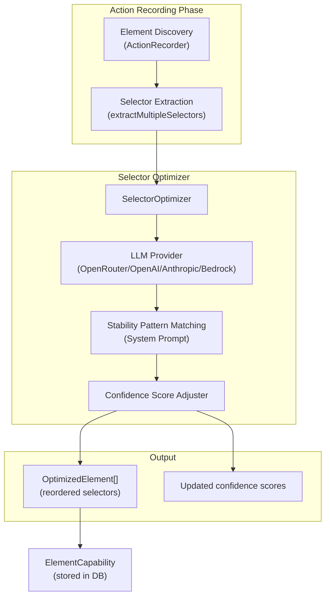
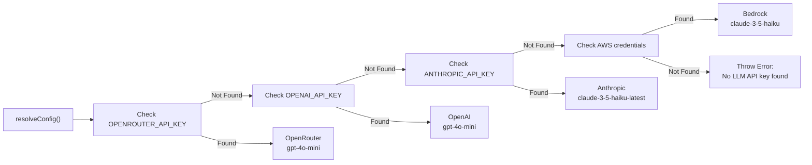
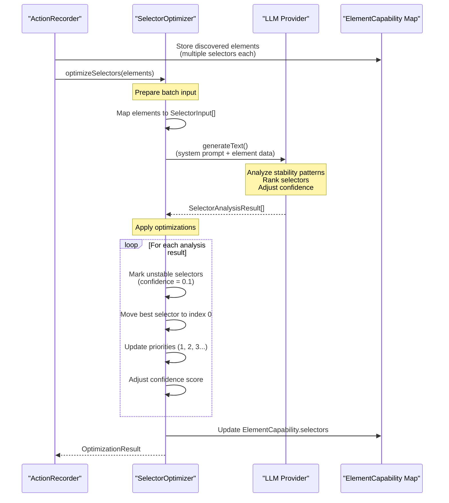
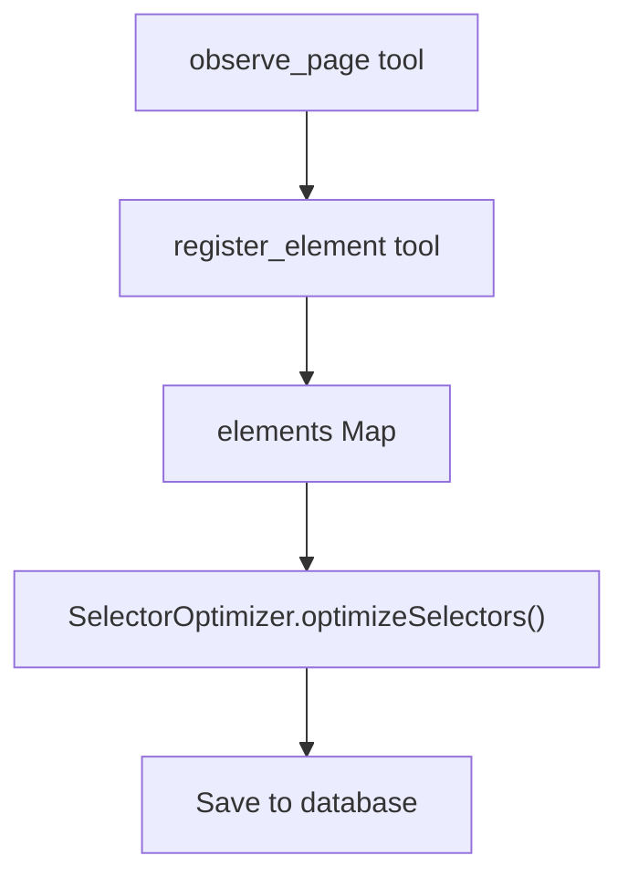

<!-- source: DeepWiki mcp.deepwiki.com · repo actionbook/actionbook · page 6.2 Selector Optimizer · fetched 2026-10-26 -->

# Selector Optimizer

<details>
<summary>Relevant source files</summary>

The following files were used as context for generating this wiki page:

- [.prettierignore](.prettierignore)
- [.prettierrc.json](.prettierrc.json)
- [CLAUDE.md](CLAUDE.md)
- [services/action-builder/scripts/login.ts](services/action-builder/scripts/login.ts)
- [services/action-builder/scripts/playbook-record.ts](services/action-builder/scripts/playbook-record.ts)
- [services/action-builder/src/optimizer/SelectorOptimizer.ts](services/action-builder/src/optimizer/SelectorOptimizer.ts)
- [services/action-builder/src/recorder/RecorderToolExecutor.ts](services/action-builder/src/recorder/RecorderToolExecutor.ts)
- [services/action-builder/src/validator/SelectorValidator.ts](services/action-builder/src/validator/SelectorValidator.ts)
- [services/action-builder/test/browser/xpath-optimizer.ut.test.ts](services/action-builder/test/browser/xpath-optimizer.ut.test.ts)
- [services/action-builder/test/validator/SelectorValidator.ut.test.ts](services/action-builder/test/validator/SelectorValidator.ut.test.ts)
- [services/common/browser-profile/package.json](services/common/browser-profile/package.json)
- [services/common/browser-profile/src/BrowserProfileManager.ts](services/common/browser-profile/src/BrowserProfileManager.ts)

</details>


## Purpose and Scope

The Selector Optimizer uses LLM-based analysis to improve the stability and reliability of discovered selectors. It identifies unstable patterns (dynamic counters, timestamps, framework-generated hashes) and reorders selectors based on their reliability. This page covers the optimization algorithm, stability analysis patterns, LLM integration, and batch processing workflow.

For information about how selectors are initially discovered and extracted, see [Action Recording](#3.2.2). For information about validating selectors after optimization, see [Selector Types](#7.2).

**Sources:** [services/action-builder/src/optimizer/SelectorOptimizer.ts:1-372]()

## Overview

The Selector Optimizer addresses a critical challenge in web automation: selectors that work initially but break over time due to dynamic content or framework-specific patterns. During element discovery, the system extracts multiple selectors per element ([services/action-builder/src/recorder/RecorderToolExecutor.ts:191-434]()), but not all selectors are equally reliable.

The optimizer performs three main functions:

1. **Stability Analysis**: Identifies selectors containing dynamic or unstable content
2. **Selector Ranking**: Reorders selectors by reliability, placing the most stable first
3. **Confidence Adjustment**: Updates confidence scores based on stability assessment

**Key Benefits:**
- Reduces selector brittleness across site updates
- Prioritizes semantic, test-friendly selectors (data-testid, aria-label)
- Detects framework-specific patterns that change on each build
- Batch processes multiple elements for efficiency

**Sources:** [services/action-builder/src/optimizer/SelectorOptimizer.ts:1-11]()

## Architecture



**Diagram: Selector Optimizer Architecture**

The optimizer is implemented as a standalone class that takes a batch of elements with their discovered selectors and returns optimized versions with adjusted priorities and confidence scores.

**Sources:** [services/action-builder/src/optimizer/SelectorOptimizer.ts:95-153](), [services/action-builder/src/optimizer/SelectorOptimizer.ts:158-278]()

## Selector Stability Patterns

The optimizer uses pattern-based analysis to classify selectors as stable or unstable. These patterns are encoded in the LLM system prompt and guide the analysis.

### Unstable Patterns

Selectors containing these patterns are marked with low confidence (0.1) as they change dynamically:

| Pattern Category | Examples | Detection Logic |
|-----------------|----------|-----------------|
| **Counters/Notifications** | `"0 条新通知"`, `"3 new messages"`, `"(5)"`, `"+99"` | Contains numeric badges or notification counts |
| **Timestamps** | `"2 minutes ago"`, `"刚刚"`, `"Yesterday"` | Contains relative time expressions |
| **User-specific IDs** | `"user-12345"`, `"profile-abc123"` | Contains user identifiers or session-specific values |
| **Framework-generated IDs** | `"#ember123"`, `"#react-xxx"`, `".ng-c123"`, `":r0:"`, `"#radix-123"` | React/Angular/Ember internal IDs |
| **CSS Module Hashes** | `".styles_button__x7y8z"`, `".Component_name__hash"` | CSS Modules pattern with hash suffix |
| **styled-components** | `".sc-1a2b3c"`, `".sc-aBcDeF"` | styled-components generated classes |
| **Emotion CSS** | `".css-1a2b3c"`, `".css-xxxxxx"` | Emotion CSS generated classes |
| **Generic Hash Patterns** | Classes ending with `_[a-z0-9]{5,}`, `__[a-z0-9]{5,}`, or `-[a-z0-9]{6,}` | Generic build-time hash suffixes |

**Sources:** [services/action-builder/src/optimizer/SelectorOptimizer.ts:283-316]()

### Stable Patterns

Selectors using these attributes are preferred for their reliability:

| Pattern Category | Examples | Priority | Confidence Range |
|-----------------|----------|----------|------------------|
| **data-testid** | `[data-testid="submit-btn"]` | 1 (Highest) | 0.90-0.95 |
| **Semantic data-*** | `[data-id="card-123"]`, `[data-component="header"]` | 2 | 0.85-0.90 |
| **ID selector** | `#main-nav`, `#search-button` | 3 | 0.85-0.95 |
| **Static aria-label** | `[aria-label="Submit"]`, `[aria-label="Close"]` | 4 | 0.80-0.85 |
| **BEM class names** | `.header__nav-item`, `.btn--primary` | 5 | 0.75-0.80 |
| **Semantic classes** | `.container`, `.navigation` | 6 | 0.70-0.75 |
| **XPath** | `//button[@name="email"]` | 7 (Lowest) | 0.60-0.70 |

**Selector Priority Logic:**
When all selectors are stable, the optimizer uses this priority order to determine which selector should be ranked first. `data-testid` is always preferred as it is explicitly designed for testing and rarely changes.

**Sources:** [services/action-builder/src/optimizer/SelectorOptimizer.ts:301-316]()

## LLM Provider Configuration

The optimizer supports multiple LLM providers with automatic provider detection based on available API keys.



**Diagram: LLM Provider Resolution Order**

### Provider Priority

The configuration resolver checks for API keys in this order:

1. **OpenRouter** (`OPENROUTER_API_KEY`) - Default model: `gpt-4o-mini`
2. **OpenAI** (`OPENAI_API_KEY`) - Default model: `gpt-4o-mini`
3. **Anthropic** (`ANTHROPIC_API_KEY`) - Default model: `claude-3-5-haiku-latest`
4. **Bedrock** (`AWS_ACCESS_KEY_ID` + `AWS_SECRET_ACCESS_KEY`) - Default model: `anthropic.claude-3-5-haiku-20241022-v1:0`

**Model Override:**
Set `SELECTOR_OPTIMIZER_MODEL` environment variable to use a different model. The optimizer uses smaller/faster models by default since selector analysis doesn't require the most powerful models.

**Proxy Support:**
The optimizer automatically detects `HTTPS_PROXY` or `HTTP_PROXY` environment variables and routes LLM requests through the configured proxy using undici's `ProxyAgent`.

**Sources:** [services/action-builder/src/optimizer/SelectorOptimizer.ts:98-153](), [services/action-builder/src/optimizer/SelectorOptimizer.ts:71-93]()

## Input and Output Format

### SelectorInput

Input format for a single element to optimize:

```typescript
interface SelectorInput {
  elementId: string           // Element identifier
  description: string         // Human-readable element description
  selectors: SelectorItem[]   // Array of discovered selectors
}
```

Each `SelectorItem` contains:
- `type`: Selector type (css, xpath, id, data-testid, aria-label, placeholder)
- `value`: Selector string value
- `priority`: Current priority (1 = highest)
- `confidence`: Current confidence score (0.0-1.0)
- `isTemplate`: Whether selector uses template parameters
- `templateParams`: Template parameter definitions (if applicable)

**Sources:** [services/action-builder/src/optimizer/SelectorOptimizer.ts:23-28]()

### SelectorAnalysisResult

LLM output format for each element:

```typescript
interface SelectorAnalysisResult {
  elementId: string
  bestSelectorIndex: number          // Index of best selector (0-based)
  unstableSelectorIndices: number[]  // Indices of all unstable selectors
  reason: string                     // Explanation of choice
  adjustedConfidence?: number        // New confidence for best selector
}
```

**Example LLM Response:**
```json
[
  {
    "elementId": "search_button",
    "bestSelectorIndex": 1,
    "unstableSelectorIndices": [0, 3],
    "reason": "data-testid is most stable; CSS class contains hash; placeholder text is dynamic",
    "adjustedConfidence": 0.92
  }
]
```

**Sources:** [services/action-builder/src/optimizer/SelectorOptimizer.ts:32-39]()

### OptimizationResult

Final output from the optimizer:

```typescript
interface OptimizationResult {
  success: boolean
  optimizedCount: number
  totalElements: number
  elements: OptimizedElement[]
  tokensUsed: {
    input: number
    output: number
    total: number
  }
  error?: string
}
```

Each `OptimizedElement` contains:
- `elementId`: Element identifier
- `originalSelectors`: Pre-optimization selector array
- `optimizedSelectors`: Post-optimization selector array (reordered with updated confidence)
- `reason`: Explanation from LLM analysis

**Sources:** [services/action-builder/src/optimizer/SelectorOptimizer.ts:44-65]()

## Optimization Process



**Diagram: Optimization Sequence**

### Step-by-Step Process

1. **Batch Preparation** ([services/action-builder/src/optimizer/SelectorOptimizer.ts:178-183]())
   - Convert `Map<string, ElementCapability>` to `SelectorInput[]`
   - Include element ID, description, and all selectors

2. **LLM Analysis** ([services/action-builder/src/optimizer/SelectorOptimizer.ts:280-369]())
   - System prompt defines stability patterns and priority rules
   - User prompt provides element data in JSON format
   - Temperature set to 0.1 for consistent analysis
   - Response parsed from JSON (handles markdown code blocks)

3. **Unstable Marking** ([services/action-builder/src/optimizer/SelectorOptimizer.ts:199-209]())
   - For each index in `unstableSelectorIndices`, set `confidence = 0.1`
   - Logs warning for each unstable selector detected

4. **Selector Reordering** ([services/action-builder/src/optimizer/SelectorOptimizer.ts:212-241]())
   - Move `bestSelectorIndex` to position 0 (highest priority)
   - Update `priority` field: best=1, others=2,3,4...
   - Apply `adjustedConfidence` to best selector

5. **Result Collection** ([services/action-builder/src/optimizer/SelectorOptimizer.ts:243-248]())
   - Create `OptimizedElement` with before/after selectors
   - Include LLM's reasoning for audit trail

**Sources:** [services/action-builder/src/optimizer/SelectorOptimizer.ts:158-278]()

## Integration Points

### Action Recording Integration

The optimizer is called after element discovery completes in the ActionRecorder:



**Diagram: Action Recording Integration Flow**

The optimizer receives the complete set of discovered elements before they are persisted to the database, ensuring all stored selectors have been analyzed for stability.

**Sources:** [services/action-builder/src/recorder/RecorderToolExecutor.ts:191-434]()

### Database Persistence

After optimization, the reordered selectors are stored in the `elements` table with the following structure:

| Field | Description |
|-------|-------------|
| `selectors` | JSONB array of `SelectorItem[]` (post-optimization) |
| `element_type` | Element type inferred from interactions |
| `allow_methods` | Permitted interaction methods |
| `discovered_at` | Timestamp of discovery |

The optimized selector order persists through the API and is returned to consumers in priority order, ensuring clients try the most stable selector first.

**Sources:** [services/action-builder/src/optimizer/SelectorOptimizer.ts:158-278]()

## Error Handling

The optimizer includes comprehensive error handling:

| Error Condition | Behavior |
|----------------|----------|
| **No API keys configured** | Throws error during constructor: `"No LLM API key found for SelectorOptimizer"` |
| **LLM call failure** | Catches error, logs message, returns `OptimizationResult` with `success: false` |
| **JSON parse error** | Catches error, logs message, returns failed result |
| **Empty element list** | Returns success with `optimizedCount: 0` (no-op) |
| **Missing elementId in results** | Skips that element, continues processing others |
| **Invalid bestSelectorIndex** | Skips reordering, only marks unstable selectors |

The optimizer is designed to be non-blocking: if optimization fails, the action recording can still succeed with the original un-optimized selectors.

**Sources:** [services/action-builder/src/optimizer/SelectorOptimizer.ts:263-277](), [services/action-builder/src/optimizer/SelectorOptimizer.ts:150-153]()

## Performance Considerations

**Batch Processing:**
The optimizer processes all elements in a single LLM call rather than making individual requests per element. For a typical page with 20-30 elements, this reduces:
- API calls: from 20-30 to 1
- Total latency: from 20-60 seconds to 2-5 seconds
- Cost: proportional reduction in API charges

**Model Selection:**
Default models are optimized for speed and cost:
- `gpt-4o-mini`: Fast, inexpensive, sufficient for pattern matching
- `claude-3-5-haiku-latest`: Fast, good reasoning for selector analysis

Override with `SELECTOR_OPTIMIZER_MODEL` if more sophisticated analysis is needed.

**Latency Logging:**
The optimizer logs LLM call duration for monitoring: `[SelectorOptimizer] LLM call completed in {latencyMs}ms`

**Sources:** [services/action-builder/src/optimizer/SelectorOptimizer.ts:339-352](), [services/action-builder/src/optimizer/SelectorOptimizer.ts:118-149]()

---

