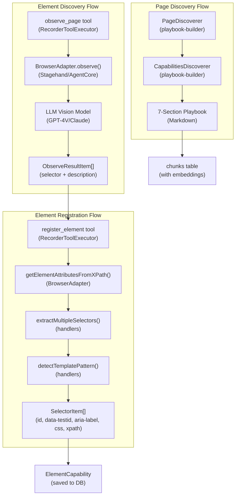
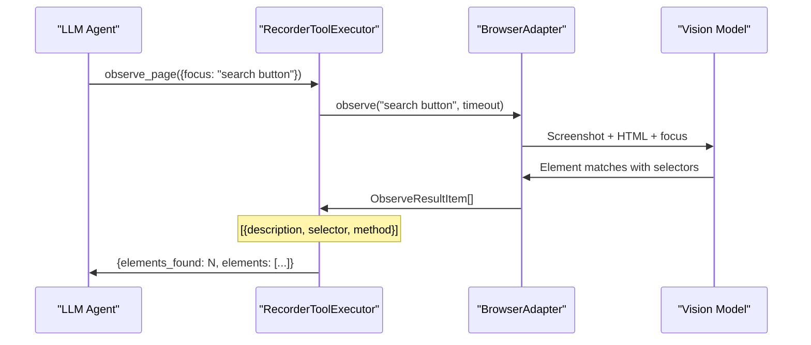
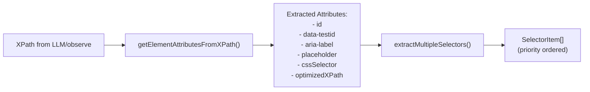
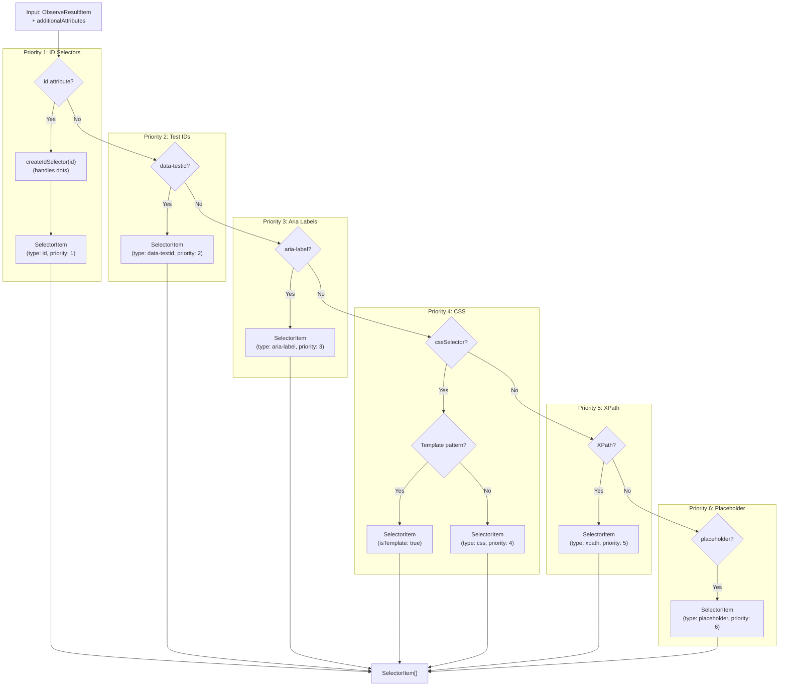
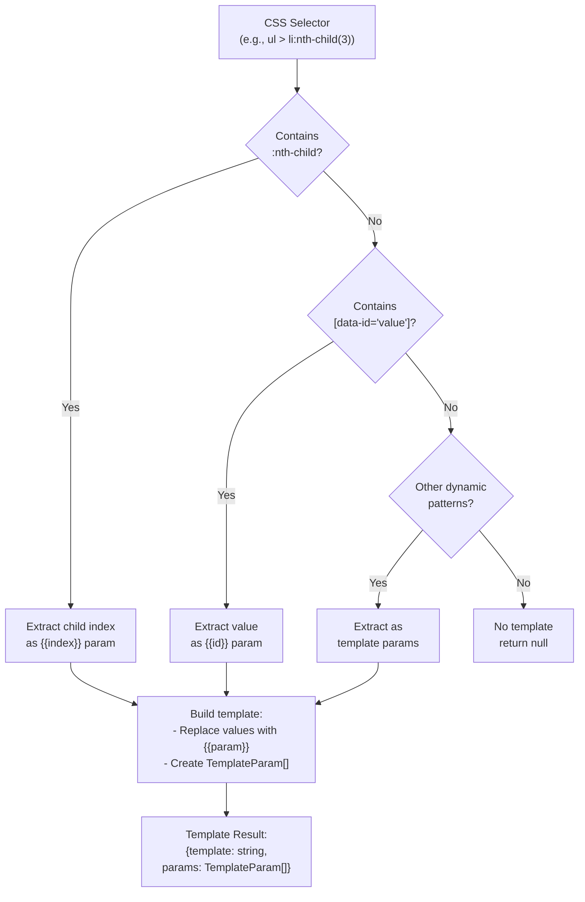
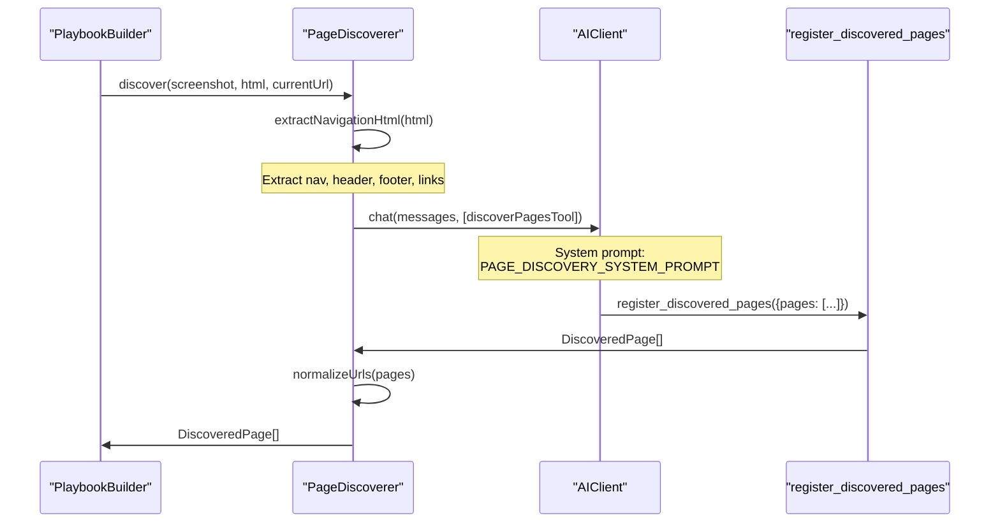
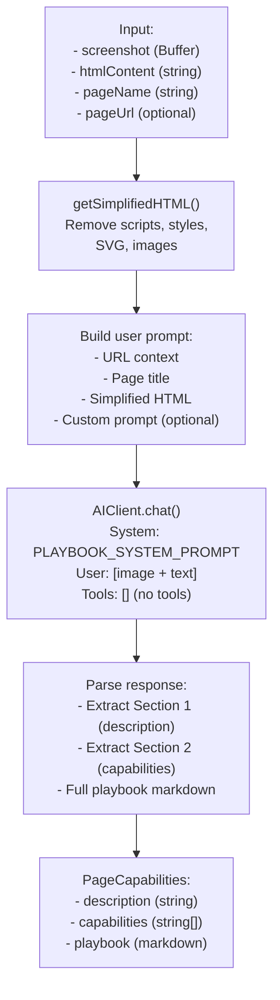
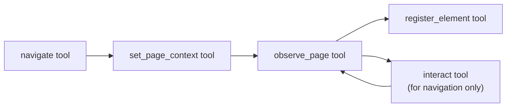
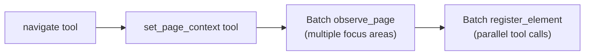
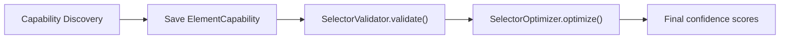

<!-- source: DeepWiki mcp.deepwiki.com · repo actionbook/actionbook · page 6.3 Capability Discovery · fetched 2026-10-26 -->

# Capability Discovery

<details>
<summary>Relevant source files</summary>

The following files were used as context for generating this wiki page:

- [services/action-builder/scripts/playbook-record.ts](services/action-builder/scripts/playbook-record.ts)
- [services/action-builder/src/recorder/RecorderToolExecutor.ts](services/action-builder/src/recorder/RecorderToolExecutor.ts)
- [services/action-builder/src/task-worker/utils/prompt-builder.ts](services/action-builder/src/task-worker/utils/prompt-builder.ts)
- [services/action-builder/src/validator/SelectorValidator.ts](services/action-builder/src/validator/SelectorValidator.ts)
- [services/action-builder/test/browser/xpath-optimizer.ut.test.ts](services/action-builder/test/browser/xpath-optimizer.ut.test.ts)
- [services/action-builder/test/validator/SelectorValidator.ut.test.ts](services/action-builder/test/validator/SelectorValidator.ut.test.ts)
- [services/db/src/models/build-task.ts](services/db/src/models/build-task.ts)
- [services/playbook-builder/scripts/worker.ts](services/playbook-builder/scripts/worker.ts)
- [services/playbook-builder/src/analyzer/page-analyzer.ts](services/playbook-builder/src/analyzer/page-analyzer.ts)
- [services/playbook-builder/src/controller/playbook-task-controller.ts](services/playbook-builder/src/controller/playbook-task-controller.ts)
- [services/playbook-builder/src/discoverer/capabilities-discoverer.ts](services/playbook-builder/src/discoverer/capabilities-discoverer.ts)
- [services/playbook-builder/src/discoverer/page-discoverer.ts](services/playbook-builder/src/discoverer/page-discoverer.ts)
- [services/playbook-builder/src/playbook-builder.ts](services/playbook-builder/src/playbook-builder.ts)
- [services/playbook-builder/src/types/index.ts](services/playbook-builder/src/types/index.ts)

</details>


## Purpose and Scope

Capability Discovery is the AI-driven process of identifying interactive UI elements and page structures on websites. This page covers how Actionbook uses LLM vision models to discover elements, extract multiple stable selectors, and generate comprehensive page documentation.

For selector stability analysis and optimization after discovery, see [Selector Optimizer](#6.2). For the task execution pipeline that orchestrates capability discovery, see [Action Recording](#3.2.2).

---

## Discovery Architecture

Capability discovery operates at two levels: **element-level** (finding individual UI components) and **page-level** (understanding page structure and purpose). Both leverage LLM vision capabilities to analyze screenshots and HTML content.

### Discovery Flow Diagram



**Sources:** [services/action-builder/src/recorder/RecorderToolExecutor.ts:122-150](), [services/playbook-builder/src/discoverer/page-discoverer.ts:1-192](), [services/playbook-builder/src/discoverer/capabilities-discoverer.ts:1-246]()

---

## Element Discovery with observe_page

The `observe_page` tool uses LLM vision capabilities to identify interactive elements on a webpage. The LLM analyzes screenshots and DOM structure to locate elements matching a given focus description.

### Tool Parameters

| Parameter | Type | Description |
|-----------|------|-------------|
| `focus` | string | Natural language description of what to observe (e.g., "search bar and filters") |
| `_timeoutMs` | number (optional) | Timeout for observation operation |

### Execution Flow



### ObserveResultItem Structure

Each discovered element returns:
- `description`: Natural language description of the element
- `selector`: XPath or CSS selector (usually starts with `xpath=`)
- `method`: Suggested interaction method (e.g., `"click"`, `"type"`)

**Sources:** [services/action-builder/src/recorder/RecorderToolExecutor.ts:122-150](), [packages/browser/src/interfaces.ts]()

---

## Element Registration with register_element

The `register_element` tool records element capabilities with multiple stable selectors. It automatically extracts additional selectors beyond what the LLM provides, ensuring redundancy for robustness.

### Selector Priority Hierarchy

The system builds a multi-selector array with priority ordering:

| Priority | Selector Type | Confidence | Example |
|----------|--------------|------------|---------|
| 1 | `id` | 0.95 | `[id="submit-btn"]` |
| 2 | `data-testid` | 0.90 | `[data-testid="checkout"]` |
| 3 | `aria-label` | 0.85 | `[aria-label="Close"]` |
| 4 | `css` | 0.75 | `.btn.btn-primary` |
| 5 | `xpath` (optimized) | 0.80 | `//button[@name="submit"]` |
| 5 | `xpath` (absolute) | 0.60 | `/html[1]/body[1]/div[3]/button[1]` |
| 6 | `placeholder` | 0.65 | `[placeholder="Enter email"]` |

### Automatic Selector Extraction

When `register_element` is called, the system automatically extracts multiple selectors:



**Key Implementation Details:**

1. **XPath Extraction** ([services/action-builder/src/recorder/RecorderToolExecutor.ts:330-348]()):
   - Calls `browser.getElementAttributesFromXPath()` to extract all available attributes
   - Retrieves `id`, `dataTestId`, `ariaLabel`, `placeholder`, `cssSelector`, and `optimizedXPath`

2. **Selector Building** ([services/action-builder/src/recorder/RecorderToolExecutor.ts:351-434]()):
   - ID selectors use `createIdSelector()` to handle special characters (e.g., dots in IDs)
   - data-testid formatted as `[data-testid="value"]`
   - aria-label formatted as `[aria-label="value"]`
   - CSS selectors checked for template patterns
   - XPath prefers optimized attribute-based over absolute path

3. **No-Selector Handling** ([services/action-builder/src/recorder/RecorderToolExecutor.ts:436-446]()):
   - If no selectors found, returns error message
   - Element is skipped with informative feedback to LLM
   - Prevents "phantom elements" (elements LLM thinks exist but don't)

**Sources:** [services/action-builder/src/recorder/RecorderToolExecutor.ts:275-476](), [packages/browser/src/StagehandBrowser.ts]()

---

## Multi-Selector Extraction Strategy

The `extractMultipleSelectors` handler function converts a single observed element into a redundant selector array. This provides fallback options when the primary selector fails due to DOM changes.

### Extraction Logic



### Special Handling: ID with Special Characters

IDs containing dots (e.g., `"cs.AI"`) require CSS attribute selector syntax:

```javascript
// Input: id = "cs.AI"
// Output: [id="cs.AI"]  (not #cs.AI which would fail)
```

Implementation: [services/action-builder/src/recorder/RecorderToolExecutor.ts:354-370]()

**Sources:** [services/action-builder/src/recorder/RecorderToolExecutor.ts:16-26](), [services/action-builder/src/utils/string.ts]()

---

## Template Pattern Detection

The `detectTemplatePattern` handler identifies CSS selectors with dynamic segments (e.g., `nth-child(3)`, `[data-id="123"]`) and converts them to parameterized templates for reusable patterns.

### Template Detection Algorithm



### Template Example

**Original CSS Selector:**
```
ul.items > li:nth-child(3) > a
```

**Template Conversion:**
```typescript
{
  template: "ul.items > li:nth-child({{index}}) > a",
  params: [{
    name: "index",
    type: "number",
    description: "List item index"
  }]
}
```

This allows the selector to match any list item by substituting the `{{index}}` parameter.

**Sources:** [services/action-builder/src/recorder/RecorderToolExecutor.ts:28-30](), [services/action-builder/src/types/index.ts]()

---

## Page Discovery (Playbook Builder)

The playbook-builder service uses two discoverers to understand website structure:

### Component Overview

| Component | Purpose | Input | Output |
|-----------|---------|-------|--------|
| `PageDiscoverer` | Find navigable pages | Screenshot + HTML + current URL | `DiscoveredPage[]` |
| `CapabilitiesDiscoverer` | Generate page playbook | Screenshot + HTML + page name | `PageCapabilities` (with 7-section Playbook) |

### PageDiscoverer Workflow



### DiscoveredPage Structure

Each discovered page includes:
- `semanticId`: Snake_case identifier (e.g., `"search_results"`, `"listing_detail"`)
- `name`: Human-readable name
- `description`: Brief description of page purpose
- `url`: Absolute URL to the page
- `navigation`: Optional instructions on how to reach the page
- `depth`: Discovery depth (0 = start page, 1 = discovered from start, etc.)

**Sources:** [services/playbook-builder/src/discoverer/page-discoverer.ts:1-192](), [services/playbook-builder/src/types/index.ts:36-51]()

---

## Capabilities Discovery (7-Section Playbook)

The `CapabilitiesDiscoverer` generates comprehensive page documentation in a standardized 7-section format. This Playbook guides AI agents in understanding, parsing, and interacting with pages.

### Playbook Structure

| Section | Content | Purpose |
|---------|---------|---------|
| 0. Page URL | URL structure, query params, dynamic params | Understanding navigation |
| 1. Page Overview | Core business objective (1 sentence) | Quick purpose identification |
| 2. Page Function Summary | List of functions/capabilities | What users can DO |
| 3. Page Structure Summary | Layout modules (header, sidebar, main) + CSS selectors | DOM structure at macro level |
| 4. DOM Structure Instance | Pattern recognition, HTML snippets | Detailed DOM patterns |
| 5. Parsing & Processing Summary | Data retrieval scenarios (direct/interaction/implicit) | How to extract data |
| 6. Operation Summary | Interactive operations (input/click/hover) + selectors | How to interact |

### Playbook Generation Flow



### Key Implementation Notes

1. **No Tool Calling** ([services/playbook-builder/src/discoverer/capabilities-discoverer.ts:136-138]()):
   - Uses direct LLM response (no function calls)
   - LLM generates markdown directly following the 7-section template

2. **HTML Simplification** ([services/playbook-builder/src/discoverer/capabilities-discoverer.ts:170-190]()):
   - Removes `<script>`, `<style>`, `<svg>`, ``, `<iframe>`, `<video>`, `<audio>`
   - Removes inline styles
   - Removes data-* attributes except `data-testid`
   - Limits to ~20KB for token efficiency

3. **Content Extraction** ([services/playbook-builder/src/discoverer/capabilities-discoverer.ts:192-233]()):
   - Section 1 (Overview) extracted via regex matching `### 1. Page Overview`
   - Section 2 (Functions) extracted to populate `capabilities` array
   - Full playbook stored as markdown string

**Sources:** [services/playbook-builder/src/discoverer/capabilities-discoverer.ts:1-246](), [services/playbook-builder/src/playbook-builder.ts:123-145]()

---

## Integration with Action Recording

Capability discovery integrates with the action recording pipeline to enable efficient element registration during task execution.

### Task-Driven Discovery

In task-driven mode, the LLM executes navigation steps while discovering elements:



**Workflow:**
1. Navigate to page
2. Set page context (page type, name)
3. Observe specific areas (e.g., "search bar", "filters")
4. Register elements WITHOUT clicking (fast)
5. Use interact ONLY for navigation clicks
6. Repeat on new pages

### Exploratory Discovery

In exploratory mode, the LLM analyzes page content and records all interactive elements:



**Optimization:**
- Focus on specific areas instead of "all interactive elements"
- Batch multiple tool calls in single turn
- Prioritize pattern registration for repeating elements

**Sources:** [services/action-builder/src/task-worker/utils/prompt-builder.ts:1-331](), [services/action-builder/scripts/playbook-record.ts:1-247]()

---

## Real-World Example: Multi-Step Discovery

This example demonstrates how capability discovery works for a search results page:

### Step 1: Initial Observation

```
Tool: observe_page
Args: { focus: "search filters and sorting controls" }

Result: {
  elements_found: 8,
  elements: [
    { description: "Price range filter", selector: "xpath=//div[@data-testid='price-filter']", method: "click" },
    { description: "Sort by dropdown", selector: "xpath=//select[@aria-label='Sort results']", method: "select" },
    { description: "Category filter checkbox", selector: "xpath=//input[@name='category']", method: "click" },
    ...
  ]
}
```

### Step 2: Multi-Selector Registration

```
Tool: register_element
Args: {
  element_id: "price_range_filter",
  description: "Price range filter control",
  xpath_selector: "//div[@data-testid='price-filter']",
  element_type: "filter",
  allow_methods: ["click", "select"]
}

Internal Processing:
1. getElementAttributesFromXPath("//div[@data-testid='price-filter']")
   → { dataTestId: "price-filter", cssSelector: "div.filter-price", id: "priceFilter" }

2. extractMultipleSelectors()
   → [
       { type: "id", value: "[id='priceFilter']", priority: 1, confidence: 0.95 },
       { type: "data-testid", value: "[data-testid='price-filter']", priority: 2, confidence: 0.90 },
       { type: "css", value: "div.filter-price", priority: 3, confidence: 0.75 },
       { type: "xpath", value: "//div[@data-testid='price-filter']", priority: 4, confidence: 0.80 }
     ]

3. Save to database with all selectors
```

### Step 3: Template Pattern Detection

```
Tool: register_element
Args: {
  element_id: "listing_card",
  description: "Property listing card",
  css_selector: "div.listings > div.card:nth-child(3)",
  is_repeating: true
}

Internal Processing:
1. detectTemplatePattern("div.listings > div.card:nth-child(3)")
   → { 
       template: "div.listings > div.card:nth-child({{index}})",
       params: [{ name: "index", type: "number", description: "Card position" }]
     }

2. Save with isTemplate: true and templateParams
```

**Sources:** [services/action-builder/src/recorder/RecorderToolExecutor.ts:122-476](), [services/action-builder/test/browser/xpath-optimizer.ut.test.ts:293-300]()

---

## Validation Integration

After capability discovery, the [SelectorValidator](#2.1) validates all discovered selectors to ensure they work correctly on the live page. The validator checks:

- **Existence**: Selector finds the element
- **Visibility**: Element is visible on page
- **Interactability**: Element is enabled and not obstructed

Validation results inform the [Selector Optimizer](#6.2), which uses LLM analysis to adjust confidence scores for unstable selectors.

**Validation Flow:**


**Sources:** [services/action-builder/src/validator/SelectorValidator.ts:273-309](), [services/action-builder/src/validator/SelectorValidator.ts:311-488]()

---

