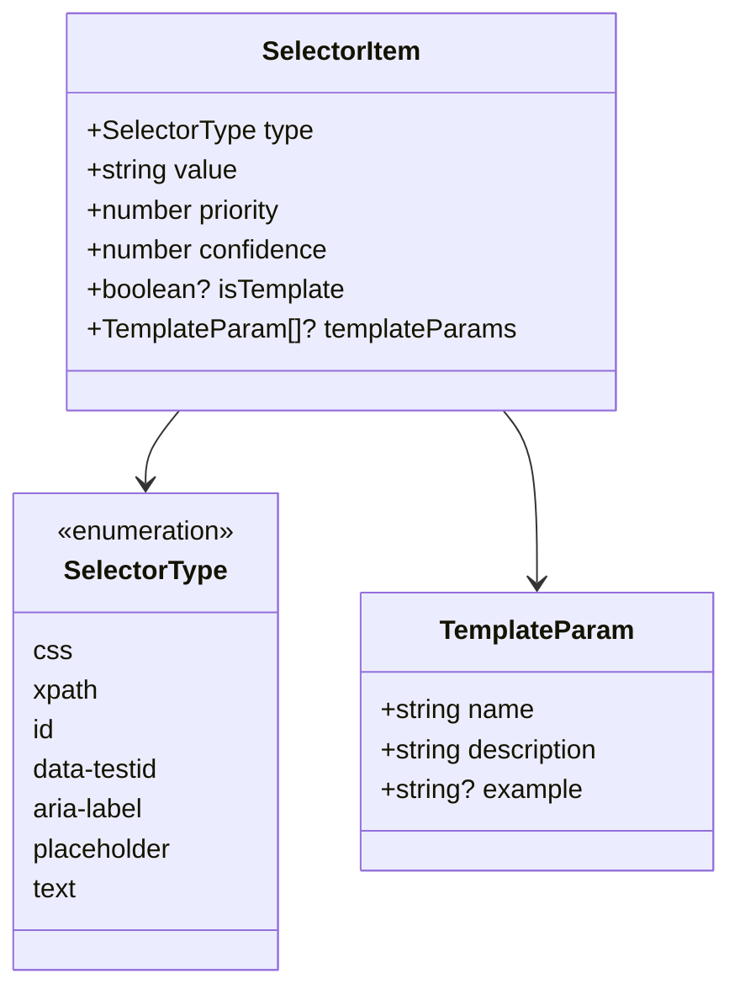
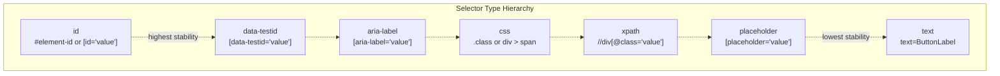
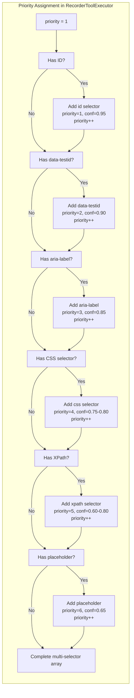
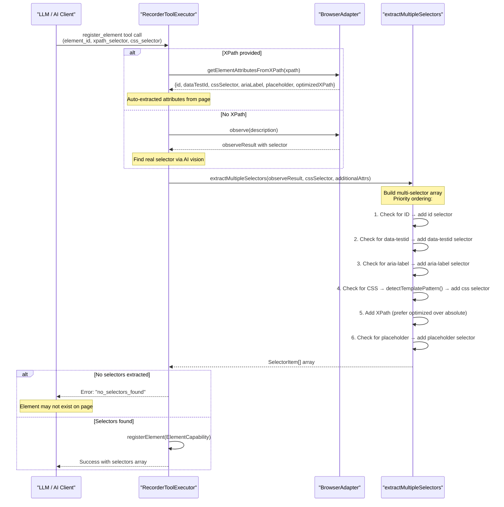
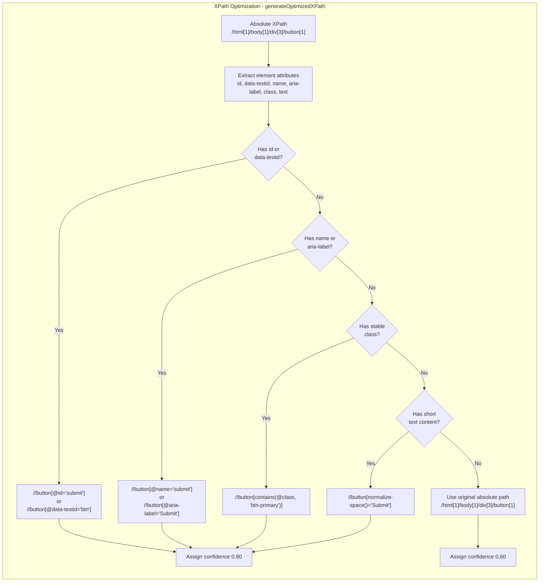

<!-- source: DeepWiki mcp.deepwiki.com · repo actionbook/actionbook · page 7.2 Selector Types · fetched 2026-10-26 -->

# Selector Types

<details>
<summary>Relevant source files</summary>

The following files were used as context for generating this wiki page:

- [services/action-builder/scripts/playbook-record.ts](services/action-builder/scripts/playbook-record.ts)
- [services/action-builder/src/recorder/RecorderToolExecutor.ts](services/action-builder/src/recorder/RecorderToolExecutor.ts)
- [services/action-builder/src/recorder/RecorderTools.ts](services/action-builder/src/recorder/RecorderTools.ts)
- [services/action-builder/src/types/capability.ts](services/action-builder/src/types/capability.ts)
- [services/action-builder/src/utils/index.ts](services/action-builder/src/utils/index.ts)
- [services/action-builder/src/utils/url-matcher.ts](services/action-builder/src/utils/url-matcher.ts)
- [services/action-builder/src/validator/SelectorValidator.ts](services/action-builder/src/validator/SelectorValidator.ts)
- [services/action-builder/test/browser/xpath-optimizer.ut.test.ts](services/action-builder/test/browser/xpath-optimizer.ut.test.ts)
- [services/action-builder/test/recorder/RecorderTools.ut.test.ts](services/action-builder/test/recorder/RecorderTools.ut.test.ts)
- [services/action-builder/test/types/capability.ut.test.ts](services/action-builder/test/types/capability.ut.test.ts)
- [services/action-builder/test/utils/url-matcher.ut.test.ts](services/action-builder/test/utils/url-matcher.ut.test.ts)
- [services/action-builder/test/validator/SelectorValidator.ut.test.ts](services/action-builder/test/validator/SelectorValidator.ut.test.ts)

</details>


This page documents the selector system used throughout Actionbook to identify and interact with UI elements. The selector system supports multiple selector types with priority ordering, confidence scoring, and template parameterization for robust element targeting.

For information about how selectors are used in capability definitions, see [Capability Types](#7.1). For details about recording actions that use these selectors, see [Action Recording](#3.2.2).

## Overview

Actionbook uses a multi-selector strategy where each UI element is identified by an array of `SelectorItem` objects. Each selector item represents a different way to locate the same element (CSS, XPath, ID, data-testid, etc.), ordered by stability and reliability. When executing actions, the system tries selectors in priority order until one succeeds.

This approach provides resilience against page structure changes: if one selector breaks (e.g., a CSS class changes), other selectors (e.g., data-testid or aria-label) can still locate the element.

Sources: [services/action-builder/src/types/capability.ts:1-6](), [services/action-builder/src/recorder/RecorderToolExecutor.ts:1-26]()

## SelectorItem Data Structure



**SelectorItem Structure**

| Field | Type | Description |
|-------|------|-------------|
| `type` | `SelectorType` | The selector type (css, xpath, id, etc.) |
| `value` | `string` | The selector value or template string |
| `priority` | `number` | Execution order (lower = higher priority) |
| `confidence` | `number` | Stability score (0.0-1.0) |
| `isTemplate` | `boolean?` | Whether this selector contains template parameters |
| `templateParams` | `TemplateParam[]?` | Template parameter definitions |

Sources: [services/action-builder/src/types/capability.ts:1-6](), [services/action-builder/src/recorder/RecorderToolExecutor.ts:10-30]()

## Selector Types

The system supports seven distinct selector types, each with specific use cases and stability characteristics:



### Type Definitions

| Selector Type | Format | Example | Stability | Use Case |
|--------------|--------|---------|-----------|----------|
| `id` | `#id` or `[id="value"]` | `#submit-btn`, `[id="cs.AI"]` | Highest (0.95) | Elements with stable ID attributes |
| `data-testid` | `[data-testid="value"]` | `[data-testid="checkout-btn"]` | Very High (0.90) | Test-specific attributes |
| `aria-label` | `[aria-label="value"]` | `[aria-label="Close dialog"]` | High (0.85) | Accessible elements with semantic labels |
| `css` | Standard CSS selector | `.nav-item`, `button.primary` | Medium (0.75) | Class-based or structural selectors |
| `xpath` | XPath expression | `//button[@name="submit"]` | Low-Medium (0.60-0.80) | Complex hierarchical queries |
| `placeholder` | `[placeholder="value"]` | `[placeholder="Search..."]` | Low (0.65) | Input fields with placeholder text |
| `text` | `text=value` | `text=Submit` | Lowest | Buttons/links with visible text |

**Note**: The `id` selector type uses special handling for IDs containing special characters (e.g., dots). The system automatically converts `id: "cs.AI"` to `[id="cs.AI"]` instead of `#cs.AI` to avoid CSS selector parsing issues.

Sources: [services/action-builder/src/recorder/RecorderToolExecutor.ts:354-434](), [services/action-builder/test/browser/xpath-optimizer.ut.test.ts:26-120]()

## Priority Ordering System



**Priority Assignment Logic**

The priority ordering is implemented in `RecorderToolExecutor.execute()` for the `register_element` tool:

1. **Priority 1**: ID selectors (including CSS ID selectors starting with `#` or `[id=`)
2. **Priority 2**: `data-testid` attributes
3. **Priority 3**: `aria-label` attributes
4. **Priority 4**: CSS selectors (with template detection)
5. **Priority 5**: XPath expressions (optimized attribute-based preferred over absolute paths)
6. **Priority 6**: Placeholder attributes (for input fields)

The priority number is assigned sequentially, so if an element has ID, data-testid, and CSS selectors, they receive priorities 1, 2, and 3 respectively.

Sources: [services/action-builder/src/recorder/RecorderToolExecutor.ts:350-434]()

## Confidence Scores

Confidence scores indicate selector stability and are used by the `SelectorOptimizer` to filter unreliable selectors. Higher confidence means the selector is less likely to break when the page changes.

### Confidence Score Table

| Selector Type | Base Confidence | Factors Affecting Score |
|---------------|----------------|-------------------------|
| `id` | 0.95 | Highest - IDs are unique and rarely change |
| `data-testid` | 0.90 | Very stable - explicitly added for testing |
| `aria-label` | 0.85 | Stable - accessibility attribute |
| `css` (template) | 0.80 | Moderately stable - parameterized pattern |
| `css` (standard) | 0.75 | Moderate - depends on class stability |
| `xpath` (optimized) | 0.80 | Moderately stable - attribute-based XPath |
| `xpath` (absolute) | 0.60 | Low - breaks with structural changes |
| `placeholder` | 0.65 | Low-moderate - text may change |

### Confidence Adjustment

The `SelectorOptimizer` can reduce confidence scores for selectors that contain unstable patterns:

- Dynamic counters (e.g., `item-123`, `post-456`)
- Hash-like patterns (e.g., `sc-xyz123`, `css-abc789`)
- Timestamp-based classes
- Generated IDs with random suffixes

Sources: [services/action-builder/src/recorder/RecorderToolExecutor.ts:354-434](), [services/action-builder/src/validator/SelectorValidator.ts:315-488]()

## Template Patterns

Template selectors support parameterization for dynamic elements. This enables recording reusable patterns that work across similar elements with different values.

```mermaid
graph TB
    subgraph "Template Selector Flow"
        Original["Original CSS Selector<br/>a[href='/category/123']"]
        
        Original --> Detect["detectTemplatePattern()<br/>Check for numeric/variable parts"]
        
        Detect -->|"Pattern found"| Create["Create Template<br/>value: 'a[href=\"/category/{{category_id}}\"]'<br/>isTemplate: true"]
        Detect -->|"No pattern"| Regular["Regular Selector<br/>value: 'a[href=\"/category/123\"]'<br/>isTemplate: false"]
        
        Create --> AddParams["Add templateParams<br/>[{name: 'category_id', description: '...'}]"]
        
        AddParams --> Store["Store in SelectorItem"]
        Regular --> Store
        
        Store --> Usage["At Runtime"]
        Usage --> Resolve["resolveSelectorValue()<br/>Replace {{category_id}} with actual value"]
    end
```

### Template Parameter Definition

```typescript
interface TemplateParam {
  name: string;           // Parameter name (e.g., "category_id")
  description: string;    // Human-readable description
  example?: string;       // Example value
}
```

### Template Usage Example

**Recording Phase**:
```json
{
  "type": "css",
  "value": "a[href=\"/search?q={{query}}\"]",
  "priority": 4,
  "confidence": 0.80,
  "isTemplate": true,
  "templateParams": [
    {
      "name": "query",
      "description": "Search query parameter",
      "example": "machine learning"
    }
  ]
}
```

**Validation Phase**:
```typescript
// Provide template parameters
const templateParams = { query: "artificial intelligence" };

// Resolved selector: a[href="/search?q=artificial intelligence"]
const resolved = resolveSelectorValue(selector, templateParams);
```

Sources: [services/action-builder/src/recorder/RecorderToolExecutor.ts:28-30](), [services/action-builder/src/recorder/RecorderToolExecutor.ts:392-412](), [services/action-builder/src/validator/SelectorValidator.ts:542-571]()

## Multi-Selector Extraction Process



### Key Functions

| Function | Location | Purpose |
|----------|----------|---------|
| `extractMultipleSelectors` | Handler callback | Builds prioritized selector array from available attributes |
| `detectTemplatePattern` | Handler callback | Identifies parameterizable patterns in CSS selectors |
| `getElementAttributesFromXPath` | BrowserAdapter | Extracts all available attributes from an XPath-located element |
| `createIdSelector` | utils/string.js | Handles special characters in ID selectors (e.g., dots) |

Sources: [services/action-builder/src/recorder/RecorderToolExecutor.ts:192-233](), [services/action-builder/src/recorder/RecorderToolExecutor.ts:275-476]()

## Selector Validation

The `SelectorValidator` validates selector effectiveness by checking three states: **exists**, **visible**, and **interactable**.

```mermaid
graph TB
    subgraph "Selector Validation Process - validateSingleSelector"
        Input["SelectorItem + templateParams"]
        
        Input --> Resolve["resolveSelectorValue()<br/>Replace template params"]
        
        Resolve -->|Error| ReturnError["Return: valid=false, error='Missing param'"]
        Resolve -->|Success| CheckType["Check selector.type"]
        
        CheckType -->|xpath| XPathEval["evaluateXPathInBrowser(page, xpath)<br/>Use document.evaluate() directly"]
        CheckType -->|other| LocatorCount["page.locator(selector).count()"]
        
        XPathEval --> CountCheck
        LocatorCount --> CountCheck
        
        CountCheck{"count > 0?"}
        CountCheck -->|No| NotFound["Return: valid=false, error='Element not found'"]
        CountCheck -->|Yes| VisCheck["Check Visibility"]
        
        VisCheck -->|xpath| XPathVis["page.evaluate()<br/>getBoundingClientRect()<br/>getComputedStyle()"]
        VisCheck -->|other| LocatorVis["locator.isVisible()"]
        
        XPathVis --> InteractCheck
        LocatorVis --> InteractCheck
        
        InteractCheck{"visible?"}
        InteractCheck -->|No| ReturnHidden["Return: valid=true, visible=false, interactable=false"]
        InteractCheck -->|Yes| CheckInteract["Check Interactability"]
        
        CheckInteract --> PointerEvents["Check pointer-events !== 'none'"]
        CheckInteract --> Opacity["Check opacity > 0"]
        CheckInteract --> Enabled["Check not disabled"]
        CheckInteract --> Obstruction["Check not obstructed by other element"]
        
        PointerEvents --> Combine
        Opacity --> Combine
        Enabled --> Combine
        Obstruction --> Combine
        
        Combine["Combine all checks"] --> ReturnResult["Return: valid=true, visible=true, interactable=[true/false]"]
    end
```



### Validation States

| State | Meaning | Example Scenario |
|-------|---------|------------------|
| `valid: true, visible: true, interactable: true` | Fully functional | Active button ready for click |
| `valid: true, visible: true, interactable: false` | Element exists but disabled | Disabled submit button or obstructed element |
| `valid: true, visible: false, interactable: false` | Element exists but hidden | Display:none or zero-sized element |
| `valid: false` | Element not found | Selector no longer matches any element |

### XPath Validation Special Handling

The validator uses direct browser evaluation for XPath selectors via `evaluateXPathInBrowser()` instead of Playwright/Stagehand's locator API. This is necessary because:

1. Stagehand's `page.locator('xpath=...')` uses CDP (Chrome DevTools Protocol)
2. CDP has issues with relative XPath expressions (e.g., `//button[@id="submit"]`)
3. Absolute XPath paths work, but relative XPath returns `count=0` incorrectly
4. Direct `document.evaluate()` in browser context handles all XPath correctly

Sources: [services/action-builder/src/validator/SelectorValidator.ts:315-488](), [services/action-builder/src/validator/SelectorValidator.ts:507-540]()

## Selector Optimization

XPath selectors undergo optimization to prefer attribute-based expressions over absolute paths:



**Optimization Priority**:
1. **ID-based**: `//tagName[@id="value"]` (confidence: 0.80)
2. **data-testid**: `//tagName[@data-testid="value"]` (confidence: 0.80)
3. **Name/aria-label**: `//tagName[@name="value"]` or `//tagName[@aria-label="value"]` (confidence: 0.80)
4. **Stable class**: `//tagName[contains(@class, "btn-primary")]` (confidence: 0.80)
5. **Text content**: `//tagName[normalize-space()="Text"]` (confidence: 0.80)
6. **Absolute path**: `/html[1]/body[1]/...` (confidence: 0.60 - fallback only)

Sources: [services/action-builder/src/recorder/RecorderToolExecutor.ts:330-348](), [services/action-builder/src/recorder/RecorderToolExecutor.ts:414-424](), [services/action-builder/test/browser/xpath-optimizer.ut.test.ts:12-120]()

## Common Selector Patterns

### Special Character Handling

```mermaid
graph TB
    subgraph "ID Selector with Special Characters"
        Input["element.id = 'cs.AI'"]
        
        Input --> Check["createIdSelector(id)"]
        
        Check --> HasDot{"Contains<br/>special chars?"}
        HasDot -->|Yes| Attribute["Use attribute selector<br/>[id='cs.AI']"]
        HasDot -->|No| Hash["Use hash selector<br/>#simpleId"]
        
        Attribute --> Result["SelectorItem<br/>type: 'id'<br/>value: '[id=\"cs.AI\"]'"]
        Hash --> Result2["SelectorItem<br/>type: 'id'<br/>value: '#simpleId'"]
    end
```

The `createIdSelector()` utility handles IDs with special characters (dots, colons, brackets) by using attribute selectors instead of hash selectors.

**Examples**:
- `cs.AI` → `[id="cs.AI"]` (not `#cs.AI` which would fail)
- `item:123` → `[id="item:123"]`
- `simple` → `#simple`

Sources: [services/action-builder/src/recorder/RecorderToolExecutor.ts:355-370](), [services/action-builder/test/browser/xpath-optimizer.ut.test.ts:293-300]()

### CSS Selector Template Detection

CSS selectors with numeric or variable parts are automatically detected and converted to templates:

```javascript
// Example: Dynamic category link
// Detected pattern: a[href="/category/123"]
// Becomes template: a[href="/category/{{category_id}}"]

const templateInfo = detectTemplatePattern(cssSelector);
if (templateInfo) {
  selector = {
    type: "css",
    value: templateInfo.template,  // a[href="/category/{{category_id}}"]
    isTemplate: true,
    templateParams: templateInfo.params,
    confidence: 0.8
  };
}
```

Sources: [services/action-builder/src/recorder/RecorderToolExecutor.ts:392-412]()

## Integration with Recording Tools

The recording tools expose selector types through the `register_element` tool schema:

```typescript
// From RecorderTools.ts
{
  name: "register_element",
  parameters: {
    element_id: string,      // Required: unique identifier
    description: string,     // Required: element description
    css_selector: string,    // Optional: CSS selector from LLM
    xpath_selector: string,  // Optional: XPath from observe_page
    aria_label: string,      // Optional: ARIA label
    placeholder: string,     // Optional: placeholder text
    // ... other fields
  }
}
```

When the LLM calls this tool, the `RecorderToolExecutor`:
1. Validates `element_id` is not empty/undefined
2. Attempts to find real selectors via `observe_page` if XPath is missing
3. Extracts all available attributes from the element
4. Builds prioritized multi-selector array
5. Creates `ElementCapability` with selectors array
6. Registers the element for storage

Sources: [services/action-builder/src/recorder/RecorderTools.ts:63-134](), [services/action-builder/src/recorder/RecorderToolExecutor.ts:275-476]()

---

