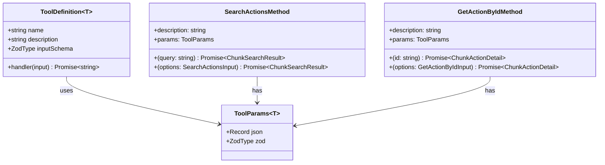
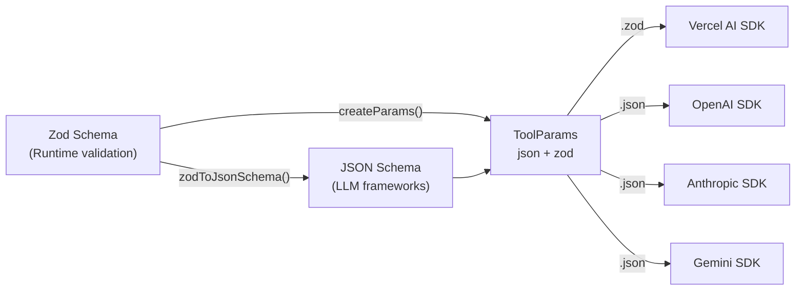
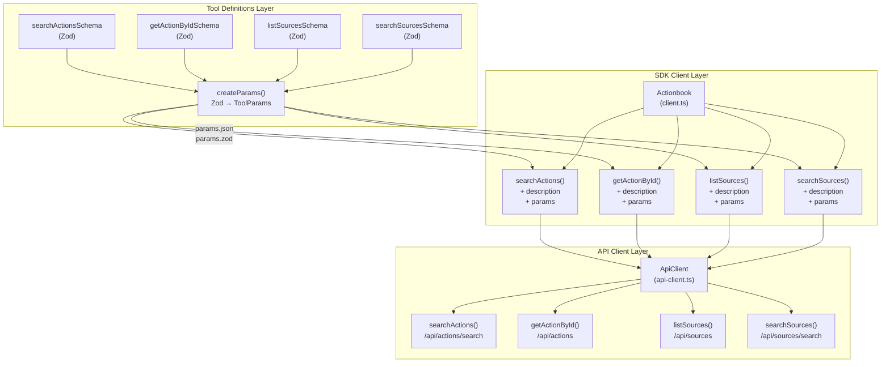
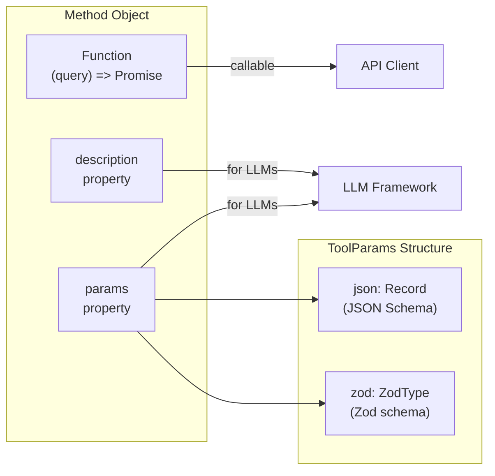
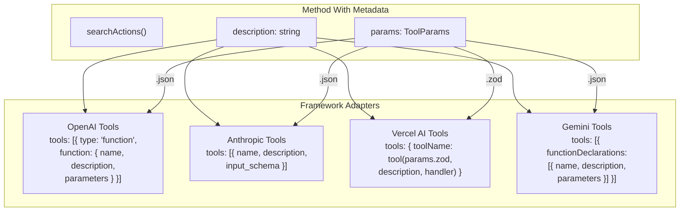
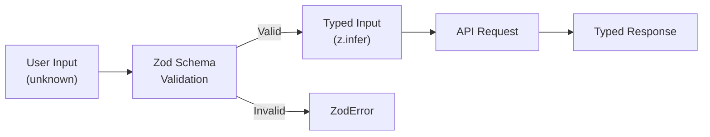
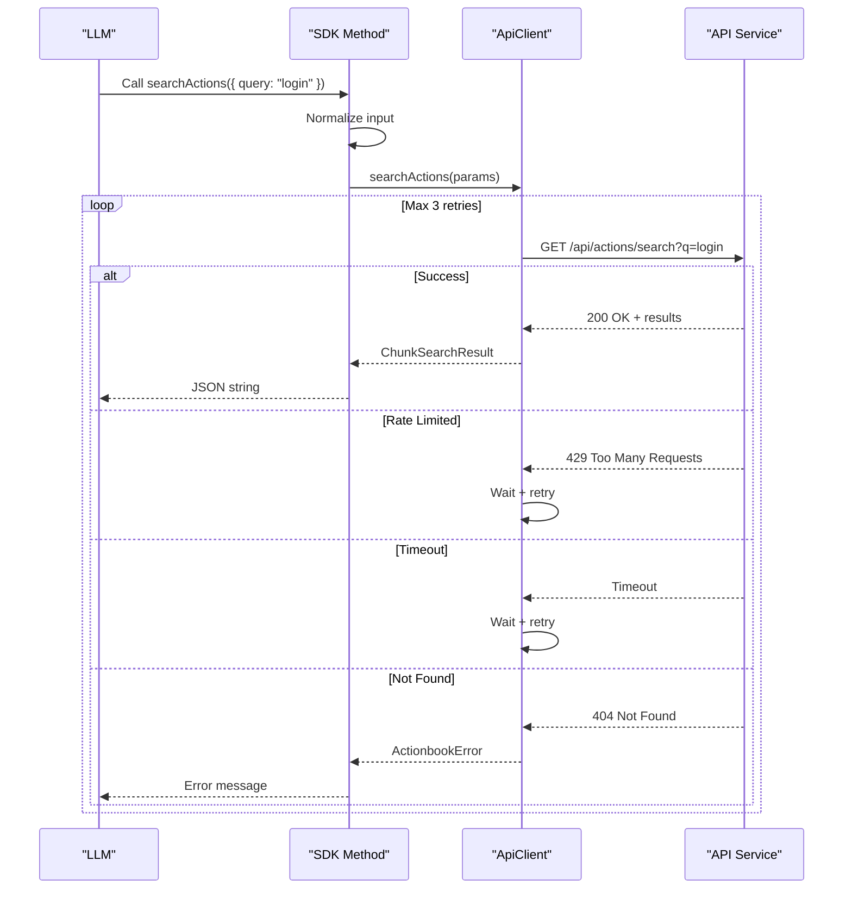

<!-- source: DeepWiki mcp.deepwiki.com · repo actionbook/actionbook · page 7.3 Tool Definitions · fetched 2026-10-26 -->

# Tool Definitions

<details>
<summary>Relevant source files</summary>

The following files were used as context for generating this wiki page:

- [packages/js-sdk/src/api-client.ts](packages/js-sdk/src/api-client.ts)
- [packages/js-sdk/src/client.ts](packages/js-sdk/src/client.ts)
- [packages/js-sdk/src/tool-defs.ts](packages/js-sdk/src/tool-defs.ts)
- [packages/js-sdk/src/types.ts](packages/js-sdk/src/types.ts)

</details>


This document describes the tool definition system used by Actionbook's SDK for integrating with LLM frameworks and AI agents. Tool definitions provide structured schemas and descriptions that enable AI models to discover and invoke Actionbook's search and retrieval capabilities.

For information about capability types (ElementCapability, PageCapability), see [Capability Types](#7.1). For selector structures, see [Selector Types](#7.2).

## Purpose and Scope

Tool definitions serve as the bridge between Actionbook's API and AI frameworks that support function calling (OpenAI, Anthropic, Vercel AI SDK, etc.). Each tool definition includes:

- A descriptive name and purpose for LLM understanding
- Input schema in multiple formats (JSON Schema and Zod)
- Parameter validation and constraints
- Integration examples and usage patterns

The SDK exposes four primary tools: `searchActions`, `getActionById`, `listSources`, and `searchSources`.

**Sources:** [packages/js-sdk/src/tool-defs.ts:1-238]()

## Tool Schema Architecture

### Core Interfaces

The tool system defines two primary interfaces for describing tools to LLM frameworks:



**`ToolDefinition<T>`** - Generic interface for defining tools with typed input schemas and handlers. Used primarily for MCP and custom integrations.

**`ToolParams<T>`** - Dual-format schema container that provides both JSON Schema (for OpenAI, Anthropic, Gemini SDKs) and Zod schema (for Vercel AI SDK) representations of the same input structure.

**Sources:** [packages/js-sdk/src/tool-defs.ts:5-36](), [packages/js-sdk/src/client.ts:29-93]()

### Schema Format Conversion



The `createParams()` function converts a Zod schema into a `ToolParams` object containing both formats. For MCP compatibility, `createCleanParams()` provides additional JSON Schema cleaning.

**Sources:** [packages/js-sdk/src/tool-defs.ts:39-58]()

## Tool Reference

### searchActions

Searches for action manuals by keyword using hybrid search (full-text + vector similarity).

#### Schema Definition

| Field | Type | Required | Constraints | Description |
|-------|------|----------|-------------|-------------|
| `query` | string | Yes | 1-200 chars | Search keyword (e.g., 'airbnb search', 'login button') |
| `type` | enum | No | vector/fulltext/hybrid | Search algorithm (default: hybrid) |
| `limit` | number | No | 1-100 | Maximum results to return (default: 5) |
| `sourceIds` | string | No | - | Comma-separated source IDs (e.g., '1,2,3') |
| `minScore` | number | No | 0-1 | Minimum similarity threshold (e.g., 0.7) |

**Zod Schema:** [packages/js-sdk/src/tool-defs.ts:64-91]()

#### Tool Description

The LLM receives this description when deciding whether to use the tool:

> Search for action manuals by keyword. Use this tool to find website actions, page elements, and their selectors for browser automation.
>
> **Example queries:**
> - "airbnb search" → find Airbnb search-related actions
> - "google login" → find Google login actions
> - "linkedin message" → find LinkedIn messaging actions
>
> **Typical workflow:**
> 1. Search for actions: searchActions("airbnb search")
> 2. Get action_id from results (URL-based, e.g., "https://example.com/page")
> 3. Get full details: getActionById("https://example.com/page")
> 4. Use returned selectors with Playwright/browser automation
>
> Returns URL-based action IDs with content previews and relevance scores.

**Sources:** [packages/js-sdk/src/tool-defs.ts:95-110]()

#### Return Type

Returns a `ChunkSearchResult` with the following structure:

```typescript
{
  success: boolean
  query: string
  results: Array<{
    action_id: string      // URL-based identifier
    content: string        // Content preview
    score: number          // Relevance score (0-1)
    createdAt: string      // Timestamp
  }>
  count: number           // Results returned
  total: number           // Total matches
  hasMore: boolean        // Pagination indicator
}
```

**Sources:** [packages/js-sdk/src/types.ts:9-21]()

### getActionById

Retrieves complete action details including DOM selectors and step-by-step instructions.

#### Schema Definition

| Field | Type | Required | Constraints | Description |
|-------|------|----------|-------------|-------------|
| `id` | string | Yes | min 1 char | Action ID (full URL or fuzzy match) |

**Action ID Format:**
- Full URL: `https://example.com/docs/page`
- Domain + path: `example.com/docs/page` (auto-matches https://example.com/docs/page)
- Domain only: `releases.rs` (matches https://releases.rs/)
- With chunk: `https://example.com/page#chunk-1`

**Zod Schema:** [packages/js-sdk/src/tool-defs.ts:118-123]()

#### Tool Description

> Get complete action details by action ID, including DOM selectors and step-by-step instructions.
>
> **What you get:**
> - Full action content/documentation
> - Page element selectors (CSS, XPath)
> - Element types and allowed methods (click, type, extract, etc.)
> - Document metadata (title, URL)
>
> **Use returned selectors with browser automation:**
> ```javascript
> const selector = '.search-button';
> await page.locator(selector).click();
> ```
>
> **Typical workflow:**
> 1. Search for actions: searchActions("airbnb search")
> 2. Get action_id from results (e.g., "https://docs.airbnb.com/search")
> 3. Get full details: getActionById("docs.airbnb.com/search") // fuzzy match works!
> 4. Extract selectors and use in automation

**Sources:** [packages/js-sdk/src/tool-defs.ts:127-152]()

#### Return Type

Returns a `ChunkActionDetail` with complete action information:

```typescript
{
  action_id: string           // URL-based identifier
  content: string             // Full documentation
  elements: string | null     // JSON string of element selectors
  createdAt: string           // Timestamp
  documentId: number          // Source document reference
  documentTitle: string       // Page title
  documentUrl: string         // Original page URL
  chunkIndex: number          // Content chunk position
  heading: string | null      // Section heading
  tokenCount: number          // Content size
}
```

The `elements` field contains a JSON string that can be parsed into a `ParsedElements` structure:

```typescript
{
  [key: string]: {
    css_selector?: string
    xpath_selector?: string
    description?: string
    element_type?: string
    allow_methods?: string[]
    depends_on?: string
  }
}
```

**Sources:** [packages/js-sdk/src/types.ts:26-51]()

### listSources

Lists all available sources (websites) in the Actionbook database.

#### Schema Definition

| Field | Type | Required | Constraints | Description |
|-------|------|----------|-------------|-------------|
| `limit` | number | No | 1-200 | Maximum sources to return (default: 50) |

**Zod Schema:** [packages/js-sdk/src/tool-defs.ts:160-168]()

#### Tool Description

> List all available sources (websites) in the Actionbook database.
>
> Use this tool to:
> - Discover what websites/sources are available
> - Get source IDs for filtering search_actions
> - View source metadata (name, URL, description, tags)
>
> **Typical workflow:**
> 1. List sources: listSources()
> 2. Note the source ID you want to search
> 3. Search actions: searchActions({ query: "login", sourceIds: "1" })
>
> Returns source IDs, names, URLs, and metadata for each source.

**Sources:** [packages/js-sdk/src/tool-defs.ts:172-184]()

#### Return Type

Returns a `SourceListResult`:

```typescript
{
  success: boolean
  results: Array<{
    id: number
    name: string
    baseUrl: string
    description: string | null
    domain: string | null
    tags: string[]
    healthScore: number | null
    lastCrawledAt: string | null
    createdAt: string
  }>
  count: number
}
```

**Sources:** [packages/js-sdk/src/types.ts:56-75]()

### searchSources

Searches for sources (websites) by keyword across name, description, domain, URL, and tags.

#### Schema Definition

| Field | Type | Required | Constraints | Description |
|-------|------|----------|-------------|-------------|
| `query` | string | Yes | 1-200 chars | Search keyword for source metadata |
| `limit` | number | No | 1-100 | Maximum results (default: 10) |

**Zod Schema:** [packages/js-sdk/src/tool-defs.ts:192-207]()

#### Tool Description

> Search for sources (websites) by keyword.
>
> Use this tool to:
> - Find specific websites/sources by name or domain
> - Search by description or tags
> - Get source IDs for filtering search_actions
>
> **Search fields:**
> - Source name
> - Description
> - Domain
> - Base URL
> - Tags
>
> **Typical workflow:**
> 1. Search sources: searchSources({ query: "airbnb" })
> 2. Note the source ID from results
> 3. Search actions: searchActions({ query: "login", sourceIds: "1" })
>
> **Example queries:**
> - "airbnb" → find Airbnb source
> - "linkedin" → find LinkedIn source
> - "e-commerce" → find sources tagged with e-commerce
>
> Returns matching source IDs, names, URLs, and metadata.

**Sources:** [packages/js-sdk/src/tool-defs.ts:211-235]()

#### Return Type

Returns a `SourceSearchResult`:

```typescript
{
  success: boolean
  query: string
  results: Array<SourceItem>  // Same structure as listSources
  count: number
}
```

**Sources:** [packages/js-sdk/src/types.ts:80-85]()

## SDK Integration Architecture



The SDK implements a three-layer architecture:

1. **Tool Definitions Layer** - Defines Zod schemas and converts them to dual-format `ToolParams`
2. **SDK Client Layer** - Exposes methods with attached tool definitions (description + params)
3. **API Client Layer** - Handles HTTP requests, retries, and error handling

**Sources:** [packages/js-sdk/src/tool-defs.ts:1-238](), [packages/js-sdk/src/client.ts:1-236](), [packages/js-sdk/src/api-client.ts:1-188]()

## Method Attachment Pattern

Each SDK method has tool definition metadata attached as properties:



This pattern enables usage in multiple contexts:

**Direct Invocation:**
```typescript
const client = new Actionbook({ apiKey: 'xxx' })
const results = await client.searchActions('airbnb search')
```

**LLM Framework Integration:**
```typescript
// Access tool metadata
console.log(client.searchActions.description)  // String for LLM
console.log(client.searchActions.params.json)  // JSON Schema
console.log(client.searchActions.params.zod)   // Zod schema
```

**Sources:** [packages/js-sdk/src/client.ts:144-234]()

## LLM Framework Integration Examples

### Tool Definition Export Structure



**Vercel AI SDK Integration:**
```typescript
import { Actionbook } from '@actionbookdev/sdk'
import { tool } from 'ai'

const client = new Actionbook({ apiKey: 'xxx' })

const tools = {
  searchActions: tool(
    client.searchActions.params.zod,
    client.searchActions.description,
    async (input) => {
      const result = await client.searchActions(input)
      return JSON.stringify(result)
    }
  )
}
```

**OpenAI SDK Integration:**
```typescript
const tools = [{
  type: 'function',
  function: {
    name: 'searchActions',
    description: client.searchActions.description,
    parameters: client.searchActions.params.json
  }
}]
```

**Anthropic SDK Integration:**
```typescript
const tools = [{
  name: 'searchActions',
  description: client.searchActions.description,
  input_schema: client.searchActions.params.json
}]
```

**Sources:** [packages/js-sdk/src/client.ts:167-189](), [packages/js-sdk/src/tool-defs.ts:41-58]()

## Type Safety and Validation



Tool schemas provide runtime validation through Zod and compile-time type safety through TypeScript inference:

**Runtime Validation:**
```typescript
// Zod validates at runtime
const input = searchActionsSchema.parse({
  query: 'airbnb search',
  limit: 10
})
// Throws ZodError if invalid
```

**Compile-Time Types:**
```typescript
// TypeScript infers types from Zod schema
type SearchActionsInput = z.infer<typeof searchActionsSchema>
// { query: string; type?: 'vector' | 'fulltext' | 'hybrid'; ... }
```

**Sources:** [packages/js-sdk/src/tool-defs.ts:64-91](), [packages/js-sdk/src/tool-defs.ts:93]()

## Tool Lifecycle and Error Handling



The API client implements automatic retry logic with exponential backoff for transient failures (timeouts, rate limits) but fails fast for permanent errors (404, invalid input).

**Retry Configuration:**
- Max retries: 3 attempts
- Retry delay: 1000ms base (configurable)
- Timeout: 30000ms default (configurable)

**Sources:** [packages/js-sdk/src/api-client.ts:111-174]()

---

