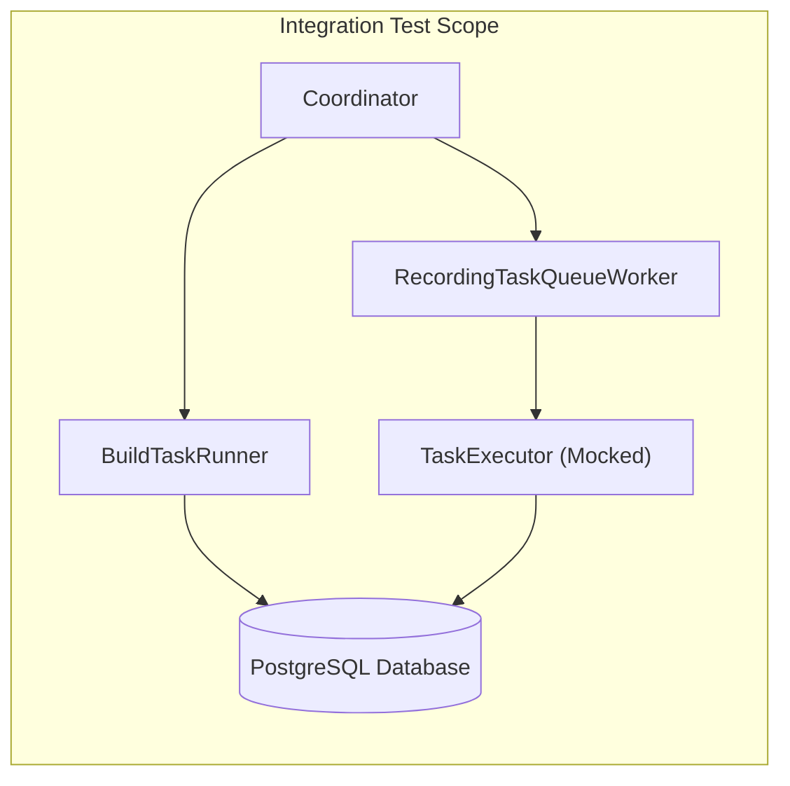
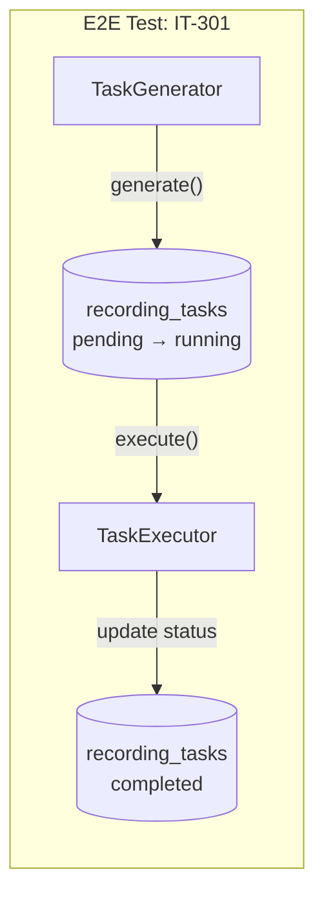
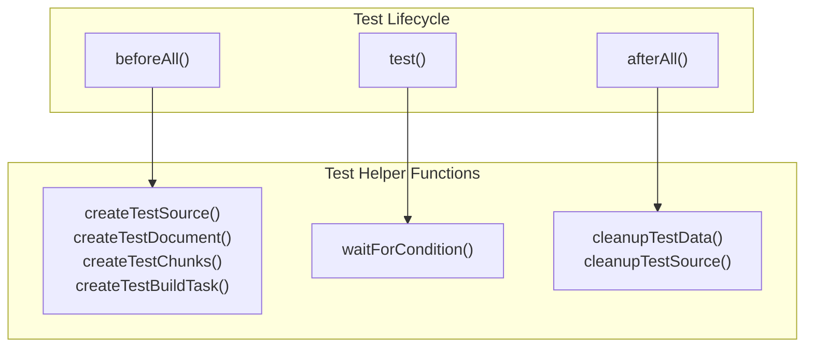
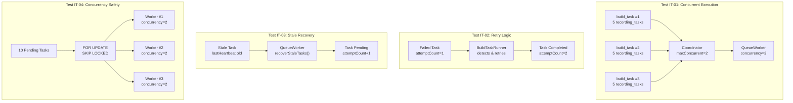

<!-- source: DeepWiki mcp.deepwiki.com · repo actionbook/actionbook · page 8.4 Testing · fetched 2026-10-26 -->

# Testing

<details>
<summary>Relevant source files</summary>

The following files were used as context for generating this wiki page:

- [.gitignore](.gitignore)
- [mcp-servers.json](mcp-servers.json)
- [package.json](package.json)
- [pnpm-lock.yaml](pnpm-lock.yaml)
- [pnpm-workspace.yaml](pnpm-workspace.yaml)
- [services/action-builder/.nvmrc](services/action-builder/.nvmrc)
- [services/action-builder/src/task-worker/build-task-runner.ts](services/action-builder/src/task-worker/build-task-runner.ts)
- [services/action-builder/src/task-worker/coordinator.ts](services/action-builder/src/task-worker/coordinator.ts)
- [services/action-builder/src/task-worker/recording-task-queue-worker.ts](services/action-builder/src/task-worker/recording-task-queue-worker.ts)
- [services/action-builder/test/coordinator.integration.it.test.ts](services/action-builder/test/coordinator.integration.it.test.ts)
- [services/action-builder/test/task-worker/integration/end-to-end.it.test.ts](services/action-builder/test/task-worker/integration/end-to-end.it.test.ts)
- [turbo.json](turbo.json)

</details>


This document describes the testing approach, tools, and patterns used in the Actionbook codebase. It covers test organization, running tests, writing new tests, and mocking strategies.

For information about setting up a local development environment before running tests, see [Local Development Setup](#8.3). For information about the build system that orchestrates test execution across the monorepo, see [Build System](#8.2).

---

## Testing Framework and Tools

Actionbook uses **Vitest** as its primary testing framework across all packages and services. Vitest is chosen for its speed, TypeScript support, and compatibility with the monorepo structure.

### Core Testing Stack

| Tool | Purpose | Location |
|------|---------|----------|
| Vitest | Test runner and assertion library | All packages and services |
| vi.mock() | Mocking framework (built into Vitest) | Test files |
| Playwright | Browser automation for E2E tests | Integration tests |
| PostgreSQL | Real database for integration tests | Test environment |

### Package-Level Test Configuration

Each package that includes tests has Vitest configured as a dev dependency:

- `packages/cli` - [pnpm-lock.yaml:70-72]()
- `packages/js-sdk` - [pnpm-lock.yaml:92-94]()
- `packages/mcp` - [pnpm-lock.yaml:123-125]()
- `services/action-builder` - [pnpm-lock.yaml:267-269]()
- `services/common/browser` - [pnpm-lock.yaml:304-306]()
- `services/playbook-builder` - [pnpm-lock.yaml:474-476]()

**Sources:** [pnpm-lock.yaml:1-477]()

---

## Test Types and Organization

### Test Naming Conventions

Tests follow a consistent naming pattern:

```
*.test.ts          - Unit tests
*.it.test.ts       - Integration tests
*.e2e.test.ts      - End-to-end tests (if applicable)
```

### Unit Tests

Unit tests focus on individual functions, classes, or modules in isolation. They use mocks for external dependencies and execute quickly.

**Characteristics:**
- Fast execution (< 100ms per test)
- No external dependencies (database, network, filesystem)
- Focus on single component behavior
- Heavy use of mocking

### Integration Tests

Integration tests verify that multiple components work together correctly. They may use real database connections and simulated external services.

**Example:** Coordinator integration tests verify the full task orchestration pipeline:



**Test IT-01: Multi-build concurrent execution** - [services/action-builder/test/coordinator.integration.it.test.ts:100-196]()

**Test IT-02: Task failure and retry** - [services/action-builder/test/coordinator.integration.it.test.ts:198-296]()

**Test IT-03: Stateless recovery** - [services/action-builder/test/coordinator.integration.it.test.ts:298-404]()

**Test IT-04: Multi-consumer concurrency safety** - [services/action-builder/test/coordinator.integration.it.test.ts:406-508]()

**Characteristics:**
- Slower execution (seconds to minutes)
- May use real database with test data
- Tests component interactions
- Longer timeouts (30-60 seconds)

**Sources:** [services/action-builder/test/coordinator.integration.it.test.ts:1-509]()

### End-to-End Tests

End-to-end tests verify complete user workflows through the entire system stack.

**Example:** TaskGenerator → TaskExecutor pipeline test:



**Test IT-301: Complete pipeline** - [services/action-builder/test/task-worker/integration/end-to-end.it.test.ts:95-149]()

**Characteristics:**
- Slowest execution (minutes)
- Tests complete workflows
- Uses real or near-real dependencies
- Extended timeouts (60+ seconds)

**Sources:** [services/action-builder/test/task-worker/integration/end-to-end.it.test.ts:1-223]()

---

## Running Tests

### Running All Tests

From the monorepo root:

```bash
pnpm test
```

This executes the `test` task defined in `turbo.json`, which runs tests across all packages and services with proper dependency ordering.

### Running Tests for Specific Package

```bash
# From monorepo root
pnpm --filter @actionbookdev/cli test

# Or navigate to package directory
cd packages/cli
pnpm test
```

### Running Specific Test Files

```bash
# Run specific test file
pnpm vitest run path/to/test.test.ts

# Run tests matching pattern
pnpm vitest run --grep "coordinator"

# Run in watch mode
pnpm vitest watch
```

### Running Integration Tests Only

```bash
pnpm vitest run --grep "\.it\.test\.ts$"
```

**Sources:** [turbo.json:1-23](), [package.json:1-25]()

---

## Test Structure and Patterns

### Typical Test File Structure

```typescript
import { describe, test, expect, beforeAll, afterAll, beforeEach, vi } from 'vitest';
import { getDb } from '@actionbookdev/db';
import type { Database } from '@actionbookdev/db';

describe('Feature Name', () => {
  let db: Database;
  let testResourceIds: number[] = [];

  beforeAll(async () => {
    // One-time setup
    db = getDb();
  });

  afterAll(async () => {
    // One-time cleanup
    await cleanupTestData(db, testResourceIds);
  });

  beforeEach(async () => {
    // Reset before each test
    testResourceIds = [];
  });

  test('should verify behavior', async () => {
    // Arrange
    const testData = await createTestData();
    
    // Act
    const result = await performAction(testData);
    
    // Assert
    expect(result).toBeDefined();
  });
});
```

**Sources:** [services/action-builder/test/coordinator.integration.it.test.ts:69-99]()

### Lifecycle Hooks

| Hook | Purpose | Usage |
|------|---------|-------|
| `beforeAll()` | One-time setup before all tests | Database connection, test data creation |
| `afterAll()` | One-time cleanup after all tests | Remove test data, close connections |
| `beforeEach()` | Setup before each test | Reset state, clear arrays |
| `afterEach()` | Cleanup after each test | Remove test-specific resources |

### Test Timeout Configuration

Integration and E2E tests require longer timeouts:

```typescript
test('IT-01: Long-running integration test', async () => {
  // Test implementation
}, 60000); // 60 second timeout
```

Default Vitest timeout is 5 seconds. Integration tests typically use 30-60 seconds.

**Sources:** [services/action-builder/test/coordinator.integration.it.test.ts:100](), [services/action-builder/test/task-worker/integration/end-to-end.it.test.ts:149]()

---

## Mocking Strategies

### Mocking External Dependencies

Tests mock expensive or external dependencies like browsers, LLMs, and cloud services.

#### Example: Mocking TaskExecutor

```typescript
vi.mock('../src/task-worker/task-executor', async () => {
  const { recordingTasks } = await import('@actionbookdev/db');
  const { eq } = await import('drizzle-orm');

  return {
    TaskExecutor: class MockTaskExecutor {
      constructor(private db: any, private config: any) {}

      async execute(task: any) {
        // Simulate fast execution
        await new Promise((resolve) => setTimeout(resolve, 50));

        // Update database as real executor would
        await this.db
          .update(recordingTasks)
          .set({
            status: 'completed',
            progress: 100,
            completedAt: new Date(),
            attemptCount: task.attemptCount + 1,
            durationMs: 100,
            tokensUsed: 0,
            updatedAt: new Date(),
          })
          .where(eq(recordingTasks.id, task.id));

        return {
          success: true,
          actions_created: 5,
          duration_ms: 100,
        };
      }
    },
  };
});
```

**Sources:** [services/action-builder/test/coordinator.integration.it.test.ts:22-56]()

#### Example: Mocking ActionBuilder

```typescript
vi.mock('../../../src/ActionBuilder', () => ({
  ActionBuilder: vi.fn().mockImplementation(() => ({
    initialize: vi.fn().mockResolvedValue(undefined),
    build: vi.fn().mockResolvedValue({
      success: true,
      turns: 5,
      totalDuration: 10000,
      tokens: { input: 1000, output: 500, total: 1500 },
      savedPath: './output/test.yaml',
      siteCapability: {
        domain: 'example.com',
        pages: {
          home: {
            elements: {
              test_element: {},
            },
          },
        },
        global_elements: {},
      },
    }),
    close: vi.fn().mockResolvedValue(undefined),
  })),
}));
```

**Sources:** [services/action-builder/test/task-worker/integration/end-to-end.it.test.ts:32-55]()

### Mock Characteristics

Mocks should:
1. **Replicate real behavior** - Update database state as real components would
2. **Execute quickly** - Use short delays (50-100ms) instead of real execution times
3. **Return realistic data** - Provide valid response structures
4. **Maintain side effects** - Preserve database updates and other state changes

---

## Test Helpers and Utilities

### Common Test Helper Functions

Integration tests use shared helper functions for common operations:



### Helper Function Patterns

#### Resource Creation

```typescript
async function createTestSource(
  db: Database, 
  name?: string
): Promise<number> {
  const result = await db.insert(sources).values({
    name: name || `test_${Date.now()}`,
    baseUrl: 'https://test.com',
    domain: 'test.com',
    // ...
  }).returning({ id: sources.id });
  
  return result[0].id;
}
```

#### Async Condition Polling

```typescript
async function waitForCondition(
  condition: () => Promise<boolean>,
  options: { timeout: number; interval: number }
): Promise<boolean> {
  const startTime = Date.now();
  
  while (Date.now() - startTime < options.timeout) {
    if (await condition()) {
      return true;
    }
    await sleep(options.interval);
  }
  
  return false;
}
```

**Usage Example:**

```typescript
// Wait for all tasks to reach completed status
const completed = await waitForCondition(
  async () => {
    const tasks = await db.select()
      .from(recordingTasks)
      .where(eq(recordingTasks.buildTaskId, buildTaskId));
    return tasks.every(t => t.status === 'completed');
  },
  { timeout: 30000, interval: 1000 }
);

expect(completed).toBe(true);
```

**Sources:** [services/action-builder/test/coordinator.integration.it.test.ts:60-67](), [services/action-builder/test/coordinator.integration.it.test.ts:162-172]()

#### Resource Cleanup

```typescript
async function cleanupTestData(
  db: Database, 
  buildTaskIds: number[]
): Promise<void> {
  // Delete recording_tasks (cascade)
  await db.delete(recordingTasks)
    .where(inArray(recordingTasks.buildTaskId, buildTaskIds));
  
  // Delete build_tasks
  await db.delete(buildTasks)
    .where(inArray(buildTasks.id, buildTaskIds));
}
```

---

## Writing New Tests

### Integration Test Template

When writing integration tests for the action-builder service:

```typescript
import { describe, test, expect, beforeAll, afterAll, vi } from 'vitest';
import { getDb } from '@actionbookdev/db';
import type { Database } from '@actionbookdev/db';
import { /* tables */ } from '@actionbookdev/db';

// Mock expensive dependencies
vi.mock('../src/expensive-component', () => ({
  ExpensiveComponent: class MockComponent {
    async execute() {
      // Fast mock implementation
    }
  }
}));

describe('Component Integration Tests', () => {
  let db: Database;
  let testResourceIds: number[] = [];

  beforeAll(async () => {
    db = getDb();
  });

  afterAll(async () => {
    await cleanupTestResources(db, testResourceIds);
  });

  test('IT-XX: should verify integrated behavior', async () => {
    // 1. Create test data
    const testData = await createTestData(db);
    testResourceIds.push(testData.id);
    
    // 2. Execute component under test
    const component = new ComponentUnderTest(db);
    await component.execute(testData);
    
    // 3. Wait for async completion
    const completed = await waitForCondition(
      async () => {
        const status = await checkStatus(db, testData.id);
        return status === 'completed';
      },
      { timeout: 30000, interval: 1000 }
    );
    
    // 4. Verify results
    expect(completed).toBe(true);
    const results = await fetchResults(db, testData.id);
    expect(results).toMatchObject({
      // Expected properties
    });
  }, 60000);
});
```

### Test Isolation Guidelines

1. **Use unique identifiers** - Timestamps or random IDs to avoid conflicts
2. **Clean up resources** - Always delete test data in `afterAll()`
3. **Avoid shared state** - Each test should be independent
4. **Mock external services** - Don't make real API calls or browser launches
5. **Use real database** - Integration tests should use actual PostgreSQL

### Database Test Data Pattern

```typescript
const testRunId = `test-${Date.now()}-${Math.floor(Math.random() * 10000)}`;
const testDomain = `${testRunId}.example.test`;

// Create test data with unique identifiers
const source = await createTestSource(db, testRunId);
const document = await createTestDocument(db, source.id, testDomain);
```

**Sources:** [services/action-builder/test/task-worker/integration/end-to-end.it.test.ts:63-64]()

---

## Test Coverage Areas

### Core Component Tests

| Component | Test Type | Key Scenarios |
|-----------|-----------|---------------|
| `Coordinator` | Integration | Multi-build concurrency, task claiming, heartbeat monitoring |
| `BuildTaskRunner` | Integration | Task generation, polling, retry logic, version publishing |
| `RecordingTaskQueueWorker` | Integration | Task claiming, concurrent execution, stale recovery |
| `TaskExecutor` | Unit + E2E | Task execution, status updates, error handling |
| `TaskGenerator` | Integration | Chunk-to-task conversion, dual-mode prompts |

### Integration Test Matrix



**Sources:** [services/action-builder/test/coordinator.integration.it.test.ts:100-508]()

---

## Continuous Integration

### Turbo Task Configuration

Tests are integrated into the Turbo build pipeline:

```json
{
  "tasks": {
    "test": {
      "dependsOn": ["^build"]
    }
  }
}
```

This ensures:
1. Dependencies are built before running tests
2. Tests can run in parallel where possible
3. Results are cached based on file changes

**Sources:** [turbo.json:12-14]()

### Running Tests in CI

```bash
# Run all tests with proper dependency ordering
pnpm test

# Run specific test suites
pnpm --filter @actionbookdev/cli test
pnpm --filter @actionbookdev/action-builder test
```

---

## Best Practices

### Do's

✓ **Use descriptive test names** - `test('IT-01: Multi-build concurrent execution')`  
✓ **Mock expensive operations** - Browser launches, LLM calls, network requests  
✓ **Use real database for integration tests** - Validates actual data flow  
✓ **Clean up test data** - Always remove resources in `afterAll()`  
✓ **Set appropriate timeouts** - 30-60s for integration tests  
✓ **Use helper functions** - Reuse common setup/teardown logic  
✓ **Test error conditions** - Verify retry logic, stale recovery, failures  

### Don'ts

✗ **Don't share test data** - Each test should create its own resources  
✗ **Don't skip cleanup** - Leftover data causes future test failures  
✗ **Don't use hard-coded IDs** - Generate unique identifiers per test run  
✗ **Don't test external services** - Mock APIs, LLMs, and cloud services  
✗ **Don't use short timeouts** - Integration tests need time to complete  

**Sources:** [services/action-builder/test/coordinator.integration.it.test.ts:1-509](), [services/action-builder/test/task-worker/integration/end-to-end.it.test.ts:1-223]()