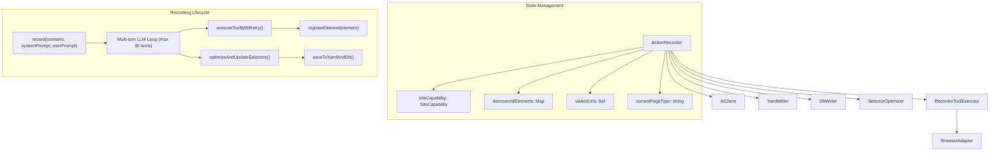
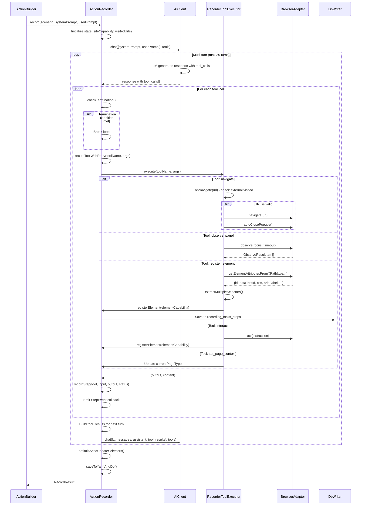
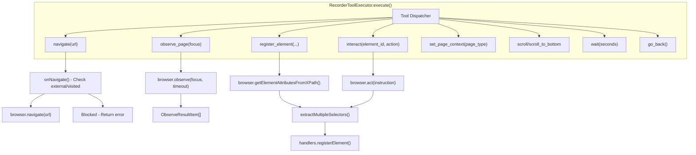
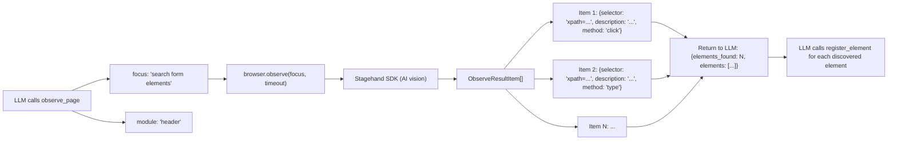
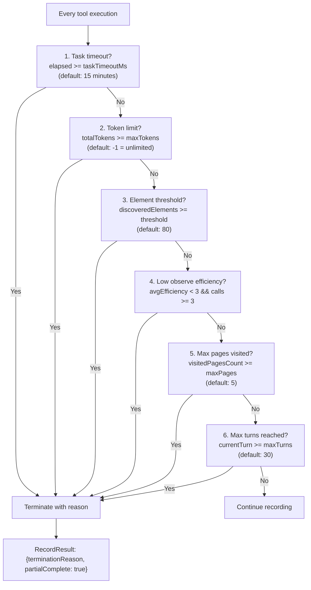
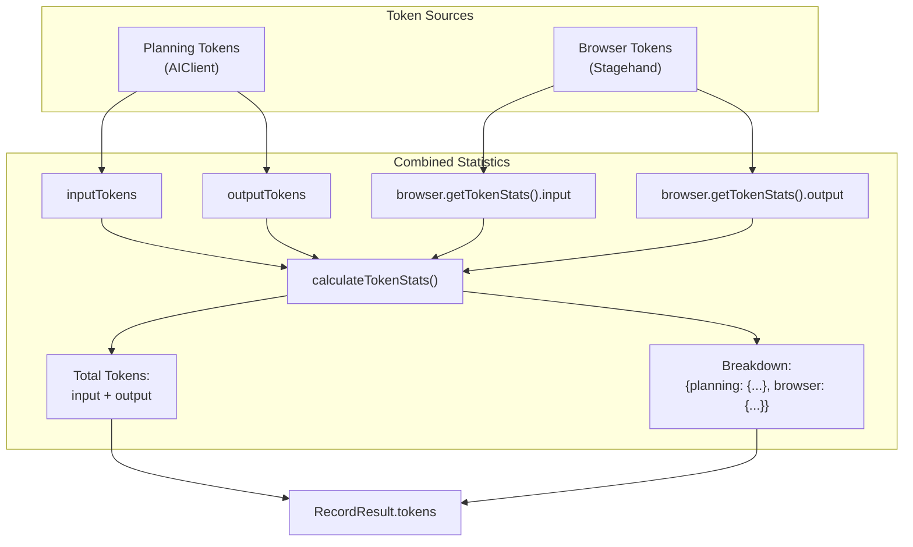

<!-- source: DeepWiki mcp.deepwiki.com · repo actionbook/actionbook · extra page Action Recording · fetched 2026-10-26 -->

# Action Recording

<details>
<summary>Relevant source files</summary>

The following files were used as context for generating this wiki page:

- [services/action-builder/scripts/playbook-record.ts](services/action-builder/scripts/playbook-record.ts)
- [services/action-builder/src/ActionBuilder.ts](services/action-builder/src/ActionBuilder.ts)
- [services/action-builder/src/llm/prompts/capability-recorder.ts](services/action-builder/src/llm/prompts/capability-recorder.ts)
- [services/action-builder/src/recorder/ActionRecorder.ts](services/action-builder/src/recorder/ActionRecorder.ts)
- [services/action-builder/src/recorder/RecorderToolExecutor.ts](services/action-builder/src/recorder/RecorderToolExecutor.ts)
- [services/action-builder/src/task-worker/task-executor.ts](services/action-builder/src/task-worker/task-executor.ts)
- [services/action-builder/src/types/config.ts](services/action-builder/src/types/config.ts)
- [services/action-builder/src/validator/SelectorValidator.ts](services/action-builder/src/validator/SelectorValidator.ts)
- [services/action-builder/test/ActionBuilder.ut.test.ts](services/action-builder/test/ActionBuilder.ut.test.ts)
- [services/action-builder/test/browser/xpath-optimizer.ut.test.ts](services/action-builder/test/browser/xpath-optimizer.ut.test.ts)
- [services/action-builder/test/task-worker/task-executor.ut.test.ts](services/action-builder/test/task-worker/task-executor.ut.test.ts)
- [services/action-builder/test/validator/SelectorValidator.ut.test.ts](services/action-builder/test/validator/SelectorValidator.ut.test.ts)

</details>


## Purpose and Scope

This page documents how the **ActionRecorder** executes multi-turn LLM conversations to discover and register UI elements on web pages. It covers the recording loop architecture, tool execution flow, element discovery mechanisms, and multi-selector extraction strategies.

For information about the overall task execution pipeline (Coordinator, BuildTaskRunner, QueueWorker), see [Task Execution Pipeline](#3.2.1). For detailed documentation of individual recorder tools and their parameters, see [Recording Tools Reference](#3.2.3).

---

## Architecture Overview

The action recording system consists of four primary components that work together to discover and register UI capabilities:

**Component Interaction Diagram**



**Sources:** [services/action-builder/src/recorder/ActionRecorder.ts:1-152](), [services/action-builder/src/recorder/RecorderToolExecutor.ts:1-68]()

### Core Classes

| Class | Location | Responsibility |
|-------|----------|----------------|
| `ActionRecorder` | [services/action-builder/src/recorder/ActionRecorder.ts:31-32]() | Orchestrates multi-turn LLM loop, manages recording state, coordinates tool execution |
| `RecorderToolExecutor` | [services/action-builder/src/recorder/RecorderToolExecutor.ts:49-67]() | Dispatches tool calls to browser operations, registers discovered elements |
| `AIClient` | [services/action-builder/src/llm/AIClient.ts]() | Manages LLM communication, handles tool calling, tracks token usage |
| `BrowserAdapter` | Interface in `@actionbookdev/browser` | Abstracts browser operations (navigate, observe, act) |

**Sources:** [services/action-builder/src/recorder/ActionRecorder.ts:31-77]()

---

## Recording Flow

The recording process follows a multi-turn conversational loop where the LLM uses tools to discover and register elements. Each turn represents one LLM response that may contain multiple tool calls.

**Multi-Turn Recording Loop**



**Sources:** [services/action-builder/src/recorder/ActionRecorder.ts:755-1100](), [services/action-builder/src/ActionBuilder.ts:410-483]()

### Recording Loop Details

The recording loop in `ActionRecorder.record()` follows these steps:

1. **Initialize Conversation**: Start with system prompt and user prompt, passing available tools
2. **LLM Response**: Receive response with tool calls (may contain 1-15+ tool calls per turn)
3. **Tool Execution**: Execute each tool call sequentially with retry logic
4. **State Updates**: Update `siteCapability`, `discoveredElements`, `visitedUrls`, `currentPageType`
5. **Step Recording**: Record each step to database for debugging and observability
6. **Termination Check**: Check termination conditions after each tool execution
7. **Next Turn**: Send tool results back to LLM for next decision

**Sources:** [services/action-builder/src/recorder/ActionRecorder.ts:755-942]()

---

## Tool Execution Flow

Tools are executed through `RecorderToolExecutor`, which dispatches to browser operations and manages state updates.

**Tool Execution Architecture**



**Sources:** [services/action-builder/src/recorder/RecorderToolExecutor.ts:69-552]()

### Tool Execution with Retry

Each tool execution includes retry logic for transient failures:

```typescript
// From ActionRecorder.executeToolWithRetry()
{
  maxAttempts: 3,
  baseDelayMs: 1000,
  exponentialBackoff: baseDelayMs * Math.pow(2, attempt - 1)
}
```

Retryable errors include browser timeouts, connection failures, and transient network issues. Non-retryable errors (e.g., element not found after retries) are marked as skipped.

**Sources:** [services/action-builder/src/recorder/ActionRecorder.ts:597-664]()

### Pre-Action Hooks

`observe_page` includes automatic pre-actions:

- **Auto-scroll**: If `config.autoScrollToBottom !== false`, scrolls to page bottom before observing to load lazy-loaded content
- **Scroll tracking**: `hasScrolledCurrentPage` flag prevents duplicate scrolling per page

**Sources:** [services/action-builder/src/recorder/ActionRecorder.ts:612-631]()

---

## Element Discovery

Elements are discovered through the `observe_page` tool, which uses AI-powered browser automation to identify interactive elements.

**Element Discovery Flow**



**Sources:** [services/action-builder/src/recorder/RecorderToolExecutor.ts:122-149]()

### Observe Result Format

Each observed element returns:

| Field | Type | Description |
|-------|------|-------------|
| `selector` | `string` | XPath selector (format: `xpath=//button[...]`) |
| `description` | `string` | Natural language description of element |
| `method` | `string` | Suggested interaction method (`click`, `type`, etc) |

**Sources:** [services/action-builder/src/types/index.ts]()

---

## Multi-Selector Extraction

When registering an element, multiple selectors are extracted with priority ordering for maximum stability.

**Selector Extraction Pipeline**

```mermaid
graph TB
    input["Input: element_id, xpath_selector, description"]
    
    subgraph "Auto-extraction via XPath"
        xpath["XPath from observe_page or LLM"]
        getAttrs["browser.getElementAttributesFromXPath(xpath)"]
        attrs["Extracted Attributes: {id, dataTestId, ariaLabel, placeholder, cssSelector, optimizedXPath}"]
        
        xpath --> getAttrs
        getAttrs --> attrs
    end
    
    subgraph "Selector Priority (extractMultipleSelectors)"
        p1["Priority 1: ID - createIdSelector(id) → '[id=\"value\"]'"]
        p2["Priority 2: data-testid → '[data-testid=\"value\"]'"]
        p3["Priority 3: aria-label → '[aria-label=\"value\"]'"]
        p4["Priority 4: data-* attributes → '[data-state--date-string=\"{{date}}\"]'"]
        p5["Priority 5: CSS selector"]
        p6["Priority 6: XPath (optimized or original)"]
        p7["Priority 7: placeholder → '[placeholder=\"value\"]'"]
        
        attrs --> p1
        attrs --> p2
        attrs --> p3
        attrs --> p4
        attrs --> p5
        attrs --> p6
        attrs --> p7
    end
    
    subgraph "Template Detection"
        p4 --> detectPattern["detectTemplatePattern(cssSelector)"]
        detectPattern --> datePattern["Date patterns: data-state--date-string='YYYY-MM-DD'"]
        datePattern --> template["Template: '[data-state--date-string=\"{{date}}\"]'"]
        template --> templateParams["templateParams: [{name: 'date', type: 'date', format: 'YYYY-MM-DD'}]"]
    end
    
    output["SelectorItem[] with priority, confidence, isTemplate"]
```

**Sources:** [services/action-builder/src/recorder/ActionRecorder.ts:263-397](), [services/action-builder/src/recorder/RecorderToolExecutor.ts:275-477]()

### Selector Types and Confidence Scores

| Selector Type | Priority | Confidence | Example |
|---------------|----------|------------|---------|
| `id` | 1 | 0.95 | `[id="submit-btn"]` |
| `data-testid` | 2 | 0.90 | `[data-testid="checkout-btn"]` |
| `aria-label` | 3 | 0.85 | `[aria-label="Close dialog"]` |
| `data-*` (stable) | 4 | 0.80 | `[data-component="header"]` |
| `css` | 5 | 0.75 | `.btn.primary` |
| `xpath` (optimized) | 6 | 0.80 | `//button[@name="submit"]` |
| `xpath` (absolute) | 6 | 0.60 | `/html[1]/body[1]/div[3]/button[1]` |
| `placeholder` | 7 | 0.65 | `[placeholder="Enter email"]` |

**Sources:** [services/action-builder/src/recorder/ActionRecorder.ts:278-394]()

### Template Pattern Detection

The system detects dynamic values that should be parameterized:

```typescript
// Example: Airbnb date selector
// Input:  button[data-state--date-string='2025-12-10']
// Output: button[data-state--date-string='{{date}}']
// Params: [{name: 'date', type: 'date', format: 'YYYY-MM-DD'}]
```

Supported patterns:
- Date attributes: `data-state--date-string`, `data-date`, `aria-label` with dates
- Format: `YYYY-MM-DD`, `MM/DD/YYYY`, `DD/MM/YYYY`

**Sources:** [services/action-builder/src/recorder/ActionRecorder.ts:209-261]()

---

## Recording Modes

ActionRecorder supports two distinct recording modes with different prompts and tool usage patterns.

**Recording Mode Comparison**

| Aspect | Exploratory Mode | Task-Driven Mode |
|--------|------------------|------------------|
| **Primary Tool** | `register_element` | `interact` |
| **Prompt Type** | `CAPABILITY_RECORDER_SYSTEM_PROMPT` | Custom system/user prompts |
| **Navigation** | Minimal (single page focus) | Task-driven (multi-page flows) |
| **Element Discovery** | Comprehensive module-by-module scan | Discover elements while executing task |
| **Use Case** | Document all elements on a page | Record task execution steps |
| **Output** | Complete page capability map | Task-specific action sequence |

**Sources:** [services/action-builder/src/llm/prompts/capability-recorder.ts:1-256](), [services/action-builder/src/task-worker/utils/prompt-builder.ts]()

### Exploratory Mode

Used by playbook-builder and default recording. Focuses on comprehensive element discovery:

```
System Prompt: CAPABILITY_RECORDER_SYSTEM_PROMPT
User Prompt: "Record all UI elements for this scenario... For EACH module, observe THEN IMMEDIATELY register..."

Tools Priority:
1. navigate(url)
2. set_page_context(page_type)
3. scroll_to_bottom() [if lazy loading]
4. observe_page(focus: "header elements", module: "header")
5. register_element() × N [batch registration]
6. observe_page(focus: "main content", module: "main")
7. register_element() × N
```

**Sources:** [services/action-builder/src/llm/prompts/capability-recorder.ts:4-135](), [scripts/playbook-record.ts:156-168]()

### Task-Driven Mode

Used by task-worker for executing specific scenarios while recording interactions:

```
System Prompt: "You are a web automation expert. Execute the given task while recording elements you interact with..."
User Prompt: "Task: Search for hotels in Tokyo\nSteps:\n1. Enter 'Tokyo' in search\n2. Click search button..."

Tools Priority:
1. navigate(url)
2. interact(element_id, action, instruction) [discovers + registers element]
3. wait/scroll as needed
4. observe_page [when need to find elements]
```

**Sources:** [services/action-builder/src/task-worker/utils/prompt-builder.ts:1-177](), [services/action-builder/src/task-worker/task-executor.ts:139-169]()

---

## Termination Strategy

Recording terminates when specific conditions are met to prevent runaway loops and optimize resource usage.

**Termination Conditions**



**Sources:** [services/action-builder/src/recorder/ActionRecorder.ts:554-595]()

### Termination Configuration

Configurable via `RecorderConfig.terminationConfig`:

```typescript
{
  terminationConfig: {
    elementThreshold: 80,              // Stop after N elements
    minObserveEfficiency: 3,           // Stop if avg < 3 elements/observe
    minObserveCallsForCheck: 3,        // Min calls before efficiency check
  },
  taskTimeoutMs: 15 * 60 * 1000,       // Overall task timeout
  maxTokens: -1,                        // Token limit (-1 = unlimited)
  maxVisitedPages: 5,                   // Stop after N pages
  maxTurns: 30                          // Max LLM turns
}
```

**Sources:** [services/action-builder/src/types/config.ts:136-176]()

### Early Termination with Partial Results

When terminated early, the system saves discovered elements:

1. **Record Termination Reason**: Set `terminationReason` field in result
2. **Save Partial Results**: Call `saveToYamlAndDb()` with current `siteCapability`
3. **Return Success**: Mark as `partialComplete: true` to indicate incomplete but valid recording

**Sources:** [services/action-builder/src/recorder/ActionRecorder.ts:996-1054]()

---

## Selector Optimization

After recording completes, selectors are analyzed and optimized using LLM-based stability detection.

**Selector Optimization Pipeline**

```mermaid
graph LR
    input["discoveredElements: Map<string, ElementCapability>"]
    
    check["config.enableSelectorOptimization\n(default: true)"]
    input --> check
    
    check -->|false| skip["Skip optimization"]
    check -->|true| optimizer["SelectorOptimizer.optimizeSelectors()"]
    
    optimizer --> analyze["LLM analyzes all selectors"]
    analyze --> detect["Detect unstable patterns:\n- Dynamic counters\n- Hashes/UUIDs\n- Timestamps\n- Session IDs"]
    
    detect --> filter["Filter out unstable selectors"]
    filter --> reorder["Reorder by stability"]
    reorder --> adjustConf["Adjust confidence scores"]
    
    adjustConf --> update["Update siteCapability.pages[].elements[].selectors"]
    update --> save["Save to DB and YAML"]
```



**Sources:** [services/action-builder/src/recorder/ActionRecorder.ts:706-748](), [services/action-builder/src/optimizer/SelectorOptimizer.ts]()

### Optimization Benefits

- **Removes unstable selectors**: Dynamic IDs, timestamps, session tokens
- **Reorders by reliability**: Prioritizes stable attributes (id, data-testid, name)
- **Updates confidence scores**: Adjusts based on stability analysis
- **Batch processing**: Optimizes all elements in one LLM call for efficiency

**Sources:** [services/action-builder/src/recorder/ActionRecorder.ts:706-748]()

---

## Token and Statistics Tracking

Recording tracks comprehensive metrics for observability and cost monitoring.

**Token Tracking Architecture**



**Sources:** [services/action-builder/src/recorder/ActionRecorder.ts:666-700]()

### Statistics Output

`RecordResult` includes detailed metrics:

```typescript
{
  success: true,
  turns: 10,                          // LLM conversation turns
  steps: 25,                          // Total tool executions
  totalDuration: 45000,               // Milliseconds
  tokens: {
    input: 15000,                     // Total input tokens
    output: 8000,                     // Total output tokens
    total: 23000,                     // Combined total
    planning: {                       // AIClient usage
      input: 12000,
      output: 6000
    },
    browser: {                        // Stagehand usage
      input: 3000,
      output: 2000
    }
  },
  elementsDiscovered: 18,
  visitedPagesCount: 3,
  observeStats: {
    totalCalls: 5,
    totalElements: 18,
    avgEfficiency: 3.6               // Elements per observe call
  },
  terminationReason: 'completed'
}
```

**Sources:** [services/action-builder/src/types/config.ts:276-316]()

### Real-Time Step Events

`onStepFinish` callback provides real-time progress updates:

```typescript
{
  stepNumber: 5,
  totalTurns: 2,
  maxTurns: 30,
  toolName: 'register_element',
  toolArgs: { element_id: 'header_search_input', ... },
  toolResult: { success: true, ... },
  success: true,
  durationMs: 1200,
  pageType: 'home',
  timestamp: Date
}
```

**Sources:** [services/action-builder/src/types/config.ts:1-32](), [services/action-builder/src/recorder/ActionRecorder.ts:174-206]()

---

## Integration Points

ActionRecorder integrates with multiple system components:

| Component | Integration Point | Purpose |
|-----------|------------------|---------|
| **ActionBuilder** | `ActionBuilder.build()` calls `ActionRecorder.record()` | Main entry point for recording |
| **TaskExecutor** | Uses `ActionBuilder` with custom prompts | Task-driven recording mode |
| **YamlWriter** | `saveToYamlAndDb()` persists to YAML | Human-readable output format |
| **DbWriter** | `saveToYamlAndDb()` persists to database | Searchable element storage |
| **SelectorOptimizer** | `optimizeAndUpdateSelectors()` before save | LLM-based selector stability analysis |

**Sources:** [services/action-builder/src/ActionBuilder.ts:410-483](), [services/action-builder/src/task-worker/task-executor.ts:139-169](), [services/action-builder/src/recorder/ActionRecorder.ts:750-1100]()

---

