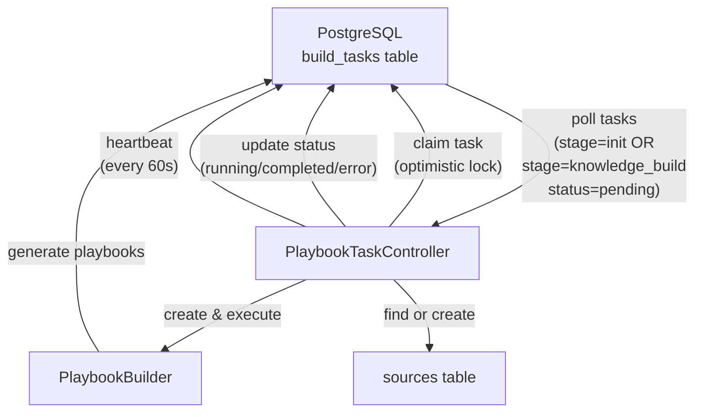
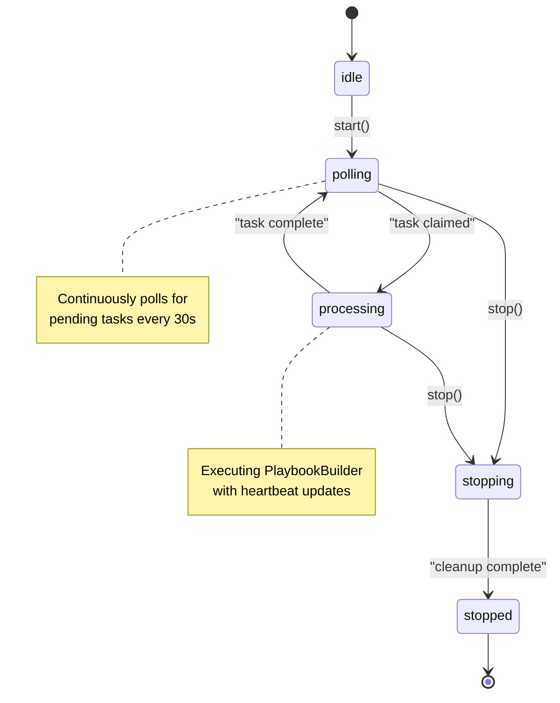
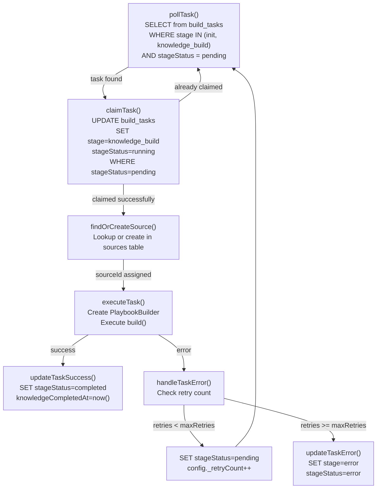
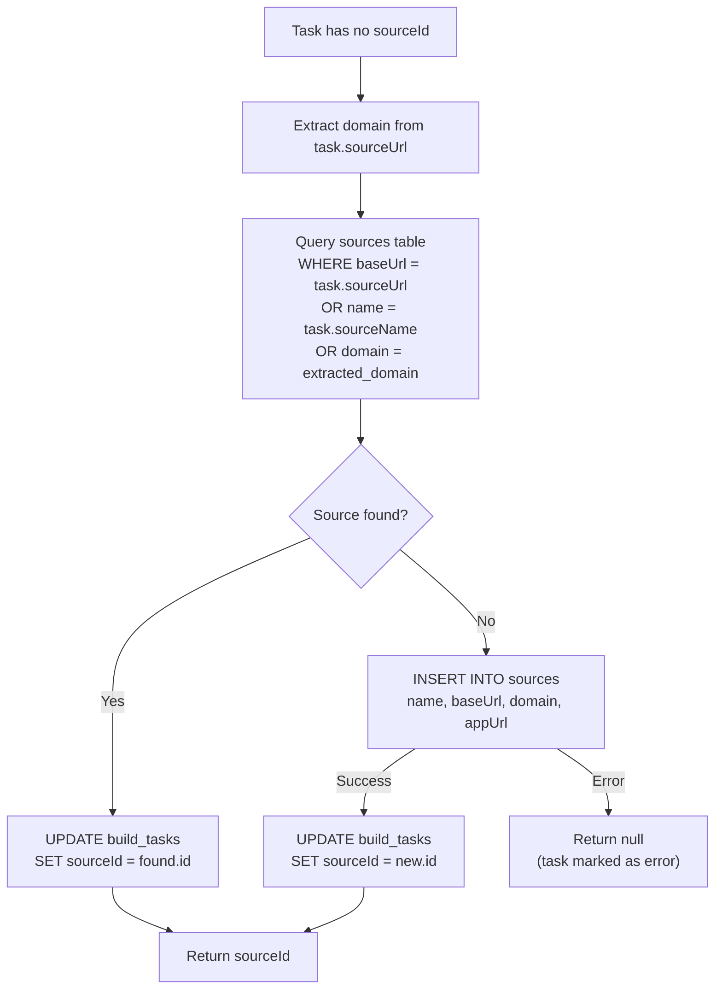
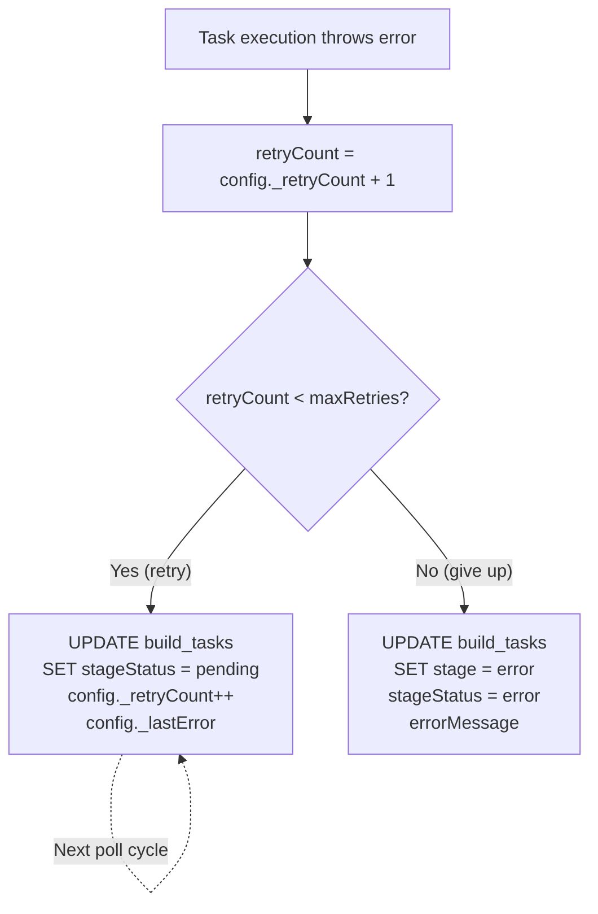
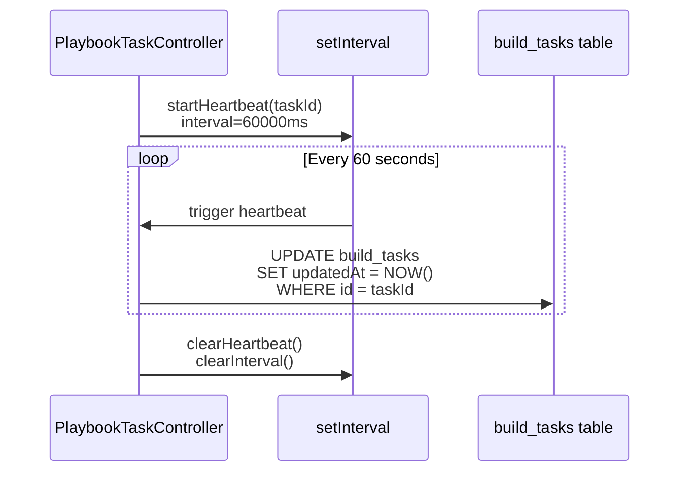
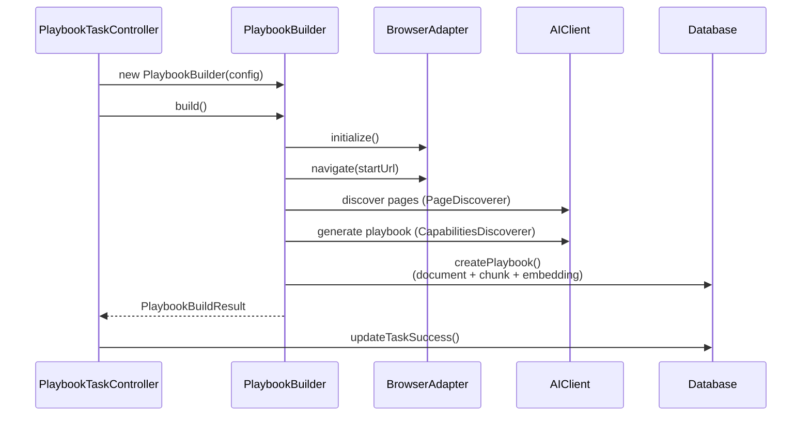

<!-- source: DeepWiki mcp.deepwiki.com · repo actionbook/actionbook · extra page Playbook Task Controller · fetched 2026-10-26 -->

# Playbook Task Controller

<details>
<summary>Relevant source files</summary>

The following files were used as context for generating this wiki page:

- [services/action-builder/src/task-worker/utils/prompt-builder.ts](services/action-builder/src/task-worker/utils/prompt-builder.ts)
- [services/db/src/models/build-task.ts](services/db/src/models/build-task.ts)
- [services/playbook-builder/scripts/worker.ts](services/playbook-builder/scripts/worker.ts)
- [services/playbook-builder/src/analyzer/page-analyzer.ts](services/playbook-builder/src/analyzer/page-analyzer.ts)
- [services/playbook-builder/src/controller/playbook-task-controller.ts](services/playbook-builder/src/controller/playbook-task-controller.ts)
- [services/playbook-builder/src/discoverer/capabilities-discoverer.ts](services/playbook-builder/src/discoverer/capabilities-discoverer.ts)
- [services/playbook-builder/src/discoverer/page-discoverer.ts](services/playbook-builder/src/discoverer/page-discoverer.ts)
- [services/playbook-builder/src/playbook-builder.ts](services/playbook-builder/src/playbook-builder.ts)
- [services/playbook-builder/src/types/index.ts](services/playbook-builder/src/types/index.ts)

</details>


## Purpose and Scope

The `PlaybookTaskController` is responsible for orchestrating the execution of playbook generation tasks within the Playbook Builder service. It polls the database for pending build tasks, claims them using optimistic locking, executes the `PlaybookBuilder`, and manages the task lifecycle including success, failure, and retry scenarios.

For information about the overall Playbook Builder service architecture, see [Playbook Builder Service](#3.3). For details on the complete Task Execution Pipeline including action-builder coordination, see [Task Execution Pipeline](#3.2.1). For information about the PlaybookBuilder class that performs the actual playbook generation, see the main implementation at [services/playbook-builder/src/playbook-builder.ts:30-272]().

**Sources:** [services/playbook-builder/src/controller/playbook-task-controller.ts:1-562]()

---

## Architecture Overview

The `PlaybookTaskController` acts as a polling-based task orchestrator that bridges the database task queue and the `PlaybookBuilder` execution engine. It operates independently as a long-running worker process, continuously polling for tasks that require playbook generation.

### System Context Diagram



**Sources:** [services/playbook-builder/src/controller/playbook-task-controller.ts:1-562](), [services/db/src/models/build-task.ts:18-94]()

---

## Controller States

The `PlaybookTaskController` implements a state machine with five distinct states. The controller transitions between these states based on external commands and task processing outcomes.

### State Machine



The `ControllerState` type is defined in [services/playbook-builder/src/controller/types.ts]() with the following values:

| State | Description |
|-------|-------------|
| `idle` | Initial state, not yet started |
| `polling` | Actively polling database for pending tasks |
| `processing` | Currently executing a task |
| `stopping` | Graceful shutdown in progress |
| `stopped` | Controller has stopped |

**Sources:** [services/playbook-builder/src/controller/playbook-task-controller.ts:52-144]()

---

## Task Lifecycle

The controller manages build tasks through a multi-stage lifecycle, coordinating with the `build_tasks` table in PostgreSQL.

### Task Lifecycle Flow



**Sources:** [services/playbook-builder/src/controller/playbook-task-controller.ts:173-303](), [services/playbook-builder/src/controller/playbook-task-controller.ts:309-420]()

### Build Task Stages

The controller specifically handles tasks in the knowledge building stage:

| Stage | Status | Controller Action |
|-------|--------|-------------------|
| `init` | `pending` | Claim and start execution |
| `knowledge_build` | `pending` | Retry execution (after previous failure) |
| `knowledge_build` | `running` | Currently processing (skip) |
| `knowledge_build` | `completed` | Pass to action-builder (not handled here) |
| `error` | `error` | Terminal failure (not handled here) |

**Sources:** [services/db/src/models/build-task.ts:110-127]()

---

## Optimistic Locking

The controller uses optimistic locking to prevent race conditions when multiple workers poll the same database. The `claimTask()` method performs an atomic compare-and-swap operation.

### Claim Task Implementation

The claim operation is implemented in [services/playbook-builder/src/controller/playbook-task-controller.ts:309-330]():

```typescript
// Pseudocode from claimTask()
UPDATE build_tasks
SET 
  stage = 'knowledge_build',
  stageStatus = 'running',
  knowledgeStartedAt = NOW()
WHERE 
  id = taskId 
  AND stageStatus = 'pending'  // ← Optimistic lock condition
RETURNING id
```

Only one worker will successfully update a row where `stageStatus = 'pending'`. Other workers attempting to claim the same task will receive 0 rows in the result set, indicating the task was already claimed.

**Sources:** [services/playbook-builder/src/controller/playbook-task-controller.ts:309-330]()

---

## Controller Configuration

The `PlaybookTaskControllerImpl` accepts configuration through the `ControllerOptions` interface.

### Configuration Options

| Option | Type | Default | Description |
|--------|------|---------|-------------|
| `pollInterval` | `number` | `30000` | Time between polls in milliseconds (30s) |
| `taskTimeout` | `number` | `0` | Task timeout (0 = no timeout) |
| `heartbeatInterval` | `number` | `60000` | Heartbeat update frequency (60s) |
| `maxRetries` | `number` | `3` | Maximum retry attempts before permanent failure |
| `onTaskStart` | `function` | - | Callback when task starts |
| `onTaskComplete` | `function` | - | Callback when task completes |
| `onTaskError` | `function` | - | Callback when task errors |
| `onProgress` | `function` | - | Callback for progress updates |

### Playbook Builder Configuration

The controller reads build configuration from the `build_tasks.config` JSONB field and passes it to `PlaybookBuilder`:

```typescript
// Mapped from build_tasks.config to PlaybookBuilderConfig
{
  sourceId: task.sourceId,              // From task.sourceId
  startUrl: task.sourceUrl,             // From task.sourceUrl
  headless: config.playbookHeadless,    // Default: true
  maxPages: config.playbookMaxPages,    // Default: 10
  maxDepth: config.playbookMaxDepth,    // Default: 1
  customPrompt: config.playbookBuilderPrompt
}
```

**Sources:** [services/playbook-builder/src/controller/playbook-task-controller.ts:34-46](), [services/playbook-builder/src/controller/playbook-task-controller.ts:244-254](), [services/db/src/models/build-task.ts:128-166]()

---

## Source Management

If a task does not have an associated `sourceId`, the controller attempts to find or create a matching source record before execution.

### Source Resolution Algorithm



This prevents duplicate sources and ensures tasks are properly linked to source records for version tracking.

**Sources:** [services/playbook-builder/src/controller/playbook-task-controller.ts:458-524]()

---

## Error Handling and Retry Logic

The controller implements automatic retry logic with exponential backoff through the `_retryCount` field stored in `build_tasks.config`.

### Retry Decision Flow



### Error State Persistence

Failed tasks store error information in multiple fields:

| Field | Purpose |
|-------|---------|
| `errorMessage` | Top-level error message (TEXT column) |
| `config._retryCount` | Current retry attempt count |
| `config._lastError` | Last error message (for debugging) |
| `config._errorAt` | ISO timestamp of error |

**Sources:** [services/playbook-builder/src/controller/playbook-task-controller.ts:349-401]()

---

## Heartbeat Mechanism

The controller maintains task liveness through periodic heartbeat updates. This allows monitoring systems to detect stale tasks.

### Heartbeat Implementation

The heartbeat runs on a separate timer while a task is processing:



The `updatedAt` timestamp is used by external monitoring to identify tasks that have not sent a heartbeat within the expected interval (typically 15 minutes in action-builder's stale detection).

**Sources:** [services/playbook-builder/src/controller/playbook-task-controller.ts:426-452]()

---

## Worker Entry Point

The controller is deployed as a long-running worker process through [services/playbook-builder/scripts/worker.ts:1-83]().

### Worker Process Lifecycle

```mermaid
graph LR
    Start["Process start"]
    Create["createPlaybookTaskController()"]
    Start_["controller.start(options)"]
    Poll["Continuous polling loop"]
    Signal["SIGINT/SIGTERM received"]
    Shutdown["controller.stop(reason)"]
    Exit["process.exit(0)"]
    
    Start --> Create
    Create --> Start_
    Start_ --> Poll
    Poll -.->|"graceful shutdown"| Signal
    Signal --> Shutdown
    Shutdown --> Exit
```



### Worker Initialization Code

The worker script sets up event handlers and callbacks:

```typescript
// From worker.ts:44-76
const controller = createPlaybookTaskController();

const controllerOptions = {
  onTaskStart: (taskId) => console.log(`Task #${taskId} started`),
  onTaskComplete: (taskId, result) => console.log(`Task #${taskId} completed`),
  onTaskError: (taskId, error, retryCount) => console.error(`Task #${taskId} error`)
};

// Graceful shutdown on SIGINT/SIGTERM
process.on('SIGINT', () => controller.stop('SIGINT'));
process.on('SIGTERM', () => controller.stop('SIGTERM'));

await controller.start(controllerOptions);
```

The worker can be run locally using `pnpm dev` in the playbook-builder service directory.

**Sources:** [services/playbook-builder/scripts/worker.ts:14-82]()

---

## Database Operations

The controller performs several key database operations on the `build_tasks` table.

### Database Operation Summary

| Operation | SQL Pattern | Method |
|-----------|-------------|--------|
| Poll tasks | `SELECT ... WHERE (stage='init' OR stage='knowledge_build') AND stageStatus='pending' ORDER BY createdAt LIMIT 1` | `pollTask()` |
| Claim task | `UPDATE ... SET stage='knowledge_build', stageStatus='running' WHERE id=? AND stageStatus='pending'` | `claimTask()` |
| Update success | `UPDATE ... SET stageStatus='completed', knowledgeCompletedAt=NOW()` | `updateTaskSuccess()` |
| Update error | `UPDATE ... SET stage='error', stageStatus='error', errorMessage=?` | `updateTaskError()` |
| Reset for retry | `UPDATE ... SET stageStatus='pending', config=config || {...}` | `handleTaskError()` |
| Heartbeat | `UPDATE ... SET updatedAt=NOW() WHERE id=?` | `sendHeartbeat()` |

### Task Status Query

The polling query uses a compound condition to find eligible tasks:

```sql
-- From pollTask()
SELECT * FROM build_tasks
WHERE (
  (stage = 'init' AND stageStatus = 'pending')
  OR 
  (stage = 'knowledge_build' AND stageStatus = 'pending')
)
ORDER BY createdAt
LIMIT 1
```

This retrieves both new tasks (`init`/`pending`) and retry tasks (`knowledge_build`/`pending`).

**Sources:** [services/playbook-builder/src/controller/playbook-task-controller.ts:174-203](), [services/playbook-builder/src/controller/playbook-task-controller.ts:309-420]()

---

## Integration with PlaybookBuilder

Once a task is claimed and source is resolved, the controller creates and executes a `PlaybookBuilder` instance.

### Execution Flow



The `PlaybookBuilder.build()` method returns a `PlaybookBuildResult` containing:

```typescript
{
  playbookCount: number,      // Number of playbooks created
  sourceVersionId: number,    // Version ID for this build
  playbookIds: number[]       // Document IDs of created playbooks
}
```

This result is stored in the controller's `ProcessingResult` and can be accessed through the `onTaskComplete` callback.

**Sources:** [services/playbook-builder/src/controller/playbook-task-controller.ts:244-280](), [services/playbook-builder/src/playbook-builder.ts:82-182](), [services/playbook-builder/src/types/index.ts:132-142]()

---

## API Reference

### PlaybookTaskController Interface

```typescript
interface PlaybookTaskController {
  // Start the controller with optional configuration
  start(options?: ControllerOptions): Promise<void>;
  
  // Stop the controller gracefully
  stop(reason?: string): Promise<void>;
  
  // Check for and execute one task (non-polling mode)
  checkOnce(): Promise<boolean>;
  
  // Get current controller state
  getState(): ControllerState;
}
```

### Factory Function

```typescript
// Create a new controller instance
function createPlaybookTaskController(): PlaybookTaskController
```

The factory function is the recommended way to instantiate the controller, as it encapsulates the implementation class `PlaybookTaskControllerImpl`.

**Sources:** [services/playbook-builder/src/controller/types.ts](), [services/playbook-builder/src/controller/playbook-task-controller.ts:559-562]()

---

