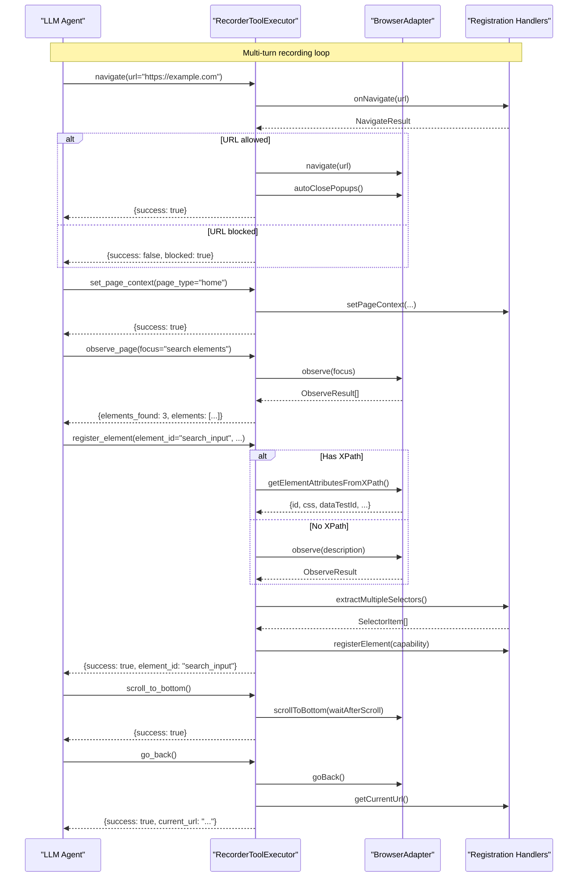
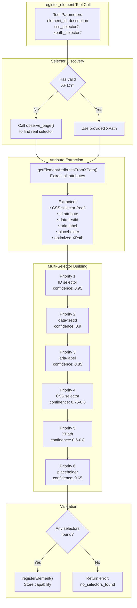
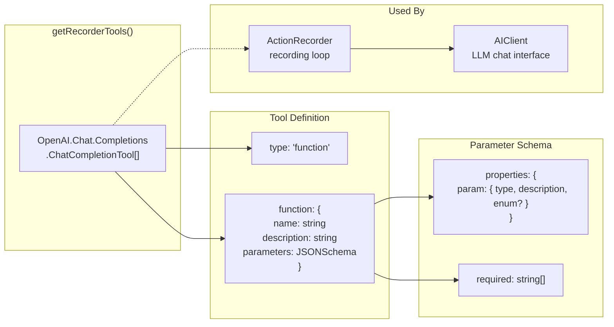

<!-- source: DeepWiki mcp.deepwiki.com · repo actionbook/actionbook · extra page Recording Tools Reference · fetched 2026-10-26 -->

# Recording Tools Reference

<details>
<summary>Relevant source files</summary>

The following files were used as context for generating this wiki page:

- [services/action-builder/scripts/playbook-record.ts](services/action-builder/scripts/playbook-record.ts)
- [services/action-builder/src/recorder/RecorderToolExecutor.ts](services/action-builder/src/recorder/RecorderToolExecutor.ts)
- [services/action-builder/src/recorder/RecorderTools.ts](services/action-builder/src/recorder/RecorderTools.ts)
- [services/action-builder/src/types/capability.ts](services/action-builder/src/types/capability.ts)
- [services/action-builder/src/utils/index.ts](services/action-builder/src/utils/index.ts)
- [services/action-builder/src/utils/url-matcher.ts](services/action-builder/src/utils/url-matcher.ts)
- [services/action-builder/src/validator/SelectorValidator.ts](services/action-builder/src/validator/SelectorValidator.ts)
- [services/action-builder/test/browser/xpath-optimizer.ut.test.ts](services/action-builder/test/browser/xpath-optimizer.ut.test.ts)
- [services/action-builder/test/recorder/RecorderTools.ut.test.ts](services/action-builder/test/recorder/RecorderTools.ut.test.ts)
- [services/action-builder/test/types/capability.ut.test.ts](services/action-builder/test/types/capability.ut.test.ts)
- [services/action-builder/test/utils/url-matcher.ut.test.ts](services/action-builder/test/utils/url-matcher.ut.test.ts)
- [services/action-builder/test/validator/SelectorValidator.ut.test.ts](services/action-builder/test/validator/SelectorValidator.ut.test.ts)

</details>


This page provides a complete reference for all recorder tools available during action recording sessions. These tools are invoked by the AI agent during multi-turn recording loops to discover, interact with, and register UI elements.

For information about how these tools are orchestrated in the recording process, see [Action Recording](#3.2.2). For details on the task execution pipeline that runs recordings, see [Task Execution Pipeline](#3.2.1).

## Overview

Recording tools are the primary interface between the AI agent and the browser during capability discovery. The `RecorderToolExecutor` dispatches tool calls from the LLM to the appropriate browser operations, element registration handlers, and page context management.

**Tool Categories:**

| Category | Tools | Purpose |
|----------|-------|---------|
| **Navigation** | `navigate`, `go_back` | URL navigation and browser history control |
| **Observation** | `observe_page` | AI-powered element discovery using vision models |
| **Interaction** | `interact` | Task-driven element interaction with automatic registration |
| **Registration** | `register_element`, `set_page_context` | Manual capability registration and page context setup |
| **Control Flow** | `wait`, `scroll`, `scroll_to_bottom` | Page state management and content loading |

Sources: [services/action-builder/src/recorder/RecorderTools.ts:3-216](), [services/action-builder/src/recorder/RecorderToolExecutor.ts:49-553]()

## Tool Execution Architecture

```mermaid
graph TB
    subgraph "AI Agent (LLM)"
        Agent["LLM Agent<br/>(Multi-turn loop)"]
    end
    
    subgraph "RecorderToolExecutor"
        Execute["execute()<br/>Tool dispatcher"]
        
        subgraph "Navigation Tools"
            Navigate["navigate<br/>URL + domain check"]
            GoBack["go_back<br/>Browser history"]
        end
        
        subgraph "Observation Tools"
            Observe["observe_page<br/>AI vision discovery"]
        end
        
        subgraph "Interaction Tools"
            Interact["interact<br/>Act + register"]
        end
        
        subgraph "Registration Tools"
            Register["register_element<br/>Multi-selector extraction"]
            SetContext["set_page_context<br/>Page metadata"]
        end
        
        subgraph "Control Tools"
            Wait["wait<br/>Time or text"]
            Scroll["scroll<br/>Up/down"]
            ScrollBottom["scroll_to_bottom<br/>Lazy loading"]
        end
    end
    
    subgraph "Handlers"
        OnNavigate["onNavigate()<br/>Visit tracking"]
        RegisterHandler["registerElement()<br/>Capability storage"]
        SetPageHandler["setPageContext()<br/>Page type setup"]
        ExtractSelectors["extractMultipleSelectors()<br/>Multi-format extraction"]
    end
    
    subgraph "Browser Automation"
        BrowserAdapter["BrowserAdapter<br/>(Stagehand/AgentCore)"]
        ObserveMethod["observe()<br/>AI element discovery"]
        ActMethod["act()<br/>Natural language action"]
        GetAttrs["getElementAttributesFromXPath()<br/>Attribute extraction"]
    end
    
    Agent -->|"Tool call"| Execute
    
    Execute --> Navigate
    Execute --> GoBack
    Execute --> Observe
    Execute --> Interact
    Execute --> Register
    Execute --> SetContext
    Execute --> Wait
    Execute --> Scroll
    Execute --> ScrollBottom
    
    Navigate --> OnNavigate
    Navigate --> BrowserAdapter
    
    Observe --> ObserveMethod
    
    Interact --> ObserveMethod
    Interact --> GetAttrs
    Interact --> ExtractSelectors
    Interact --> ActMethod
    Interact --> RegisterHandler
    
    Register --> ObserveMethod
    Register --> GetAttrs
    Register --> ExtractSelectors
    Register --> RegisterHandler
    
    SetContext --> SetPageHandler
    
    GoBack --> BrowserAdapter
    Scroll --> BrowserAdapter
    ScrollBottom --> BrowserAdapter
    Wait --> BrowserAdapter
```



**Execution Flow:**
1. LLM agent calls a tool via OpenAI function calling format
2. `RecorderToolExecutor.execute()` dispatches to the appropriate tool handler
3. Tool handler interacts with browser, extracts selectors, or updates state
4. Tool returns structured output to guide next LLM turn

Sources: [services/action-builder/src/recorder/RecorderToolExecutor.ts:49-67](), [services/action-builder/src/recorder/RecorderToolExecutor.ts:69-553]()

## Tool Reference

### navigate

Navigates the browser to a URL with domain validation and visit tracking.

**Parameters:**

| Name | Type | Required | Description |
|------|------|----------|-------------|
| `url` | string | Yes | Full URL to navigate to |

**Behavior:**

1. **Pre-navigation validation**: Checks if URL should be visited BEFORE loading the page to avoid:
   - External domain navigation (security)
   - Duplicate page loads (efficiency)
   - Unwanted side effects (form submissions, cart modifications)

2. **Domain checking**: Extracts hostname and validates against source domain via `onNavigate()` handler

3. **Visit tracking**: Maintains normalized URL history using sorted query parameters + hash for SPA support

4. **Auto-popup closing**: Calls `browser.autoClosePopups()` after successful navigation

**Output:**

```typescript
// Success
{ success: true, url: string }

// Already visited
{ 
  success: false, 
  url: string,
  message: string,
  already_visited: true,
  blocked: true 
}

// External domain
{ 
  success: false, 
  url: string,
  message: string,
  external_domain: true,
  blocked: true 
}
```

**Example Output:**

```json
{
  "success": false,
  "url": "https://example.com/search",
  "message": "Navigation to /search?q=test blocked: already visited. Please continue with other elements on the current page.",
  "already_visited": true,
  "blocked": true
}
```

Sources: [services/action-builder/src/recorder/RecorderToolExecutor.ts:76-120](), [services/action-builder/src/recorder/RecorderTools.ts:8-18]()

### observe_page

Discovers interactive elements on the current page using AI vision models.

**Parameters:**

| Name | Type | Required | Description |
|------|------|----------|-------------|
| `focus` | string | Yes | What to focus on (e.g., "search box and submit button") |
| `module` | string | No | Page module to observe: "header", "footer", "sidebar", "navibar", "main", "modal", "breadcrumb", "tab", "all" |
| `_timeoutMs` | number | No | Internal timeout parameter (not exposed to LLM) |

**Behavior:**

1. Calls `browser.observe()` with the focus instruction and optional timeout
2. AI vision model (via Stagehand/AgentCore) analyzes page and returns element descriptions with selectors
3. Results are filtered to elements with both description and selector
4. Limited to 20 elements in output to avoid token overflow

**Output:**

```typescript
{
  elements_found: number,
  elements: Array<{
    description: string,
    selector: string,      // CSS or XPath format
    method: string         // Default: "click"
  }>
}
```

**Module Classification:**

The `module` parameter helps focus observation on specific page regions:
- `header` - Top navigation, logos, user menu
- `footer` - Bottom links, copyright, social media
- `sidebar` - Side navigation or filters
- `navibar` - Navigation bars
- `main` - Primary content area
- `modal` - Dialog overlays
- `breadcrumb` - Breadcrumb navigation
- `tab` - Tab navigation
- `all` - Entire page (default)

**Example Output:**

```json
{
  "elements_found": 3,
  "elements": [
    {
      "description": "Search input field for entering query",
      "selector": "xpath=/html[1]/body[1]/div[1]/input[1]",
      "method": "click"
    },
    {
      "description": "Submit search button",
      "selector": "css=#search-btn",
      "method": "click"
    }
  ]
}
```

Sources: [services/action-builder/src/recorder/RecorderToolExecutor.ts:122-150](), [services/action-builder/src/recorder/RecorderTools.ts:19-42]()

### set_page_context

Sets metadata about the current page type for organizing recorded capabilities.

**Parameters:**

| Name | Type | Required | Description |
|------|------|----------|-------------|
| `page_type` | string | Yes | Page type identifier (e.g., "home", "search_results") |
| `page_name` | string | Yes | Human-readable page name |
| `page_description` | string | No | Optional detailed description |
| `url_pattern` | string | No | Optional regex pattern for this page type |

**Behavior:**

1. Extracts current URL from browser
2. Calls `setPageContext()` handler with page metadata
3. Handler associates subsequent element registrations with this page type

**Output:**

```typescript
{ success: true, page_type: string }
```

**Usage Pattern:**

Call `set_page_context` once at the start of recording on each new page type before registering elements:

```
1. navigate("https://example.com/search")
2. set_page_context(page_type="search_results", page_name="Search Results")
3. observe_page(focus="search filters")
4. register_element(...) // Elements belong to "search_results" page
```

Sources: [services/action-builder/src/recorder/RecorderToolExecutor.ts:479-502](), [services/action-builder/src/recorder/RecorderTools.ts:43-62]()

### register_element

Manually registers a UI element capability with multi-selector extraction and validation.

**Parameters:**

| Name | Type | Required | Description |
|------|------|----------|-------------|
| `element_id` | string | Yes | Unique identifier in snake_case (cannot be "undefined" or empty) |
| `description` | string | Yes | Human-readable element description |
| `element_type` | string | Yes | Element type: "button", "input", "link", "select", "checkbox", "radio", "text", "data_field", "container", "list", "list_item", "other" |
| `allow_methods` | string[] | Yes | Allowed methods: "click", "type", "clear", "scroll", "hover", "select", "extract" |
| `css_selector` | string | No | CSS selector (LLM-provided, may be inaccurate) |
| `xpath_selector` | string | No | XPath selector (preferred if available) |
| `aria_label` | string | No | ARIA label attribute |
| `placeholder` | string | No | Placeholder text (for inputs) |
| `leads_to` | string | No | Page type this element navigates to |
| `arguments` | object[] | No | Arguments for parameterized actions |
| `parent` | string | No | Parent element ID |
| `depends_on` | string | No | Element that must be interacted with first |
| `visibility_condition` | string | No | Visibility condition description |
| `is_repeating` | boolean | No | Whether element repeats in a list |
| `data_key` | string | No | Data extraction key for data_field type |
| `children` | string[] | No | Child element IDs |
| `module` | string | No | Page module: "header", "footer", "sidebar", "navibar", "main", "modal", "breadcrumb", "tab", "unknown" |
| `input_type` | string | No | Input type (text, email, password, number, etc.) |
| `input_name` | string | No | Name attribute for input elements |
| `input_value` | string | No | Default/placeholder value for inputs |
| `href` | string | No | Link href URL or pattern |

**Behavior:**

1. **Selector Validation**: Rejects elements with invalid IDs (undefined, null, empty string, "undefined")

2. **Automatic Selector Discovery**: If no valid XPath provided, calls `observe_page()` to find real selectors (LLM often provides made-up CSS selectors)

3. **Multi-Selector Extraction**: If XPath is provided, calls `getElementAttributesFromXPath()` to extract:
   - CSS selector (real from page, not LLM-provided)
   - ID attribute
   - data-testid attribute
   - aria-label attribute
   - placeholder attribute
   - Optimized attribute-based XPath

4. **Priority Ordering**: Builds selector array with priority order:
   - Priority 1: ID selector (confidence 0.95)
   - Priority 2: data-testid (confidence 0.9)
   - Priority 3: aria-label (confidence 0.85)
   - Priority 4: CSS (confidence 0.8 for templates, 0.75 for regular)
   - Priority 5: XPath (confidence 0.8 for optimized, 0.6 for absolute)
   - Priority 6: placeholder (confidence 0.65)

5. **Template Detection**: Checks CSS selectors for template patterns (e.g., dynamic IDs)

6. **Phantom Element Filtering**: Rejects elements with no valid selectors (element doesn't exist on current page)

**Output:**

```typescript
// Success
{ success: true, element_id: string }

// Invalid element_id
{ 
  error: "invalid_element_id",
  message: "element_id is required and cannot be empty or undefined"
}

// No selectors found
{
  error: "no_selectors_found",
  message: "Could not find element on current page. Skip this element.",
  element_id: string
}
```

**Multi-Selector Format:**

```typescript
interface SelectorItem {
  type: "css" | "xpath" | "id" | "data-testid" | "aria-label" | "placeholder"
  value: string
  priority: number       // Lower = higher priority
  confidence: number     // 0-1 scale
  isTemplate?: boolean
  templateParams?: Array<{
    name: string
    type: string
    description: string
  }>
}
```

**Example - ID with Special Characters:**

```json
{
  "element_id": "arxiv_category_cs_ai",
  "description": "Computer Science - Artificial Intelligence category link",
  "element_type": "link",
  "allow_methods": ["click"],
  "module": "main"
}

// Output includes optimized selectors:
{
  "success": true,
  "element_id": "arxiv_category_cs_ai",
  "selectors": [
    {
      "type": "id",
      "value": "[id=\"cs.AI\"]",  // Handles dots correctly
      "priority": 1,
      "confidence": 0.95
    },
    {
      "type": "xpath",
      "value": "//a[@id=\"cs.AI\"]",
      "priority": 2,
      "confidence": 0.8
    }
  ]
}
```

Sources: [services/action-builder/src/recorder/RecorderToolExecutor.ts:275-477](), [services/action-builder/src/recorder/RecorderTools.ts:63-135]()

### interact

Performs an interaction on an element and automatically registers it. Used in task-driven recording mode.

**Parameters:**

| Name | Type | Required | Description |
|------|------|----------|-------------|
| `element_id` | string | Yes | Unique element identifier |
| `action` | string | Yes | Action to perform (e.g., "click", "type") |
| `instruction` | string | Yes | Natural language instruction for locating element |
| `element_description` | string | Yes | Human-readable element description |
| `value` | string | No | Value to type (required for "type" action) |
| `css_selector` | string | No | Optional CSS selector hint |
| `xpath_selector` | string | No | Optional XPath selector hint |

**Behavior:**

1. **Selector Resolution**:
   - If LLM provides XPath or CSS, uses those
   - Otherwise, calls `observe_page()` with instruction to find element

2. **Attribute Extraction**: If XPath available, calls `getElementAttributesFromXPath()` to extract additional selectors (id, data-testid, aria-label, CSS, placeholder)

3. **Multi-Selector Building**: Constructs selector array using `extractMultipleSelectors()`

4. **Action Execution**: Calls `browser.act()` with natural language instruction:
   - For "type" action: appends value to instruction (e.g., "click search box and type 'query'")

5. **Element Inference**: Automatically infers `element_type` and `allow_methods` from action

6. **Auto Registration**: Creates and registers `ElementCapability` with discovered selectors

**Output:**

```typescript
{
  success: true,
  element_id: string,
  selectors: SelectorItem[],
  action_result: object  // Result from browser.act()
}
```

**Usage Pattern:**

Use `interact` for task-driven exploration where you want to both interact and register in one step:

```
interact(
  element_id="search_input",
  action="type",
  instruction="type into the search box",
  value="artificial intelligence",
  element_description="Main search input field"
)
```

Sources: [services/action-builder/src/recorder/RecorderToolExecutor.ts:152-273](), [services/action-builder/src/recorder/RecorderTools.ts:136-156]()

### wait

Pauses execution for a specified time or waits for text to appear.

**Parameters:**

| Name | Type | Required | Description |
|------|------|----------|-------------|
| `seconds` | number | No | Seconds to wait |
| `forText` | string | No | Text to wait for on page |

**Behavior:**

- If `seconds` provided: Waits for specified duration via `browser.wait()`
- If `forText` provided: Waits for text to appear via `browser.waitForText()`
- If neither provided: Returns immediately

**Output:**

```typescript
// Time-based wait
{ waited: number }

// Text-based wait
{ waitedFor: string }

// No-op
{ waited: 0 }
```

**Example Usage:**

```json
// Wait for loading
{ "seconds": 2 }

// Wait for confirmation message
{ "forText": "Successfully saved" }
```

Sources: [services/action-builder/src/recorder/RecorderToolExecutor.ts:504-516](), [services/action-builder/src/recorder/RecorderTools.ts:157-170]()

### scroll

Scrolls the page up or down by a specified amount.

**Parameters:**

| Name | Type | Required | Description |
|------|------|----------|-------------|
| `direction` | string | Yes | "up" or "down" |
| `amount` | number | No | Scroll distance in pixels (default: 300) |

**Behavior:**

Calls `browser.scroll(direction, amount)` to scroll the viewport.

**Output:**

```typescript
{ scrolled: "up" | "down", amount: number }
```

**Example Usage:**

```json
{
  "direction": "down",
  "amount": 500
}
```

Sources: [services/action-builder/src/recorder/RecorderToolExecutor.ts:518-524](), [services/action-builder/src/recorder/RecorderTools.ts:171-185]()

### scroll_to_bottom

Scrolls the page to the bottom to trigger lazy-loaded content.

**Parameters:**

| Name | Type | Required | Description |
|------|------|----------|-------------|
| `wait_after_scroll` | number | No | Time to wait after scrolling in milliseconds (default: 1000) |

**Behavior:**

1. Scrolls to page bottom via `browser.scrollToBottom()`
2. Waits for specified duration to allow lazy-loaded elements to render
3. Useful for infinite scroll pages, dynamically loaded lists, and footer content

**Output:**

```typescript
{ success: true, wait_after_scroll: number }
```

**Example Usage:**

```json
{
  "wait_after_scroll": 1500
}
```

**Use Cases:**
- Product listing pages with infinite scroll
- Social media feeds
- Search results with pagination
- Footer elements that load on scroll

Sources: [services/action-builder/src/recorder/RecorderToolExecutor.ts:526-532](), [services/action-builder/src/recorder/RecorderTools.ts:186-202](), [services/action-builder/scripts/playbook-record.ts:133-134]()

### go_back

Navigates back to the previous page in browser history.

**Parameters:**

None required.

**Behavior:**

1. Retrieves previous URL from visit history via `getPreviousUrl()`
2. Calls `browser.goBack()` to navigate back
3. Returns both previous and current URLs for tracking

**Output:**

```typescript
{
  success: true,
  previous_url: string | null,
  current_url: string | null
}
```

**Use Cases:**
- Return to listing page after viewing details
- Navigate back after exploring modal or overlay
- Undo navigation to unwanted page
- Control navigation flow during exploration

**Example Workflow:**

```
1. navigate("/products")
2. observe_page("product cards")
3. interact(element_id="product_1", action="click", ...)  // Goes to /products/1
4. observe_page("product details")
5. go_back()  // Returns to /products
6. interact(element_id="product_2", action="click", ...)  // Goes to /products/2
```

Sources: [services/action-builder/src/recorder/RecorderToolExecutor.ts:534-545](), [services/action-builder/src/recorder/RecorderTools.ts:203-214]()

## Tool Execution Flow



**Key Points:**

1. **Pre-validation**: `navigate` checks URL validity before browser navigation
2. **Auto-extraction**: `register_element` automatically extracts multiple selector formats
3. **Fallback discovery**: Tools call `observe_page()` internally when selectors are missing
4. **Stateful tracking**: Handlers maintain visit history, page context, and registered elements
5. **Error handling**: Tools return structured errors instead of throwing exceptions

Sources: [services/action-builder/src/recorder/RecorderToolExecutor.ts:69-553]()

## Selector Extraction Strategy



**Selector Priority Rationale:**

| Priority | Selector Type | Confidence | Reasoning |
|----------|--------------|------------|-----------|
| 1 | ID | 0.95 | Most stable, unique identifier. Uses `createIdSelector()` to handle special characters like dots |
| 2 | data-testid | 0.9 | Designed for testing, intentionally stable |
| 3 | aria-label | 0.85 | Semantic, accessibility-focused, usually stable |
| 4 | CSS | 0.75-0.8 | Structure-dependent, may break with layout changes. Higher confidence for templates |
| 5 | XPath | 0.6-0.8 | Attribute-based XPath (0.8) is more stable than absolute paths (0.6) |
| 6 | placeholder | 0.65 | Input-specific, may change with content updates |

**Why This Matters:**

1. **Fallback Chain**: Browser automation tries selectors in priority order until one succeeds
2. **Stability**: Higher priority selectors are less likely to break during site updates
3. **Real Selectors**: Always extracts from actual page DOM, not LLM hallucinations
4. **Template Support**: Detects parameterized selectors for list items and dynamic content

Sources: [services/action-builder/src/recorder/RecorderToolExecutor.ts:275-477](), [services/action-builder/src/recorder/RecorderToolExecutor.ts:192-233](), [services/action-builder/src/recorder/RecorderToolExecutor.ts:330-435]()

## Tool Definition Schema

The tools are defined using OpenAI's function calling schema format for LLM consumption:



**Example Tool Definition:**

```typescript
{
  type: "function",
  function: {
    name: "register_element",
    description: "Register a UI element capability with selectors...",
    parameters: {
      type: "object",
      properties: {
        element_id: { 
          type: "string", 
          description: "Unique element identifier (snake_case)" 
        },
        module: {
          type: "string",
          enum: ["header", "footer", "sidebar", "navibar", 
                 "main", "modal", "breadcrumb", "tab", "unknown"],
          description: "Page module location"
        }
        // ... more parameters
      },
      required: ["element_id", "description", "element_type", "allow_methods"]
    }
  }
}
```

Sources: [services/action-builder/src/recorder/RecorderTools.ts:3-216]()

## Common Usage Patterns

### Pattern 1: Exploratory Recording (observe + register)

Used for discovering all elements on a page without interaction:

```
1. navigate("https://example.com")
2. set_page_context(page_type="home", page_name="Home Page")
3. observe_page(focus="all interactive elements", module="header")
4. register_element(element_id="logo", ...) [from observe results]
5. register_element(element_id="search_input", ...) [from observe results]
6. observe_page(focus="main content area", module="main")
7. register_element(element_id="hero_cta", ...) [from observe results]
```

### Pattern 2: Task-Driven Recording (interact)

Used for recording through user workflows:

```
1. navigate("https://example.com")
2. set_page_context(page_type="home", page_name="Home Page")
3. interact(element_id="search_input", action="type", 
            value="product", instruction="type in search box")
4. interact(element_id="search_button", action="click",
            instruction="click search button")
5. set_page_context(page_type="search_results", page_name="Search Results")
6. observe_page(focus="search result cards")
```

### Pattern 3: Lazy-Loaded Content

Used for pages with dynamic content loading:

```
1. navigate("https://example.com/products")
2. set_page_context(page_type="product_listing", page_name="Products")
3. observe_page(focus="visible product cards")
4. scroll_to_bottom(wait_after_scroll=1500)
5. observe_page(focus="newly loaded product cards")
6. register_element(...) [additional elements]
```

### Pattern 4: Modal/Overlay Exploration

Used for recording elements in modals or overlays:

```
1. navigate("https://example.com")
2. observe_page(focus="main page elements")
3. interact(element_id="filters_button", action="click",
            instruction="click filters button")
4. wait(seconds=1)  // Wait for modal animation
5. observe_page(focus="filter options in modal", module="modal")
6. register_element(...) [modal elements]
7. go_back()  // Or close modal
```

### Pattern 5: Navigation Control

Used for exploring multiple pages systematically:

```
1. navigate("https://example.com/categories")
2. observe_page(focus="category cards")
3. interact(element_id="category_1", action="click", ...)
4. observe_page(focus="category detail page")
5. go_back()  // Return to categories
6. interact(element_id="category_2", action="click", ...)
7. observe_page(focus="category detail page")
```

Sources: [services/action-builder/scripts/playbook-record.ts:97-240]()

## Error Handling

Tools return structured error objects instead of throwing exceptions:

| Tool | Error Condition | Error Output |
|------|----------------|--------------|
| `navigate` | Already visited URL | `{success: false, already_visited: true, blocked: true, message: "..."}` |
| `navigate` | External domain | `{success: false, external_domain: true, blocked: true, message: "..."}` |
| `register_element` | Invalid element_id | `{error: "invalid_element_id", message: "element_id is required..."}` |
| `register_element` | No selectors found | `{error: "no_selectors_found", message: "Could not find element..."}` |

**Error Messages Guide LLM Behavior:**

- **`already_visited`**: Instructs LLM to continue with current page instead of navigating
- **`external_domain`**: Warns LLM not to record elements from external sites
- **`no_selectors_found`**: Suggests element may be on different page, skip it

Sources: [services/action-builder/src/recorder/RecorderToolExecutor.ts:92-111](), [services/action-builder/src/recorder/RecorderToolExecutor.ts:276-282](), [services/action-builder/src/recorder/RecorderToolExecutor.ts:438-446]()

## Implementation Notes

### URL Normalization

URLs are normalized for visit tracking to support SPAs:

```typescript
const urlObj = new URL(url);
const sortedParams = new URLSearchParams(urlObj.searchParams);
sortedParams.sort();
const urlKey = urlObj.pathname + 
               (sortedParams.toString() ? '?' + sortedParams.toString() : '') + 
               urlObj.hash;
```

- Query parameters are sorted alphabetically
- Hash fragments are preserved (important for SPAs)
- Enables accurate duplicate detection

Sources: [services/action-builder/src/recorder/RecorderToolExecutor.ts:86-89]()

### ID Selector Escaping

Special characters in IDs (like dots in "cs.AI") are handled via `createIdSelector()`:

```typescript
// Without escaping: #cs.AI (invalid, interprets as id="cs" class="AI")
// With escaping: [id="cs.AI"] (correct)
```

Sources: [services/action-builder/src/recorder/RecorderToolExecutor.ts:355-362]()

### Phantom Element Detection

Elements that the LLM thinks exist but aren't found on the page are filtered out:

```typescript
if (multiSelectors.length === 0) {
  log("warn", `Skipping element ${elementId} - no valid selectors found`);
  return { error: "no_selectors_found", message: "..." };
}
```

This prevents recording hallucinated elements and guides the LLM to focus on real UI.

Sources: [services/action-builder/src/recorder/RecorderToolExecutor.ts:438-446]()

---

