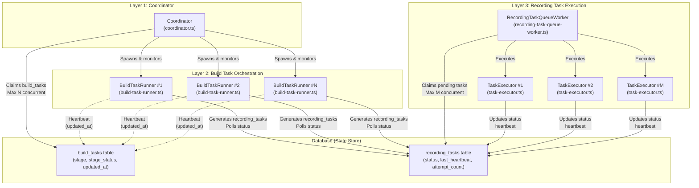
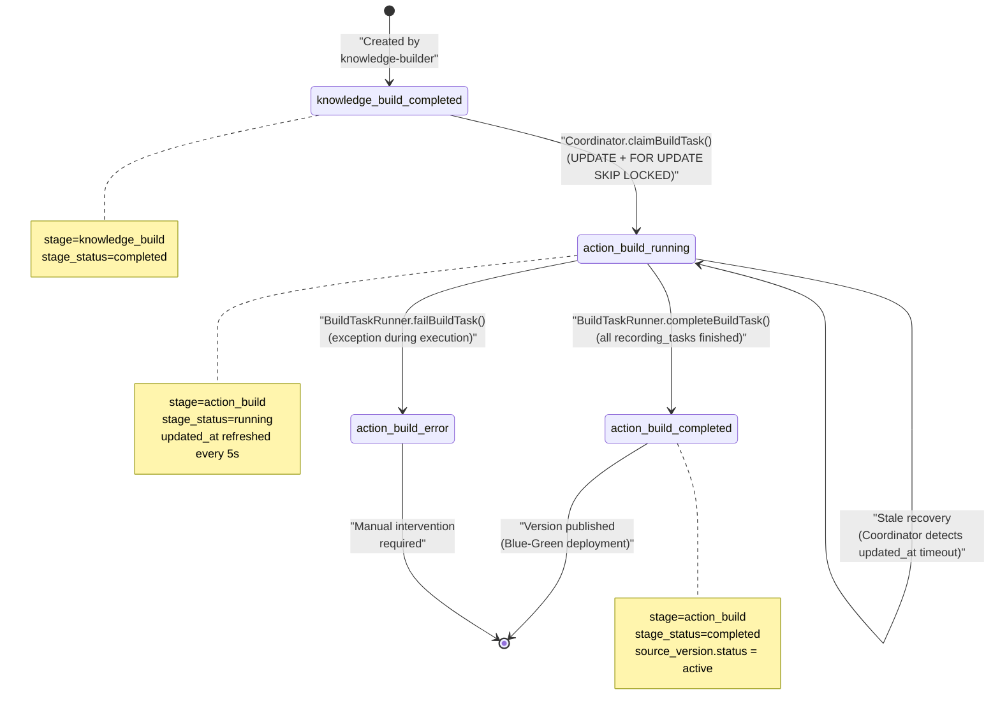
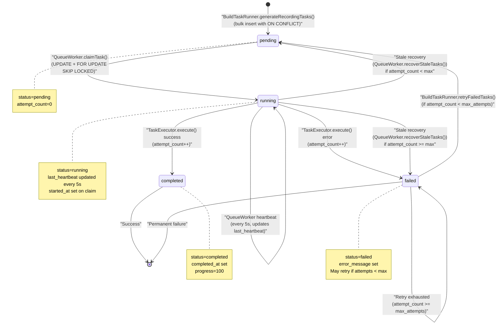
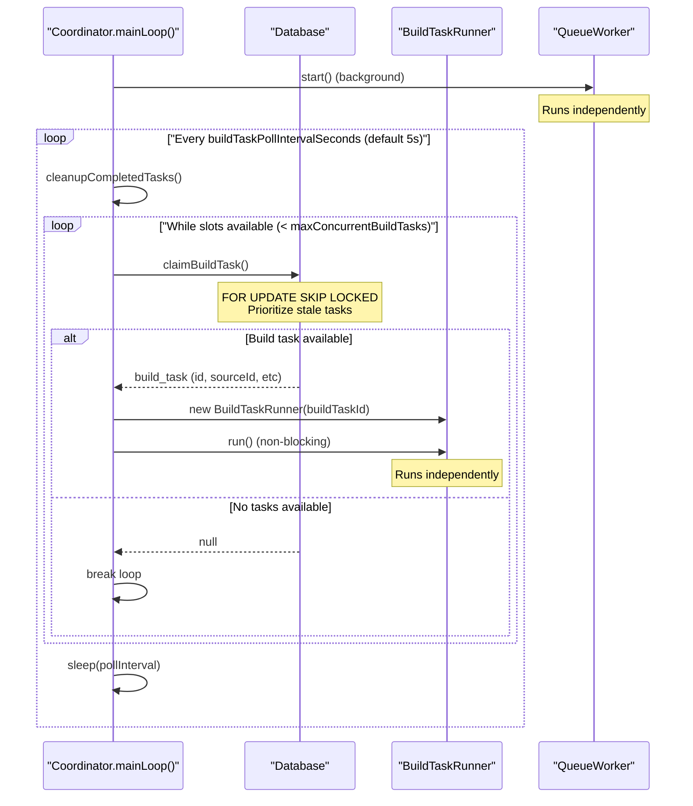
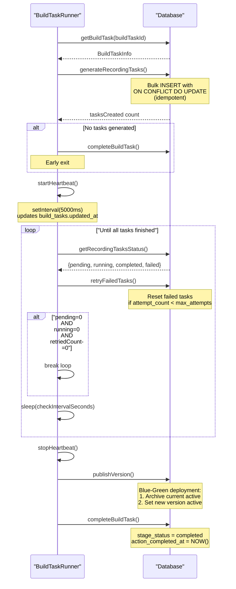
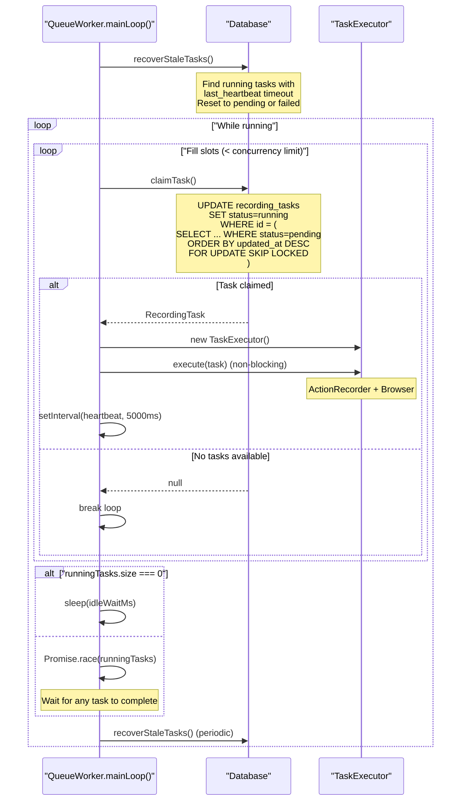
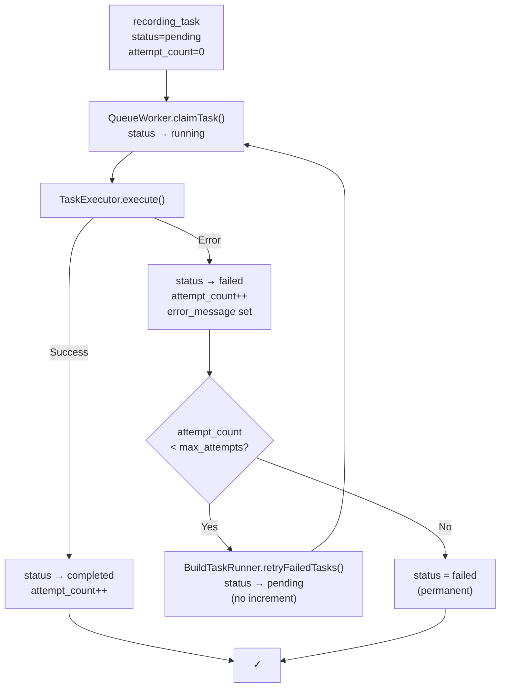

<!-- source: DeepWiki mcp.deepwiki.com · repo actionbook/actionbook · extra page Task Execution Pipeline · fetched 2026-10-26 -->

# Task Execution Pipeline

<details>
<summary>Relevant source files</summary>

The following files were used as context for generating this wiki page:

- [services/action-builder/.env.example](services/action-builder/.env.example)
- [services/action-builder/README.md](services/action-builder/README.md)
- [services/action-builder/scripts/coordinator.ts](services/action-builder/scripts/coordinator.ts)
- [services/action-builder/src/task-worker/build-task-runner.ts](services/action-builder/src/task-worker/build-task-runner.ts)
- [services/action-builder/src/task-worker/coordinator.ts](services/action-builder/src/task-worker/coordinator.ts)
- [services/action-builder/src/task-worker/recording-task-queue-worker.ts](services/action-builder/src/task-worker/recording-task-queue-worker.ts)
- [services/action-builder/test/coordinator.integration.it.test.ts](services/action-builder/test/coordinator.integration.it.test.ts)
- [services/action-builder/test/task-worker/integration/end-to-end.it.test.ts](services/action-builder/test/task-worker/integration/end-to-end.it.test.ts)

</details>


## Purpose and Scope

The Task Execution Pipeline is the core orchestration system in the Action Builder service that manages concurrent execution of website capability recording. It implements a 3-layer architecture with stateless recovery, automatic retry, and distributed task consumption.

This page covers the task orchestration components (`Coordinator`, `BuildTaskRunner`, `RecordingTaskQueueWorker`) and their lifecycle management. For details on how individual recording tasks discover and register UI elements, see [Action Recording](#3.2.2). For the tool definitions used during recording, see [Recording Tools Reference](#3.2.3).

**Sources:** [services/action-builder/README.md:153-191](), [services/action-builder/src/task-worker/coordinator.ts:1-10]()

---

## Architecture Overview

The Task Execution Pipeline implements a producer-consumer architecture with three distinct layers that coordinate through database state.

### Three-Layer Architecture



**Responsibilities by Layer:**

| Layer | Component | Responsibilities |
|-------|-----------|------------------|
| Layer 1 | `Coordinator` | Claims `build_tasks`, spawns `BuildTaskRunner` instances, enforces concurrency limit (max N build_tasks), monitors metrics |
| Layer 2 | `BuildTaskRunner` | Generates `recording_tasks` for one build, polls task status, retries failed tasks, updates build status, publishes versions |
| Layer 3 | `RecordingTaskQueueWorker` | Claims pending `recording_tasks` (global queue), spawns `TaskExecutor` instances, enforces concurrency limit (max M tasks), recovers stale tasks |

**Sources:** [services/action-builder/README.md:159-191](), [services/action-builder/src/task-worker/coordinator.ts:1-10](), [services/action-builder/src/task-worker/build-task-runner.ts:1-15](), [services/action-builder/src/task-worker/recording-task-queue-worker.ts:1-16]()

---

## Task Lifecycle

### Build Task State Transitions

The `build_tasks` table tracks the overall build pipeline with two-dimensional state (`stage` and `stage_status`):



**Key Methods:**
- `Coordinator.claimBuildTask()` - Atomically claims a build_task using `FOR UPDATE SKIP LOCKED` [services/action-builder/src/task-worker/coordinator.ts:163-206]()
- `BuildTaskRunner.run()` - Main lifecycle execution [services/action-builder/src/task-worker/build-task-runner.ts:59-114]()
- `BuildTaskRunner.completeBuildTask()` - Marks build complete [services/action-builder/src/task-worker/build-task-runner.ts:376-386]()
- `BuildTaskRunner.publishVersion()` - Blue-Green version deployment [services/action-builder/src/task-worker/build-task-runner.ts:389-459]()

**Sources:** [services/action-builder/src/task-worker/coordinator.ts:159-206](), [services/action-builder/src/task-worker/build-task-runner.ts:59-114]()

### Recording Task State Transitions

The `recording_tasks` table tracks individual recording executions with status field and retry logic:



**Key Methods:**
- `BuildTaskRunner.generateRecordingTasks()` - Creates tasks from chunks [services/action-builder/src/task-worker/build-task-runner.ts:154-226]()
- `RecordingTaskQueueWorker.claimTask()` - Atomically claims pending task [services/action-builder/src/task-worker/recording-task-queue-worker.ts:201-245]()
- `BuildTaskRunner.retryFailedTasks()` - Resets failed tasks to pending [services/action-builder/src/task-worker/build-task-runner.ts:298-336]()
- `RecordingTaskQueueWorker.recoverStaleTasks()` - Recovers tasks with stale heartbeat [services/action-builder/src/task-worker/recording-task-queue-worker.ts:304-352]()

**Sources:** [services/action-builder/src/task-worker/build-task-runner.ts:154-226](), [services/action-builder/src/task-worker/recording-task-queue-worker.ts:201-245](), [services/action-builder/src/task-worker/recording-task-queue-worker.ts:304-352]()

---

## Components

### Coordinator

The `Coordinator` class is the top-level orchestrator that manages the entire pipeline.

**Class Definition:**
```typescript
class Coordinator {
  constructor(db: Database, config: CoordinatorConfig)
  async start(): Promise<void>
  async stop(timeoutMs?: number): Promise<void>
  getStatus(): CoordinatorStatus
}
```

**Main Loop Execution Flow:**



**Configuration Options:**

| Parameter | Default | Description |
|-----------|---------|-------------|
| `maxConcurrentBuildTasks` | 5 | Max number of simultaneous build_tasks (different sources) |
| `buildTaskPollIntervalSeconds` | 5 | How often to check for new build_tasks |
| `buildTaskStaleTimeoutMinutes` | 15 | Stale threshold for `action_build/running` tasks (crash recovery) |
| `buildTaskRunner` | `{}` | Config passed to `BuildTaskRunner` instances |
| `queueWorker` | `{}` | Config for the global `RecordingTaskQueueWorker` |

**Graceful Shutdown:**
The `stop()` method implements graceful shutdown with timeout:
1. Stops accepting new build_tasks (`running = false`)
2. Stops `RecordingTaskQueueWorker` (waits for running tasks)
3. Waits for all `BuildTaskRunner` instances to complete
4. Enforces timeout to prevent indefinite waiting

**Sources:** [services/action-builder/src/task-worker/coordinator.ts:39-123](), [services/action-builder/src/task-worker/coordinator.ts:125-157](), [scripts/coordinator.ts:12-76]()

### BuildTaskRunner

The `BuildTaskRunner` class orchestrates a single build_task lifecycle.

**Class Definition:**
```typescript
class BuildTaskRunner {
  constructor(db: Database, buildTaskId: number, config: BuildTaskRunnerConfig)
  async run(): Promise<void>
  stop(): void
}
```

**Execution Flow:**



**Recording Task Generation:**
The `generateRecordingTasks()` method uses an idempotent UPSERT pattern [services/action-builder/src/task-worker/build-task-runner.ts:154-226]():
- Queries all chunks for the `source_version_id`
- Creates one `recording_task` per chunk
- Uses `ON CONFLICT DO UPDATE` with target `(chunk_id, build_task_id)`
- Only resets tasks in `pending/running` state (preserves `completed/failed`)

**Polling and Retry:**
The polling loop [services/action-builder/src/task-worker/build-task-runner.ts:231-263]():
1. Queries task status counts grouped by status
2. Retries failed tasks (if `attempt_count < max_attempts`)
3. Waits until `pending=0 AND running=0 AND retriedCount=0`
4. **Important:** Permanent failures (`attempt_count >= max_attempts`) do NOT block completion

**Sources:** [services/action-builder/src/task-worker/build-task-runner.ts:39-114](), [services/action-builder/src/task-worker/build-task-runner.ts:154-226](), [services/action-builder/src/task-worker/build-task-runner.ts:231-263]()

### RecordingTaskQueueWorker

The `RecordingTaskQueueWorker` (also called `QueueWorker`) is the global consumer that executes recording_tasks from all build_tasks.

**Class Definition:**
```typescript
class RecordingTaskQueueWorker {
  constructor(db: Database, config: RecordingTaskQueueWorkerConfig)
  async start(): Promise<void>
  async stop(timeoutMs?: number): Promise<void>
  getStatus(): WorkerStatus
}
```

**Main Loop Execution:**



**Task Claiming:**
The `claimTask()` method implements atomic claiming [services/action-builder/src/task-worker/recording-task-queue-worker.ts:201-245]():
- Uses `FOR UPDATE SKIP LOCKED` to avoid contention
- Orders by `updated_at DESC` to prioritize recently retried tasks
- Atomically updates status to `running` and sets `started_at`, `last_heartbeat`

**Concurrency Control:**
- Maintains a `Map<taskId, RunningTask>` of executing tasks
- Each `RunningTask` includes: executor instance, heartbeat timer, promise
- Enforces max concurrent limit before claiming new tasks
- Uses `Promise.race()` to wait for any task completion

**Sources:** [services/action-builder/src/task-worker/recording-task-queue-worker.ts:44-86](), [services/action-builder/src/task-worker/recording-task-queue-worker.ts:154-195](), [services/action-builder/src/task-worker/recording-task-queue-worker.ts:201-245]()

### TaskExecutor

The `TaskExecutor` class wraps the execution of a single recording_task. It is responsible for:
- Initializing browser and ActionRecorder
- Executing the recording loop (see [Action Recording](#3.2.2))
- Updating task status and progress
- Handling errors and timeouts

**Note:** The actual implementation of `TaskExecutor` is not included in the provided files, but is referenced throughout the codebase. It serves as the bridge between task orchestration and action recording.

**Sources:** [services/action-builder/src/task-worker/recording-task-queue-worker.ts:250-285]()

---

## Concurrency Control

The pipeline implements concurrency control at two levels:

### Build Task Concurrency

| Parameter | Environment Variable | Default | Description |
|-----------|---------------------|---------|-------------|
| `maxConcurrentBuildTasks` | `ACTION_BUILDER_BUILD_TASK_CONCURRENCY` | 5 | Max number of different sources processed simultaneously |

**Mechanism:**
- `Coordinator` maintains `Map<buildTaskId, RunningBuildTask>`
- Before claiming new tasks, checks `runningBuildTasks.size < maxConcurrentBuildTasks`
- Each `BuildTaskRunner` runs independently in background

**Why Limit:** Different sources may have different characteristics (page count, complexity). Limiting concurrent builds prevents resource exhaustion.

### Recording Task Concurrency

| Parameter | Environment Variable | Default | Description |
|-----------|---------------------|---------|-------------|
| `concurrency` | `ACTION_BUILDER_RECORDING_TASK_CONCURRENCY` | 3 | Max number of browser instances running simultaneously (global queue) |

**Mechanism:**
- `RecordingTaskQueueWorker` maintains `Map<taskId, RunningTask>`
- Before claiming new tasks, checks `runningTasks.size < concurrency`
- Each `TaskExecutor` runs in a separate browser context

**Why Limit:** Each recording task launches a browser instance, which consumes significant CPU and memory. The global concurrency limit prevents system overload.

### Atomic Task Claiming

Both `build_tasks` and `recording_tasks` use PostgreSQL's `FOR UPDATE SKIP LOCKED` to enable concurrent claiming without conflicts:

```sql
UPDATE recording_tasks
SET status = 'running', started_at = NOW(), last_heartbeat = NOW()
WHERE id = (
  SELECT id FROM recording_tasks
  WHERE status = 'pending'
  ORDER BY updated_at DESC, id
  LIMIT 1
  FOR UPDATE SKIP LOCKED  -- Skip locked rows, prevents waiting
)
RETURNING *
```

This pattern ensures:
- Multiple workers can claim tasks concurrently
- No worker ever claims the same task twice
- No blocking waits (skip locked rows instead of waiting)

**Sources:** [services/action-builder/src/task-worker/coordinator.ts:163-206](), [services/action-builder/src/task-worker/recording-task-queue-worker.ts:201-245](), [services/action-builder/.env.example:93-116]()

---

## Heartbeat and Monitoring

### Heartbeat Mechanism

The system uses different heartbeat strategies for different task types:

| Task Type | Field | Update Interval | Timeout | Updated By |
|-----------|-------|-----------------|---------|------------|
| `build_tasks` | `updated_at` | 5 seconds | 15 minutes | `BuildTaskRunner.updateHeartbeat()` |
| `recording_tasks` | `last_heartbeat` | 5 seconds | 15 minutes | `RecordingTaskQueueWorker.updateTaskHeartbeat()` |

**Implementation:**

```typescript
// BuildTaskRunner heartbeat (services/action-builder/src/task-worker/build-task-runner.ts:341-372)
private startHeartbeat(): void {
  this.heartbeatTimer = setInterval(() => {
    this.updateHeartbeat().catch(console.error);
  }, this.config.heartbeatIntervalMs); // Default 5000ms
}

private async updateHeartbeat(): Promise<void> {
  await this.db
    .update(buildTasks)
    .set({ updatedAt: new Date() })
    .where(eq(buildTasks.id, this.buildTaskId));
}
```

```typescript
// QueueWorker heartbeat (services/action-builder/src/task-worker/recording-task-queue-worker.ts:250-298)
const heartbeatTimer = setInterval(() => {
  this.updateTaskHeartbeat(task.id).catch(console.error);
}, this.config.heartbeatIntervalMs); // Default 5000ms

private async updateTaskHeartbeat(taskId: number): Promise<void> {
  await this.db
    .update(recordingTasks)
    .set({ lastHeartbeat: new Date(), updatedAt: new Date() })
    .where(eq(recordingTasks.id, taskId));
}
```

### Metrics Output

The `Coordinator` outputs metrics every 30 seconds [services/action-builder/src/task-worker/coordinator.ts:250-316]():

```
[Metrics] build_tasks=2/5, recording_tasks=3/3, elapsed=30.0s
  #123 [arxiv.org] tasks=15+1/50 (32.0%) elapsed=1.5min
  #124 [github.com] tasks=8+0/25 (32.0%) elapsed=0.8min
```

**Metrics Format:**
- `build_tasks=X/Y`: X running builds out of Y max concurrent
- `recording_tasks=X/Y`: X running recordings out of Y concurrency limit
- Per build details:
  - `#123`: build_task ID
  - `[arxiv.org]`: source name
  - `tasks=15+1/50`: 15 completed + 1 failed / 50 total
  - `(32.0%)`: completion percentage
  - `elapsed=1.5min`: time since `action_started_at`

**Sources:** [services/action-builder/src/task-worker/build-task-runner.ts:341-372](), [services/action-builder/src/task-worker/recording-task-queue-worker.ts:250-298](), [services/action-builder/src/task-worker/coordinator.ts:250-316]()

---

## Failure Handling

### Retry Logic

The system implements multi-level retry with attempt counting:

**Recording Task Retry:**



**Key Points:**
- `attempt_count` increments when `TaskExecutor` starts execution (whether success or failure)
- `BuildTaskRunner.retryFailedTasks()` resets `failed` → `pending` without incrementing attempts
- Only tasks with `attempt_count < max_attempts` are retriable
- Permanent failures do NOT block build_task completion

**Sources:** [services/action-builder/src/task-worker/build-task-runner.ts:298-336](), [services/action-builder/README.md:336-354]()

### Stale Detection and Recovery

Stale detection handles processes that crash or hang without updating heartbeat:

**Build Task Stale Recovery:**

Performed by `Coordinator.claimBuildTask()` [services/action-builder/src/task-worker/coordinator.ts:163-206]():

```sql
UPDATE build_tasks
SET stage = 'action_build', stage_status = 'running',
    action_started_at = COALESCE(action_started_at, NOW()),
    updated_at = NOW()
WHERE id = (
  SELECT id FROM build_tasks
  WHERE
    (stage = 'knowledge_build' AND stage_status = 'completed')  -- New tasks
    OR
    (stage = 'action_build' AND stage_status = 'running' AND updated_at < staleThreshold)  -- Stale tasks
  ORDER BY
    CASE WHEN stage = 'action_build' THEN 0 ELSE 1 END,  -- Prioritize stale recovery
    id
  LIMIT 1
  FOR UPDATE SKIP LOCKED
)
RETURNING id
```

**Recording Task Stale Recovery:**

Performed by `RecordingTaskQueueWorker.recoverStaleTasks()` [services/action-builder/src/task-worker/recording-task-queue-worker.ts:304-352]():

```sql
WITH stale_tasks AS (
  SELECT
    id,
    attempt_count,
    CASE
      WHEN attempt_count < max_attempts THEN 'pending'
      ELSE 'failed'
    END AS new_status
  FROM recording_tasks
  WHERE status = 'running' AND last_heartbeat < staleThreshold
)
UPDATE recording_tasks
SET
  status = stale_tasks.new_status,
  attempt_count = CASE
    WHEN stale_tasks.new_status = 'pending' THEN attempt_count + 1
    ELSE attempt_count
  END,
  error_message = CASE
    WHEN stale_tasks.new_status = 'failed' THEN 'Task stale: max attempts reached'
    ELSE NULL
  END
FROM stale_tasks
WHERE recording_tasks.id = stale_tasks.id
```

**Stale Recovery Flow:**

| Scenario | Detection | Action | Result |
|----------|-----------|--------|--------|
| `build_task` stale | `updated_at < threshold` (15min) | Re-claim with priority | `BuildTaskRunner` regenerates tasks (idempotent UPSERT) |
| `recording_task` stale (retriable) | `last_heartbeat < threshold` (15min) AND `attempt_count < max` | Reset to `pending`, increment `attempt_count` | Task re-queued for execution |
| `recording_task` stale (exhausted) | `last_heartbeat < threshold` AND `attempt_count >= max` | Mark as `failed` | Permanent failure, will not retry |

**Stateless Recovery After Crash:**

When the system crashes and restarts:
1. `Coordinator` starts and begins claiming build_tasks
2. Stale `action_build/running` tasks are detected and re-claimed (prioritized over new tasks)
3. `RecordingTaskQueueWorker` runs `recoverStaleTasks()` on startup
4. Stale `running` recording_tasks are reset to `pending` or `failed` based on attempt count
5. Normal execution resumes - no progress is lost

**Sources:** [services/action-builder/src/task-worker/coordinator.ts:163-206](), [services/action-builder/src/task-worker/recording-task-queue-worker.ts:304-352](), [services/action-builder/README.md:356-365]()

---

## Configuration

### Environment Variables

All configuration is controlled via environment variables with sensible defaults:

**Coordinator Configuration:**

| Variable | Default | Description |
|----------|---------|-------------|
| `ACTION_BUILDER_BUILD_TASK_CONCURRENCY` | `5` | Max concurrent build_tasks (different sources) |
| `ACTION_BUILDER_BUILD_TASK_POLL_INTERVAL_SECONDS` | `5` | Build task polling interval |
| `ACTION_BUILDER_BUILD_TASK_STALE_TIMEOUT_MINUTES` | `15` | Stale build_task timeout for crash recovery |

**BuildTaskRunner Configuration:**

| Variable | Default | Description |
|----------|---------|-------------|
| `ACTION_BUILDER_CHECK_INTERVAL_SECONDS` | `5` | Status check interval (how often to poll recording_tasks) |
| `ACTION_BUILDER_MAX_ATTEMPTS` | `3` | Max retry attempts for failed tasks |

**RecordingTaskQueueWorker Configuration:**

| Variable | Default | Description |
|----------|---------|-------------|
| `ACTION_BUILDER_RECORDING_TASK_CONCURRENCY` | `3` | Max concurrent recording_tasks (browser instances) |
| `ACTION_BUILDER_STALE_TIMEOUT_MINUTES` | `15` | Stale recording_task timeout |
| `ACTION_BUILDER_TASK_TIMEOUT_MINUTES` | `10` | Single task execution timeout |

**Recording Task Settings:**

| Variable | Default | Description |
|----------|---------|-------------|
| `ACTION_BUILDER_HEADLESS` | `true` | Run browser in headless mode |
| `ACTION_BUILDER_MAX_TURNS` | `30` | Maximum LLM turns per recording task |
| `OUTPUT_DIR` | `./output` | Output directory for generated YAML files |

**Logging:**

| Variable | Default | Description |
|----------|---------|-------------|
| `ACTION_BUILDER_QUIET` | `true` | Quiet mode: only task-level logs to console, detailed logs to file |

### Starting the Coordinator

**Command line:**
```bash
# Start with default settings
pnpm coordinator

# Development mode with auto-reload (quiet mode)
pnpm dev

# Verbose mode (all logs to console)
pnpm coordinator:verbose
pnpm dev:verbose
```

**Programmatic usage:**
```typescript
import { getDb } from '@actionbookdev/db';
import { Coordinator } from '@actionbookdev/action-builder/task-worker/coordinator';

const db = getDb();
const coordinator = new Coordinator(db, {
  maxConcurrentBuildTasks: 5,
  buildTaskPollIntervalSeconds: 5,
  buildTaskStaleTimeoutMinutes: 15,
  queueWorker: {
    concurrency: 3,
    staleTimeoutMinutes: 15,
    taskTimeoutMinutes: 10,
    databaseUrl: process.env.DATABASE_URL!,
    headless: true,
    outputDir: './output',
    maxAttempts: 3,
    maxTurns: 30,
  },
  buildTaskRunner: {
    checkIntervalSeconds: 5,
    maxAttempts: 3,
  },
});

// Start coordinator
await coordinator.start();

// Graceful shutdown
process.on('SIGINT', async () => {
  await coordinator.stop(60000); // 60 second timeout
  process.exit(0);
});
```

**Sources:** [services/action-builder/.env.example:93-142](), [services/action-builder/scripts/coordinator.ts:12-76](), [services/action-builder/README.md:205-232]()

---

## Summary

The Task Execution Pipeline provides robust, concurrent, stateless orchestration for website capability recording:

**Key Design Principles:**
1. **3-Layer Architecture** - Separation of concerns (coordination, per-build orchestration, execution)
2. **Database as State Store** - All state in database enables stateless recovery
3. **Atomic Operations** - `FOR UPDATE SKIP LOCKED` prevents conflicts
4. **Heartbeat Monitoring** - Detect and recover from crashes/hangs
5. **Graceful Degradation** - Partial failures don't block completion

**Fault Tolerance:**
- Automatic retry with attempt limiting
- Stale task detection and recovery
- Crash recovery without state loss
- Graceful shutdown with timeout

**Scalability:**
- Configurable concurrency at multiple levels
- Independent worker processes can be scaled horizontally
- Global task queue enables efficient resource utilization

For details on how recording tasks discover and register UI elements, see [Action Recording](#3.2.2).

**Sources:** [services/action-builder/README.md:153-203](), [services/action-builder/README.md:336-365]()

---

