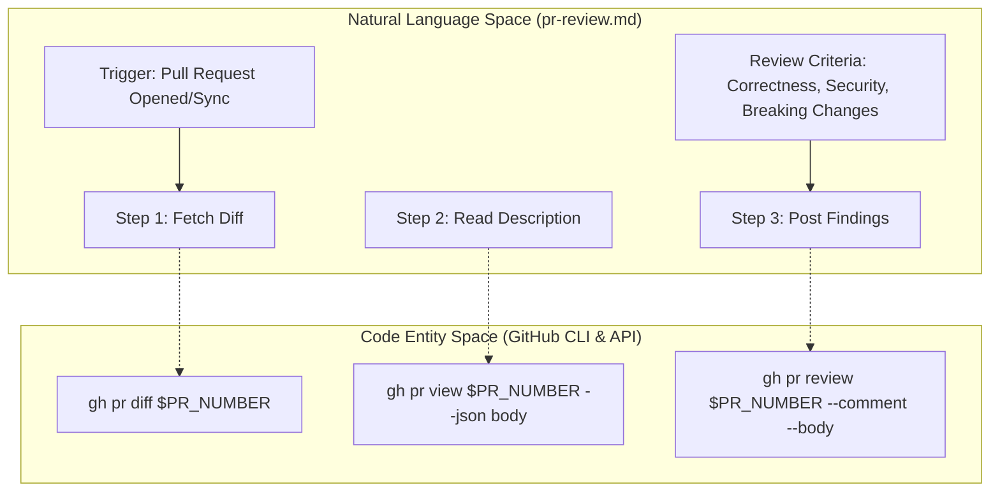
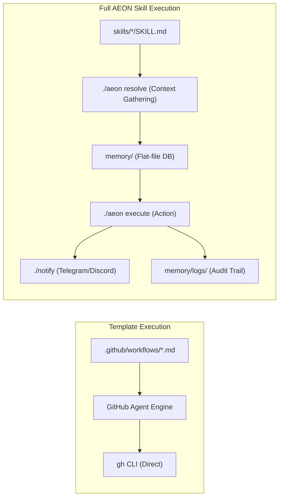

<!-- source: DeepWiki mcp.deepwiki.com · repo aaronjmars/aeon · page 10.1 Available Templates & Customization · fetched 2026-10-26 -->

# Available Templates & Customization

Relevant source files

The following files were used as context for generating this wiki page:

- [skills/auto-merge/SKILL.md](skills/auto-merge/SKILL.md)
- [skills/changelog/SKILL.md](skills/changelog/SKILL.md)
- [skills/code-health/SKILL.md](skills/code-health/SKILL.md)
- [skills/github-monitor/SKILL.md](skills/github-monitor/SKILL.md)
- [skills/issue-triage/SKILL.md](skills/issue-triage/SKILL.md)
- [skills/pr-review/SKILL.md](skills/pr-review/SKILL.md)
- [workflows/README.md](workflows/README.md)
- [workflows/changelog.md](workflows/changelog.md)
- [workflows/code-health.md](workflows/code-health.md)
- [workflows/issue-triage.md](workflows/issue-triage.md)
- [workflows/pr-review.md](workflows/pr-review.md)
- [workflows/security-digest.md](workflows/security-digest.md)

AEON provides a set of standalone GitHub Agentic Workflow templates in the `workflows/` directory [workflows/README.md:1-7](). These Markdown-based templates allow any repository to leverage AEON's logic for issue triage, PR review, and code health without requiring a full fork of the AEON system [workflows/README.md:5-6]().

## Overview of Workflow Templates

Each template is a portable `.md` file designed for the GitHub Agentic Workflows technical preview [workflows/README.md:3-5](). They wrap the core logic of AEON skills into a format that can be executed by agent engines like Claude Code or Copilot CLI [workflows/README.md:26-28]().

### Available Templates Mapping

| Template | Core AEON Skill Equivalent | Purpose |
| :--- | :--- | :--- |
| `issue-triage.md` | `skills/issue-triage` | Auto-labeling and prioritization of new issues [workflows/issue-triage.md:1-3]() |
| `pr-review.md` | `skills/pr-review` | Automated code review with severity-tagged findings [workflows/pr-review.md:1-3]() |
| `changelog.md` | `skills/changelog` | Weekly user-facing changelog generation [workflows/changelog.md:1-3]() |
| `security-digest.md` | `skills/security-scan` | Monitoring GitHub Advisory DB for vulnerabilities [workflows/security-digest.md:1-3]() |
| `code-health.md` | `skills/code-health` | Audit of TODOs, dead code, and test gaps [workflows/code-health.md:1-3]() |

Sources: [workflows/README.md:7-16](), [workflows/issue-triage.md:1-3](), [workflows/pr-review.md:1-3](), [workflows/changelog.md:1-3](), [workflows/security-digest.md:1-3](), [workflows/code-health.md:1-3]()

## Technical Implementation & Data Flow

The templates operate by providing structured instructions to an LLM-based agent. Unlike full AEON skills which use a `RESOLVE/EXECUTE` pattern and persist state in `memory/`, these templates are stateless and rely on the `gh` CLI for real-time data [workflows/README.md:38-41]().

### From Natural Language to Code Execution

The following diagram illustrates how the `pr-review.md` template bridges natural language instructions to specific GitHub CLI commands and code entities.

**Diagram: PR Review Template Logic Flow**

Sources: [workflows/pr-review.md:5-33]()

## Customization Guide

Templates are designed to be modified directly in the repository where they are deployed [workflows/README.md:32-37]().

### 1. Trigger Configuration
The `## Trigger` section in each file defines when the agent wakes up.
*   **Event-based:** `issue-triage.md` triggers on `opened` [workflows/issue-triage.md:7]().
*   **Schedule-based:** `changelog.md` defaults to Mondays at 9:00 AM UTC [workflows/changelog.md:7]().

### 2. Criteria & Logic Customization
Users can adjust the "Instructions" section to change how the agent evaluates data. For example, in `issue-triage.md`, the `Primary labels` list can be expanded to include project-specific labels like `area/frontend` or `needs-repro` [workflows/issue-triage.md:17-21]().

### 3. Project Context
To improve accuracy, users should add a `## Context` section to the templates describing:
*   Coding standards (e.g., "We prefer functional components over classes").
*   Security requirements (e.g., "All API routes must use the `withAuth` middleware").
*   Dependency management (e.g., "Do not update `peerDependencies`").

Sources: [workflows/README.md:30-37](), [workflows/issue-triage.md:9-21]()

## Comparison: Templates vs. Full Skills

While templates are portable, they lack the advanced orchestration features of the full AEON Skill system.

**Diagram: Template vs. Skill Execution Architecture**

### Key Functional Differences

| Feature | Workflow Template | Full AEON Skill |
| :--- | :--- | :--- |
| **State** | Stateless | Persistent (`memory/`) [skills/issue-triage/SKILL.md:39-40]() |
| **Multi-Repo** | Single repo only | Multi-repo via `watched-repos.md` [skills/github-monitor/SKILL.md:9-19]() |
| **Notifications** | GitHub Comments/Issues | Telegram, Discord, Slack, Email [skills/auto-merge/SKILL.md:55-61]() |
| **Audit Log** | GitHub Action Logs | Daily Markdown logs in `memory/logs/` [skills/pr-review/SKILL.md:121-128]() |
| **Complexity** | Simple (10-50 lines) | Advanced (Logic gates, safety policies) [skills/auto-merge/SKILL.md:17-31]() |

Sources: [workflows/README.md:38-41](), [skills/issue-triage/SKILL.md:39-40](), [skills/github-monitor/SKILL.md:9-19](), [skills/auto-merge/SKILL.md:17-31](), [skills/pr-review/SKILL.md:121-128]()

---

