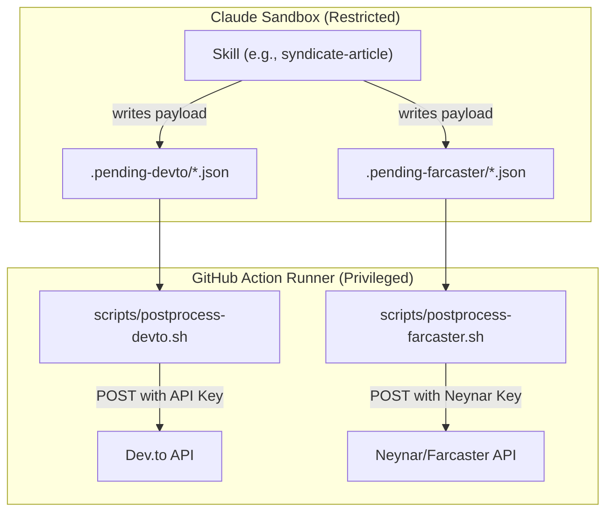
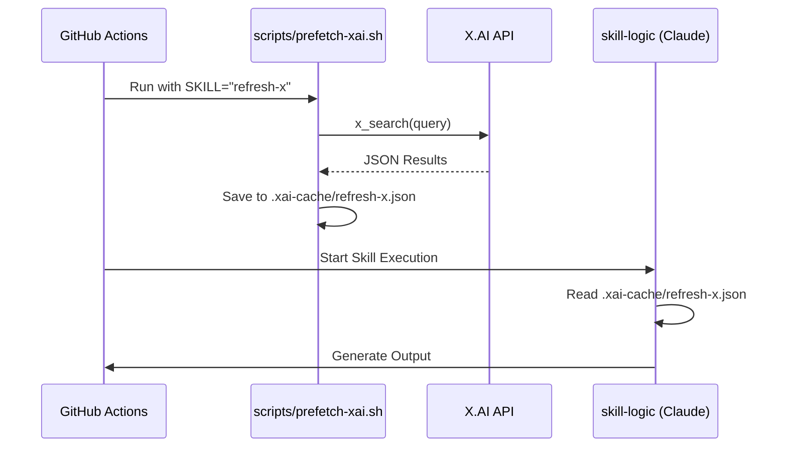

<!-- source: DeepWiki mcp.deepwiki.com · repo aaronjmars/aeon · page 2.3 Notification & Post-Processing Pipeline · fetched 2026-10-26 -->

# Notification & Post-Processing Pipeline

Relevant source files

The following files were used as context for generating this wiki page:

- [.github/workflows/aeon.yml](.github/workflows/aeon.yml)
- [.github/workflows/messages.yml](.github/workflows/messages.yml)
- [.gitignore](.gitignore)
- [add-skill](add-skill)
- [memory/issues/INDEX.md](memory/issues/INDEX.md)
- [scripts/eval-audit](scripts/eval-audit)
- [scripts/postprocess-devto.sh](scripts/postprocess-devto.sh)
- [scripts/postprocess-farcaster.sh](scripts/postprocess-farcaster.sh)
- [scripts/postprocess-replicate.sh](scripts/postprocess-replicate.sh)
- [scripts/prefetch-xai.sh](scripts/prefetch-xai.sh)
- [scripts/skill-runs](scripts/skill-runs)
- [skills/agent-buzz/SKILL.md](skills/agent-buzz/SKILL.md)
- [skills/skill-analytics/SKILL.md](skills/skill-analytics/SKILL.md)
- [skills/skill-update-check/SKILL.md](skills/skill-update-check/SKILL.md)
- [skills/syndicate-article/SKILL.md](skills/syndicate-article/SKILL.md)

The Notification and Post-Processing pipeline is AEON's mechanism for delivering high-signal updates to users and interacting with external APIs while operating within the security constraints of the Claude Code sandbox. This system uses a deferred execution pattern to bypass network restrictions, ensuring that notifications and third-party syndications (like Dev.to or Farcaster) occur reliably after the primary AI execution phase.

## Notification Delivery Architecture

The primary notification logic resides in the `./notify` script, which serves as a unified entry point for all skills to send messages. AEON supports multiple delivery channels: Telegram, Discord, Slack, and SendGrid (Email).

### Delivery Flow
When a skill invokes `./notify`, the script checks for the presence of specific environment variables to determine which channels are active. It formats the message appropriately for each platform (e.g., handling Markdown-to-HTML conversion for Telegram or SendGrid).

| Channel | Required Secrets | Implementation Details |
| :--- | :--- | :--- |
| **Telegram** | `TELEGRAM_BOT_TOKEN`, `TELEGRAM_CHAT_ID` | Sends via Bot API. Uses `parse_mode=html`. |
| **Discord** | `DISCORD_WEBHOOK_URL` (or Bot Token/Channel ID) | Supports both Webhooks and Bot API delivery. |
| **Slack** | `SLACK_BOT_TOKEN`, `SLACK_CHANNEL_ID` | Uses `chat.postMessage` via the Slack Web API. |
| **SendGrid** | `SENDGRID_API_KEY`, `NOTIFY_EMAIL` | Sends formatted HTML emails. |

**Sources:** [.github/workflows/aeon.yml:191-199](), [.github/workflows/aeon.yml:365-375]()

## The Deferred Execution Pattern

Because the `claude-code` sandbox environment restricts certain types of outbound network requests (specifically those requiring sensitive headers or complex auth), AEON utilizes a **Pending Buffer Pattern**.

1.  **Stage (Inside Sandbox):** The skill logic identifies an action (like syndicating an article) and writes a JSON payload to a specific hidden directory (e.g., `.pending-devto/`).
2.  **Commit (Sandbox Exit):** The skill execution finishes, and any file changes are committed to the repository.
3.  **Execute (Post-Process):** The GitHub Actions workflow runs a series of `postprocess-*.sh` scripts. These scripts run in the standard runner environment (outside the sandbox), where they have full access to secrets and the `curl` utility.

### Code Entity Mapping: Sandbox to Post-Processor

The following diagram bridges the "Natural Language Space" (the intent to post) to the "Code Entity Space" (the scripts and directories that handle it).

**Diagram: Sandbox Escape via Pending Payloads**

**Sources:** [skills/syndicate-article/SKILL.md:109-134](), [scripts/postprocess-devto.sh:6-26](), [scripts/postprocess-farcaster.sh:9-37]()

## Post-Processing Scripts

AEON includes several specialized post-processors that consume the `.pending-*` buffers.

### Dev.to Syndication
The `postprocess-devto.sh` script monitors the `.pending-devto/` directory. It uses the `DEVTO_API_KEY` to publish articles to the Dev Community. It handles `201 Created` responses by logging the new article URL and `422` responses by cleaning up duplicate payloads.
**Sources:** [scripts/postprocess-devto.sh:17-42]()

### Farcaster (via Neynar)
The `postprocess-farcaster.sh` script delivers "casts" to Farcaster. It is unique because it injects the `NEYNAR_SIGNER_UUID` into the JSON payload at runtime. This ensures that the sensitive Signer UUID is never written to the disk/repository, only existing in the runner's memory during the `curl` call.
**Sources:** [scripts/postprocess-farcaster.sh:25-37]()

### Replicate & AI Generation
The `postprocess-replicate.sh` script (and associated prefetchers) handles long-running AI image generation or model inference. It allows skills to request a generation, which is then executed by the privileged runner.
**Sources:** [.gitignore:16](), [.github/workflows/aeon.yml:129]()

## Prefetching Logic

While post-processing handles *outbound* data, **Prefetching** handles *inbound* data that the sandbox might block. The `scripts/prefetch-xai.sh` script runs before the AI starts.

*   **Functionality:** It calls the X.AI (Grok) API to perform searches based on the skill name and variable (`VAR`).
*   **Caching:** Results are saved to `.xai-cache/`.
*   **Skill Integration:** Skills like `refresh-x`, `remix-tweets`, and `agent-buzz` read these cached files locally rather than attempting to call the X.AI API directly during execution.

**Diagram: Data Flow for Social Skills**

**Sources:** [scripts/prefetch-xai.sh:10-40](), [skills/agent-buzz/SKILL.md:127-133]()

## Analytics & Health Notifications

The pipeline is also used for self-observability. The `skill-analytics` and `heartbeat` skills monitor the execution logs and GitHub Actions API to detect anomalies.

*   **Exit Taxonomy:** Skills use a specific exit taxonomy (e.g., `_OK`, `_OK_SILENT`, `SKIP_UNCHANGED`, `NEW_INFO`) to signal their status.
*   **Significance Gating:** `skill-analytics` implements a significance gate. It only triggers a notification via `./notify` if an anomaly (like `🔴 SILENT` or `🔴 ALL_FAIL`) is detected. This prevents "notification fatigue" by remaining silent when the system is operating normally.

**Sources:** [skills/skill-analytics/SKILL.md:10-15](), [skills/skill-analytics/SKILL.md:72-87](), [skills/skill-analytics/SKILL.md:112-114]()

---

