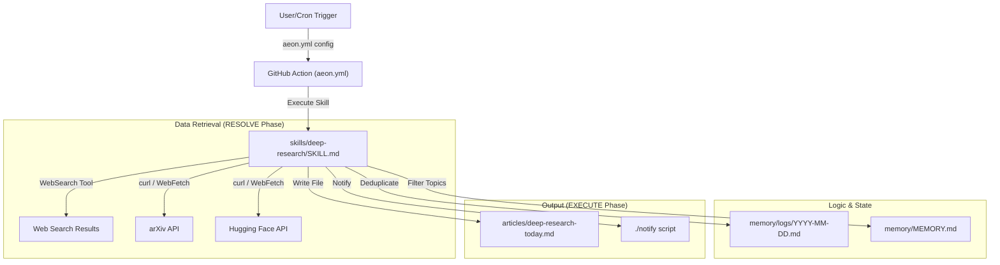
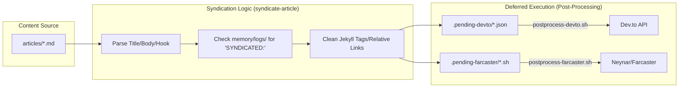

<!-- source: DeepWiki mcp.deepwiki.com · repo aaronjmars/aeon · page 3.2 Research & Content Skills · fetched 2026-10-26 -->

# Research & Content Skills

Relevant source files

The following files were used as context for generating this wiki page:

- [.gitignore](.gitignore)
- [add-skill](add-skill)
- [scripts/postprocess-farcaster.sh](scripts/postprocess-farcaster.sh)
- [skills/article/SKILL.md](skills/article/SKILL.md)
- [skills/daily-routine/SKILL.md](skills/daily-routine/SKILL.md)
- [skills/deep-research/SKILL.md](skills/deep-research/SKILL.md)
- [skills/defi-monitor/SKILL.md](skills/defi-monitor/SKILL.md)
- [skills/defi-overview/SKILL.md](skills/defi-overview/SKILL.md)
- [skills/digest/SKILL.md](skills/digest/SKILL.md)
- [skills/fetch-tweets/SKILL.md](skills/fetch-tweets/SKILL.md)
- [skills/fork-contributor-leaderboard/SKILL.md](skills/fork-contributor-leaderboard/SKILL.md)
- [skills/hacker-news-digest/SKILL.md](skills/hacker-news-digest/SKILL.md)
- [skills/list-digest/SKILL.md](skills/list-digest/SKILL.md)
- [skills/monitor-polymarket/SKILL.md](skills/monitor-polymarket/SKILL.md)
- [skills/monitor-polymarket/watchlist.md](skills/monitor-polymarket/watchlist.md)
- [skills/morning-brief/SKILL.md](skills/morning-brief/SKILL.md)
- [skills/on-chain-monitor/SKILL.md](skills/on-chain-monitor/SKILL.md)
- [skills/paper-digest/SKILL.md](skills/paper-digest/SKILL.md)
- [skills/paper-pick/SKILL.md](skills/paper-pick/SKILL.md)
- [skills/reddit-digest/SKILL.md](skills/reddit-digest/SKILL.md)
- [skills/refresh-x/SKILL.md](skills/refresh-x/SKILL.md)
- [skills/remix-tweets/SKILL.md](skills/remix-tweets/SKILL.md)
- [skills/research-brief/SKILL.md](skills/research-brief/SKILL.md)
- [skills/rss-digest/SKILL.md](skills/rss-digest/SKILL.md)
- [skills/skill-leaderboard/SKILL.md](skills/skill-leaderboard/SKILL.md)
- [skills/skill-update-check/SKILL.md](skills/skill-update-check/SKILL.md)
- [skills/syndicate-article/SKILL.md](skills/syndicate-article/SKILL.md)
- [skills/technical-explainer/SKILL.md](skills/technical-explainer/SKILL.md)
- [skills/token-alert/SKILL.md](skills/token-alert/SKILL.md)
- [skills/vibecoding-digest/SKILL.md](skills/vibecoding-digest/SKILL.md)

The **Research & Content Skills** category comprises modular agents designed to aggregate, curate, and synthesize information from diverse sources—including social media, academic repositories, and web search—into structured reports and articles. These skills leverage a two-phase execution pattern: **RESOLVE** (gathering data and mapping the landscape) and **EXECUTE** (synthesis, formatting, and delivery).

## Overview of Content Pipeline

Research skills in AEON follow a rigorous "Signal over Volume" philosophy. Instead of simple aggregation, they implement filtering logic to drop low-quality or redundant information before it reaches the user.

| Skill | Primary Data Source | Key Output |
| :--- | :--- | :--- |
| `digest` | WebSearch, Grok (X) | Daily topical briefing [skills/digest/SKILL.md:2-5]() |
| `fetch-tweets` | X/Twitter (via Grok/XAI) | Clustered sub-narratives [skills/fetch-tweets/SKILL.md:2-5]() |
| `paper-digest` | arXiv, Hugging Face | Research synthesis with "So what" insights [skills/paper-digest/SKILL.md:2-5]() |
| `reddit-digest` | Reddit JSON API | Cross-subreddit narrative detection [skills/reddit-digest/SKILL.md:2-5]() |
| `deep-research` | 30-50 Web/Academic sources | Analyst-grade reports with source tiering [skills/deep-research/SKILL.md:2-5]() |
| `syndicate-article` | Local `articles/` directory | Cross-posts to Dev.to and Farcaster [skills/syndicate-article/SKILL.md:2-5]() |

**Sources:** [skills/digest/SKILL.md](), [skills/fetch-tweets/SKILL.md](), [skills/paper-digest/SKILL.md](), [skills/reddit-digest/SKILL.md](), [skills/deep-research/SKILL.md](), [skills/syndicate-article/SKILL.md]()

---

## Data Flow: From Search to Synthesis

Research skills utilize a tiered retrieval system to bypass sandbox limitations and ensure data freshness.

### Natural Language to Code Entity Mapping
The following diagram illustrates how a research request (e.g., "Deep Research on AI Security") traverses the system components.

**Research Execution Path**

**Sources:** [skills/deep-research/SKILL.md:33-69](), [skills/paper-digest/SKILL.md:24-48](), [skills/digest/SKILL.md:15-28]()

---

## Technical Implementation Details

### 1. Source Credibility & Tiering
The `deep-research` skill implements a **CRAAP-lite** rubric to score sources on Authority, Recency, and Verifiability [skills/deep-research/SKILL.md:84-105]().
- **T1 (Tier 1):** Peer-reviewed papers, official docs (Score 8-9) [skills/deep-research/SKILL.md:98-99]().
- **T2 (Tier 2):** Reputable news, academic preprints (Score 5-7) [skills/deep-research/SKILL.md:100-101]().
- **T3 (Tier 3):** Social posts, commentary (Score ≤4) [skills/deep-research/SKILL.md:101-101]().

### 2. Narrative Detection (Reddit)
The `reddit-digest` skill identifies "cross-sub narratives"—stories appearing in multiple unrelated subreddits—using Jaccard similarity on normalized word sets of post titles [skills/reddit-digest/SKILL.md:72-76](). It calculates a `narrative_signal` score that gives a bonus for cross-community engagement [skills/reddit-digest/SKILL.md:84-90]().

### 3. X/Twitter Clustering
`fetch-tweets` clusters candidates into 2–4 sub-narratives (e.g., "price action" vs "ecosystem integration") [skills/fetch-tweets/SKILL.md:55-58](). It uses a persistent seen-file at `memory/fetch-tweets-seen.txt` to prevent duplicate notifications [skills/fetch-tweets/SKILL.md:14-18]().

**Sources:** [skills/deep-research/SKILL.md](), [skills/reddit-digest/SKILL.md](), [skills/fetch-tweets/SKILL.md]()

---

## Syndication & Distribution

Once an article is generated in the `articles/` directory, the `syndicate-article` skill manages cross-posting.

**Syndication Pipeline**

### Key Functions in Syndication:
- **Hook Extraction:** Attempts to find an explicit TL;DR or a "strongest line" (containing numbers or concrete verbs) to use as the Farcaster cast [skills/syndicate-article/SKILL.md:72-89]().
- **Canonical URLs:** Generates SEO-friendly URLs pointing back to the GitHub Pages site [skills/syndicate-article/SKILL.md:91-96]().
- **Post-Processing:** Because the GitHub Actions sandbox may block direct API calls with auth headers, payloads are written to `.pending-*` directories for execution by separate scripts [skills/syndicate-article/SKILL.md:109-133](), [scripts/postprocess-farcaster.sh]().

**Sources:** [skills/syndicate-article/SKILL.md:44-50](), [skills/syndicate-article/SKILL.md:61-70](), [skills/syndicate-article/SKILL.md:72-89](), [skills/syndicate-article/SKILL.md:109-113]()

---

## Meta-Research: Fleet & Skill Leaderboards

The system also includes research skills that analyze the AEON ecosystem itself.

| Skill | Logic |
| :--- | :--- |
| `skill-leaderboard` | Scans forks to see which skills are `enabled: true` in `aeon.yml`, excluding untouched templates [skills/skill-leaderboard:11-16](). |
| `fork-contributor-leaderboard` | Ranks developers based on merged PRs, reviews, fork commits, and "new skills" detected in their forks [skills/fork-contributor-leaderboard:60-69](). |
| `skill-update-check` | Compares local `skills.lock` against upstream SHAs to detect drift and security regressions [skills/skill-update-check:12-14](). |

**Sources:** [skills/skill-leaderboard/SKILL.md](), [skills/fork-contributor-leaderboard/SKILL.md](), [skills/skill-update-check/SKILL.md]()

---

