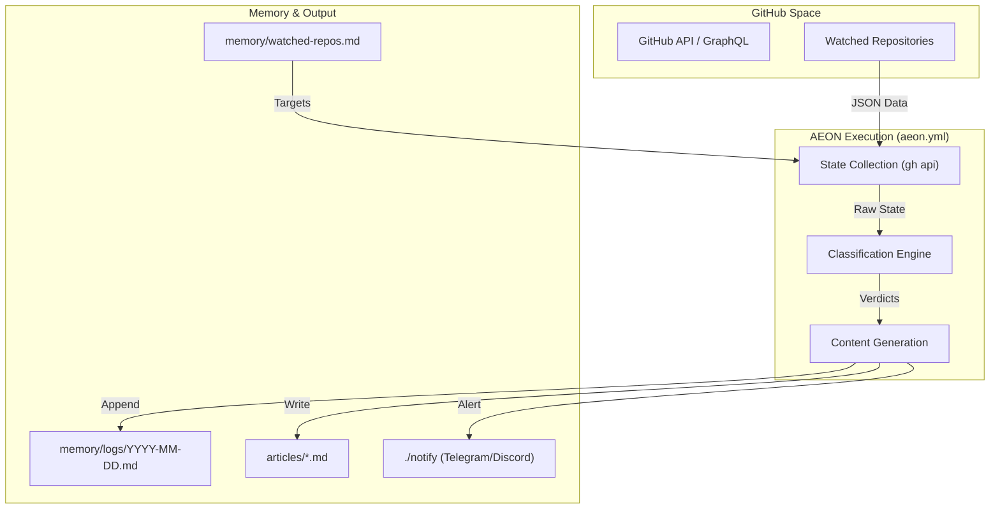
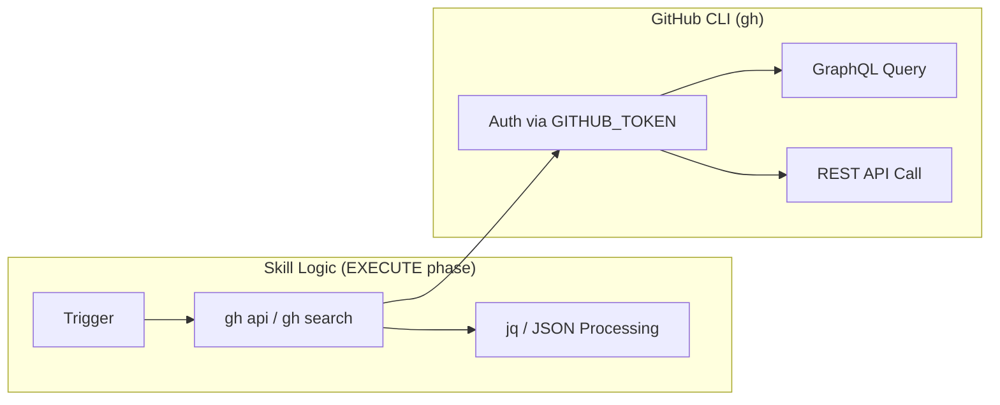

<!-- source: DeepWiki mcp.deepwiki.com · repo aaronjmars/aeon · page 3.3 Dev & GitHub Skills · fetched 2026-10-26 -->

# Dev & GitHub Skills

Relevant source files

The following files were used as context for generating this wiki page:

- [skills/auto-merge/SKILL.md](skills/auto-merge/SKILL.md)
- [skills/changelog/SKILL.md](skills/changelog/SKILL.md)
- [skills/code-health/SKILL.md](skills/code-health/SKILL.md)
- [skills/github-issues/SKILL.md](skills/github-issues/SKILL.md)
- [skills/github-monitor/SKILL.md](skills/github-monitor/SKILL.md)
- [skills/github-releases/SKILL.md](skills/github-releases/SKILL.md)
- [skills/github-trending/SKILL.md](skills/github-trending/SKILL.md)
- [skills/issue-triage/SKILL.md](skills/issue-triage/SKILL.md)
- [skills/monitor-runners/SKILL.md](skills/monitor-runners/SKILL.md)
- [skills/pr-review/SKILL.md](skills/pr-review/SKILL.md)
- [skills/push-recap/SKILL.md](skills/push-recap/SKILL.md)
- [skills/repo-actions/SKILL.md](skills/repo-actions/SKILL.md)
- [skills/repo-article/SKILL.md](skills/repo-article/SKILL.md)
- [skills/repo-pulse/SKILL.md](skills/repo-pulse/SKILL.md)
- [workflows/README.md](workflows/README.md)
- [workflows/changelog.md](workflows/changelog.md)
- [workflows/code-health.md](workflows/code-health.md)
- [workflows/issue-triage.md](workflows/issue-triage.md)
- [workflows/pr-review.md](workflows/pr-review.md)
- [workflows/security-digest.md](workflows/security-digest.md)

The Dev & GitHub skills category encompasses a suite of autonomous agents designed to monitor repository health, triage community input, review code contributions, and synthesize development activity into human-readable intelligence. These skills leverage the `gh` CLI and GitHub GraphQL API to act as a virtual maintainer and technical writer.

## Architecture & Data Flow

Development skills follow a multi-phase pattern: state collection via GitHub APIs, classification/scoring based on repository-specific heuristics, and delivery of "decision-ready" outputs.

### High-Level Data Flow

The following diagram illustrates how raw GitHub events are transformed into structured memory and actionable notifications.

**Figure 1: GitHub Skill Data Pipeline**

**Sources:** [skills/github-monitor/SKILL.md:27-52](), [skills/issue-triage/SKILL.md:42-63](), [skills/push-recap/SKILL.md:23-48]()

## Core Development Skills

### GitHub Monitor & Triage
These skills reduce maintainer fatigue by filtering noise and highlighting items requiring immediate attention.

*   **`github-monitor`**: Scans for stale PRs, new issues, and releases. It classifies items into `ACT NOW` (e.g., CI failure, security labels), `REVIEW`, and `INFO` tiers [skills/github-monitor/SKILL.md:53-79]().
*   **`issue-triage`**: Implements a "decision-first" policy. For every new issue, it emits one of four verdicts: `ACCEPT`, `NEEDS-INFO`, `DUPLICATE`, or `DECLINE` [skills/issue-triage/SKILL.md:13-23](). It uses title token overlap (≥70%) for duplicate detection [skills/issue-triage/SKILL.md:78-83]().
*   **`pr-review`**: Conducts automated code reviews with severity-tagged findings (`[CRITICAL]`, `[ISSUE]`, `[NIT]`) [skills/pr-review/SKILL.md:66-70](). It posts both a consolidated summary and line-specific inline comments using `gh api repos/owner/repo/pulls/NUMBER/comments` [skills/pr-review/SKILL.md:82-92]().

### Activity Synthesis
These skills transform raw commit logs into high-level technical narratives.

*   **`push-recap`**: Performs a daily deep-dive into pushes. It classifies commits as **user-visible**, **internal**, or **infra** based on file paths [skills/push-recap/SKILL.md:49-68](). It ranks impact using a formula: `impact = (additions + deletions) × user_visible_multiplier × breadth_multiplier` [skills/push-recap/SKILL.md:71-77]().
*   **`changelog`**: Generates a weekly user-facing changelog following the "Keep a Changelog" format. It rewrites imperative dev-speak into past-tense user statements [skills/changelog/SKILL.md:13-14](), [skills/changelog/SKILL.md:93-101]().
*   **`repo-article`**: Writes thesis-driven articles about a repository. It requires a **falsifiable claim** (≤25 words) that must be disprovable by specific evidence [skills/repo-article/SKILL.md:68-78]().

### Repository Maintenance & Growth
*   **`auto-merge`**: Automatically merges PRs that pass a strict safety policy (author allowlist, size cap ≤ 500 lines, passing CI, no conflicts) [skills/auto-merge/SKILL.md:17-31]().
*   **`repo-pulse`**: Tracks growth metrics (stars, forks, releases). It includes "notable-stargazer" enrichment, flagging users with ≥100 followers [skills/repo-pulse/SKILL.md:77-83]().
*   **`github-trending`**: Curates a slate of 5-8 trending repos, filtering out "noise" like meta-lists, tutorials, and dotfiles [skills/github-trending/SKILL.md:15-18](), [skills/github-trending/SKILL.md:47-55]().

## Implementation Details

### State Collection Patterns
Skills primarily use the `gh` CLI to interact with GitHub. This bypasses many sandbox restrictions regarding outbound `curl` calls and handles authentication via the `GITHUB_TOKEN` [skills/auto-merge/SKILL.md:72-74](), [skills/pr-review/SKILL.md:130-133]().

**Figure 2: API Interaction Logic**

**Sources:** [skills/repo-actions/SKILL.md:35-78](), [skills/github-issues/SKILL.md:16-40]()

### Security & Safety Gates
Because AEON skills can act on repositories (merging PRs, labeling issues), they incorporate hard-coded safety constraints:

| Skill | Safety Mechanism | Source |
| :--- | :--- | :--- |
| `auto-merge` | Author allowlist + Size cap (500 lines) | [skills/auto-merge/SKILL.md:17-23]() |
| `pr-review` | Skip if author is a bot or `aeonframework` | [skills/pr-review/SKILL.md:31-34]() |
| `issue-triage` | Label creation try/log wrapper to prevent aborts | [skills/issue-triage/SKILL.md:122-129]() |
| `repo-article` | "Enough story?" gate (Min 3 commits/week) | [skills/repo-article/SKILL.md:60-64]() |

### Memory Integration
Development skills rely on `memory/watched-repos.md` for their target list. They persist state in `memory/logs/` to perform deduplication, ensuring that the same issue or PR isn't alerted multiple times [skills/github-monitor/SKILL.md:80-89](), [skills/github-issues/SKILL.md:11-12]().

**Sources:**
- `skills/repo-article/SKILL.md`
- `skills/repo-actions/SKILL.md`
- `skills/auto-merge/SKILL.md`
- `skills/push-recap/SKILL.md`
- `skills/github-monitor/SKILL.md`
- `skills/issue-triage/SKILL.md`
- `skills/pr-review/SKILL.md`
- `skills/repo-pulse/SKILL.md`
- `skills/github-trending/SKILL.md`
- `skills/github-issues/SKILL.md`
- `skills/changelog/SKILL.md`

---

