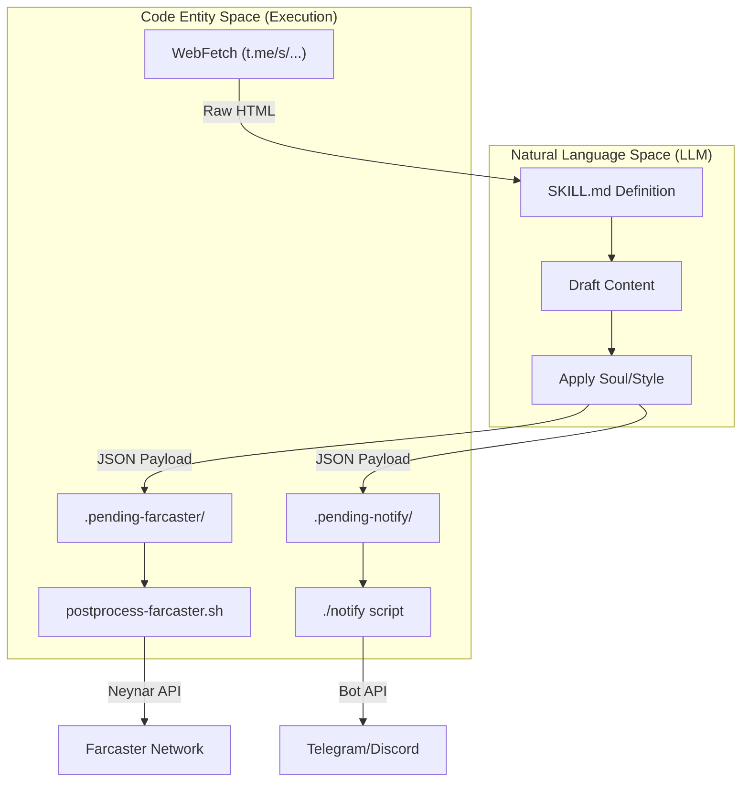
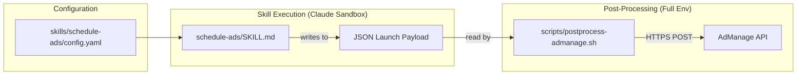

<!-- source: DeepWiki mcp.deepwiki.com · repo aaronjmars/aeon · page 3.5 Social & Productivity Skills · fetched 2026-10-26 -->

# Social & Productivity Skills

Relevant source files

The following files were used as context for generating this wiki page:

- [images/.gitkeep](images/.gitkeep)
- [scripts/postprocess-admanage-create.sh](scripts/postprocess-admanage-create.sh)
- [scripts/postprocess-admanage.sh](scripts/postprocess-admanage.sh)
- [skills/action-converter/SKILL.md](skills/action-converter/SKILL.md)
- [skills/aixbt-pulse/SKILL.md](skills/aixbt-pulse/SKILL.md)
- [skills/channel-recap/SKILL.md](skills/channel-recap/SKILL.md)
- [skills/create-campaign/SKILL.md](skills/create-campaign/SKILL.md)
- [skills/create-campaign/config.example.yaml](skills/create-campaign/config.example.yaml)
- [skills/evening-recap/SKILL.md](skills/evening-recap/SKILL.md)
- [skills/farcaster-digest/SKILL.md](skills/farcaster-digest/SKILL.md)
- [skills/goal-tracker/SKILL.md](skills/goal-tracker/SKILL.md)
- [skills/idea-capture/SKILL.md](skills/idea-capture/SKILL.md)
- [skills/polymarket-comments/SKILL.md](skills/polymarket-comments/SKILL.md)
- [skills/reply-maker/SKILL.md](skills/reply-maker/SKILL.md)
- [skills/schedule-ads/SKILL.md](skills/schedule-ads/SKILL.md)
- [skills/schedule-ads/config.example.yaml](skills/schedule-ads/config.example.yaml)
- [skills/startup-idea/SKILL.md](skills/startup-idea/SKILL.md)
- [skills/telegram-digest/SKILL.md](skills/telegram-digest/SKILL.md)
- [skills/token-movers/SKILL.md](skills/token-movers/SKILL.md)
- [skills/tool-builder/SKILL.md](skills/tool-builder/SKILL.md)
- [skills/tweet-roundup/SKILL.md](skills/tweet-roundup/SKILL.md)
- [skills/vuln-scanner/SKILL.md](skills/vuln-scanner/SKILL.md)
- [skills/weekly-review/SKILL.md](skills/weekly-review/SKILL.md)
- [skills/write-tweet/SKILL.md](skills/write-tweet/SKILL.md)

The **Social & Productivity Skills** subsystem manages AEON's external engagement and the operator's internal focus. These skills handle high-leverage content creation for X (Twitter), Farcaster, and Telegram, while also providing structured loops for personal productivity, goal tracking, and strategic planning.

## Overview of Social Engagement

AEON's social skills are designed to move beyond simple automation toward "Agentic Curation." Instead of blind posting, these skills analyze engagement metrics, cluster conversations into narratives, and apply "voice" via the `soul/` layer to ensure substantive participation.

### Data Flow: Social Content Pipeline

The social pipeline typically follows a three-stage pattern to respect the Claude sandbox limitations:
1.  **Resolve & Fetch**: Using `WebFetch` to bypass sandbox network restrictions or using `prefetch-xai.sh` to cache data.
2.  **Analyze & Draft**: Clustering posts by narrative and drafting replies/articles using the `soul/` personality.
3.  **Post-Process**: Writing payloads to `.pending-*` directories for external scripts to publish.

Title: Social Engagement Logic Flow

Sources: [skills/telegram-digest/SKILL.md:29-41](), [skills/farcaster-digest/SKILL.md:23-56](), [skills/reply-maker/SKILL.md:40-60]()

---

## Social Curation Skills

### Telegram Digest & Channel Recap
These skills ingest public Telegram data without requiring API keys by scraping the `t.me/s/` web preview.
*   **`telegram-digest`**: Aggregates multiple channels, clusters them by narrative, and provides a cross-channel "insight line" [skills/telegram-digest/SKILL.md:14-19]().
*   **`channel-recap`**: Focuses on a single channel to produce a 750–1500 word "Week in Review" article, ranking posts by an engagement score: `views + (reactions * 50)` [skills/channel-recap/SKILL.md:51-53]().

### Farcaster Digest
The `farcaster-digest` skill uses the Neynar API to fetch trending and semantic search results. It maintains a persistent deduplication state in `memory/state/farcaster-seen-hashes.json` to ensure the operator never sees the same cast twice [skills/farcaster-digest/SKILL.md:15-16]().
*   **Signal Scoring**: `likes + (2 * recasts) + (0.5 * replies)` [skills/farcaster-digest/SKILL.md:71-72]().
*   **Clustering**: Groups casts into 2–3 sub-narratives based on conversation topics rather than simple keywords [skills/farcaster-digest/SKILL.md:78-84]().

### Reply Maker & Write Tweet
*   **`reply-maker`**: Generates two distinct options for 5 high-leverage tweets: **Option A (Evidence Add)** and **Option B (Frame Challenge)** [skills/reply-maker/SKILL.md:80-91]().
*   **Anti-Sycophancy**: Explicitly filters out "filler" phrases like "Great point" or "Thanks for sharing" to maintain a substantive presence [skills/reply-maker/SKILL.md:94-98]().

---

## Productivity & Meta-Skills

These skills serve as the "Internal CEO" for the AEON instance, converting raw logs into actionable items.

### Action Converter
The core of AEON's productivity system. It reads all memory files, PR lists, and `cron-state.json` to extract "open loops" [skills/action-converter/SKILL.md:32-43]().
*   **Leverage Scoring**: Loops are scored on Leverage, Urgency, and Concreteness. Only those scoring ≥8 are converted into actions [skills/action-converter/SKILL.md:49-57]().
*   **Specificity Gate**: Rejects vague actions like "think about X." Every action must name a file, person, or URL [skills/action-converter/SKILL.md:63-64]().

### Goal Tracker & Weekly Review
*   **`goal-tracker`**: Monitors progress against the `MEMORY.md` "Next Priorities" section.
*   **`weekly-review`**: Runs every Sunday to consolidate `memory/logs/` into a strategic update, closing stale issues and updating the `SOUL.md` based on the week's learned experiences.

---

## Growth & Ad Management

AEON includes a sophisticated ad scheduling system that interacts with the `AdManage.ai` API.

Title: Ad Scheduling Architecture

Sources: [skills/schedule-ads/SKILL.md:11-13](), [skills/schedule-ads/config.example.yaml:20-31]()

### Key Safety Guardrails for Ads
| Guardrail | Implementation |
| :--- | :--- |
| **PAUSED by default** | All `POST /v1/launch` payloads are hardcoded to `status: PAUSED` [skills/schedule-ads/SKILL.md:66-71](). |
| **Spend Circuit Breaker** | `postprocess-admanage.sh` checks `GET /v1/spend/daily` and halts if `dailySpendCap` is exceeded [skills/schedule-ads/SKILL.md:29-30](). |
| **Dry Run Mode** | Payloads are written to `.pending-admanage/dryrun/` without API calls [skills/schedule-ads/SKILL.md:85-89](). |

---

## Content Generation: Startup Ideas

The `startup-idea` skill generates evidence-backed memos. It uses a "Tarpit Filter" to reject low-value ideas (e.g., generic AI wrappers) unless the operator has an "earned secret" [skills/startup-idea/SKILL.md:41-49]().

### Memo Schema Requirements
Every startup idea must include:
1.  **Pain Evidence**: 2+ permalinks to real customer complaints (Reddit, G2, etc.) [skills/startup-idea/SKILL.md:64-66]().
2.  **Kill Criteria**: A numeric, time-bound metric to stop the project (e.g., "<3 paid pilots in 60 days") [skills/startup-idea/SKILL.md:72-73]().
3.  **Wedge**: The specific first product to launch in the first 12 months [skills/startup-idea/SKILL.md:63-63]().

Sources: [skills/startup-idea/SKILL.md:58-74]()

---

