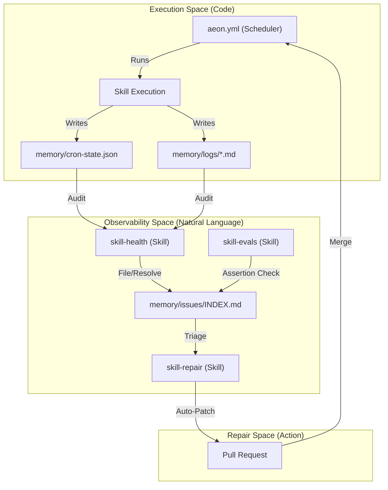
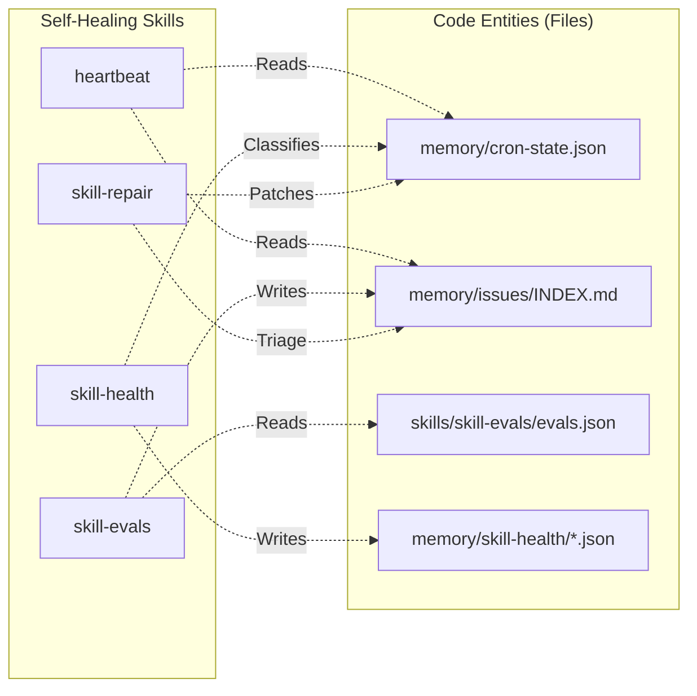

<!-- source: DeepWiki mcp.deepwiki.com · repo aaronjmars/aeon · page 4 Self-Healing & Observability · fetched 2026-10-26 -->

# Self-Healing & Observability

Relevant source files

The following files were used as context for generating this wiki page:

- [docs/_config.yml](docs/_config.yml)
- [docs/status.md](docs/status.md)
- [memory/skill-health/.gitkeep](memory/skill-health/.gitkeep)
- [skills/heartbeat/SKILL.md](skills/heartbeat/SKILL.md)
- [skills/reflect/SKILL.md](skills/reflect/SKILL.md)
- [skills/skill-evals/SKILL.md](skills/skill-evals/SKILL.md)
- [skills/skill-evals/evals.json](skills/skill-evals/evals.json)
- [skills/skill-health/SKILL.md](skills/skill-health/SKILL.md)
- [skills/skill-repair/SKILL.md](skills/skill-repair/SKILL.md)

AEON is designed as a "zero-maintenance" system that proactively monitors its own health, audits the quality of its AI-generated outputs, and attempts to repair code or configuration when failures occur. This autonomous loop ensures that the fleet of 90+ skills remains functional even as upstream APIs change or execution environments shift.

The observability stack transitions from raw execution metrics in `memory/cron-state.json` to high-level quality evaluations and automated issue tracking.

### The Self-Healing Loop

The system operates on a continuous feedback cycle where execution data informs health assessment, which in turn triggers repair or operator notification.

**Sources:** [skills/heartbeat/SKILL.md:15-42](), [skills/skill-health/SKILL.md:38-57](), [skills/skill-repair/SKILL.md:15-20]()

---

### Heartbeat & Health Monitoring
The `heartbeat` skill is AEON's primary ambient check, running 3x daily to surface critical failures. It acts as the "first responder" by scanning `memory/cron-state.json` for stuck or failing skills and regenerating the public status dashboard.

*   **P0 Monitoring:** Detects "stuck" skills (dispatched >45 mins ago) and API degradation (3+ consecutive failures) [skills/heartbeat/SKILL.md:36-41]().
*   **Public Status:** Updates `docs/status.md` with a live view of skill success rates and open issues [skills/heartbeat/SKILL.md:73-80]().
*   **Tiered Alerts:** Batches findings into priority-coded notifications (🔴 FAILED, 🟡 STALLED, 🔵 MEMORY) [skills/heartbeat/SKILL.md:64-69]().

For details, see [Heartbeat & Health Monitoring](#4.1).

**Sources:** [skills/heartbeat/SKILL.md:1-152](), [docs/status.md:1-36]()

---

### Skill Evals, Analytics & Repair
Beyond simple pass/fail execution, AEON monitors the *content quality* of its outputs. This is handled by a specialized pipeline that bridges the gap between raw files and semantic correctness.

| Component | Role | Data Source |
| :--- | :--- | :--- |
| **Skill Evals** | Validates outputs against regex and numeric assertions. | `skills/skill-evals/evals.json` [skills/skill-evals/SKILL.md:18-24]() |
| **Skill Health** | Classifies skills as `CRITICAL`, `DEGRADED`, or `FLAPPING`. | `memory/cron-state.json` [skills/skill-health/SKILL.md:38-50]() |
| **Skill Repair** | Applies per-category playbooks to auto-patch bugs. | `memory/issues/INDEX.md` [skills/skill-repair/SKILL.md:111-120]() |

The `skill-repair` skill uses an **Exit Taxonomy** to report its results, ranging from `REPAIR_OK_FIXED` (PR opened) to `REPAIR_DIAGNOSED_NO_FIX` (requires human intervention, such as a missing secret) [skills/skill-repair/SKILL.md:21-32]().

For details, see [Skill Evals, Analytics & Repair](#4.2).

**Sources:** [skills/skill-evals/SKILL.md:1-135](), [skills/skill-health/SKILL.md:1-125](), [skills/skill-repair/SKILL.md:1-120]()

---

### Security & Update Management
AEON maintains supply-chain integrity through the `skills.lock` model and automated security scanning. The system monitors for "drift" between the local fork and the upstream repository, ensuring that security patches and engine improvements are triaged effectively.

*   **Integrity:** Uses `skills.lock` to pin skill versions and dependencies.
*   **Drift Detection:** `skill-update-check` identifies available improvements from upstream.
*   **Audit Loop:** `workflow-security-audit` monitors GitHub Actions permissions and secret usage.

For details, see [Security & Update Management](#4.3).

---

### Memory-State Association
The following diagram illustrates how the self-healing skills interact with specific flat-file database entities in the `memory/` directory.

**Sources:** [skills/heartbeat/SKILL.md:17-34](), [skills/skill-evals/SKILL.md:18-24](), [skills/skill-health/SKILL.md:17-26](), [skills/skill-repair/SKILL.md:34-46]()

---

