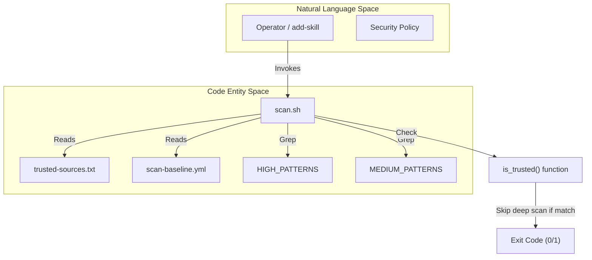
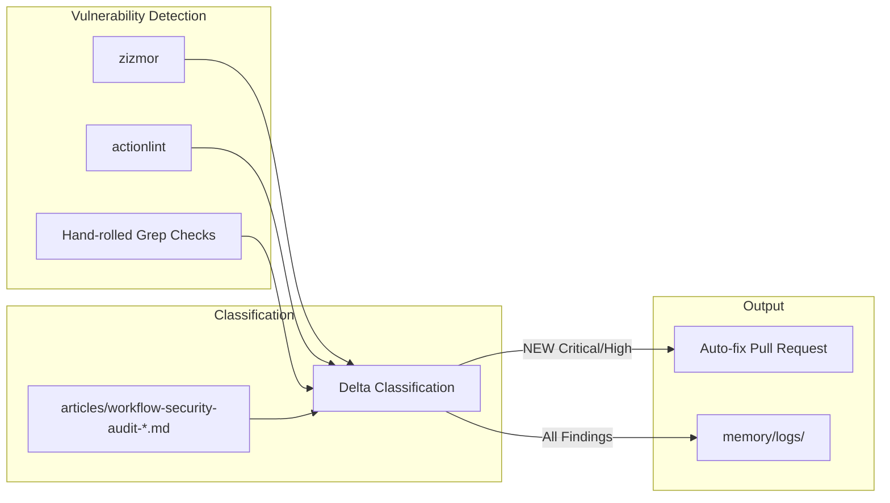

<!-- source: DeepWiki mcp.deepwiki.com · repo aaronjmars/aeon · page 4.3 Security & Update Management · fetched 2026-10-26 -->

# Security & Update Management

Relevant source files

The following files were used as context for generating this wiki page:

- [.gitignore](.gitignore)
- [add-skill](add-skill)
- [articles/workflow-security-audit-2026-04-11.md](articles/workflow-security-audit-2026-04-11.md)
- [scripts/postprocess-farcaster.sh](scripts/postprocess-farcaster.sh)
- [skills/security-digest/SKILL.md](skills/security-digest/SKILL.md)
- [skills/security/trusted-sources.txt](skills/security/trusted-sources.txt)
- [skills/skill-security-scan/SKILL.md](skills/skill-security-scan/SKILL.md)
- [skills/skill-security-scan/scan.sh](skills/skill-security-scan/scan.sh)
- [skills/skill-update-check/SKILL.md](skills/skill-update-check/SKILL.md)
- [skills/syndicate-article/SKILL.md](skills/syndicate-article/SKILL.md)
- [skills/workflow-security-audit/SKILL.md](skills/workflow-security-audit/SKILL.md)

AEON implements a multi-layered security model designed to protect the system from supply-chain attacks, script injection, and credential exfiltration. This system combines static analysis of skill logic, integrity pinning via a lockfile, and automated auditing of the underlying GitHub Actions infrastructure.

## Supply Chain Integrity: skills.lock

The `skills.lock` file serves as the source of truth for all external skills imported into an AEON instance. It ensures that skills are pinned to specific immutable versions and tracks their provenance.

### Data Model
Each entry in `skills.lock` tracks the specific state of an imported skill [skills/skill-update-check/SKILL.md:20-30]():
- `skill_name`: Local name of the skill.
- `source_repo`: The upstream GitHub repository.
- `source_path`: The file path within that repository.
- `commit_sha`: The immutable SHA-1 hash of the version currently installed.
- `imported_at`: Timestamp of installation or last manual update.

### Implementation in add-skill
The `./add-skill` utility manages this lifecycle. When a skill is installed, the script:
1. Downloads the repository tarball [add-skill:81-91]().
2. Performs a security scan (unless the source is trusted) [add-skill:207-221]().
3. Records the provenance data into `skills.lock` [add-skill:235-237]().

**Sources:** [add-skill:1-237](), [skills/skill-update-check/SKILL.md:1-30]()

---

## Skill Security Scanning

The `skill-security-scan` system provides automated auditing of `SKILL.md` files, companion scripts, and workflows. It uses a regex-based engine to detect high-risk patterns.

### Threat Categories & Detection
The scanner classifies findings into three severity tiers based on their potential impact [skills/skill-security-scan/scan.sh:78-167]():

| Severity | Category | Example Patterns |
| :--- | :--- | :--- |
| **HIGH** | Code Execution / Exfil | `eval`, `$(...$VAR)`, `curl.*$SECRET`, `rm -rf /`, Prompt Injection |
| **MEDIUM** | Suspicious Behavior | `../../`, `/etc/passwd`, `chmod 777`, `base64 --decode` |
| **LOW** | Informational | `find /`, `fetch()`, writing outside `skills/` |

### Trusted Sources & Baselines
To reduce noise, the system supports two suppression mechanisms:
1. **Trusted Sources**: Repositories or owners listed in `skills/security/trusted-sources.txt` skip deep content analysis and only undergo format validation [skills/skill-security-scan/SKILL.md:81-82](), [skills/security/trusted-sources.txt:1-12]().
2. **Scan Baseline**: The `skills/security/scan-baseline.yml` file allows for manual suppression of specific findings (file/line/pattern) that have been human-reviewed [skills/skill-security-scan/SKILL.md:52-62]().

### Security Scan Logic Flow
The following diagram illustrates how the `scan.sh` utility processes a skill file.

**Skill Scanning Process**

**Sources:** [skills/skill-security-scan/scan.sh:60-167](), [skills/skill-security-scan/SKILL.md:41-68]()

---

## Update Management & Drift Detection

The `skill-update-check` skill runs weekly to detect drift between the local `skills.lock` and the upstream source repositories [skills/skill-update-check/SKILL.md:1-12]().

### Triage & Enrichment
When drift is detected, the skill fetches comparison metadata to classify the update [skills/skill-update-check/SKILL.md:52-64]():
- **Diff Size**: Categorized from `TRIVIAL` to `MAJOR` based on additions/deletions in `SKILL.md`.
- **Breaking Keywords**: Scans commit messages for strings like `BREAKING CHANGE` or `deprecate`.
- **Frontmatter Diff**: Detects changes in keys such as `cron` or `model`.
- **New Dependencies**: Greps for new environment variables or shell tools.

### Priority Assignment
The system assigns a priority to each update to guide operator triage [skills/skill-update-check/SKILL.md:89-97]():
- **CRITICAL**: Security scan `FAIL` or `MISSING_UPSTREAM`.
- **HIGH**: Enabled skills with `WARN` verdicts or breaking changes.
- **MEDIUM**: Enabled skills with clean updates.
- **LOW**: Disabled skills with drift.

**Sources:** [skills/skill-update-check/SKILL.md:35-100]()

---

## Workflow Security Auditing

The `workflow-security-audit` skill focuses on the GitHub Actions infrastructure itself, specifically targeting script injection vulnerabilities [skills/workflow-security-audit/SKILL.md:1-10]().

### Automated Tooling
The audit utilizes industry-standard scanners [skills/workflow-security-audit/SKILL.md:22-42]():
- **zizmor**: A SARIF-capable auditor for GitHub Actions.
- **actionlint**: A syntax-level linter for workflow files.

### Critical Injection Patterns
The audit specifically checks for "toJson-into-shell" injection, where user-controlled event data is interpolated directly into a `run:` block [skills/workflow-security-audit/SKILL.md:82](). This was the cause of a critical incident in `messages.yml` where `$MESSAGE` variables allowed remote code execution [articles/workflow-security-audit-2026-04-11.md:12-21]().

### Remediation Strategy
The system promotes using environment variables as intermediaries to prevent shell interpolation [articles/workflow-security-audit-2026-04-11.md:31-39]().

**Workflow Security Audit Data Flow**

**Sources:** [skills/workflow-security-audit/SKILL.md:59-123](), [articles/workflow-security-audit-2026-04-11.md:1-160]()

---

## Security Digest & Threat Intelligence

The `security-digest` skill provides a curated feed of vulnerabilities relevant to the AEON stack [skills/security-digest/SKILL.md:1-16]().

### Data Sources & Enrichment
The skill aggregates data from three primary sources:
1. **CISA KEV**: Known Exploited Vulnerabilities [skills/security-digest/SKILL.md:20-27]().
2. **GitHub Advisory Database**: Filtered by the repo's tracked ecosystem (e.g., `npm`, `pip`) [skills/security-digest/SKILL.md:29-40]().
3. **EPSS**: FIRST.org’s Exploit Prediction Scoring System [skills/security-digest/SKILL.md:42-49]().

### Action Tiers
Findings are ranked by exploitation signal rather than raw CVSS score [skills/security-digest/SKILL.md:52-58]():
- **PATCH TODAY**: Confirmed exploitation (KEV) or EPSS ≥ 0.5.
- **PATCH THIS WEEK**: High CVSS in tracked stack or EPSS 0.1–0.5.
- **MONITOR**: Critical advisories without available fixes.

**Sources:** [skills/security-digest/SKILL.md:1-96]()

---

