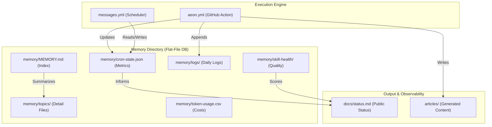
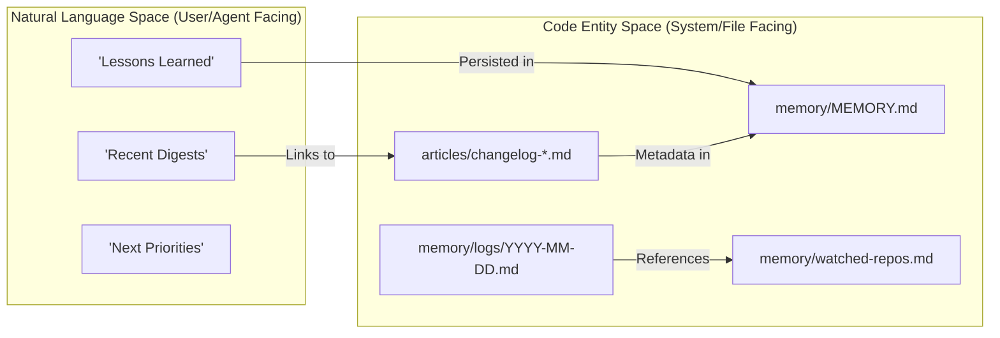

<!-- source: DeepWiki mcp.deepwiki.com · repo aaronjmars/aeon · page 5.1 Memory Directory Structure · fetched 2026-10-26 -->

# Memory Directory Structure

Relevant source files

The following files were used as context for generating this wiki page:

- [articles/.gitkeep](articles/.gitkeep)
- [articles/changelog-2026-03-19.md](articles/changelog-2026-03-19.md)
- [memory/MEMORY.md](memory/MEMORY.md)
- [memory/cron-state.json](memory/cron-state.json)
- [memory/logs/.gitkeep](memory/logs/.gitkeep)
- [memory/logs/2026-03-19.md](memory/logs/2026-03-19.md)
- [memory/topics/.gitkeep](memory/topics/.gitkeep)
- [memory/watched-repos.md](memory/watched-repos.md)

AEON utilizes a flat-file database system located in the `memory/` directory to persist state, track execution metrics, and maintain long-term context across ephemeral GitHub Actions runs. This architecture enables a "zero-infrastructure" model where the repository itself acts as the storage layer.

## Overview of Memory Architecture

The `memory/` directory is the central nervous system for AEON's state management. It transitions data from the **Natural Language Space** (summaries, lessons, and topics) to the **Code Entity Space** (JSON metrics, CSV logs, and state files).

### Data Flow and Persistence
1.  **Skill Execution**: A skill runs via `aeon.yml` and generates output.
2.  **State Update**: The skill or the orchestration logic updates files in `memory/`.
3.  **Commit Loop**: At the end of a successful run, AEON commits the changes back to the repository [memory/MEMORY.md:21-21]().

### Memory Organization Diagram

The following diagram illustrates how different components of the system interact with the `memory/` directory.

"AEON Memory Interaction Map"

**Sources:** [memory/MEMORY.md:1-26](), [memory/cron-state.json:1-1](), [memory/logs/2026-03-19.md:1-9]()

---

## Core Memory Files

### memory/MEMORY.md
This is the high-level index and "Long-term Memory" of the agent. It serves as a human-readable and agent-parsable summary of the system's history. It includes sections for:
*   **Recent Articles**: Links to files in the `articles/` directory [memory/MEMORY.md:7-10]().
*   **Recent Digests**: Tracking of information synthesis runs [memory/MEMORY.md:11-14]().
*   **Lessons Learned**: Critical insights for future runs, such as formatting constraints or commit requirements [memory/MEMORY.md:19-22]().
*   **Next Priorities**: A manual or autonomous task list for the agent [memory/MEMORY.md:23-26]().

### memory/cron-state.json
A machine-readable JSON file tracking the execution metrics of every skill. This file is critical for the `heartbeat` skill to monitor for failures or degraded performance [memory/cron-state.json:1-1](). It typically stores:
*   Last successful run timestamp.
*   Last exit code.
*   Failure counts.

### memory/logs/
This directory contains daily append-only logs in Markdown format. Each file (e.g., `2026-03-19.md`) provides a chronological record of what skills performed what actions [memory/logs/2026-03-19.md:1-9]().
*   **Example Log Entry**: A "Changelog Skill" entry detailing 51 commits fetched, grouping them into categories, and saving the result to `articles/` [memory/logs/2026-03-19.md:3-9]().

### memory/watched-repos.md
A configuration file used by skills like `github-monitor` or `changelog` to define the scope of their activity [memory/watched-repos.md:1-3]().

---

## Observability and Analytics

### Token Usage and Cost Tracking
While not explicitly detailed in the provided file snippets, the system tracks costs in `memory/token-usage.csv`. This allows the agent to self-throttle if budget limits are approached.

### Skill Health and Quality
The `memory/skill-health/` directory (referenced in the system architecture) stores quality scores (1-5) generated by the `skill-evals` framework. These scores are aggregated to inform the autonomous repair loop.

---

## Memory to Code Mapping

The following diagram bridges the natural language concepts found in `MEMORY.md` with the underlying code entities and file paths.

"Natural Language to Code Entity Mapping"

**Sources:** [memory/MEMORY.md:1-26](), [memory/logs/2026-03-19.md:1-9](), [articles/changelog-2026-03-19.md:1-54]()

## Implementation Details

| File / Directory | Type | Key Function / Purpose |
| :--- | :--- | :--- |
| `memory/MEMORY.md` | Markdown | Primary index and "soul" context for the agent [memory/MEMORY.md:1-2](). |
| `memory/cron-state.json` | JSON | Persistence for the scheduler and health monitor [memory/cron-state.json:1-1](). |
| `memory/logs/` | Directory | Daily audit trail of all skill executions [memory/logs/2026-03-19.md:1-1](). |
| `memory/topics/` | Directory | Granular detail files for specific research subjects. |
| `memory/watched-repos.md`| Markdown | Input list for repository monitoring skills [memory/watched-repos.md:1-3](). |
| `articles/` | Directory | Final output of content-generating skills [articles/changelog-2026-03-19.md:1-1](). |

**Sources:** [memory/MEMORY.md:1-26](), [memory/cron-state.json:1-1](), [memory/logs/2026-03-19.md:1-9](), [memory/watched-repos.md:1-3](), [articles/changelog-2026-03-19.md:1-54]()

---

