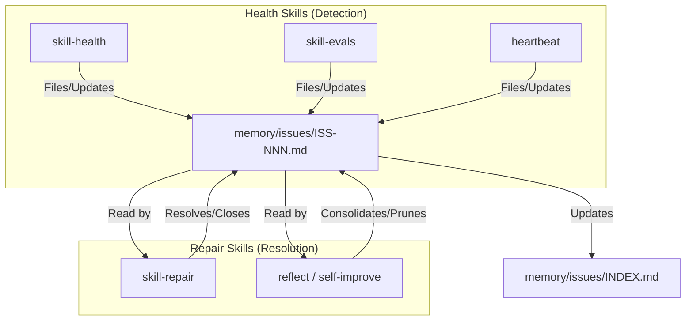
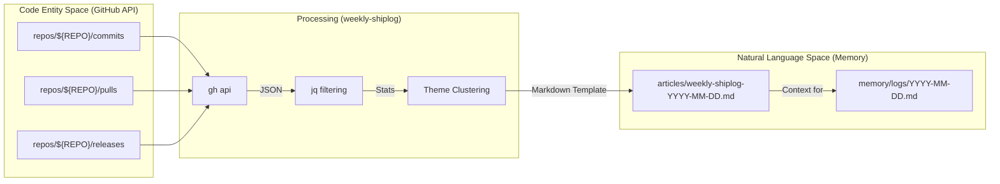

<!-- source: DeepWiki mcp.deepwiki.com · repo aaronjmars/aeon · page 5.2 Issues Tracker & Reflect Skills · fetched 2026-10-26 -->

# Issues Tracker & Reflect Skills

Relevant source files

The following files were used as context for generating this wiki page:

- [.github/workflows/chain-runner.yml](.github/workflows/chain-runner.yml)
- [.outputs/.gitkeep](.outputs/.gitkeep)
- [CLAUDE.md](CLAUDE.md)
- [memory/skill-health/.gitkeep](memory/skill-health/.gitkeep)
- [skills/last30/SKILL.md](skills/last30/SKILL.md)
- [skills/reflect/SKILL.md](skills/reflect/SKILL.md)
- [skills/skill-health/SKILL.md](skills/skill-health/SKILL.md)
- [skills/weekly-shiplog/SKILL.md](skills/weekly-shiplog/SKILL.md)

AEON implements an autonomous, self-healing lifecycle for its skill ecosystem. This system relies on a structured issue tracker maintained in the flat-file memory database and a set of "Reflect" skills that perform periodic maintenance, memory consolidation, and automated issue resolution.

## 1. Structured Issues Tracker

The issue tracker resides in `memory/issues/` and provides a persistent, machine-readable record of system degradations, API failures, and quality regressions [CLAUDE.md:30-32](). Unlike ephemeral logs, issues have a defined lifecycle and taxonomy, allowing AEON to track the health of its skills over time.

### 1.1 Issue Lifecycle & Taxonomy
Issues follow a strict status and severity lifecycle to help meta-skills prioritize repairs.

| Status | Description |
| :--- | :--- |
| `open` | New issue detected and filed. |
| `investigating` | Root cause analysis in progress. |
| `fixing` | Repair skill or operator is applying a patch. |
| `resolved` | Skill health has returned to baseline. |
| `wontfix` | Permanent limitation (e.g., sandbox restriction). |

[CLAUDE.md:33-33]()

**Severity Taxonomy:**
- `critical`: 0% success rate or total skill failure [CLAUDE.md:34-34]().
- `high`: >50% failure rate [CLAUDE.md:34-34]().
- `medium`: Intermittent failures or degraded output quality [CLAUDE.md:34-34]().
- `low`: Noise or optimization suggestions [CLAUDE.md:34-34]().

**Category Taxonomy:**
Categories include `config`, `api-change`, `rate-limit`, `timeout`, `sandbox-limitation`, `permanent-limitation`, `prompt-bug`, `missing-secret`, `quality-regression`, `output-format`, `optimization`, and `unknown` [CLAUDE.md:35-35]().

### 1.2 The INDEX.md and ISS-NNN Pattern
The tracker consists of a central index and individual detail files:
- **`memory/issues/INDEX.md`**: Contains tables for Open and Resolved issues, serving as a quick-lookup for health skills to avoid filing duplicates [CLAUDE.md:31-31]().
- **`memory/issues/ISS-{NNN}.md`**: Individual files using YAML frontmatter to store metadata like `detected_at`, `affected_skills`, `root_cause`, and `fix_pr` [CLAUDE.md:32-32]().

### 1.3 Data Flow: Detection to Resolution
The system operates as a closed loop where health-monitoring skills file issues and repair/consolidation skills close them.

**Issue Tracker State Machine**

Sources: [CLAUDE.md:36-36](), [skills/skill-health/SKILL.md:15-15]()

---

## 2. Skill Health Monitoring (`skill-health`)

The `skill-health` skill is the primary auditor of the system. It runs periodically to classify the state of every enabled skill in `aeon.yml` [skills/skill-health/SKILL.md:22-22]().

### 2.1 Classification Logic
The skill assigns statuses based on metrics from `memory/cron-state.json` and recent logs [skills/skill-health/SKILL.md:19-20]().

| Status | Trigger Condition |
| :--- | :--- |
| **CRITICAL** | `consecutive_failures >= 3` or no success in ≥3 days [skills/skill-health/SKILL.md:44-44](). |
| **DEGRADED** | `success_rate < 0.6` or average quality score < 2.5 [skills/skill-health/SKILL.md:45-45](). |
| **FLAPPING** | ≥3 status transitions (success/fail) in 7 days [skills/skill-health/SKILL.md:46-46](). |
| **HEALTHY** | `success_rate >= 0.8` and `consecutive_failures == 0` [skills/skill-health/SKILL.md:48-48](). |

### 2.2 Issue Reconciliation
`skill-health` reconciles its findings with the issue tracker:
1. **New Failures**: If a skill is CRITICAL/FLAPPING and no open issue exists, it creates a new `ISS-NNN.md` [skills/skill-health/SKILL.md:72-80]().
2. **Recovery**: If a skill previously marked in an issue is now HEALTHY, it removes the skill from the `affected_skills` list. If the list is empty, the issue is marked `resolved` [skills/skill-health/SKILL.md:74-75]().
3. **Systemic Detection**: It groups failures by `api_host` or error signature to detect vendor-wide outages (e.g., Coingecko rate limits) [skills/skill-health/SKILL.md:60-61]().

Sources: [skills/skill-health/SKILL.md:38-57](), [skills/skill-health/SKILL.md:64-76]()

---

## 3. Reflect & Consolidation Skills

Reflection skills manage the growth of the flat-file database, ensuring that memory remains actionable rather than becoming an unmanageable log.

### 3.1 Weekly Reflect (`reflect`)
The `reflect` skill is responsible for long-term memory maintenance. It reviews activity from the last 7 days across `memory/logs/` and `articles/` [skills/reflect/SKILL.md:16-17]().

**Key Functions:**
- **Consolidation**: Identifies patterns in recent work and records key decisions [skills/reflect/SKILL.md:19-20]().
- **Pruning**: Removes stale entries from `memory/MEMORY.md` to keep it under the ~50-line limit [skills/reflect/SKILL.md:21-25]().
- **Topic Migration**: Moves detailed notes from the main index into specific files within `memory/topics/` [skills/reflect/SKILL.md:26-27]().

### 3.2 Last 30 Days (`last30`)
While `reflect` focuses on internal system state, `last30` performs external narrative reflection. It aggregates data across Reddit, X, Hacker News, and Polymarket to identify what has changed in a specific topic over a 30-day window [skills/last30/SKILL.md:2-3]().

**Implementation Pattern:**
- **Prefetch Consumption**: To bypass sandbox limitations, it reads X/Twitter data from `.xai-cache/` populated by `scripts/prefetch-xai.sh` [skills/last30/SKILL.md:100-105]().
- **Narrative Clustering**: Instead of a flat list, it clusters findings into "Narratives" and highlights disagreements between platforms (e.g., Reddit bearish vs. X bullish) [skills/last30/SKILL.md:11-12]().

### 3.3 Weekly Shiplog (`weekly-shiplog`)
This skill reflects on the codebase itself. It queries the GitHub API for commits, merged PRs, and releases over the last 7 days [skills/weekly-shiplog/SKILL.md:35-49](). It uses this data to write a "narrative of momentum," which is saved to the `articles/` directory [skills/weekly-shiplog/SKILL.md:102-109]().

**Code Entity to Natural Language Mapping**

Sources: [skills/weekly-shiplog/SKILL.md:35-54](), [skills/weekly-shiplog/SKILL.md:106-135]()

---

## 4. Implementation Details

### 4.1 Memory File Interactions
Skills interact with the memory system using standard file I/O, but must follow the "atomic write" rule to prevent corruption during GitHub Action runner failures [skills/skill-health/SKILL.md:105-105]().

| File Path | Reader(s) | Writer(s) | Purpose |
| :--- | :--- | :--- | :--- |
| `memory/MEMORY.md` | All Skills | `reflect`, `self-improve` | High-level index and current goals. |
| `memory/issues/INDEX.md` | `skill-health`, `heartbeat` | `skill-health`, `skill-repair` | Global issue registry. |
| `memory/cron-state.json` | `skill-health`, `heartbeat` | Execution Engine | Success/Failure metrics per skill. |
| `memory/topics/*.md` | `reflect`, `last30` | `reflect` | Long-term granular memory. |

Sources: [CLAUDE.md:27-32](), [skills/skill-health/SKILL.md:19-25](), [skills/reflect/SKILL.md:24-27]()

### 4.2 Chain Execution and Context
When issues are being resolved or memory is being consolidated, AEON often uses `chain-runner.yml` to pass context between skills [CLAUDE.md:55-58]().

1. **Output Capture**: A skill's output is saved to `.outputs/{skill}.md` [.github/workflows/chain-runner.yml:130-130]().
2. **Context Injection**: Downstream skills with a `consume` definition have these outputs injected into a `.chain-context-{target}.md` file [.github/workflows/chain-runner.yml:125-136]().
3. **Execution**: The `chain-runner` dispatches the next skill via `gh workflow run aeon.yml` [.github/workflows/chain-runner.yml:55-55]().

Sources: [.github/workflows/chain-runner.yml:46-75](), [.github/workflows/chain-runner.yml:121-147]()

---

