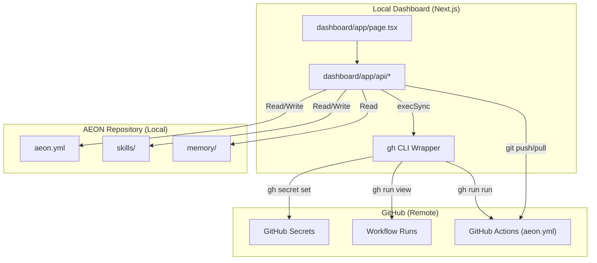
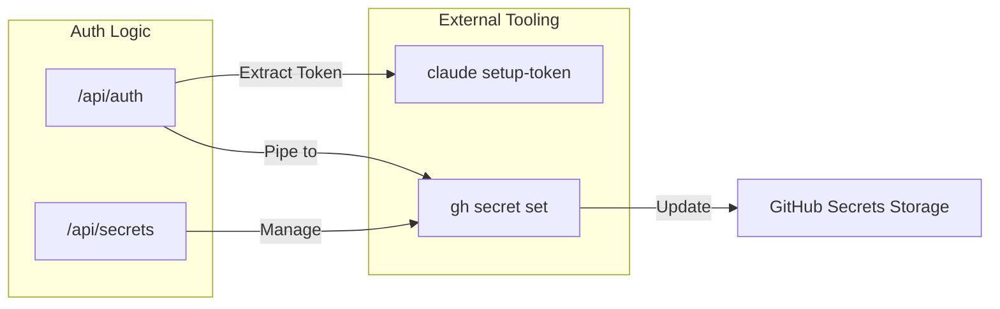

<!-- source: DeepWiki mcp.deepwiki.com · repo aaronjmars/aeon · page 6 Dashboard · fetched 2026-10-26 -->

# Dashboard

Relevant source files

The following files were used as context for generating this wiki page:

- [aeon](aeon)
- [dashboard/app/api/auth/route.ts](dashboard/app/api/auth/route.ts)
- [dashboard/app/api/runs/[id]/logs/route.ts](dashboard/app/api/runs/[id]/logs/route.ts)
- [dashboard/app/api/secrets/route.ts](dashboard/app/api/secrets/route.ts)
- [dashboard/app/api/upload/route.ts](dashboard/app/api/upload/route.ts)
- [dashboard/app/page.tsx](dashboard/app/page.tsx)
- [dashboard/next-env.d.ts](dashboard/next-env.d.ts)
- [dashboard/package-lock.json](dashboard/package-lock.json)
- [dashboard/package.json](dashboard/package.json)

The AEON Dashboard is a local Next.js management interface that provides a unified control plane for configuring skills, managing environment secrets, monitoring execution history, and importing new capabilities. It bridges the gap between the local developer environment and the remote GitHub Actions execution engine by using the `gh` CLI to interact with repository state and secrets.

The dashboard is launched via the `aeon` script in the repository root [aeon:1-44](), which starts a Next.js development server on a local port (defaulting to `5555`).

### System Interaction Overview

The dashboard acts as a local orchestrator that manipulates the AEON system through several layers:

1.  **Skill Configuration**: Modifies `aeon.yml` and `skills.json` to enable/disable skills or update their schedules.
2.  **Secret Management**: Uses the GitHub CLI (`gh`) to securely set or delete repository secrets required by skills.
3.  **Run Monitoring**: Fetches and parses GitHub Actions workflow logs to provide real-time visibility into skill execution.
4.  **Local Sync**: Manages the git lifecycle (commit/push/pull) to keep the local dashboard in sync with the remote GitHub runner.

### Code-to-System Mapping

The following diagram illustrates how dashboard components interact with the underlying AEON file structure and external GitHub services.

**Dashboard Architecture & Data Flow**

Sources: [dashboard/app/page.tsx:52-71](), [dashboard/app/api/secrets/route.ts:32-51](), [dashboard/app/api/runs/[id]/logs/route.ts:19-37](), [dashboard/app/api/upload/route.ts:135-149]()

### Core Functionality

#### Skill Management
The dashboard allows users to toggle skills on or off, modify their cron schedules, and update "Briefs" (skill-specific variables). These changes are staged locally and then synced to the remote repository via a git commit/push loop initiated by the **Sync** button.
*   For UI details, see [Dashboard UI Components](#6.1).
*   For API details, see [Dashboard API Routes](#6.2).

#### Secret & Auth Orchestration
AEON requires various API keys (Anthropic, Telegram, etc.) to function. The dashboard provides a centralized **SecretsPanel** to manage these. It specifically handles the `CLAUDE_CODE_OAUTH_TOKEN` and `ANTHROPIC_API_KEY` through a specialized authentication flow that can automatically extract tokens using `claude setup-token`.

**Authentication & Secret Flow**

Sources: [dashboard/app/api/auth/route.ts:31-94](), [dashboard/app/api/secrets/route.ts:79-105]()

#### Run Monitoring and Logs
The dashboard polls the GitHub API for recent workflow runs. It doesn't just show status; it fetches raw logs and parses out the specific `## Summary` block generated by the Claude execution engine to provide a clean overview of what the skill actually accomplished.
*   For details on log parsing, see [Dashboard API Routes](#6.2).

#### Skill Ingestion
New skills can be added via the **ImportModal**. The system accepts file uploads, detects the skill name from frontmatter or filenames, renames `.skill` files to `SKILL.md`, and automatically injects the new skill into the `aeon.yml` configuration.
*   Sources: [dashboard/app/api/upload/route.ts:109-158]()

### Component Navigation

| Page | Description | Key Files |
| :--- | :--- | :--- |
| **[Dashboard UI Components](#6.1)** | Details the React architecture, including the `LeftSidebar` for skill navigation and `SpecNode` for JSON rendering. | `dashboard/components/*` |
| **[Dashboard API Routes](#6.2)** | Technical reference for the Next.js API layer that wraps `execSync` calls to `gh` and `git`. | `dashboard/app/api/*` |

Sources: [dashboard/app/page.tsx:10-17](), [dashboard/app/api/upload/route.ts:1-5](), [dashboard/app/api/runs/[id]/logs/route.ts:1-5]()

---

