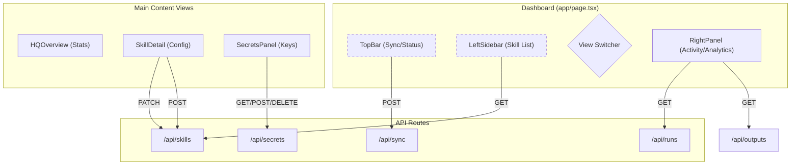
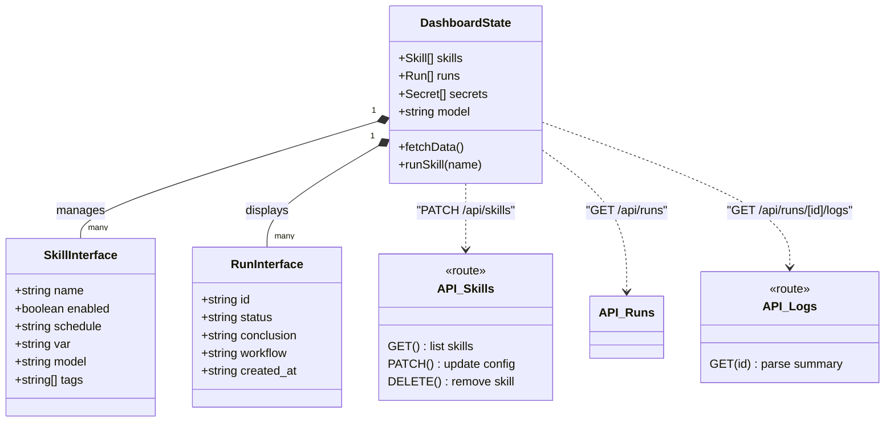

<!-- source: DeepWiki mcp.deepwiki.com · repo aaronjmars/aeon · page 6.1 Dashboard UI Components · fetched 2026-10-26 -->

# Dashboard UI Components

Relevant source files

The following files were used as context for generating this wiki page:

- [dashboard/app/api/runs/[id]/logs/route.ts](dashboard/app/api/runs/[id]/logs/route.ts)
- [dashboard/app/api/secrets/route.ts](dashboard/app/api/secrets/route.ts)
- [dashboard/app/api/upload/route.ts](dashboard/app/api/upload/route.ts)
- [dashboard/app/page.tsx](dashboard/app/page.tsx)
- [dashboard/components/AuthModal.tsx](dashboard/components/AuthModal.tsx)
- [dashboard/components/ErrorScreen.tsx](dashboard/components/ErrorScreen.tsx)
- [dashboard/components/HQOverview.tsx](dashboard/components/HQOverview.tsx)
- [dashboard/components/ImportModal.tsx](dashboard/components/ImportModal.tsx)
- [dashboard/components/LeftSidebar.tsx](dashboard/components/LeftSidebar.tsx)
- [dashboard/components/LoadingScreen.tsx](dashboard/components/LoadingScreen.tsx)
- [dashboard/components/RightPanel.tsx](dashboard/components/RightPanel.tsx)
- [dashboard/components/ScheduleEditor.tsx](dashboard/components/ScheduleEditor.tsx)
- [dashboard/components/SecretsPanel.tsx](dashboard/components/SecretsPanel.tsx)
- [dashboard/components/SkillDetail.tsx](dashboard/components/SkillDetail.tsx)
- [dashboard/components/SpecNode.tsx](dashboard/components/SpecNode.tsx)
- [dashboard/components/TopBar.tsx](dashboard/components/TopBar.tsx)
- [dashboard/next-env.d.ts](dashboard/next-env.d.ts)

The AEON Dashboard is a Next.js-based management interface designed for configuring skills, managing secrets, and observing execution history. It follows a modular React component architecture that communicates with a local API layer to interact with the AEON repository and the GitHub CLI.

## Component Architecture Overview

The dashboard UI is structured as a single-page application (SPA) centered around `dashboard/app/page.tsx`. It manages state for skills, runs, secrets, and analytics, distributing this data to specialized sub-components.

### Implementation Diagram: Component Tree and Data Flow

This diagram maps the high-level React components to their primary data responsibilities and the API routes they consume.

**Sources:** [dashboard/app/page.tsx:1-18](), [dashboard/app/page.tsx:51-60](), [dashboard/app/page.tsx:20-21]()

---

## Primary Components

### LeftSidebar (Skill List)
The `LeftSidebar` serves as the primary navigation and status monitor for the skill roster. It categorizes skills into "Departments" based on their tags (e.g., Research, Dev, Crypto) [dashboard/components/LeftSidebar.tsx:24-25]().

*   **Skill Search:** Real-time filtering of skills by name [dashboard/components/LeftSidebar.tsx:58-62]().
*   **Status Indicators:** Uses `getSkillStatus` to render colored dots representing the current state (On Duty, Working, Error, Off Duty) [dashboard/components/LeftSidebar.tsx:73-86]().
*   **Department Grouping:** Renders skills under department headers with associated colors defined in `DEPARTMENTS` [dashboard/components/LeftSidebar.tsx:60-71]().

**Sources:** [dashboard/components/LeftSidebar.tsx:1-98]()

### TopBar (Sync & Global Status)
The `TopBar` manages the repository-level state and authentication.
*   **Sync Logic:** Displays if the local repo `hasChanges` and provides a button to trigger `syncToGithub` (git commit/push) [dashboard/app/page.tsx:34-35](), [dashboard/app/page.tsx:69]().
*   **Auth Status:** Displays the status of Claude Code authentication and allows triggering the `AuthModal` [dashboard/app/page.tsx:45-47]().

**Sources:** [dashboard/app/page.tsx:69-71](), [dashboard/components/TopBar.tsx]()

### SkillDetail (Per-Skill Configuration)
The `SkillDetail` component is the primary interface for modifying a specific skill's behavior.
*   **Execution Control:** Contains buttons to toggle a skill's `enabled` state or manually trigger a run via `runSkill` [dashboard/components/SkillDetail.tsx:56-63]().
*   **Schedule Editor:** An inline `ScheduleEditor` that allows users to switch between "Interval" (every X hours/minutes) and "Time" (at specific HH:MM) modes, which then serializes into a Cron expression [dashboard/components/ScheduleEditor.tsx:8-16](), [dashboard/components/ScheduleEditor.tsx:63]().
*   **Assignment Brief:** Edits the `var` field of a skill, allowing users to provide specific context (e.g., "focus on Bitcoin") [dashboard/components/SkillDetail.tsx:79-87]().
*   **Model Override:** A dropdown to set a specific LLM model for the skill, overriding the global default [dashboard/components/SkillDetail.tsx:90-96]().

**Sources:** [dashboard/components/SkillDetail.tsx:1-108](), [dashboard/components/ScheduleEditor.tsx:1-70]()

### SecretsPanel
The `SecretsPanel` manages environment variables stored as GitHub Actions Secrets. It interacts with the `gh` CLI via the `/api/secrets` route [dashboard/app/api/secrets/route.ts:41-51]().
*   **Built-in Groups:** Organizes secrets into Core, Telegram, Discord, Slack, Email, and Skill Keys [dashboard/app/api/secrets/route.ts:4-25]().
*   **Security:** Masked inputs for setting new values; once set, values are not retrievable from the UI, only deletable [dashboard/components/SecretsPanel.tsx:42-54]().

**Sources:** [dashboard/components/SecretsPanel.tsx:1-67](), [dashboard/app/api/secrets/route.ts:1-126]()

---

## Specialized Systems

### SpecNode JSON-Render System
The `SpecNode` component is a recursive renderer used in the `RightPanel` (Activity Feed) to display structured output from skills. It allows skills to output a "Spec" (a JSON tree of elements) which is then rendered into a rich UI.
*   **Data Flow:** Skill outputs saved in `memory/` are fetched via `/api/outputs` [dashboard/app/page.tsx:60]().
*   **Rendering:** If an output contains a `spec.root` and `spec.elements`, the `RightPanel` passes these to `SpecNode` for rendering [dashboard/components/RightPanel.tsx:64]().

**Sources:** [dashboard/components/RightPanel.tsx:64](), [dashboard/components/SpecNode.tsx]()

### ImportModal & Skill Ingestion
The `ImportModal` facilitates adding new skills to the AEON instance. It sends file contents to `/api/upload`.
*   **Name Derivation:** The system automatically extracts the skill name from `SKILL.md` frontmatter or the filename [dashboard/app/api/upload/route.ts:40-88]().
*   **Secret Detection:** The backend scans the uploaded content for common secret patterns (e.g., `*_API_KEY`) and alerts the user to configure them [dashboard/app/api/upload/route.ts:5-16]().

**Sources:** [dashboard/app/api/upload/route.ts:90-163](), [dashboard/components/ImportModal.tsx]()

### Log Retrieval and Parsing
The `RightPanel` fetches and processes GitHub Action logs to provide immediate feedback on skill execution.
*   **Step Filtering:** The API route `/api/runs/[id]/logs` parses the raw `gh run view --log` output to isolate the "Run" step, removing GitHub Actions timestamps and ANSI escape codes [dashboard/app/api/runs/[id]/logs/route.ts:49-76]().
*   **Summary Extraction:** It specifically looks for a `## Summary` Markdown block to display as a high-level recap before showing the full logs [dashboard/app/api/runs/[id]/logs/route.ts:68-87]().

**Sources:** [dashboard/app/api/runs/[id]/logs/route.ts:1-108](), [dashboard/components/RightPanel.tsx:32-35]()

---

## Code Entity Mapping

This diagram bridges the visual UI elements to their corresponding TypeScript interfaces and API endpoints.

**Sources:** [dashboard/app/page.tsx:23-42](), [dashboard/app/api/runs/[id]/logs/route.ts:95-102](), [dashboard/app/page.tsx:62-68]()

---

