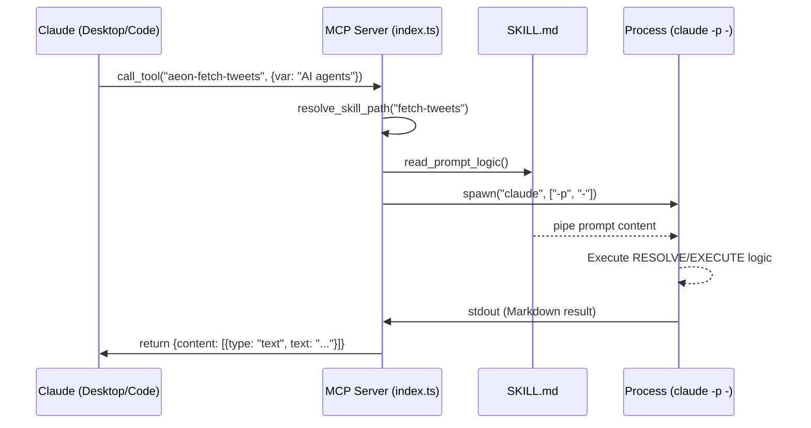
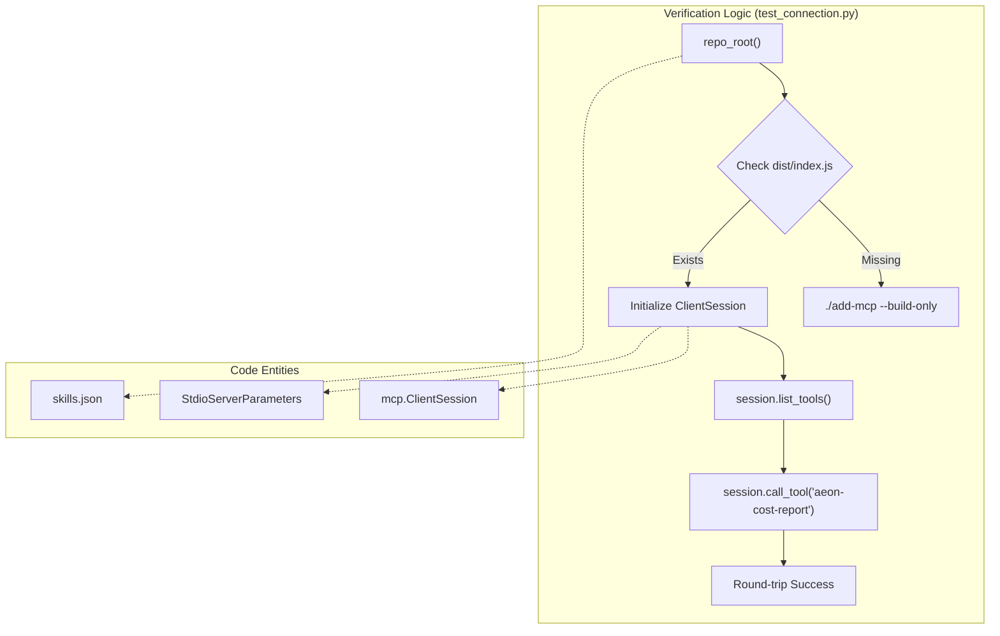

<!-- source: DeepWiki mcp.deepwiki.com · repo aaronjmars/aeon · page 7.1 MCP Server (Claude Desktop & Claude Code) · fetched 2026-10-26 -->

# MCP Server (Claude Desktop & Claude Code)

<details>
<summary>Relevant source files</summary>

The following files were used as context for generating this wiki page:

- [README.md](README.md)
- [add-mcp](add-mcp)
- [aeon.yml](aeon.yml)
- [examples/README.md](examples/README.md)
- [examples/a2a/autogen_workflow.py](examples/a2a/autogen_workflow.py)
- [examples/a2a/crewai_task.py](examples/a2a/crewai_task.py)
- [examples/a2a/langchain_client.py](examples/a2a/langchain_client.py)
- [examples/a2a/openai_agents_client.py](examples/a2a/openai_agents_client.py)
- [examples/mcp/claude_desktop_config.json](examples/mcp/claude_desktop_config.json)
- [examples/mcp/test_connection.py](examples/mcp/test_connection.py)
- [mcp-server/package.json](mcp-server/package.json)
- [mcp-server/src/index.ts](mcp-server/src/index.ts)
- [mcp-server/tsconfig.json](mcp-server/tsconfig.json)
- [skills/contributor-reward/SKILL.md](skills/contributor-reward/SKILL.md)

</details>


The Model Context Protocol (MCP) server is the integration layer that allows interactive agents—specifically **Claude Desktop** and **Claude Code**—to invoke any of AEON's 90+ skills as native tools. By exposing skills via MCP, AEON bridges the gap between its autonomous, scheduled execution model and the interactive workflows of human-in-the-loop agents.

### Purpose and Scope
The MCP server implementation transforms every entry in the AEON skill registry into a JSON-RPC tool definition. When an agent calls a tool (e.g., `aeon-token-report`), the server spawns a local execution process using the same prompt logic and environment as the GitHub Actions runner, ensuring behavioral parity across all execution environments [examples/README.md:53-56]().

---

## Architecture & Data Flow

The MCP server operates as a `stdio` server. It reads the local `skills.json` registry to advertise capabilities and executes skills by piping prompts to the Claude CLI.

### Skill-to-Tool Mapping
The server follows a strict naming convention: a skill with the slug `deep-research` becomes the MCP tool `aeon-deep-research`.

**Tool Advertisement Flow**
1. The server reads `skills.json` at the repo root [examples/mcp/test_connection.py:33-41]().
2. For each skill, it creates an MCP `Tool` object.
3. The `description` field from the skill's frontmatter is used as the tool's documentation for the LLM.
4. The tool accepts a single optional argument: `var`.

### Execution Pipeline
When a tool is invoked, the server executes the skill using the following flow:

**MCP Execution Sequence**

Sources: [mcp-server/src/index.ts](), [examples/README.md:53-56]()

---

## Implementation Details

### Server Core (`mcp-server/src/index.ts`)
The server is built using the `@modelcontextprotocol/sdk` [mcp-server/package.json:15-17](). It implements two primary handlers:

1.  **`list_tools`**: Iterates through the skill registry and converts metadata into MCP tool definitions.
2.  **`call_tool`**: The execution bridge. It prepares the environment, handles the `var` input, and manages the lifecycle of the underlying `claude` process.

### Configuration and Build
The server is written in TypeScript and compiled to a single entry point at `mcp-server/dist/index.js` [mcp-server/package.json:6-13]().

| File | Role |
| :--- | :--- |
| `mcp-server/tsconfig.json` | Configures `NodeNext` module resolution and `ES2022` target [mcp-server/tsconfig.json:3-5](). |
| `mcp-server/package.json` | Defines dependencies and the `aeon-mcp` binary [mcp-server/package.json:7-9](). |
| `add-mcp` | Setup script that automates compilation and Claude Code integration. |

Sources: [mcp-server/package.json:1-26](), [mcp-server/tsconfig.json:1-17]()

---

## Setup and Verification

### The `add-mcp` Script
The `add-mcp` script is the primary entry point for users. It performs the following:
1.  Installs dependencies in the `mcp-server/` directory.
2.  Compiles the TypeScript source into the `dist/` folder.
3.  (Optional) Configures Claude Code to recognize the new MCP server.

### Verification Flow (`test_connection.py`)
To ensure the MCP server is functioning correctly without launching a full UI, AEON provides a Python-based sanity checker [examples/mcp/test_connection.py:1-21]().

**Verification Process**

Sources: [examples/mcp/test_connection.py:22-80](), [examples/README.md:32-40]()

---

## Integration with Claude

### Claude Desktop
For Claude Desktop, the server must be added to the global configuration file. AEON provides a template for this configuration [examples/mcp/claude_desktop_config.json:1-8]().

**Sample Configuration:**
```json
{
  "mcpServers": {
    "aeon": {
      "command": "node",
      "args": ["/ABSOLUTE/PATH/TO/aeon/mcp-server/dist/index.js"]
    }
  }
}
```
Sources: [examples/mcp/claude_desktop_config.json:1-8](), [examples/README.md:40-41]()

### Claude Code
Claude Code integration is handled via the `claude mcp add` command. Running `./add-mcp` without the `--build-only` flag will attempt to register the server automatically with the local Claude Code instance.

### Security and Environment
Skills executed via MCP require the same environment variables (e.g., `ANTHROPIC_API_KEY`, `XAI_API_KEY`) as the standard AEON workflows [examples/README.md:51-52](). These should be present in the shell environment where Claude Desktop or Claude Code is launched.

Sources: [README.md:97-109](), [examples/README.md:42-52]()

---

