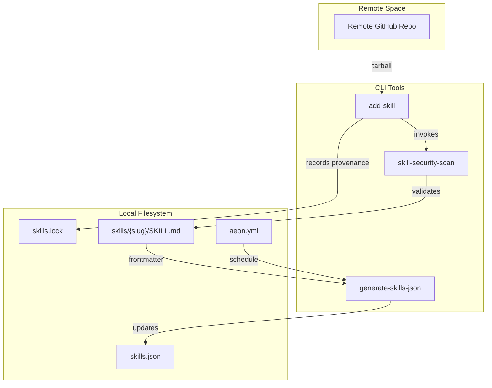
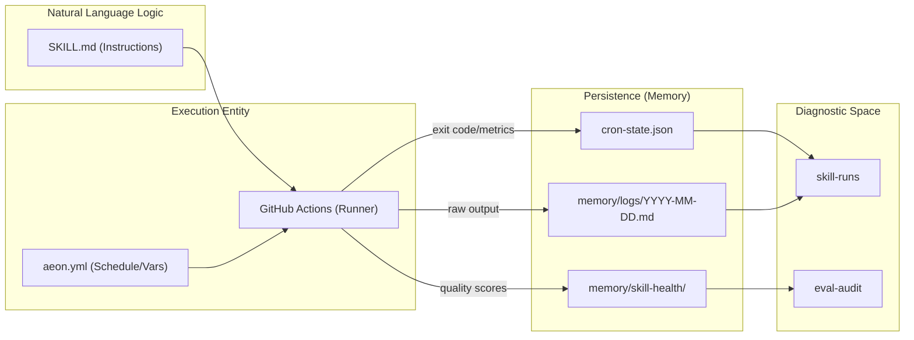

<!-- source: DeepWiki mcp.deepwiki.com · repo aaronjmars/aeon · page 9.2 Skill Management CLI Tools · fetched 2026-10-26 -->

# Skill Management CLI Tools

Relevant source files

The following files were used as context for generating this wiki page:

- [.gitignore](.gitignore)
- [add-skill](add-skill)
- [export-skill](export-skill)
- [generate-skills-json](generate-skills-json)
- [memory/issues/INDEX.md](memory/issues/INDEX.md)
- [onboard](onboard)
- [scripts/eval-audit](scripts/eval-audit)
- [scripts/postprocess-farcaster.sh](scripts/postprocess-farcaster.sh)
- [scripts/postprocess-replicate.sh](scripts/postprocess-replicate.sh)
- [scripts/prefetch-xai.sh](scripts/prefetch-xai.sh)
- [scripts/skill-runs](scripts/skill-runs)
- [scripts/sync-upstream.sh](scripts/sync-upstream.sh)
- [skills.json](skills.json)
- [skills/agent-buzz/SKILL.md](skills/agent-buzz/SKILL.md)
- [skills/auto-workflow/SKILL.md](skills/auto-workflow/SKILL.md)
- [skills/distribute-tokens/SKILL.md](skills/distribute-tokens/SKILL.md)
- [skills/onboard/SKILL.md](skills/onboard/SKILL.md)
- [skills/skill-update-check/SKILL.md](skills/skill-update-check/SKILL.md)
- [skills/star-milestone/SKILL.md](skills/star-milestone/SKILL.md)
- [skills/syndicate-article/SKILL.md](skills/syndicate-article/SKILL.md)
- [skills/treasury-info/SKILL.md](skills/treasury-info/SKILL.md)

AEON provides a suite of CLI tools and diagnostic scripts to manage the lifecycle of skills—from installation and manifest generation to upstream synchronization and quality auditing. These tools allow operators to interact with the system's "Natural Language Space" (the `SKILL.md` files) and "Code Entity Space" (the `aeon.yml` config and `skills.json` registry) through a standard terminal interface.

## Core Installation & Management Tools

### `add-skill`
The primary entry point for extending an AEON instance. It fetches skills from remote GitHub repositories, performs security validation, and updates the local registry.

*   **Implementation**: A Bash script that downloads repository tarballs to a temporary directory [add-skill:19-20](), extracts them, and identifies skill directories containing a `SKILL.md` file [add-skill:100-109]().
*   **Security Gate**: Before installation, it checks if the source is in `skills/security/trusted-sources.txt` [add-skill:168-182](). If untrusted, it invokes the `skill-security-scan` [add-skill:207-221]().
*   **Provenance**: Upon successful installation, it records the skill's origin (repo, path, branch, and commit SHA) in `skills.lock` [add-skill:235-245]().

### `generate-skills-json`
Compiles the `skills.json` manifest, which serves as the authoritative registry for the dashboard and the `add-skill` tool.

*   **Data Aggregation**: It iterates through all directories in `skills/` [generate-skills-json:90](), parsing YAML frontmatter (name, description, var) from each `SKILL.md` [generate-skills-json:97-99]().
*   **Metadata Enrichment**: It cross-references `aeon.yml` to find the current schedule [generate-skills-json:57-62]() and uses `git log` to determine the last updated date and SHA for each skill [generate-skills-json:71-80]().
*   **Classification**: Skills are mapped to categories (research, dev, crypto, social, productivity) based on their slug [generate-skills-json:25-54]().

### `export-skill`
Packagers a local skill directory into a portable format for distribution or backup, ensuring all associated logic and frontmatter are preserved.

**Skill Management Data Flow**

Sources: [add-skill:1-245](), [generate-skills-json:1-140](), [skills.json:1-12]()

---

## Maintenance & Synchronization

### `sync-upstream.sh`
Used to keep the AEON core and default skills updated with the main `aaronjmars/aeon` repository. It manages the complexity of merging upstream changes while preserving local configuration in `aeon.yml` and `memory/`.

### `skill-update-check`
An automated maintenance skill that monitors `skills.lock` to detect drift between local versions and their upstream sources [skills/skill-update-check/SKILL.md:3-4]().

*   **Drift Detection**: Uses the GitHub API to compare the `commit_sha` in `skills.lock` with the latest upstream commit [skills/skill-update-check/SKILL.md:37-41]().
*   **Triage**: Classifies updates by `diff_size` (Trivial to Major) and scans for `breaking_keywords` in commit messages [skills/skill-update-check/SKILL.md:58-61]().
*   **Priority Logic**: Assigns `CRITICAL` priority if security regressions are found or if the upstream file is missing [skills/skill-update-check/SKILL.md:89-96]().

Sources: [skills/skill-update-check/SKILL.md:1-100]()

---

## Diagnostics & Observability

### `skill-runs`
A diagnostic script used to inspect the execution history of skills. It parses `memory/cron-state.json` and daily logs to provide a summary of recent successes, failures, and execution durations.

### `eval-audit`
A quality-focused diagnostic tool that aggregates scores from the `skill-evals` framework. It allows developers to see the performance of the Claude-based "Natural Language" logic over time.

*   **Implementation**: It reads quality scores (1-5) and "Haiku-based" critiques stored in `memory/skill-health/`.
*   **Purpose**: Identifies skills that are technically "passing" (exit code 0) but producing low-quality or hallucinated output.

**Diagnostic Mapping: Logic to Logs**

Sources: [skills/skill-update-check/SKILL.md:18-21](), [onboard:118-125]()

---

## Initialization & Validation

### `onboard`
A validation utility to ensure a new fork is configured correctly. It checks both local environment and remote GitHub settings.

*   **Local Checks**: Verifies the existence of core workflows (`aeon.yml`, `messages.yml`) and checks if the `memory/` directory is writable [onboard:118-151]().
*   **Remote Checks**: If `gh` is authenticated, it verifies that essential secrets like `ANTHROPIC_API_KEY` and notification tokens (Telegram, Discord, etc.) are present in the GitHub repository [onboard:163-205]().

### `auto-workflow`
A meta-skill that assists in the initial configuration of a target. By analyzing a URL (e.g., a GitHub repo or X account), it suggests which skills to enable in `aeon.yml` [skills/auto-workflow/SKILL.md:3-4]().

*   **Signal Extraction**: Uses `WebFetch` to find RSS feeds, X handles, and GitHub links [skills/auto-workflow/SKILL.md:51-64]().
*   **Verification**: It only recommends skills if the required data (e.g., a valid RSS feed) is actually present on the target [skills/auto-workflow/SKILL.md:91-101]().

Sources: [onboard:1-185](), [skills/auto-workflow/SKILL.md:1-120]()

---

