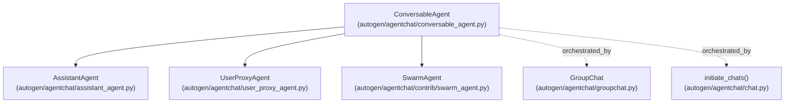
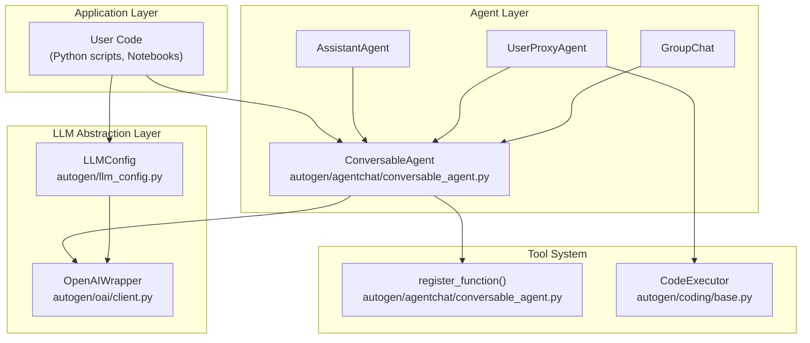
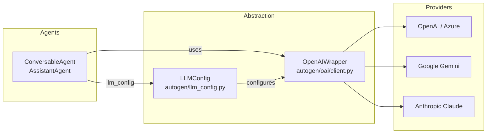

<!-- source: DeepWiki mcp.deepwiki.com · repo ag2ai/ag2 · page 1 Overview · fetched 2026-10-26 -->

# Overview

<details>
<summary>Relevant source files</summary>

The following files were used as context for generating this wiki page:

- [.github/workflows/python-package.yml](.github/workflows/python-package.yml)
- [README.md](README.md)
- [autogen/__init__.py](autogen/__init__.py)
- [autogen/agentchat/__init__.py](autogen/agentchat/__init__.py)
- [autogen/agentchat/agent.py](autogen/agentchat/agent.py)
- [autogen/agentchat/eligibility_policy.py](autogen/agentchat/eligibility_policy.py)
- [autogen/coding/jupyter/import_utils.py](autogen/coding/jupyter/import_utils.py)
- [autogen/import_utils.py](autogen/import_utils.py)
- [autogen/tools/experimental/deep_research/deep_research.py](autogen/tools/experimental/deep_research/deep_research.py)
- [autogen/version.py](autogen/version.py)
- [notebook/agentchat_groupchat_eligibility.ipynb](notebook/agentchat_groupchat_eligibility.ipynb)
- [test/agentchat/realtime_agent/clients/test_gemini_realtime_client.py](test/agentchat/realtime_agent/clients/test_gemini_realtime_client.py)
- [test/agentchat/realtime_agent/clients/test_oai_realtime_client.py](test/agentchat/realtime_agent/clients/test_oai_realtime_client.py)
- [test/agentchat/test_eligibility_policy.py](test/agentchat/test_eligibility_policy.py)
- [test/agentchat/test_groupchat_eligibility.py](test/agentchat/test_groupchat_eligibility.py)
- [test/test_import_utils.py](test/test_import_utils.py)
- [test/tools/experimental/deep_research/test_deep_research.py](test/tools/experimental/deep_research/test_deep_research.py)
- [website/docs/community-talks/2025-04-10-NOVA/index.mdx](website/docs/community-talks/2025-04-10-NOVA/index.mdx)
- [website/docs/home/quickstart.mdx](website/docs/home/quickstart.mdx)
- [website/docs/quick-start.mdx](website/docs/quick-start.mdx)
- [website/docs/user-guide/advanced-concepts/llm-configuration-deep-dive.mdx](website/docs/user-guide/advanced-concepts/llm-configuration-deep-dive.mdx)
- [website/docs/user-guide/advanced-concepts/orchestration/group-chat.mdx](website/docs/user-guide/advanced-concepts/orchestration/group-chat.mdx)
- [website/docs/user-guide/advanced-concepts/orchestration/group-chat/context-variables.mdx](website/docs/user-guide/advanced-concepts/orchestration/group-chat/context-variables.mdx)
- [website/docs/user-guide/advanced-concepts/orchestration/group-chat/handoffs.mdx](website/docs/user-guide/advanced-concepts/orchestration/group-chat/handoffs.mdx)
- [website/docs/user-guide/advanced-concepts/orchestration/group-chat/introduction.mdx](website/docs/user-guide/advanced-concepts/orchestration/group-chat/introduction.mdx)
- [website/docs/user-guide/advanced-concepts/orchestration/group-chat/patterns.mdx](website/docs/user-guide/advanced-concepts/orchestration/group-chat/patterns.mdx)
- [website/docs/user-guide/advanced-concepts/orchestration/nested-chat.mdx](website/docs/user-guide/advanced-concepts/orchestration/nested-chat.mdx)
- [website/docs/user-guide/advanced-concepts/orchestration/sequential-chat.mdx](website/docs/user-guide/advanced-concepts/orchestration/sequential-chat.mdx)
- [website/docs/user-guide/advanced-concepts/pattern-cookbook/context_aware_routing.mdx](website/docs/user-guide/advanced-concepts/pattern-cookbook/context_aware_routing.mdx)
- [website/docs/user-guide/advanced-concepts/tools/tools-with-secrets.mdx](website/docs/user-guide/advanced-concepts/tools/tools-with-secrets.mdx)
- [website/docs/user-guide/basic-concepts/conversable-agent.mdx](website/docs/user-guide/basic-concepts/conversable-agent.mdx)
- [website/docs/user-guide/basic-concepts/installing-ag2.mdx](website/docs/user-guide/basic-concepts/installing-ag2.mdx)
- [website/docs/user-guide/basic-concepts/introducing-swarm-orchestration.mdx](website/docs/user-guide/basic-concepts/introducing-swarm-orchestration.mdx)
- [website/docusaurus.config.js](website/docusaurus.config.js)

</details>


## Purpose and Scope

This document provides a high-level introduction to the AG2 (formerly AutoGen) framework, its architecture, and core capabilities. It explains what AG2 is, how its components fit together, and the fundamental concepts needed to understand the system. For detailed information about specific subsystems, refer to their dedicated pages: [Core Agent System](#2), [LLM Integration](#3), [Advanced Agent Types](#4), [Tools and Capabilities](#5), and [Developer Guide](#13).

## What is AG2?

AG2 is an open-source programming framework for building AI agents and facilitating multi-agent collaboration. The framework provides:

- **Agent-based architecture** built on the `ConversableAgent` base class [autogen/agentchat/conversable_agent.py:1]()
- **LLM abstraction layer** supporting 10+ providers through `OpenAIWrapper` [autogen/oai/client.py:1]()
- **Tool integration system** with secure execution and dependency injection [autogen/agentchat/conversable_agent.py:17]()
- **Multi-agent orchestration** via `GroupChat`, swarms, and nested chat patterns [autogen/agentchat/groupchat.py:28]()
- **Code execution capabilities** through Docker or local executors [autogen/agentchat/user_proxy_agent.py:29]()
- **Extensible design** allowing custom agents, providers, and tools [autogen/agentchat/agent.py:22-27]()

The project evolved from Microsoft's AutoGen and is now moving towards a v1.0 release where the beta framework (`autogen.beta`) will become the official version [README.md:46-49]().

**Sources:** [README.md:46-55](), [README.md:139-148](), [autogen/agentchat/__init__.py:7-30]()

## Core Architecture

### Agent System Foundation

The framework is built around a hierarchical agent class structure with `ConversableAgent` as the foundation:



**Agent Class Hierarchy**

| Agent Type | Purpose | Key Methods |
|------------|---------|-------------|
| `ConversableAgent` | Base class for all agents | `send()`, `receive()`, `generate_reply()` [autogen/agentchat/agent.py:41-108]() |
| `AssistantAgent` | LLM-powered AI assistant | Inherits base, configured for LLM responses [autogen/agentchat/assistant_agent.py:8]() |
| `UserProxyAgent` | Human input + code execution | `initiate_chat()`, `run()`, code executor integration [autogen/agentchat/user_proxy_agent.py:29]() |
| `SwarmAgent` | Dynamic agent transitions | `run_swarm()`, handoff conditions [autogen/agentchat/contrib/swarm_agent.py:12-16]() |

**Sources:** [README.md:149-155](), [autogen/agentchat/__init__.py:7-30](), [autogen/agentchat/agent.py:22-158]()

### System Component Diagram



This diagram shows how user code interacts with agents, which delegate to the LLM abstraction layer and utilize tools.

**Sources:** [README.md:115-130](), [autogen/__init__.py:9-46](), [autogen/agentchat/__init__.py:7-30]()

## Package Structure and Distribution

AG2 is distributed on PyPI under two package names for backward compatibility:

| Package | PyPI Name | Description |
|---------|-----------|-------------|
| Primary | `ag2` | New branding (v0.3+) [README.md:85]() |
| Legacy | `autogen` | Alias for backward compatibility [README.md:85]() |

**Installation Commands**

```bash
# Standard installation
pip install ag2[openai]

# Or using legacy name
pip install autogen[openai]
```

**Version Information**

Current version is defined in [autogen/version.py:7]():

```python
__version__ = "0.11.5"
```

**Optional Dependencies**

AG2 uses a minimal core with optional feature sets installed via extras like `[openai]`, `[gemini]`, `[anthropic]`, etc. [website/docs/user-guide/basic-concepts/installing-ag2.mdx:24-32]().

For details, see [Package Structure and Distribution](#1.1).

**Sources:** [README.md:83-98](), [autogen/version.py:1-8](), [.github/workflows/python-package.yml:58-69](), [website/docs/user-guide/basic-concepts/installing-ag2.mdx:7-23]()

## LLM Integration Architecture

AG2 abstracts LLM interactions through a unified interface:



**Example Configuration** ([README.md:107-114]()):

```json
[
  {
    "model": "gpt-5",
    "api_key": "<your OpenAI API key here>"
  }
]
```

For detailed information on LLM integration, see [LLM Integration](#3).

**Sources:** [README.md:99-114](), [autogen/llm_config.py:37](), [autogen/oai/__init__.py:38-46]()

## Multi-Agent Orchestration

AG2 supports multiple orchestration patterns:

| Pattern | Implementation | Use Case |
|---------|----------------|----------|
| Two-agent chat | `initiate_chat()` | Simple request-response [website/docs/home/quickstart.mdx:145]() |
| Group chat | `GroupChat`, `GroupChatManager` | Multiple agents with speaker selection [autogen/agentchat/groupchat.py:28]() |
| Swarm | `run_swarm()` | Dynamic agent handoffs [autogen/agentchat/contrib/swarm_agent.py:15]() |

**Sources:** [README.md:143-146](), [autogen/agentchat/__init__.py:20-28](), [website/docs/user-guide/advanced-concepts/orchestration/group-chat/handoffs.mdx:8-42]()

## Getting Started

**Minimal Example** ([website/docs/quick-start.mdx:42-66]()):

```python
from autogen import ConversableAgent, LLMConfig
import os

llm_config = LLMConfig(
    {"api_type": "openai", "model": "gpt-5-nano", "api_key": os.environ["OPENAI_API_KEY"]}
)

my_agent = ConversableAgent(
    name="helpful_agent",
    system_message="You are a poetic AI assistant, respond in rhyme.",
    llm_config=llm_config,
)

response = my_agent.run(
    message="In one sentence, what's the big deal about AI?",
    max_turns=3,
)
response.process()
```

For comprehensive setup instructions, see [Installation and Configuration](#1.2).

**Sources:** [README.md:115-130](), [website/docs/quick-start.mdx:6-100]()

---

