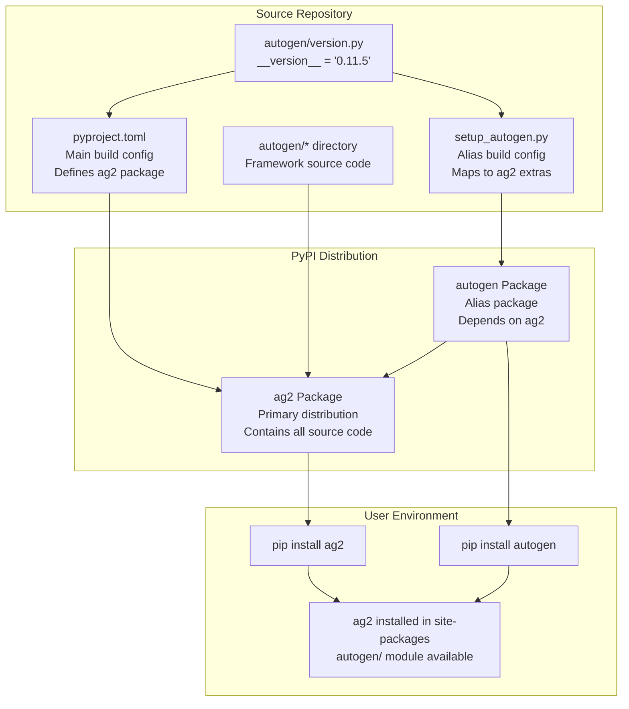
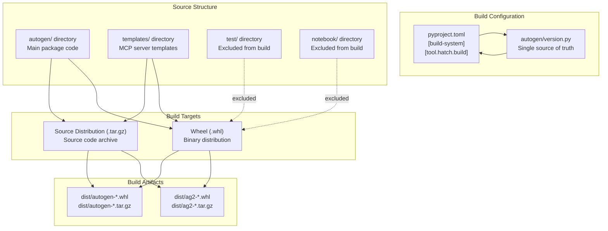
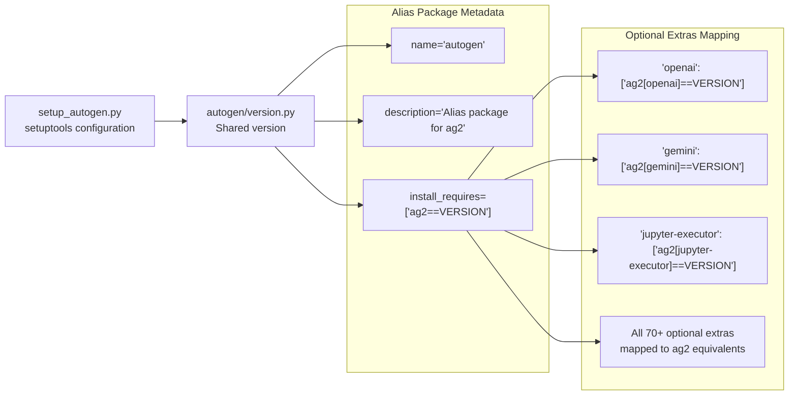
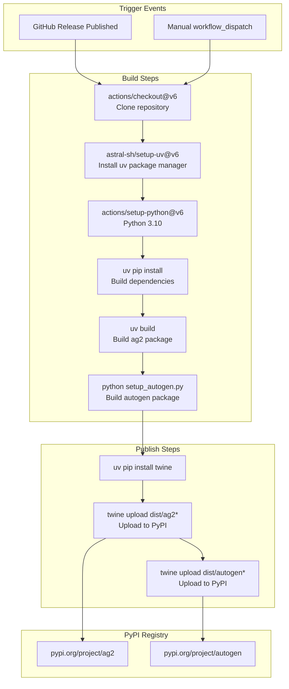
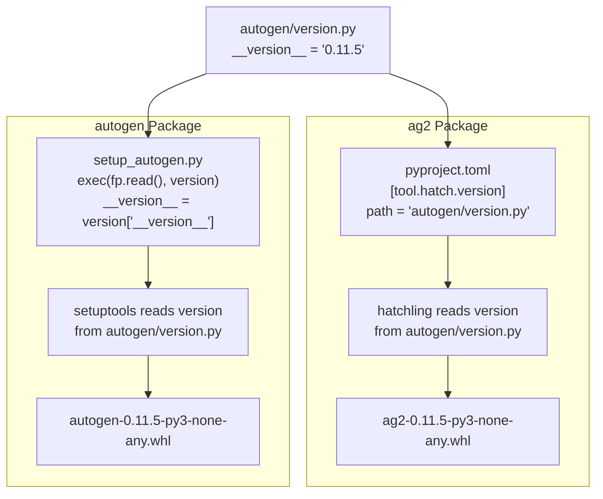
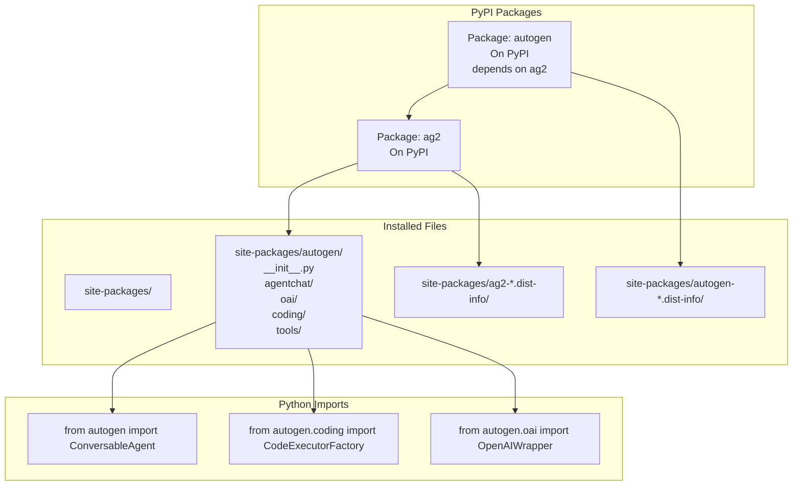

<!-- source: DeepWiki mcp.deepwiki.com · repo ag2ai/ag2 · page 1.1 Package Structure and Distribution · fetched 2026-10-26 -->

# Package Structure and Distribution

<details>
<summary>Relevant source files</summary>

The following files were used as context for generating this wiki page:

- [.github/CODEOWNERS](.github/CODEOWNERS)
- [.github/workflows/python-package.yml](.github/workflows/python-package.yml)
- [LICENSE](LICENSE)
- [MAINTAINERS.md](MAINTAINERS.md)
- [NOTICE.md](NOTICE.md)
- [README.md](README.md)
- [TRANSPARENCY_FAQS.md](TRANSPARENCY_FAQS.md)
- [autogen/beta/agent.py](autogen/beta/agent.py)
- [autogen/coding/jupyter/import_utils.py](autogen/coding/jupyter/import_utils.py)
- [autogen/import_utils.py](autogen/import_utils.py)
- [autogen/oai/openai_responses.py](autogen/oai/openai_responses.py)
- [autogen/tools/experimental/__init__.py](autogen/tools/experimental/__init__.py)
- [autogen/version.py](autogen/version.py)
- [notebook/agentchat_gpt5.1_apply_patch_example.ipynb](notebook/agentchat_gpt5.1_apply_patch_example.ipynb)
- [pyproject.toml](pyproject.toml)
- [setup_autogen.py](setup_autogen.py)
- [test/agentchat/realtime_agent/clients/test_gemini_realtime_client.py](test/agentchat/realtime_agent/clients/test_gemini_realtime_client.py)
- [test/agentchat/realtime_agent/clients/test_oai_realtime_client.py](test/agentchat/realtime_agent/clients/test_oai_realtime_client.py)
- [test/oai/test_responses_client.py](test/oai/test_responses_client.py)
- [test/test_import_utils.py](test/test_import_utils.py)
- [website/docs/user-guide/FAQ.mdx](website/docs/user-guide/FAQ.mdx)
- [website/docs/user-guide/observability/logging_events.mdx](website/docs/user-guide/observability/logging_events.mdx)
- [website/docs/user-guide/reference-tools/index.mdx](website/docs/user-guide/reference-tools/index.mdx)
- [website/docusaurus.config.js](website/docusaurus.config.js)
- [website/mint-json-template.json.jinja](website/mint-json-template.json.jinja)

</details>


This document details AG2's package structure, distribution mechanism, optional dependencies system, and build/release pipeline. For information about installation and configuration steps, see [Installation and Configuration](#1.2). For details on how optional features integrate into the codebase, see [Optional Dependencies and Feature Sets](#13.3).

---

## Package Architecture Overview

AG2 is distributed as two PyPI packages with a specific relationship: `ag2` is the primary package containing all source code, while `autogen` serves as a backward-compatible alias that depends on `ag2`. This architecture allows users to install either package name while maintaining a single codebase.

### Package Relationship Diagram



**Sources:** [pyproject.toml:34-36](), [pyproject.toml:12-13](), [setup_autogen.py:24-29](), [autogen/version.py:7](), [README.md:85-90]()

---

## Core Package Configuration

The `pyproject.toml` file defines the `ag2` package using the `hatchling` build backend. The package structure is optimized for modularity with minimal required dependencies and extensive optional features.

### Package Metadata

The core package metadata defines basic information and Python version requirements:

| Property | Value | Location |
|----------|-------|----------|
| Package Name | `ag2` | [pyproject.toml:34]() |
| Build System | `hatchling` | [pyproject.toml:1-3]() |
| Python Version | `>=3.10` | [pyproject.toml:51]() |
| License | Apache-2.0 | [pyproject.toml:37]() |
| Version Source | `autogen/version.py` | [pyproject.toml:5-6]() |

The version is dynamically read from [autogen/version.py:7](), which contains:

```python
__version__ = "0.11.5"
```

This version string is used by both `ag2` and `autogen` packages to ensure synchronization.

### Minimal Dependencies

The core package installs with minimal dependencies to keep the base installation lightweight:

```toml
dependencies = [
    "termcolor",
    "python-dotenv",
    "tiktoken",
    "pydantic>=2.6.1,<3",
    "pyyaml>=6.0.2",
    "docker",
    "packaging",
    "httpx>=0.28.1,<1",
    "anyio>=4.0.0,<5.0.0",
    "fast-depends[pydantic]>=3.0.8,<4.0.0"
]
```

These dependencies provide:
- **termcolor**: Terminal output formatting [pyproject.toml:79]()
- **python-dotenv**: Environment variable management [pyproject.toml:80]()
- **tiktoken**: Token counting for LLMs [pyproject.toml:81]()
- **pydantic**: Data validation and configuration [pyproject.toml:82]()
- **pyyaml**: YAML parsing for configuration [pyproject.toml:83]()
- **docker**: Container execution support [pyproject.toml:84]()
- **packaging**: Version parsing utilities [pyproject.toml:85]()
- **httpx**: HTTP client for API calls [pyproject.toml:86]()
- **anyio**: Async I/O support [pyproject.toml:87]()
- **fast-depends**: Dependency injection for tools [pyproject.toml:89]()

**Sources:** [pyproject.toml:78-90](), [pyproject.toml:51]()

---

## Optional Dependencies System

AG2's optional dependencies are organized into functional groups that users install based on their needs. This modular approach reduces installation size and dependency conflicts.

### Dependency Group Architecture

```mermaid
graph TB
    BASE["ag2 Base Package<br/>Minimal dependencies"]
    
    subgraph "LLM Providers"
        OPENAI["openai<br/>OpenAI API"]
        ANTHROPIC["anthropic<br/>Claude/Bedrock"]
        GEMINI["gemini<br/>Google Gemini/Vertex"]
        MISTRAL["mistral<br/>Mistral AI"]
        COHERE["cohere<br/>Cohere API"]
        OLLAMA["ollama<br/>Local models"]
        CEREBRAS["cerebras<br/>Cerebras Cloud"]
        GROQ["groq<br/>Groq API"]
        DEEPSEEK["deepseek<br/>DeepSeek API"]
    end
    
    subgraph "Code Execution"
        JUPYTER["jupyter-executor<br/>Jupyter kernels"]
        REMYX["remyx<br/>Research paper envs"]
        YEPCODE["yepcode<br/>Serverless execution"]
    end
    
    subgraph "RAG & Search"
        RETRIEVE["retrievechat<br/>ChromaDB RAG"]
        PGVECTOR["retrievechat-pgvector<br/>PostgreSQL vector"]
        QDRANT["retrievechat-qdrant<br/>Qdrant vector"]
        RAG["rag<br/>Advanced RAG with docling"]
        FALKOR["graph-rag-falkor-db<br/>Graph RAG"]
    end
    
    subgraph "Tools & Integrations"
        CRAWL["crawl4ai<br/>Web scraping"]
        BROWSER["browser-use<br/>Browser automation"]
        DUCKDUCKGO["duckduckgo<br/>Search"]
        TAVILY["tavily<br/>Search API"]
        MCP["mcp<br/>Model Context Protocol"]
        INTEROP["interop<br/>CrewAI/LangChain"]
    end
    
    BASE --> OPENAI
    BASE --> ANTHROPIC
    BASE --> GEMINI
    BASE --> MISTRAL
    BASE --> COHERE
    BASE --> OLLAMA
    BASE --> CEREBRAS
    BASE --> GROQ
    BASE --> DEEPSEEK
    
    BASE --> JUPYTER
    BASE --> REMYX
    BASE --> YEPCODE
    
    BASE --> RETRIEVE
    BASE --> PGVECTOR
    BASE --> QDRANT
    BASE --> RAG
    BASE --> FALKOR
    
    BASE --> CRAWL
    BASE --> BROWSER
    BASE --> DUCKDUCKGO
    BASE --> TAVILY
    BASE --> MCP
    BASE --> INTEROP
```



**Sources:** [pyproject.toml:92-287]()

### LLM Provider Dependencies

AG2 supports multiple LLM providers through optional dependencies:

| Group | Packages | Purpose |
|-------|----------|---------|
| `openai` | `openai>=1.99.3,<2` | OpenAI API including GPT models [pyproject.toml:109]() |
| `openai-realtime` | `ag2[openai]`, `openai[realtime]` | Real-time audio API support [pyproject.toml:110]() |
| `anthropic` | `anthropic[vertex]>=0.79.0,<1` | Claude models via Anthropic/Bedrock/Vertex [pyproject.toml:114]() |
| `gemini` | `google-genai>=1.20.0,<2.0`, `google-cloud-aiplatform` | Google Gemini/Vertex AI [pyproject.toml:116-126]() |
| `gemini-realtime` | `ag2[gemini]`, `ag2[websockets]` | Real-time Gemini API [pyproject.toml:127]() |
| `mistral` | `mistralai>=2.0.0` | Mistral AI models [pyproject.toml:135]() |
| `cohere` | `cohere>=5.13.5` | Cohere language models [setup_autogen.py:89]() |
| `ollama` | `ollama>=0.4.7`, `fix_busted_json>=0.0.18` | Local model execution [pyproject.toml:131]() |
| `cerebras` | `cerebras_cloud_sdk>=1.0.0` | Cerebras Cloud API [setup_autogen.py:85]() |
| `groq` | `groq>=0.9.0` | Groq inference API [pyproject.toml:129]() |
| `together` | `together>=1.2` | Together AI API [setup_autogen.py:80]() |
| `bedrock` | `boto3>=1.34.149` | AWS Bedrock [pyproject.toml:133]() |
| `deepseek` | `ag2[openai]` | DeepSeek API (OpenAI-compatible) [pyproject.toml:112]() |

**Sources:** [pyproject.toml:109-138](), [setup_autogen.py:80-94]()

### Code Execution Dependencies

Code execution environments require specific dependencies:

| Group | Key Packages | Executor Type |
|-------|-------------|---------------|
| `jupyter-executor` | `jupyter-kernel-gateway`, `jupyter-client>=8.6.0`, `ipykernel>=6.29.0` | Interactive Jupyter kernels [pyproject.toml:150-156]() |
| `remyx` | `remyxai>=0.2.0` | Research paper environment [setup_autogen.py:87]() |
| `yepcode` | `yepcode-run>=1.6.1` | Serverless cloud execution [setup_autogen.py:86]() |
| `daytona` | `daytona-sdk` | Daytona remote workspace [setup_autogen.py:88]() |

**Sources:** [pyproject.toml:150-156](), [setup_autogen.py:86-88]()

### RAG and Vector Store Dependencies

Retrieval-Augmented Generation support includes multiple vector store backends:

| Group | Key Packages | Backend |
|-------|-------------|---------|
| `retrievechat` | `chromadb>=1.4.1,<1.5`, `sentence_transformers>=5.2.2`, `pypdf` | ChromaDB vector store [pyproject.toml:158-166]() |
| `retrievechat-pgvector` | `ag2[retrievechat]`, `pgvector>=0.2.5`, `psycopg` | PostgreSQL with pgvector [pyproject.toml:168-173]() |
| `retrievechat-mongodb` | `ag2[retrievechat]`, `pymongo>=4.0.0` | MongoDB vector search [pyproject.toml:175]() |
| `retrievechat-qdrant` | `ag2[retrievechat]`, `qdrant_client`, `fastembed>=0.3.1` | Qdrant vector database [pyproject.toml:177]() |
| `rag` | `docling>=2.15.1,<3`, `chromadb>=0.5,<2`, `llama-index>=0.14.13` | Advanced RAG with document parsing [pyproject.toml:183-197]() |
| `graph-rag-falkor-db` | `graphrag_sdk==0.8.2`, `falkordb>=1.0.10` | Graph-based RAG [pyproject.toml:181]() |

**Sources:** [pyproject.toml:158-197]()

### Tool and Integration Dependencies

External tools and framework integrations:

| Group | Packages | Purpose |
|-------|----------|---------|
| `crawl4ai` | `crawl4ai>=0.5.0,<0.9` | Web crawling and scraping [pyproject.toml:200]() |
| `browser-use` | `browser-use>=0.3.1,<1.0` | Browser automation [pyproject.toml:212]() |
| `duckduckgo` | `duckduckgo_search` | DuckDuckGo search [setup_autogen.py:93]() |
| `tavily` | `tavily-python` | Tavily search API [setup_autogen.py:94]() |
| `google-search` | `ag2[google-client]` | Google search integration [pyproject.toml:224]() |
| `wikipedia` | `wikipedia-api>=0.8.1, <1.0` | Wikipedia queries [pyproject.toml:226]() |
| `mcp` | `mcp>=1.11.0` | Model Context Protocol [pyproject.toml:240]() |
| `mcp-proxy-gen` | `fastapi-code-generator>=0.5.4`, `fastapi>=0.112` | MCP proxy generation [pyproject.toml:245-251]() |
| `interop-crewai` | `crewai[tools]>=0.76,<1`, `litellm<=1.76.3` | CrewAI integration [pyproject.toml:253-259]() |
| `interop-langchain` | `langchain-community>=0.3.12` | LangChain integration [pyproject.toml:260]() |
| `interop-pydantic-ai` | `pydantic-ai>=0.0.12` | Pydantic AI integration [pyproject.toml:261]() |

The experimental tools system is exposed via [autogen/tools/experimental/__init__.py:30-58]() with classes like `BrowserUseTool`, `Crawl4AITool`, `DuckDuckGoSearchTool`, `TavilySearchTool`, etc.

**Sources:** [pyproject.toml:200-261](), [autogen/tools/experimental/__init__.py:30-58]()

### Development Dependencies

Development, testing, and documentation dependencies are also organized as optional groups:

| Group | Purpose | Key Packages |
|-------|---------|-------------|
| `test` | Testing infrastructure | `pytest>=8.3.4`, `pytest-cov`, `pytest-asyncio` [pyproject.toml:311-320]() |
| `docs` | Documentation generation | `mkdocs-material`, `mkdocstrings`, `pdoc3` [pyproject.toml:322-337]() |
| `types` | Type checking | `mypy==1.15.0`, type stubs [pyproject.toml:339-346]() |
| `lint` | Code quality | `ruff==0.9.6`, `codespell` [pyproject.toml:348-352]() |
| `dev` | Complete dev environment | Combines all dev dependencies [pyproject.toml:354-361]() |

**Sources:** [pyproject.toml:311-361]()

---

## Build System Configuration

AG2 uses the `hatchling` build backend with specific configurations for package assembly and distribution.

### Build Configuration Structure



**Sources:** [pyproject.toml:1-10](), [pyproject.toml:12-25]()

### Build System Definition

The build system is configured in [pyproject.toml:1-6]():

```toml
[build-system]
requires = ["hatchling"]
build-backend = "hatchling.build"

[tool.hatch.version]
path = "autogen/version.py"
```

This configuration:
- Uses `hatchling` as the PEP 517 build backend [pyproject.toml:2-3]()
- Dynamically reads version from `autogen/version.py` [pyproject.toml:6]()
- Supports both wheel and sdist generation [pyproject.toml:12-20]()

### Package Contents

The build configuration specifies what to include in distributions:

```toml
[tool.hatch.build]
skip-excluded-dirs = true
exclude = ["/test", "/notebook"]

[tool.hatch.build.targets.wheel]
packages = ["autogen"]
only-include = [
    "autogen",
    "templates",
]
```

The `autogen/` directory contains all framework code. The `templates/` directory is included specifically for the generation of MCP Servers from OpenAPI specifications [pyproject.toml:16-18]().

**Sources:** [pyproject.toml:8-18]()

---

## Autogen Alias Package

The `autogen` package is built separately using `setup_autogen.py` and serves as a pure alias to `ag2`.

### Alias Package Structure



**Sources:** [setup_autogen.py:23-103]()

### Setup Script Structure

The [setup_autogen.py:23-114]() script creates the alias package:

```python
setuptools.setup(
    name="autogen",
    version=__version__,
    description="Alias package for ag2",
    long_description=long_description,
    long_description_content_type="text/markdown",
    install_requires=["ag2==" + __version__],
    extras_require={
        "openai": ["ag2[openai]==" + __version__],
        "gemini": ["ag2[gemini]==" + __version__],
        "jupyter-executor": ["ag2[jupyter-executor]==" + __version__],
        # ... all other extras mapped similarly
    },
    python_requires=">=3.10,<3.14",
)
```

This setup ensures:
1. `pip install autogen` installs the same version of `ag2` [setup_autogen.py:29]()
2. All optional extras are passed through to `ag2` equivalents [setup_autogen.py:30-103]()
3. Version numbers stay synchronized [setup_autogen.py:25]()
4. Users can use either package name interchangeably [setup_autogen.py:26]()

**Sources:** [setup_autogen.py:17-114]()

---

## Distribution Pipeline

AG2 uses GitHub Actions for automated building and publishing to PyPI when releases are created.

### CI/CD Workflow Architecture



**Sources:** [.github/workflows/python-package.yml:1-70]()

### Workflow Configuration

The GitHub Actions workflow [.github/workflows/python-package.yml:5-70]() runs on:
- Release published events [github/workflows/python-package.yml:8-9]()
- Manual trigger via `workflow_dispatch` [github/workflows/python-package.yml:10]()

Build process:
1. **Environment Setup**: Ubuntu with Python 3.10 and `uv` package manager [.github/workflows/python-package.yml:21-31]()
2. **Build ag2**: `uv build` generates wheel and source distributions [.github/workflows/python-package.yml:47]()
3. **Build autogen**: `python setup_autogen.py sdist bdist_wheel` creates alias package [.github/workflows/python-package.yml:57]()
4. **Publish**: Twine uploads both packages to PyPI with credentials from GitHub secrets [.github/workflows/python-package.yml:63-69]()

**Sources:** [.github/workflows/python-package.yml:1-70]()

---

## Version Management

Version management ensures both `ag2` and `autogen` packages remain synchronized through a single source of truth.

### Version Synchronization



**Sources:** [autogen/version.py:7](), [pyproject.toml:5-6](), [setup_autogen.py:17-21]()

### Version File

The version is defined in [autogen/version.py:1-8]():

```python
# Copyright (c) 2023 - 2026, AG2ai, Inc., AG2ai open-source projects maintainers and core contributors
#
# SPDX-License-Identifier: Apache-2.0

__all__ = ("__version__",)

__version__ = "0.11.5"
```

### Version Resolution

**For ag2 package** [pyproject.toml:53](), [pyproject.toml:5-6]():
- Build system declares `dynamic = ["version"]` [pyproject.toml:53]()
- Hatchling reads from `path = "autogen/version.py"` [pyproject.toml:6]()

**For autogen package** [setup_autogen.py:17-21]():
- Script executes `version.py` and extracts `__version__` [setup_autogen.py:20-21]()
- Uses same value for package version and dependency constraint [setup_autogen.py:25,29]()

**Sources:** [autogen/version.py:1-8](), [pyproject.toml:5-6,53](), [setup_autogen.py:17-21]()

---

## Installation Patterns

Users can install AG2 using several patterns depending on their needs.

### Basic Installation

The simplest installations use the base package with optional LLM provider:

```bash
# Install ag2 with OpenAI support
pip install ag2[openai]

# Install via autogen alias (equivalent)
pip install autogen[openai]
```

On macOS, quotes are required due to shell interpretation:

```bash
# macOS/Zsh requires quotes
pip install 'ag2[openai]'
```

**Sources:** [README.md:85-95]()

### Multiple Optional Dependencies

Users can install multiple optional dependency groups. The package resolver handles transitive dependencies automatically.

```bash
# Install with multiple LLM providers
pip install ag2[openai,gemini,anthropic]

# Install with LLM provider and tools
pip install ag2[openai,browser-use,crawl4ai]
```

### Feature-Complete Installation

For development or comprehensive feature usage, the `dev` extra [pyproject.toml:354-361]() includes `lint`, `test`, `types`, and `docs` groups.

```bash
# Install with dev dependencies
pip install ag2[dev]

# Install with all interoperability features
pip install ag2[interop]  # Includes crewai, langchain, pydantic-ai
```

**Sources:** [pyproject.toml:354-361](), [pyproject.toml:272]()

---

## Package Import Structure

Despite being distributed as two packages, both install the same `autogen` module in Python environments.

### Import Resolution



Both `pip install ag2` and `pip install autogen` result in the `autogen/` directory in site-packages [pyproject.toml:13](). All code imports use the `autogen` module name [README.md:121]().

**Sources:** [README.md:121](), [pyproject.toml:13](), [setup_autogen.py:24,29]()

---

