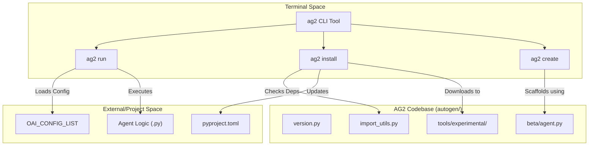
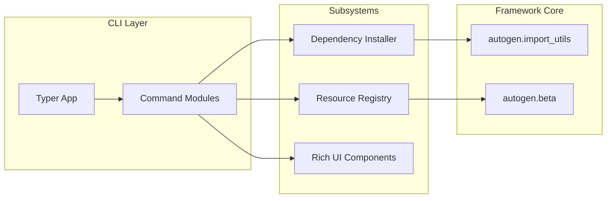

<!-- source: DeepWiki mcp.deepwiki.com · repo ag2ai/ag2 · page 10 AG2 CLI · fetched 2026-10-26 -->

# AG2 CLI

Relevant source files

The following files were used as context for generating this wiki page:

- [.github/workflows/python-package.yml](.github/workflows/python-package.yml)
- [README.md](README.md)
- [autogen/beta/agent.py](autogen/beta/agent.py)
- [autogen/coding/jupyter/import_utils.py](autogen/coding/jupyter/import_utils.py)
- [autogen/import_utils.py](autogen/import_utils.py)
- [autogen/tools/experimental/__init__.py](autogen/tools/experimental/__init__.py)
- [autogen/version.py](autogen/version.py)
- [pyproject.toml](pyproject.toml)
- [setup_autogen.py](setup_autogen.py)
- [test/agentchat/realtime_agent/clients/test_gemini_realtime_client.py](test/agentchat/realtime_agent/clients/test_gemini_realtime_client.py)
- [test/agentchat/realtime_agent/clients/test_oai_realtime_client.py](test/agentchat/realtime_agent/clients/test_oai_realtime_client.py)
- [test/test_import_utils.py](test/test_import_utils.py)
- [website/docs/user-guide/reference-tools/index.mdx](website/docs/user-guide/reference-tools/index.mdx)
- [website/docusaurus.config.js](website/docusaurus.config.js)
- [website/mint-json-template.json.jinja](website/mint-json-template.json.jinja)

The AG2 CLI (Command Line Interface) is a unified terminal tool designed to streamline the development lifecycle of multi-agent applications. It provides commands for scaffolding new projects, managing resources like "skills" and "tools," running agentic workflows, and deploying applications to various environments. The CLI acts as a bridge between the high-level natural language requirements of a developer and the underlying code entities of the AG2 framework.

## Overview and Purpose

The CLI tool, accessible via the `ag2` command (with `autogen` as a legacy alias), is built to reduce the boilerplate associated with setting up complex multi-agent systems. It manages the installation of specialized dependencies, facilitates testing in "arena" environments, and provides a "resource-hub" for sharing agent artifacts.

For detailed command usage and options, see [CLI Commands Reference](#10.1).
For internal implementation and extension details, see [CLI Architecture and Extension](#10.2).

### CLI to Code Entity Mapping

The following diagram illustrates how CLI operations interact with the core AG2 package structure and external environments.

**CLI-Code Integration Flow**

Sources: [pyproject.toml:243-251](), [autogen/version.py:1-7](), [README.md:83-95](), [autogen/import_utils.py:32-89]()

## Core Command Categories

The AG2 CLI organizes its functionality into several high-level categories to support different phases of development:

| Category | Commands | Description |
| :--- | :--- | :--- |
| **Project Setup** | `create`, `install` | Scaffolds new projects and installs optional feature sets (e.g., `ag2[openai]`). |
| **Execution** | `run`, `chat`, `serve` | Launches agent workflows, interactive chat sessions, or API endpoints for agents. |
| **Development** | `test`, `replay`, `proxy` | Debugs agent interactions, replays previous traces, and manages MCP proxies. |
| **Distribution** | `publish`, `arena` | Shares agents to the resource hub or benchmarks them against other agents. |

For a full list of flags and subcommands, see [CLI Commands Reference](#10.1).

Sources: [pyproject.toml:92-103](), [README.md:121-130](), [setup_autogen.py:23-114]()

## Architecture and Registry System

The CLI is built using the `typer` library, providing a type-safe and self-documenting interface. It interacts closely with the `import_utils.py` module to verify that the necessary optional dependencies are present before attempting to run specific tools or agents.

**CLI Component Architecture**

Sources: [autogen/import_utils.py:166-188](), [pyproject.toml:249-251](), [autogen/beta/agent.py:18-46]()

### Dependency Management
The CLI simplifies the installation of AG2's modular architecture. Since AG2 uses many optional dependencies (e.g., `retrievechat`, `gemini`, `mcp`), the CLI's `install` command manages these sets as defined in `pyproject.toml`. It ensures that when a user requests a "tool" (like `BrowserUseTool`), the underlying environment satisfies the requirements.

For details on extending the CLI or adding new resources to the registry, see [CLI Architecture and Extension](#10.2).

Sources: [pyproject.toml:92-138](), [autogen/tools/experimental/__init__.py:5-28](), [autogen/import_utils.py:189-210]()

---

