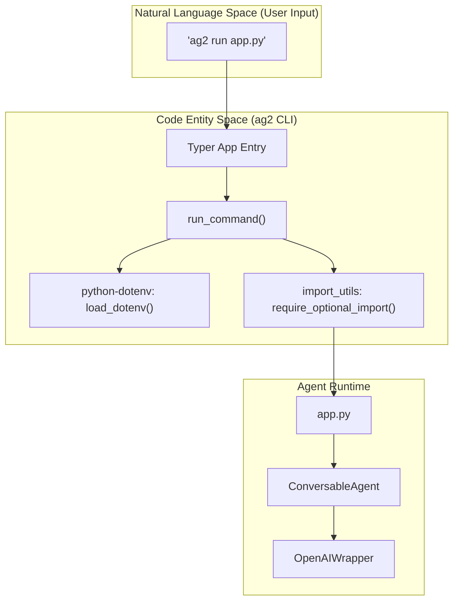
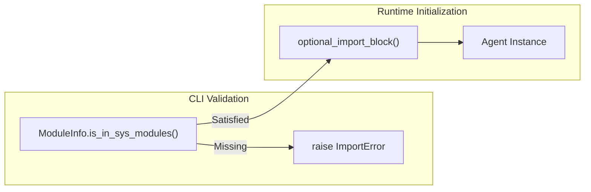

<!-- source: DeepWiki mcp.deepwiki.com · repo ag2ai/ag2 · page 10.1 CLI Commands Reference · fetched 2026-10-26 -->

# CLI Commands Reference

Relevant source files

The following files were used as context for generating this wiki page:

- [.github/workflows/python-package.yml](.github/workflows/python-package.yml)
- [README.md](README.md)
- [autogen/beta/agent.py](autogen/beta/agent.py)
- [autogen/coding/jupyter/import_utils.py](autogen/coding/jupyter/import_utils.py)
- [autogen/import_utils.py](autogen/import_utils.py)
- [autogen/tools/experimental/__init__.py](autogen/tools/experimental/__init__.py)
- [autogen/version.py](autogen/version.py)
- [pyproject.toml](pyproject.toml)
- [setup_autogen.py](setup_autogen.py)
- [test/agentchat/realtime_agent/clients/test_gemini_realtime_client.py](test/agentchat/realtime_agent/clients/test_gemini_realtime_client.py)
- [test/agentchat/realtime_agent/clients/test_oai_realtime_client.py](test/agentchat/realtime_agent/clients/test_oai_realtime_client.py)
- [test/test_import_utils.py](test/test_import_utils.py)
- [website/docs/user-guide/reference-tools/index.mdx](website/docs/user-guide/reference-tools/index.mdx)
- [website/docusaurus.config.js](website/docusaurus.config.js)
- [website/mint-json-template.json.jinja](website/mint-json-template.json.jinja)

The `ag2` CLI (also accessible via the `autogen` alias) provides a suite of terminal-based tools for managing the lifecycle of agentic applications. It handles everything from environment setup and dependency management to running multi-agent simulations and serving agents over network protocols.

## Command Overview

The CLI is built using the `typer` framework [pyproject.toml:249-249](), offering a structured command-line interface. The primary entry point is the `ag2` executable.

### 1. Install Command
The `install` command manages the acquisition of external resources, specialized agent definitions, and IDE integrations.

*   **Skills & Tools**: Downloads pre-defined functions or toolsets from the AG2 resource hub.
*   **Templates**: Scaffolds new projects based on proven multi-agent patterns (e.g., Swarm, GroupChat).
*   **IDE Integration**: Configures AG2 support for specific editors like Cursor, Claude Code, or GitHub Copilot [website/mint-json-template.json.jinja:108-110]().

### 2. Run & Chat
These commands provide the primary interface for interacting with agents.

*   **`ag2 run <script.py>`**: Executes an AG2 application script. It ensures the environment is correctly configured with necessary optional dependencies defined in `pyproject.toml` [pyproject.toml:92-103]().
*   **`ag2 chat`**: Launches an interactive terminal session where a user can converse with a default or configured `AssistantAgent`. This command utilizes `IOConsole` for message rendering [README.md:121-130]().

### 3. Serve & Proxy
Commands for exposing agents to external systems or bridging protocols.

*   **`serve`**: Starts an ASGI-compatible server to host agents. It often leverages the `ag-ui-protocol` to provide a backend for interactive frontends [pyproject.toml:101-103]().
*   **`proxy`**: Specifically used for the Model Context Protocol (MCP). It can generate MCP-compliant proxies for existing tools or OpenAPI specifications [pyproject.toml:245-251]().

### 4. Test & Replay
*   **`test`**: Runs the AG2 test suite or specific agent validation tests. It integrates with the `test-core` and `test` extras [pyproject.toml:96-97]().
*   **`replay`**: Utilizes the runtime logging system [README.md:158-163]() to re-execute a conversation from a `SqliteLogger` database, allowing for debugging of agent logic without re-invoking LLM calls.

---

## Data Flow: CLI to Agent Execution

The following diagram illustrates how a CLI command like `ag2 run` transitions from a string input to the execution of a `ConversableAgent`.

**CLI Execution Pipeline**

**Sources:** [pyproject.toml:80-80](), [autogen/import_utils.py:24-24](), [README.md:121-130]()

---

## Technical Detail: Installation & Dependency Resolution

AG2 uses a modular dependency system. The CLI `install` command maps user requests to the "extras" defined in `pyproject.toml`.

| Target | Extra Requirement | Key Functionality |
| :--- | :--- | :--- |
| `gemini` | `ag2[gemini]` | `GoogleGenAI` client support [pyproject.toml:116-126]() |
| `browser` | `ag2[browser-use]` | `BrowserUseTool` for web navigation [autogen/tools/experimental/__init__.py:5-5]() |
| `mcp` | `ag2[mcp-proxy-gen]` | Fast API generation for MCP servers [pyproject.toml:245-251]() |
| `realtime` | `ag2[openai-realtime]` | Low-latency WebSocket communication [test/agentchat/realtime_agent/clients/test_gemini_realtime_client.py:11-12]() |

### Implementation of Optional Imports
The CLI relies on `autogen.import_utils` to validate that the environment satisfies the requirements for a specific command. The `ModuleInfo` class [autogen/import_utils.py:32-40]() parses version constraints (e.g., `openai>=1.99.3`) to ensure compatibility before the agent runtime initializes.

**Dependency Validation Flow**

**Sources:** [autogen/import_utils.py:40-48](), [autogen/import_utils.py:165-181]()

---

## Specialized CLI Commands

### MCP Proxy Generation
The `ag2 proxy` command is a technical utility that automates the creation of Model Context Protocol bridges. It uses `fastapi-code-generator` [pyproject.toml:246-246]() to transform an OpenAPI `.json` or `.yaml` file into a set of AG2-compatible tools.

### Arena & Publish
*   **`arena`**: (Experimental) Launches a local leaderboard or evaluation environment where multiple agent configurations can compete on standardized tasks.
*   **`publish`**: Packages a local agent (including its `system_message`, `tools`, and `llm_config`) into a shareable artifact for the AG2 Resource Hub.

### Beta Framework Access
The CLI provides access to the next-generation `autogen.beta` features. When running scripts that utilize `autogen.beta.Agent` [autogen/beta/agent.py:57-57](), the CLI enables advanced middleware processing [autogen/beta/agent.py:35-35]() and event-driven history tracking.

**Sources:** [pyproject.toml:245-251](), [autogen/beta/agent.py:1-57](), [README.md:46-49]()

---

