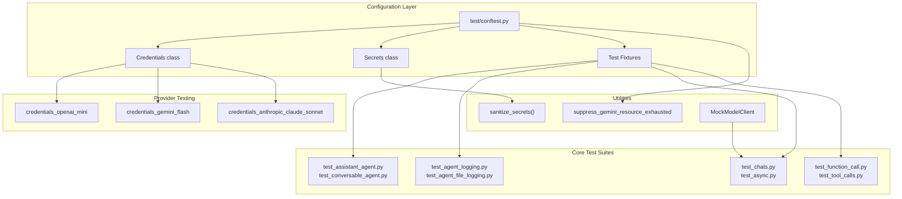
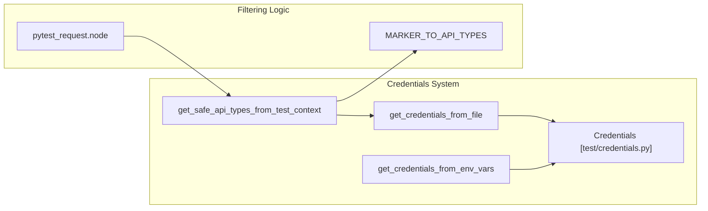
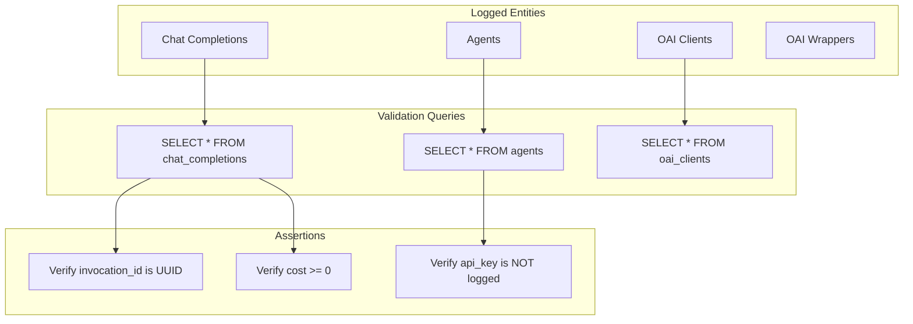

<!-- source: DeepWiki mcp.deepwiki.com · repo ag2ai/ag2 · page 11.1 Testing Framework and Strategies · fetched 2026-10-26 -->

# Testing Framework and Strategies

<details>
<summary>Relevant source files</summary>

The following files were used as context for generating this wiki page:

- [.devcontainer/devcontainer.json](.devcontainer/devcontainer.json)
- [.devcontainer/python-3.11/devcontainer.json](.devcontainer/python-3.11/devcontainer.json)
- [.devcontainer/python-3.12/devcontainer.json](.devcontainer/python-3.12/devcontainer.json)
- [.devcontainer/python-3.13/devcontainer.json](.devcontainer/python-3.13/devcontainer.json)
- [.devcontainer/python-3.14/devcontainer.json](.devcontainer/python-3.14/devcontainer.json)
- [.github/workflows/beta-llm-test.yml](.github/workflows/beta-llm-test.yml)
- [.github/workflows/beta-test.yml](.github/workflows/beta-test.yml)
- [.github/workflows/claude-code-review.yml](.github/workflows/claude-code-review.yml)
- [.github/workflows/claude.yml](.github/workflows/claude.yml)
- [autogen/oai/client.py](autogen/oai/client.py)
- [scripts/devcontainer/generate-devcontainers.py](scripts/devcontainer/generate-devcontainers.py)
- [scripts/devcontainer/templates/devcontainer.json.jinja](scripts/devcontainer/templates/devcontainer.json.jinja)
- [scripts/test-beta-llm.sh](scripts/test-beta-llm.sh)
- [scripts/test-core-llm.sh](scripts/test-core-llm.sh)
- [scripts/test-skip-llm.sh](scripts/test-skip-llm.sh)
- [test/agentchat/test_agent_logging.py](test/agentchat/test_agent_logging.py)
- [test/agentchat/test_agent_usage.py](test/agentchat/test_agent_usage.py)
- [test/agentchat/test_assistant_agent.py](test/agentchat/test_assistant_agent.py)
- [test/agentchat/test_async.py](test/agentchat/test_async.py)
- [test/agentchat/test_async_chats.py](test/agentchat/test_async_chats.py)
- [test/agentchat/test_async_get_human_input.py](test/agentchat/test_async_get_human_input.py)
- [test/agentchat/test_cache_agent.py](test/agentchat/test_cache_agent.py)
- [test/agentchat/test_chats.py](test/agentchat/test_chats.py)
- [test/agentchat/test_function_call.py](test/agentchat/test_function_call.py)
- [test/agentchat/test_function_call_groupchat.py](test/agentchat/test_function_call_groupchat.py)
- [test/agentchat/test_human_input.py](test/agentchat/test_human_input.py)
- [test/agentchat/test_math_user_proxy_agent.py](test/agentchat/test_math_user_proxy_agent.py)
- [test/agentchat/test_nested.py](test/agentchat/test_nested.py)
- [test/agentchat/test_tool_calls.py](test/agentchat/test_tool_calls.py)
- [test/conftest.py](test/conftest.py)
- [test/oai/test_client.py](test/oai/test_client.py)
- [test/oai/test_client_stream.py](test/oai/test_client_stream.py)
- [test/test_conftest.py](test/test_conftest.py)
- [website/docs/beta/roadmap.mdx](website/docs/beta/roadmap.mdx)
- [website/docs/contributor-guide/tests.mdx](website/docs/contributor-guide/tests.mdx)

</details>


AG2's testing infrastructure validates agent behavior, LLM integrations, code execution, and logging functionality across multiple providers and execution environments. The framework uses `pytest` with custom fixtures for credential management, output sanitization, and multi-provider testing.

## Test Infrastructure Architecture

The testing framework centers on `pytest` with custom fixtures in `test/conftest.py` that manage credentials, sanitize sensitive data, and provide utilities for multi-provider testing.

**Test Infrastructure Components**



Sources: [test/conftest.py:7-65](), [test/oai/test_client.py:46-93]()

## Test Organization

### Directory Structure

```
test/
├── conftest.py                           # Pytest configuration, fixtures, secret sanitization
├── credentials.py                        # Credential loading logic
├── agentchat/
│   ├── test_assistant_agent.py           # AssistantAgent & UserProxyAgent tests
│   ├── test_agent_logging.py             # SQLite runtime logging tests
│   ├── test_agent_file_logging.py        # JSON file logging tests
│   ├── test_chats.py                     # Multi-agent initiate_chats tests
│   ├── test_async.py                     # Async groupchat and streaming tests
│   ├── test_function_call.py             # Legacy function calling tests
│   └── test_tool_calls.py                # OpenAI-style tool call tests
├── oai/
│   ├── test_client.py                    # OpenAIWrapper and routing tests
│   └── test_client_stream.py             # LLM streaming and chunk processing tests
```

Sources: [test/agentchat/test_agent_logging.py:1-45](), [test/oai/test_client.py:1-40](), [test/agentchat/test_assistant_agent.py:1-20]()

## Core Testing Components

### Credentials Management

The `Credentials` class provides secure handling of API keys and LLM configurations. The system uses a safety filter to prevent cross-SDK imports during CI, ensuring that a test marked for OpenAI does not accidentally trigger logic requiring the Anthropic SDK.



The `MARKER_TO_API_TYPES` mapping in [test/conftest.py:53-65]() associates pytest markers (e.g., `openai`, `gemini`, `anthropic`) with allowed API types. This prevents the framework from attempting to load configurations for providers not relevant to the current test context.

Sources: [test/conftest.py:53-65](), [test/conftest.py:68-112](), [test/conftest.py:115-160]()

### Security and Sanitization

The `Secrets` class prevents sensitive information from appearing in test logs or terminal output. It intercepts the pytest terminal writer to scrub registered secrets.

| Component | Purpose | Implementation |
|-----------|---------|----------------|
| `Secrets.sanitize_secrets()` | Replaces secrets with `******` | Regex-based replacement [test/credentials.py]() |
| `patch_pytest_terminal_writer()` | Overrides pytest output methods | Wraps `TerminalWriter.write` and `line` [test/conftest.py:29-49]() |
| `get_credentials_from_file` | Loads `OAI_CONFIG_LIST` | Uses `autogen.LLMConfig.from_json` [test/conftest.py:152-157]() |

Sources: [test/conftest.py:29-49](), [test/conftest.py:115-160]()

## Test Categories and Patterns

### LLM Client and Routing Tests

Tests in `test/oai/test_client.py` validate the `OpenAIWrapper`'s ability to route requests across multiple configurations.

**Routing Strategies Validation**
- **Fixed Order**: Ensures the first successful client is always used. [test/oai/test_client.py:142-148]()
- **Round Robin**: Validates that the `_round_robin_index` increments correctly across multiple `create` calls. [test/oai/test_client.py:150-173]()
- **Random**: Checks that different clients are selected over a large sample size.

**Streaming and Chunking**
The `test_client_stream.py` suite validates the reconstruction of partial delta chunks into complete messages, specifically for function calls and tool calls.
- `_update_dict_from_chunk`: Handles basic field updates. [test/oai/test_client_stream.py:49-80]()
- `_update_function_call_from_chunk`: Merges `arguments` and `name` deltas. [test/oai/test_client_stream.py:84-113]()
- `_update_tool_calls_from_chunk`: Manages an array of tool call deltas indexed by the chunk's `index` field. [test/oai/test_client_stream.py:117-173]()

Sources: [test/oai/test_client.py:94-173](), [test/oai/test_client_stream.py:49-173]()

### Agent and Conversation Tests

**Assistant and Proxy Interaction**
Tests in `test/agentchat/test_assistant_agent.py` verify the end-to-end loop between an `AssistantAgent` and a `UserProxyAgent`.
- **Termination Logic**: Validates `is_termination_msg` triggers (e.g., checking for "TERMINATE"). [test/agentchat/test_assistant_agent.py:85-100]()
- **Code Execution**: Verifies that `UserProxyAgent` can run generated code in Docker or local environments. [test/agentchat/test_assistant_agent.py:87-91]()

**Group Chat Orchestration**
- `test_function_call_groupchat.py` ensures that `GroupChatManager` correctly handles tool execution when multiple agents are involved. [test/agentchat/test_function_call_groupchat.py:40-98]()
- `test_chats.py` validates the `initiate_chats` batch interface and summary methods like `reflection_with_llm`. [test/agentchat/test_chats.py:150-163]()

Sources: [test/agentchat/test_assistant_agent.py:71-108](), [test/agentchat/test_function_call_groupchat.py:40-98](), [test/agentchat/test_chats.py:150-163]()

### Logging System Tests

The runtime logging system is tested via `test/agentchat/test_agent_logging.py`, which uses an in-memory SQLite database to verify data persistence.



Key validations include:
- **Completeness**: Ensures `request` and `response` JSON blobs are correctly stored. [test/agentchat/test_agent_logging.py:100-128]()
- **Privacy**: Asserts that sensitive fields like `api_key` are absent from `init_args` in the logs. [test/agentchat/test_agent_logging.py:150-151]()
- **Traceability**: Confirms that `session_id`, `wrapper_id`, and `client_id` link records across different tables. [test/agentchat/test_agent_logging.py:92-98]()

Sources: [test/agentchat/test_agent_logging.py:33-45](), [test/agentchat/test_agent_logging.py:57-184]()

### Function and Tool Calling

Tests validate the conversion of Python functions to JSON schemas and the subsequent execution of LLM-requested calls.
- `test_execute_function`: Checks for correct execution, handling of missing functions, and invalid JSON arguments. [test/agentchat/test_function_call.py:90-154]()
- `test_a_execute_function`: Validates asynchronous tool execution. [test/agentchat/test_function_call.py:156-180]()
- `test_update_tool`: Verifies that tools can be added or removed from an agent's signature dynamically. [test/agentchat/test_tool_calls.py:134-184]()

Sources: [test/agentchat/test_function_call.py:90-180](), [test/agentchat/test_tool_calls.py:134-184]()

---

