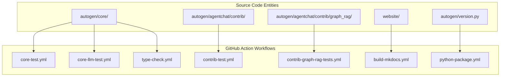
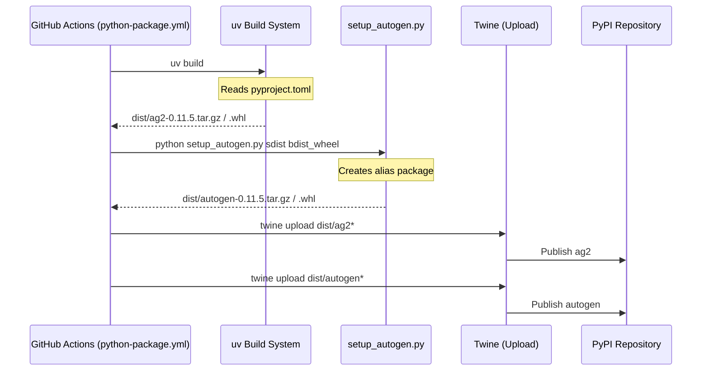

<!-- source: DeepWiki mcp.deepwiki.com · repo ag2ai/ag2 · page 11.2 CI/CD Workflows · fetched 2026-10-26 -->

# CI/CD Workflows

Relevant source files

The following files were used as context for generating this wiki page:

- [.github/workflows/beta-llm-test.yml](.github/workflows/beta-llm-test.yml)
- [.github/workflows/beta-test.yml](.github/workflows/beta-test.yml)
- [.github/workflows/build-mkdocs.yml](.github/workflows/build-mkdocs.yml)
- [.github/workflows/claude-code-review.yml](.github/workflows/claude-code-review.yml)
- [.github/workflows/claude.yml](.github/workflows/claude.yml)
- [.github/workflows/contrib-graph-rag-tests.yml](.github/workflows/contrib-graph-rag-tests.yml)
- [.github/workflows/contrib-llm-test.yml](.github/workflows/contrib-llm-test.yml)
- [.github/workflows/contrib-test.yml](.github/workflows/contrib-test.yml)
- [.github/workflows/core-llm-test.yml](.github/workflows/core-llm-test.yml)
- [.github/workflows/core-test.yml](.github/workflows/core-test.yml)
- [.github/workflows/integration-test.yml](.github/workflows/integration-test.yml)
- [.github/workflows/pr-checks.yml](.github/workflows/pr-checks.yml)
- [.github/workflows/python-package.yml](.github/workflows/python-package.yml)
- [.github/workflows/test-with-optional-deps.yml](.github/workflows/test-with-optional-deps.yml)
- [.github/workflows/type-check.yml](.github/workflows/type-check.yml)
- [README.md](README.md)
- [autogen/coding/jupyter/import_utils.py](autogen/coding/jupyter/import_utils.py)
- [autogen/import_utils.py](autogen/import_utils.py)
- [autogen/version.py](autogen/version.py)
- [scripts/test-beta-llm.sh](scripts/test-beta-llm.sh)
- [scripts/test-core-llm.sh](scripts/test-core-llm.sh)
- [scripts/test-skip-llm.sh](scripts/test-skip-llm.sh)
- [test/agentchat/realtime_agent/clients/test_gemini_realtime_client.py](test/agentchat/realtime_agent/clients/test_gemini_realtime_client.py)
- [test/agentchat/realtime_agent/clients/test_oai_realtime_client.py](test/agentchat/realtime_agent/clients/test_oai_realtime_client.py)
- [test/test_import_utils.py](test/test_import_utils.py)
- [website/docs/beta/roadmap.mdx](website/docs/beta/roadmap.mdx)
- [website/docs/contributor-guide/tests.mdx](website/docs/contributor-guide/tests.mdx)
- [website/docusaurus.config.js](website/docusaurus.config.js)

## Purpose and Scope

This document details the continuous integration and deployment (CI/CD) workflows used in the AG2 repository. These GitHub Actions automate testing across various configurations (core, contrib, Graph RAG), type checking, documentation building, and the release pipeline for publishing the `ag2` and `autogen` packages to PyPI.

Sources: [.github/workflows/python-package.yml:1-5](), [.github/workflows/core-test.yml:4-5](), [.github/workflows/contrib-test.yml:4](), [.github/workflows/type-check.yml:1]()

## Workflow Architecture Overview

AG2 employs a modular CI/CD strategy to handle its extensive dependency matrix and specialized features. The workflows are categorized into:
- **Core Verification**: Testing foundational agent logic without external LLM dependencies.
- **LLM Integration Testing**: Validating providers (OpenAI, Gemini, Anthropic, etc.) using live API keys.
- **Specialized Feature Testing**: Dedicated pipelines for RAG, Graph RAG, and experimental contrib agents.
- **Static Analysis**: Type checking with `mypy` across different Python versions and dependency sets.
- **Release & Docs**: Automated package publishing and MkDocs/Quarto documentation deployment.

### Code-to-Workflow Mapping

**Diagram: Association of Code Entities with CI/CD Workflows**

Sources: [.github/workflows/core-test.yml:31-37](), [.github/workflows/contrib-test.yml:13-18](), [.github/workflows/contrib-graph-rag-tests.yml:12-16](), [.github/workflows/build-mkdocs.yml:35-41]()

---

## Core and Contrib Testing

The testing suite is split to manage execution time and resource requirements.

### Core Tests (No LLM)
The `core-test.yml` workflow runs on every push and daily schedule. It validates the base `ConversableAgent` logic, code execution, and tool registration without making expensive LLM calls.
- **Environment**: Matrix of OS (`ubuntu-latest`, `macos-latest`, `windows-latest`) and Python versions (3.10 to 3.14).
- **Setup**: Installs core dependencies plus `jupyter-executor`, `redis`, and `websockets`.
- **Execution**: Runs `scripts/test-core-skip-llm.sh`.

Sources: [.github/workflows/core-test.yml:57-61](), [.github/workflows/core-test.yml:85-97](), [.github/workflows/core-test.yml:104-106]()

### Contrib and Graph RAG Tests
Contrib tests handle specialized agents and integrations.
- **Graph RAG**: `contrib-graph-rag-tests.yml` utilizes Docker services for `falkordb` and `neo4j`.
- **RetrieveChat**: `contrib-test.yml` sets up `pgvector`, `mongodb`, and `couchbase` services to test vector database integrations.

Sources: [.github/workflows/contrib-graph-rag-tests.yml:36-40](), [.github/workflows/contrib-test.yml:78-112]()

---

## Static Analysis: Type Check

The `type-check.yml` workflow ensures type safety across the codebase using `mypy`. Because AG2 has many optional dependencies, the workflow uses a matrix to test different "feature sets."

| Optional Dependency | Purpose of Type Check |
| :--- | :--- |
| `none` | Checks core logic with minimal dependencies. |
| `openai`, `gemini`, `anthropic` | Checks provider-specific client implementations. |
| `browser-use`, `crawl4ai` | Checks web automation and scraping tools. |
| `interop` | Checks bridges to CrewAI, LangChain, and PydanticAI. |

Sources: [.github/workflows/type-check.yml:23-55](), [.github/workflows/type-check.yml:79-80]()

---

## Documentation Pipeline

The `build-mkdocs.yml` workflow manages the transition from Jupyter notebooks and Markdown files to the live documentation site.

1. **Quarto Processing**: Uses `quarto-dev/quarto-actions/setup` to prepare notebook rendering.
2. **Build**: Executes `just docs-build --force` which triggers the `process_notebooks.py` logic.
3. **Versioning**: Uses `mike` to manage versioned documentation (e.g., `latest`, `0.11.x`).
4. **Deployment**: Pushes rendered HTML to the `gh-pages` branch.

Sources: [.github/workflows/build-mkdocs.yml:31-40](), [.github/workflows/build-mkdocs.yml:69-74]()

---

## Package Release Workflow

The `python-package.yml` workflow is the production pipeline for publishing to PyPI. It handles the dual-package distribution strategy where `ag2` is the primary package and `autogen` is the backward-compatible alias.

### Release Execution Flow

**Diagram: Release Pipeline Data Flow**

Sources: [.github/workflows/python-package.yml:43-69](), [autogen/version.py:7]()

### Implementation Details
- **Trigger**: Runs on `release: published` or manual `workflow_dispatch`.
- **Tools**: Uses `astral-sh/setup-uv` for high-speed dependency resolution and `twine` for secure uploads.
- **Versioning**: The version is dynamically extracted from `autogen/version.py` during the build process.

Sources: [.github/workflows/python-package.yml:7-10](), [.github/workflows/python-package.yml:29-31](), [.github/workflows/python-package.yml:56-69]()

---

## Optional Dependency Matrix Testing

The `test-with-optional-deps.yml` workflow is a specialized stress test for the `pyproject.toml` configuration. It iterates through nearly every optional dependency group defined in the framework.

- **Matrix**: Combines `optional-dependencies` (e.g., `commsagent-discord`, `mcp`, `twilio`) with OS and Python versions.
- **Marker Logic**: Converts the dependency name into a `pytest` marker (e.g., `browser-use` becomes `browser_use`) to run only the relevant subset of tests.
- **Import Verification**: Runs `test/test_import.py` for every configuration to ensure that installing a specific extra doesn't break sub-module imports.

Sources: [.github/workflows/test-with-optional-deps.yml:58-85](), [.github/workflows/test-with-optional-deps.yml:147-158]()

---

