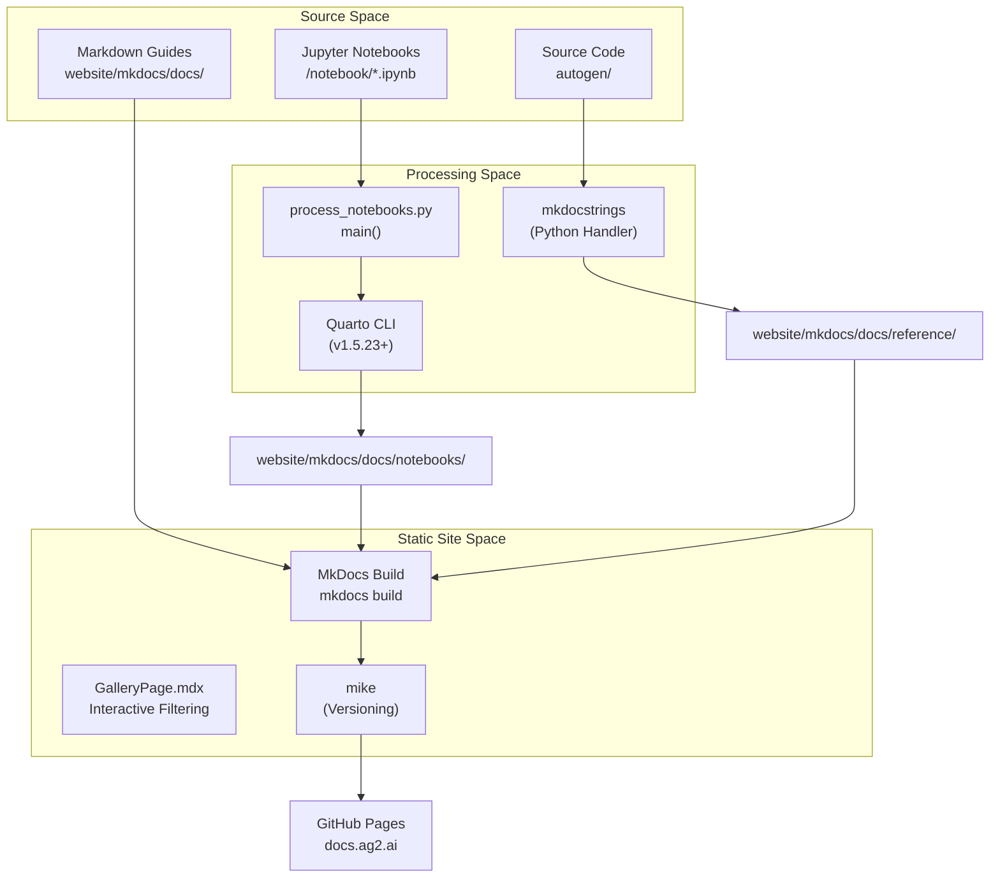
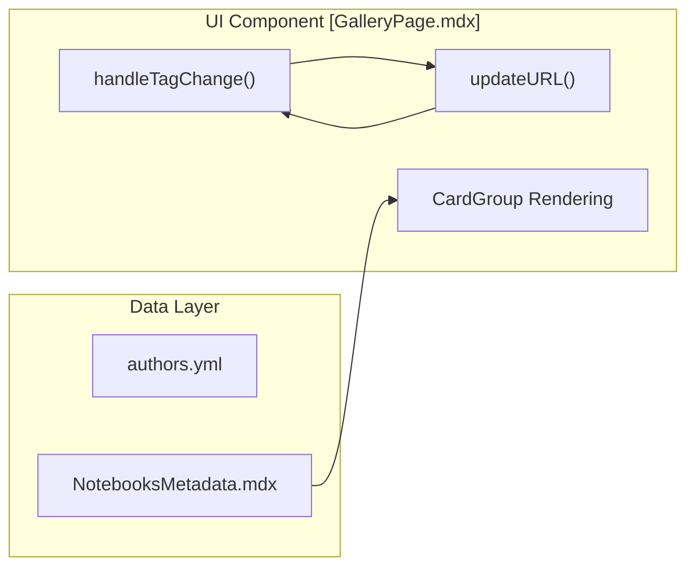

<!-- source: DeepWiki mcp.deepwiki.com · repo ag2ai/ag2 · page 12 Documentation System · fetched 2026-10-26 -->

# Documentation System

Relevant source files

The following files were used as context for generating this wiki page:

- [.devcontainer/Dockerfile](.devcontainer/Dockerfile)
- [.devcontainer/README.md](.devcontainer/README.md)
- [.github/PULL_REQUEST_TEMPLATE.md](.github/PULL_REQUEST_TEMPLATE.md)
- [.github/workflows/deploy-website.yml](.github/workflows/deploy-website.yml)
- [website/.gitignore](website/.gitignore)
- [website/README.md](website/README.md)
- [website/blogs_and_user_stories_authors.yml](website/blogs_and_user_stories_authors.yml)
- [website/docs/_blogs/2025-04-28-0.9-Release-Announcement/index.mdx](website/docs/_blogs/2025-04-28-0.9-Release-Announcement/index.mdx)
- [website/docs/_blogs/2026-03-19-Arcade/img/ag2-arcade-banner.webp](website/docs/_blogs/2026-03-19-Arcade/img/ag2-arcade-banner.webp)
- [website/docs/_blogs/2026-03-19-Arcade/img/ag2-arcade-diagram.png](website/docs/_blogs/2026-03-19-Arcade/img/ag2-arcade-diagram.png)
- [website/docs/_blogs/2026-03-19-Arcade/index.mdx](website/docs/_blogs/2026-03-19-Arcade/index.mdx)
- [website/docs/contributor-guide/documentation.mdx](website/docs/contributor-guide/documentation.mdx)
- [website/docs/user-stories/2025-04-11-Productionizing-OSS-Agents/img/banner.png](website/docs/user-stories/2025-04-11-Productionizing-OSS-Agents/img/banner.png)
- [website/docs/user-stories/2025-04-11-Productionizing-OSS-Agents/index.mdx](website/docs/user-stories/2025-04-11-Productionizing-OSS-Agents/index.mdx)
- [website/mkdocs/docs/javascripts/extra.js](website/mkdocs/docs/javascripts/extra.js)
- [website/mkdocs/docs/stylesheets/extra.css](website/mkdocs/docs/stylesheets/extra.css)
- [website/mkdocs/mkdocs.yml](website/mkdocs/mkdocs.yml)
- [website/mkdocs/overrides/home.html](website/mkdocs/overrides/home.html)
- [website/process_notebooks.py](website/process_notebooks.py)
- [website/snippets/components/GalleryPage.mdx](website/snippets/components/GalleryPage.mdx)

## Purpose and Scope

The AG2 documentation system manages the lifecycle of technical content, transforming Jupyter notebooks, Markdown files, and docstrings into a cohesive, versioned documentation website. The system utilizes **Material for MkDocs** for the frontend, **Quarto** for notebook rendering, and custom Python processing pipelines for metadata extraction and gallery generation.

This system ensures that complex agentic AI examples (stored as `.ipynb` files) are automatically converted into interactive web pages with integrated Google Colab and GitHub links.

---

## Documentation Pipeline Architecture

The documentation generation follows a multi-stage pipeline from source content to the final static site. It bridges the gap between interactive development environments (Jupyter) and static documentation.

### Content Flow Diagram

**Sources:**
- [website/README.md:1-48]()
- [website/mkdocs/mkdocs.yml:91-113]()
- [.github/workflows/deploy-website.yml:1-26]()

---

## Notebook Processing Pipeline

The system treats Jupyter notebooks as primary documentation sources. The conversion process is orchestrated by `website/process_notebooks.py`, which wraps core logic in the `mkdocs` internal package.

### Key Conversion Steps
1.  **Rendering**: Quarto converts `.ipynb` to Markdown/MDX, preserving code execution outputs.
2.  **Metadata Extraction**: Frontmatter (tags, titles, descriptions) is extracted to generate `NotebooksMetadata.mdx`.
3.  **Path Resolution**: Local image paths and internal markdown links are adjusted for the MkDocs directory structure.
4.  **Component Injection**: Callout blocks and interactive badges (Colab/GitHub) are added to the rendered output.

For details, see [Notebook Processing Pipeline](#12.1).

**Sources:**
- [website/process_notebooks.py:11-14]()
- [website/README.md:102-107]()
- [website/.gitignore:14-25]()

---

## Documentation Build Configuration

The site is configured via `website/mkdocs/mkdocs.yml`, utilizing the **Material** theme with extensive customizations for the AG2 brand.

### Build Toolchain

| Tool | Role | File/Reference |
| :--- | :--- | :--- |
| **MkDocs** | Core static site generator | [website/mkdocs/mkdocs.yml:1-25]() |
| **Quarto** | Notebook to Markdown converter | [website/README.md:12-16]() |
| **mkdocstrings** | Automatic API reference generation | [website/mkdocs/mkdocs.yml:91-113]() |
| **mike** | Documentation versioning (e.g., /latest, /v0.2) | [website/mkdocs/mkdocs.yml:128-131]() |
| **Jinja2** | Template macros for dynamic content | [website/mkdocs/mkdocs.yml:87-90]() |

The deployment is automated via GitHub Actions, triggered on pushes to the `main` branch or manual dispatches.

For details, see [Documentation Build Configuration](#12.2).

**Sources:**
- [website/mkdocs/mkdocs.yml:1-184]()
- [.github/workflows/deploy-website.yml:1-26]()
- [website/README.md:27-31]()

---

## Gallery and Interactive Components

To help users navigate hundreds of notebooks and use cases, the documentation includes a dynamic gallery powered by React-style MDX components.

### Gallery Logic

The `GalleryPage` component provides a client-side filtering interface. It consumes a structured dataset of `galleryItems` and allows users to filter by technology tags (e.g., "OpenAI", "RAG", "Tool Calling").

The gallery supports deep-linking via URL parameters (`?tags=...`), enabling shared filtered views of the documentation.

For details, see [Gallery and Interactive Components](#12.3).

**Sources:**
- [website/snippets/components/GalleryPage.mdx:1-169]()
- [website/blogs_and_user_stories_authors.yml:1-240]()
- [website/mkdocs/docs/stylesheets/extra.css:237-292]()

---

## Developer Environment

Contributors can build and preview the documentation locally using provided scripts or a pre-configured Dev Container.

### Local Build Commands
- **Install dependencies**: `pip install -e ".[docs]"` [website/README.md:22-23]()
- **Build**: `./scripts/docs_build_mkdocs.sh` [website/README.md:30-31]()
- **Serve**: `./scripts/docs_serve_mkdocs.sh` [website/README.md:44-45]()

The Dev Container environment (defined in `.devcontainer/Dockerfile`) comes pre-installed with Quarto `1.5.23`, Node.js/Yarn, and all Python documentation dependencies.

**Sources:**
- [website/README.md:49-83]()
- [.devcontainer/Dockerfile:12-39]()
- [website/docs/contributor-guide/documentation.mdx:5-51]()

---

