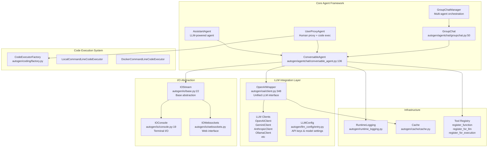
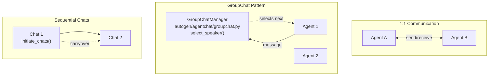
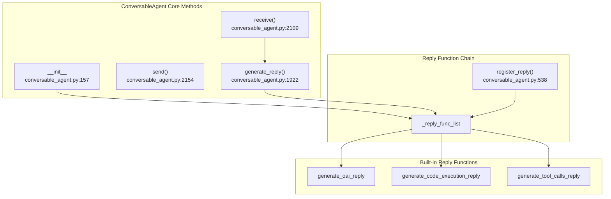
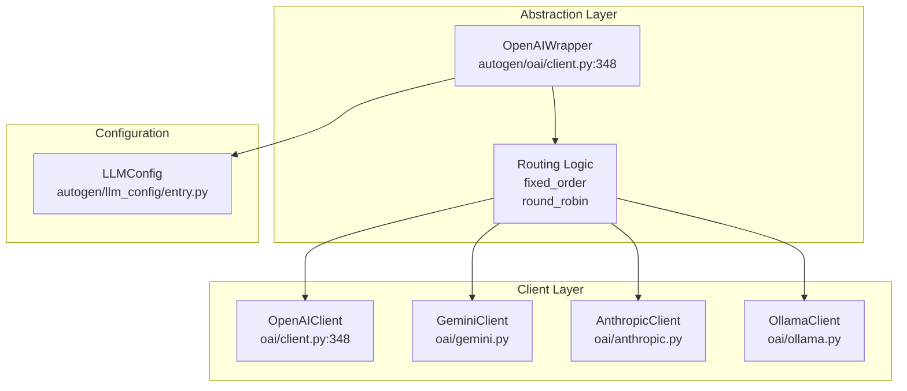
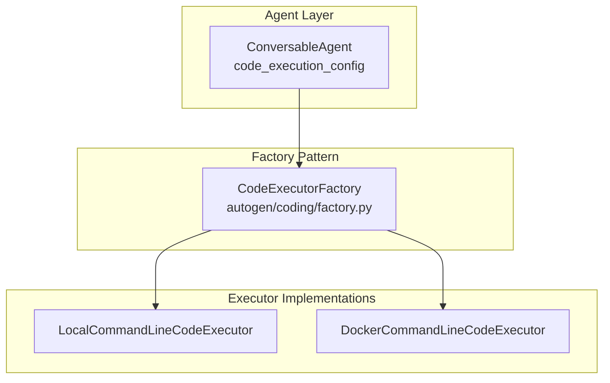
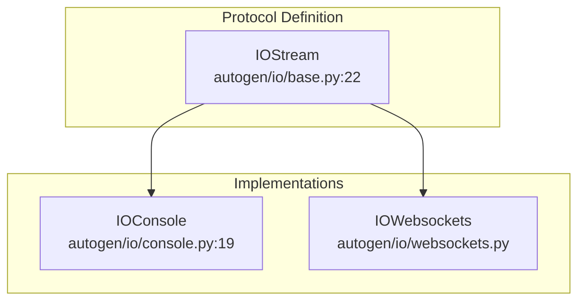
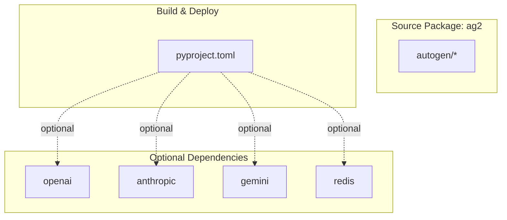

<!-- source: DeepWiki mcp.deepwiki.com · repo ag2ai/ag2 · page 13.1 Architecture Overview · fetched 2026-10-26 -->

# Architecture Overview

Relevant source files

The following files were used as context for generating this wiki page:

- [autogen/agentchat/chat.py](autogen/agentchat/chat.py)
- [autogen/agentchat/conversable_agent.py](autogen/agentchat/conversable_agent.py)
- [autogen/agentchat/groupchat.py](autogen/agentchat/groupchat.py)
- [autogen/beta/agent.py](autogen/beta/agent.py)
- [autogen/exception_utils.py](autogen/exception_utils.py)
- [autogen/io/__init__.py](autogen/io/__init__.py)
- [autogen/io/base.py](autogen/io/base.py)
- [autogen/io/console.py](autogen/io/console.py)
- [autogen/io/websockets.py](autogen/io/websockets.py)
- [autogen/messages/agent_messages.py](autogen/messages/agent_messages.py)
- [autogen/oai/client.py](autogen/oai/client.py)
- [autogen/tools/experimental/__init__.py](autogen/tools/experimental/__init__.py)
- [notebook/agentchat_websockets.ipynb](notebook/agentchat_websockets.ipynb)
- [pyproject.toml](pyproject.toml)
- [setup_autogen.py](setup_autogen.py)
- [test/agentchat/test_agent_logging.py](test/agentchat/test_agent_logging.py)
- [test/agentchat/test_agent_usage.py](test/agentchat/test_agent_usage.py)
- [test/agentchat/test_assistant_agent.py](test/agentchat/test_assistant_agent.py)
- [test/agentchat/test_async.py](test/agentchat/test_async.py)
- [test/agentchat/test_async_chats.py](test/agentchat/test_async_chats.py)
- [test/agentchat/test_async_get_human_input.py](test/agentchat/test_async_get_human_input.py)
- [test/agentchat/test_cache_agent.py](test/agentchat/test_cache_agent.py)
- [test/agentchat/test_chats.py](test/agentchat/test_chats.py)
- [test/agentchat/test_conversable_agent.py](test/agentchat/test_conversable_agent.py)
- [test/agentchat/test_function_call.py](test/agentchat/test_function_call.py)
- [test/agentchat/test_function_call_groupchat.py](test/agentchat/test_function_call_groupchat.py)
- [test/agentchat/test_groupchat.py](test/agentchat/test_groupchat.py)
- [test/agentchat/test_human_input.py](test/agentchat/test_human_input.py)
- [test/agentchat/test_math_user_proxy_agent.py](test/agentchat/test_math_user_proxy_agent.py)
- [test/agentchat/test_nested.py](test/agentchat/test_nested.py)
- [test/agentchat/test_tool_calls.py](test/agentchat/test_tool_calls.py)
- [test/conftest.py](test/conftest.py)
- [test/io/test_base.py](test/io/test_base.py)
- [test/io/test_websockets.py](test/io/test_websockets.py)
- [test/messages/test_agent_messages.py](test/messages/test_agent_messages.py)
- [test/oai/test_client.py](test/oai/test_client.py)
- [test/oai/test_client_stream.py](test/oai/test_client_stream.py)
- [test/test_conftest.py](test/test_conftest.py)
- [website/docs/user-guide/reference-tools/index.mdx](website/docs/user-guide/reference-tools/index.mdx)
- [website/mint-json-template.json.jinja](website/mint-json-template.json.jinja)

## Purpose and Scope

This document provides a comprehensive overview of AG2's architectural design patterns, component relationships, and abstraction layers. It is intended for developers who want to understand how the framework is structured internally, extend its capabilities, or contribute to the codebase.

For step-by-step guides on creating custom agents or implementing new providers, see [Extending AG2](#13.2). For information about optional dependency configurations, see [Optional Dependencies and Feature Sets](#13.3). For basic usage concepts, see [Core Agent System](#2).

---

## Core Architectural Principles

AG2 is built on several key architectural principles that enable its flexibility and extensibility:

1.  **Plugin Architecture**: Core components like `ConversableAgent` serve as extensible base classes that specialized agents inherit from. [autogen/agentchat/conversable_agent.py:136-148]()
2.  **Abstraction Layers**: Clear separation between interface and implementation (e.g., `OpenAIWrapper` abstracts multiple LLM providers). [autogen/oai/client.py:348-360]()
3.  **Reply Function Chain**: Flexible message processing through a chain of registered reply functions. [autogen/agentchat/conversable_agent.py:538-609]()
4.  **Separation of Concerns**: Security boundaries between decision-making (caller agents) and execution (executor agents). [autogen/agentchat/conversable_agent.py:2714-3043]()
5.  **Dependency Injection**: Tools can receive context without exposing sensitive data to LLMs via `Depends()`. [autogen/agentchat/conversable_agent.py:77-77]()
6.  **Hook System**: Lifecycle management through hookable methods. [autogen/agentchat/conversable_agent.py:2370-2427]()

Sources: [autogen/agentchat/conversable_agent.py:136-148](), [autogen/oai/client.py:348-360](), [autogen/agentchat/conversable_agent.py:538-609]()

---

## System Architecture Overview

AG2 is organized into five major subsystems that work together to provide a comprehensive agentic AI framework.

### Five Major Subsystems

Title: AG2 Five Major Subsystems

Sources: [autogen/agentchat/conversable_agent.py:136-178](), [autogen/oai/client.py:348-400](), [autogen/io/base.py:22-114](), [autogen/agentchat/groupchat.py:50-105]()

---

## Agent Communication Patterns

AG2 supports several primary communication patterns for multi-agent systems:

### Communication Pattern Overview

Title: Agent Communication Patterns

Sources: [autogen/agentchat/conversable_agent.py:2154-2271](), [autogen/agentchat/groupchat.py:50-105](), [autogen/agentchat/chat.py:157-178]()

### ConversableAgent Reply Function Chain

The `ConversableAgent` implements a plugin architecture where all agent behaviors are built through composable reply functions.

Title: ConversableAgent Reply Function Chain

Sources: [autogen/agentchat/conversable_agent.py:157-392](), [autogen/agentchat/conversable_agent.py:538-609](), [autogen/agentchat/conversable_agent.py:1922-2030]()

---

## LLM Integration Architecture

AG2 provides an architecture for LLM integration that abstracts provider differences through provider-specific clients.

### LLM Integration Layers

Title: LLM Integration Architecture

Sources: [autogen/oai/client.py:348-400](), [autogen/oai/client.py:1164-1310](), [autogen/llm_config/entry.py:32-33]()

---

## Code Execution Architecture

AG2 uses a factory pattern to provide multiple code execution backends.

Title: Code Execution Architecture

Sources: [autogen/agentchat/conversable_agent.py:316-361](), [autogen/coding/factory.py:41-42]()

---

## I/O System Architecture

### IOStream Abstraction

Title: I/O System Architecture

Sources: [autogen/io/base.py:22-114](), [autogen/io/console.py:19-46](), [autogen/io/websockets.py:30-250]()

---

## Distribution Architecture

### Package Structure and Deployment

AG2 uses a modular package structure defined in `pyproject.toml`.

Title: Package and Dependency Structure

Sources: [pyproject.toml:1-150](), [autogen/version.py:1-8]()

### Optional Dependencies Summary

| Extra Name | Key Dependencies | Purpose |
|------------|-----------------|---------|
| `openai` | `openai>=1.99.3` | OpenAI and Azure OpenAI support | [pyproject.toml:109]() |
| `anthropic` | `anthropic>=0.79.0` | Anthropic Claude integration | [pyproject.toml:114]() |
| `gemini` | `google-genai>=1.20.0` | Google Gemini integration | [pyproject.toml:116]() |
| `redis` | `redis` | Redis caching backend | [pyproject.toml:140]() |
| `docker` | `docker` | Docker code execution | [pyproject.toml:84]() |

Sources: [pyproject.toml:78-150]()

---

