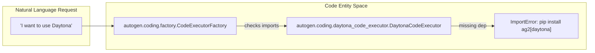
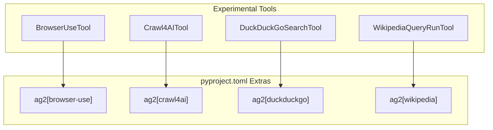

<!-- source: DeepWiki mcp.deepwiki.com · repo ag2ai/ag2 · page 13.3 Optional Dependencies and Feature Sets · fetched 2026-10-26 -->

# Optional Dependencies and Feature Sets

<details>
<summary>Relevant source files</summary>

The following files were used as context for generating this wiki page:

- [.github/workflows/python-package.yml](.github/workflows/python-package.yml)
- [README.md](README.md)
- [autogen/beta/agent.py](autogen/beta/agent.py)
- [autogen/coding/__init__.py](autogen/coding/__init__.py)
- [autogen/coding/base.py](autogen/coding/base.py)
- [autogen/coding/daytona_code_executor.py](autogen/coding/daytona_code_executor.py)
- [autogen/coding/factory.py](autogen/coding/factory.py)
- [autogen/coding/jupyter/import_utils.py](autogen/coding/jupyter/import_utils.py)
- [autogen/import_utils.py](autogen/import_utils.py)
- [autogen/tools/experimental/__init__.py](autogen/tools/experimental/__init__.py)
- [autogen/version.py](autogen/version.py)
- [notebook/agentchat_daytona_executor.ipynb](notebook/agentchat_daytona_executor.ipynb)
- [pyproject.toml](pyproject.toml)
- [setup_autogen.py](setup_autogen.py)
- [test/agentchat/realtime_agent/clients/test_gemini_realtime_client.py](test/agentchat/realtime_agent/clients/test_gemini_realtime_client.py)
- [test/agentchat/realtime_agent/clients/test_oai_realtime_client.py](test/agentchat/realtime_agent/clients/test_oai_realtime_client.py)
- [test/coding/test_daytona_code_executor.py](test/coding/test_daytona_code_executor.py)
- [test/coding/test_daytona_code_executor_integration.py](test/coding/test_daytona_code_executor_integration.py)
- [test/test_import_utils.py](test/test_import_utils.py)
- [website/docs/installation/Optional-Dependencies.mdx](website/docs/installation/Optional-Dependencies.mdx)
- [website/docs/user-guide/advanced-concepts/code-execution.mdx](website/docs/user-guide/advanced-concepts/code-execution.mdx)
- [website/docs/user-guide/getting-started/Getting-Started.mdx](website/docs/user-guide/getting-started/Getting-Started.mdx)
- [website/docs/user-guide/reference-tools/index.mdx](website/docs/user-guide/reference-tools/index.mdx)
- [website/docusaurus.config.js](website/docusaurus.config.js)
- [website/mint-json-template.json.jinja](website/mint-json-template.json.jinja)

</details>


This document explains AG2's modular dependency architecture, which allows users to install only the packages needed for their specific use cases. Instead of installing all dependencies upfront, AG2 provides fine-grained optional dependency groups that can be selectively installed based on required functionality.

For information about extending AG2 with custom components, see [Extending AG2](#13.2). For core package structure and distribution, see [Package Structure and Distribution](#1.1).

## Purpose and Design

AG2 uses a modular architecture where the core package (`ag2`) contains only essential dependencies, while optional features require additional packages. This design:

- Minimizes installation size and complexity for basic usage.
- Prevents dependency conflicts when specific providers are not needed.
- Enables flexible deployment across different environments.
- Supports incremental feature adoption.

The core package [pyproject.toml:78-90]() includes foundational dependencies like `termcolor`, `python-dotenv`, `tiktoken`, `pydantic>=2.6.1`, `pyyaml`, `docker`, `httpx`, and `anyio`. It also includes `fast-depends` to support the beta tool system [pyproject.toml:89-90](). All other functionality is provided through optional dependency groups.

## Dependency Group Structure

The [pyproject.toml:92-357]() file defines all optional dependency groups. The structure follows a hierarchical organization:

**AG2 Feature Set Hierarchy**

```mermaid
graph TB
    subgraph "Core Package (ag2)"
        CORE["Core Dependencies<br/>pydantic, docker,<br/>tiktoken, httpx, anyio"]
    end
    
    subgraph "LLM Provider Groups"
        OPENAI["openai<br/>openai>=1.99.3"]
        ANTHROPIC["anthropic<br/>anthropic[vertex]>=0.79.0"]
        GEMINI["gemini<br/>google-genai>=1.20.0"]
        OLLAMA["ollama<br/>ollama>=0.4.7"]
        MISTRAL["mistral<br/>mistralai>=2.0.0"]
        COHERE["cohere<br/>cohere>=5.13.5"]
        GROQ["groq<br/>0.9.0"]
        BEDROCK["bedrock<br/>boto3>=1.34.149"]
    end
    
    subgraph "Code Executor Groups"
        JUPYTER["jupyter-executor<br/>jupyter-kernel-gateway,<br/>jupyter-client>=8.6.0"]
        REMYX["remyx<br/>remyxai>=0.2.0"]
        YEPCODE["yepcode<br/>yepcode-run>=1.6.1"]
        DAYTONA["daytona<br/>daytona-sdk"]
    end
    
    subgraph "RAG System Groups"
        RETRIEVE["retrievechat<br/>chromadb>=1.4.1,<br/>sentence_transformers"]
        PGVECTOR["retrievechat-pgvector<br/>pgvector>=0.2.5"]
        RAG["rag<br/>docling>=2.15.1,<br/>llama-index"]
        GRAPH_RAG["graph-rag-falkor-db<br/>falkordb>=1.0.10"]
    end
    
    subgraph "Tool Groups"
        BROWSER["browser-use<br/>browser-use>=0.3.1"]
        CRAWL["crawl4ai<br/>crawl4ai>=0.5.0"]
        WIKI["wikipedia<br/>wikipedia-api>=0.8.1"]
        MCP["mcp<br/>mcp>=1.11.0"]
    end
    
    subgraph "Infrastructure Groups"
        REDIS["redis<br/>redis"]
        WEBSOCKETS["websockets<br/>websockets>=14.0"]
        TRACING["tracing<br/>opentelemetry-sdk>=1.20"]
        A2A["a2a<br/>a2a-sdk>=0.3.11"]
    end
    
    CORE -.->|optional| OPENAI
    CORE -.->|optional| ANTHROPIC
    CORE -.->|optional| GEMINI
    CORE -.->|optional| JUPYTER
    CORE -.->|optional| RETRIEVE
    CORE -.->|optional| BROWSER
    CORE -.->|optional| REDIS
    CORE -.->|optional| MCP
```


Sources: [pyproject.toml:92-357]()

## Installation Commands

### LLM Provider Installation

Install support for specific LLM providers:

```bash
# Single provider
pip install "ag2[openai]"
pip install "ag2[anthropic]"
pip install "ag2[gemini]"

# Multiple providers
pip install "ag2[openai,anthropic,gemini,mistral,cohere]"
```

The `openai` extra [pyproject.toml:109]() installs `openai>=1.99.3`. The `anthropic` extra [pyproject.toml:114]() installs `anthropic[vertex]>=0.79.0`, providing both direct Anthropic API and Vertex AI access.

Sources: [pyproject.toml:109-114](), [README.md:87-95]()

### Code Executor Installation

Different code execution environments require different dependencies:

```bash
# Jupyter/IPython executor
pip install "ag2[jupyter-executor]"

# Cloud-based executors
pip install "ag2[remyx]"
pip install "ag2[yepcode]"
pip install "ag2[daytona]"
```

The `jupyter-executor` group [pyproject.toml:150-156]() includes `jupyter-kernel-gateway`, `jupyter-client>=8.6.0`, and `ipykernel>=6.29.0` for stateful code execution. The `daytona` extra [pyproject.toml:274]() provides support for Daytona Cloud sandboxes.

Sources: [pyproject.toml:150-156](), [pyproject.toml:271-274](), [website/docs/user-guide/advanced-concepts/code-execution.mdx:11-18]()

### RAG and Research System Installation

Retrieval-augmented generation systems with different vector stores:

```bash
# ChromaDB (default for RetrieveChat)
pip install "ag2[retrievechat]"

# Full RAG with docling and llama-index
pip install "ag2[rag]"

# Specialized research tools
pip install "ag2[quick-research]"
```

The `retrievechat` group [pyproject.toml:158-166]() provides `chromadb>=1.4.1` and `sentence_transformers`. The `rag` extra [pyproject.toml:183-197]() is more comprehensive, including `docling>=2.15.1` and `llama-index` for multi-format document processing.

Sources: [pyproject.toml:158-197](), [pyproject.toml:204-210]()

### Tool and Protocol Installation

External tools and Model Context Protocol (MCP) support:

```bash
# Browser and web tools
pip install "ag2[browser-use]"
pip install "ag2[crawl4ai]"

# Model Context Protocol
pip install "ag2[mcp]"
```

The `mcp` extra [pyproject.toml:240-243]() enables agents to consume MCP servers as tools, requiring `mcp>=1.11.0`.

Sources: [pyproject.toml:212-214](), [pyproject.toml:240-243](), [website/docs/user-guide/reference-tools/index.mdx:34-42]()

## Optional Dependency Implementation Patterns

### Import Guards and Utilities

AG2 uses a robust import utility system in `autogen/import_utils.py` to handle optional dependencies gracefully. The `ModuleInfo` class [autogen/import_utils.py:32-151]() manages version constraints, while `optional_import_block` [autogen/import_utils.py:165-188]() suppresses `ImportError` during initialization.

**Pattern in autogen/import_utils.py:**
```python
@contextmanager
def optional_import_block() -> Generator[Result, None, None]:
    result = Result()
    try:
        yield result
        result._failed = False
    except ImportError as e:
        logger.debug(f"Ignoring ImportError: {e}")
        result._failed = True
```

This pattern allows the package to remain importable even when optional dependencies are missing.

Sources: [autogen/import_utils.py:165-188]()

### Factory Pattern with Runtime Checks

The `CodeExecutorFactory` uses runtime checks to provide clear installation instructions when an executor is requested but its dependencies are missing.

**Mapping Logic to Entities**


The factory method [autogen/coding/factory.py:18-68]() uses try-except blocks to provide actionable error messages:

```python
elif executor == "daytona":
    try:
        from .daytona_code_executor import DaytonaCodeExecutor
    except ImportError as e:
        raise ImportError(
            "Missing dependencies for DaytonaCodeExecutor. Please install with: pip install ag2[daytona]"
        ) from e
    return DaytonaCodeExecutor(**code_execution_config.get("daytona", {}))
```

Sources: [autogen/coding/factory.py:18-68](), [website/docs/user-guide/advanced-concepts/code-execution.mdx:11-18]()

## Major Feature Sets and Tooling

### Experimental Tools Registry

The `autogen.tools.experimental` module acts as a registry for high-level tools that often require optional extras.

**Tool to Dependency Mapping**


Sources: [autogen/tools/experimental/__init__.py:1-58](), [pyproject.toml:200-226]()

### Beta Framework Requirements

The `autogen.beta` framework introduces a more modular dependency injection system. It relies on `fast-depends[pydantic]` [pyproject.toml:89]() as a core dependency to manage the execution pipeline, middleware, and tool parameter resolution.

The `Agent` class in beta [autogen/beta/agent.py:14-45]() uses `Provider` from `fast-depends` to resolve dependencies like `Context` and `Stream` during the `ask` and `generate_reply` cycles.

Sources: [autogen/beta/agent.py:14-45](), [pyproject.toml:89]()

### Interoperability Adapters

AG2 provides adapters for other agent frameworks, isolated in specific extras to prevent version conflicts.

| Extra Name | Target Framework | Key Dependency |
|------------|------------------|----------------|
| `interop-crewai` | CrewAI | `crewai[tools]>=0.76` [pyproject.toml:254]() |
| `interop-langchain` | LangChain | `langchain-community>=0.3.12` [pyproject.toml:260]() |
| `interop-pydantic-ai`| PydanticAI | `pydantic-ai>=1.0.12` [pyproject.toml:261]() |

Sources: [pyproject.toml:253-262]()

## Backward Compatibility (Alias Package)

The `autogen` package name is maintained as an alias for `ag2`. The `setup_autogen.py` script [setup_autogen.py:23-103]() mirrors every optional extra from `ag2` into the `autogen` package.

```python
setuptools.setup(
    name="autogen",
    version=__version__,
    description="Alias package for ag2",
    install_requires=["ag2==" + __version__],
    extras_require={
        "openai": ["ag2[openai]==" + __version__],
        "gemini": ["ag2[gemini]==" + __version__],
        # ... mirrors all 60+ extras
    }
)
```

This ensures that legacy installation commands like `pip install "autogen[openai]"` continue to function correctly by pulling the corresponding `ag2` feature set.

Sources: [setup_autogen.py:23-103](), [autogen/version.py:7]()

---

