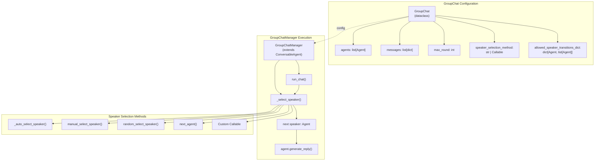
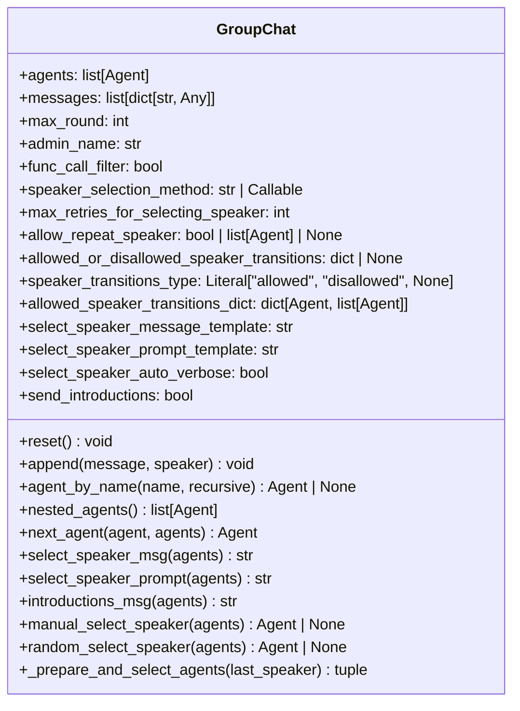
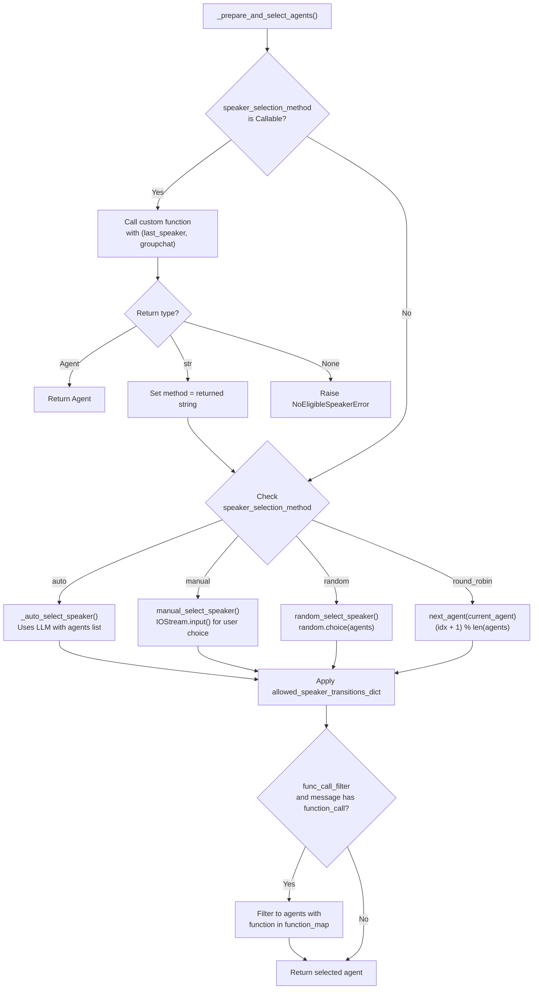
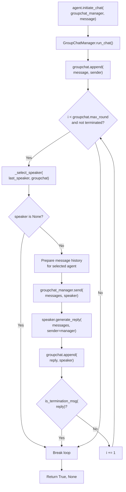
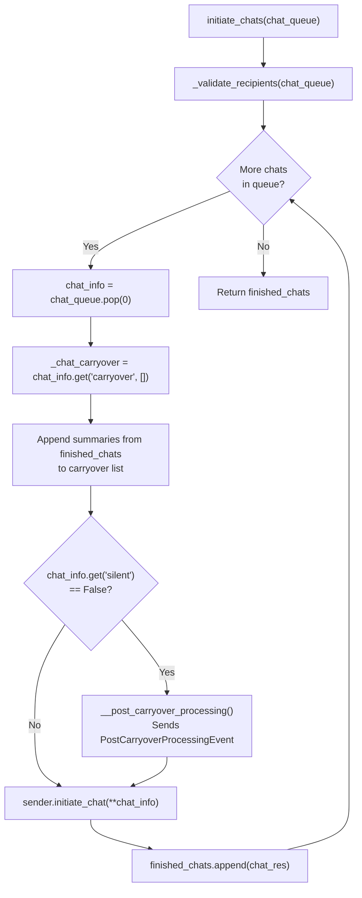

<!-- source: DeepWiki mcp.deepwiki.com · repo ag2ai/ag2 · page 2.4 GroupChat and Multi-Agent Orchestration · fetched 2026-10-26 -->

# GroupChat and Multi-Agent Orchestration

Relevant source files

The following files were used as context for generating this wiki page:

- [autogen/agentchat/chat.py](autogen/agentchat/chat.py)
- [autogen/agentchat/conversable_agent.py](autogen/agentchat/conversable_agent.py)
- [autogen/agentchat/group/events/transition_events.py](autogen/agentchat/group/events/transition_events.py)
- [autogen/agentchat/group/group_tool_executor.py](autogen/agentchat/group/group_tool_executor.py)
- [autogen/agentchat/group/group_utils.py](autogen/agentchat/group/group_utils.py)
- [autogen/agentchat/group/guardrails.py](autogen/agentchat/group/guardrails.py)
- [autogen/agentchat/group/multi_agent_chat.py](autogen/agentchat/group/multi_agent_chat.py)
- [autogen/agentchat/group/patterns/pattern.py](autogen/agentchat/group/patterns/pattern.py)
- [autogen/agentchat/group/targets/transition_target.py](autogen/agentchat/group/targets/transition_target.py)
- [autogen/agentchat/groupchat.py](autogen/agentchat/groupchat.py)
- [autogen/exception_utils.py](autogen/exception_utils.py)
- [autogen/io/__init__.py](autogen/io/__init__.py)
- [autogen/io/base.py](autogen/io/base.py)
- [autogen/io/console.py](autogen/io/console.py)
- [autogen/io/run_response.py](autogen/io/run_response.py)
- [autogen/io/step_controller.py](autogen/io/step_controller.py)
- [autogen/io/thread_io_stream.py](autogen/io/thread_io_stream.py)
- [autogen/io/websockets.py](autogen/io/websockets.py)
- [autogen/messages/agent_messages.py](autogen/messages/agent_messages.py)
- [notebook/agentchat_custom_events.ipynb](notebook/agentchat_custom_events.ipynb)
- [notebook/agentchat_groupchat_finite_state_machine.ipynb](notebook/agentchat_groupchat_finite_state_machine.ipynb)
- [notebook/agentchat_groupchat_stateflow.ipynb](notebook/agentchat_groupchat_stateflow.ipynb)
- [notebook/agentchat_iterating_runs.ipynb](notebook/agentchat_iterating_runs.ipynb)
- [notebook/agentchat_swarm.ipynb](notebook/agentchat_swarm.ipynb)
- [notebook/agentchat_swarm_enhanced.ipynb](notebook/agentchat_swarm_enhanced.ipynb)
- [notebook/agentchat_swarm_graphrag_telemetry_trip_planner.ipynb](notebook/agentchat_swarm_graphrag_telemetry_trip_planner.ipynb)
- [notebook/agentchat_swarm_w_groupchat_legacy.ipynb](notebook/agentchat_swarm_w_groupchat_legacy.ipynb)
- [notebook/agentchat_websockets.ipynb](notebook/agentchat_websockets.ipynb)
- [notebook/contributing.md](notebook/contributing.md)
- [test/agentchat/group/targets/test_transition_target.py](test/agentchat/group/targets/test_transition_target.py)
- [test/agentchat/group/test_group_chat_cost.py](test/agentchat/group/test_group_chat_cost.py)
- [test/agentchat/group/test_group_tool_executor.py](test/agentchat/group/test_group_tool_executor.py)
- [test/agentchat/group/test_group_utils.py](test/agentchat/group/test_group_utils.py)
- [test/agentchat/group/test_guardrails.py](test/agentchat/group/test_guardrails.py)
- [test/agentchat/group/test_multi_agent_chat.py](test/agentchat/group/test_multi_agent_chat.py)
- [test/agentchat/group/test_transition_events.py](test/agentchat/group/test_transition_events.py)
- [test/agentchat/test_conversable_agent.py](test/agentchat/test_conversable_agent.py)
- [test/agentchat/test_event_streaming.py](test/agentchat/test_event_streaming.py)
- [test/agentchat/test_groupchat.py](test/agentchat/test_groupchat.py)
- [test/io/test_base.py](test/io/test_base.py)
- [test/io/test_run_response.py](test/io/test_run_response.py)
- [test/io/test_step_controller.py](test/io/test_step_controller.py)
- [test/io/test_websockets.py](test/io/test_websockets.py)
- [test/messages/test_agent_messages.py](test/messages/test_agent_messages.py)
- [test/oai/test_openai_streaming_structured_output.py](test/oai/test_openai_streaming_structured_output.py)
- [website/docs/user-guide/advanced-concepts/iterating-runs.mdx](website/docs/user-guide/advanced-concepts/iterating-runs.mdx)
- [website/docs/user-guide/advanced-concepts/orchestration/group-chat/guardrails.mdx](website/docs/user-guide/advanced-concepts/orchestration/group-chat/guardrails.mdx)
- [website/docs/user-guide/advanced-concepts/tools/index.mdx](website/docs/user-guide/advanced-concepts/tools/index.mdx)

This document explains how multiple agents collaborate in group conversations using `GroupChat`, `GroupChatManager`, and sequential chat orchestration via `initiate_chats`. These components enable multi-agent conversations with configurable speaker selection strategies, message routing, and carryover of context between sequential chats.

For information about the base agent capabilities, see [ConversableAgent](2.1). For more advanced orchestration patterns, see [SwarmAgent and Dynamic Orchestration](4.1).

## Overview

AG2 provides two main patterns for multi-agent orchestration:

1.  **GroupChat/GroupChatManager**: Multiple agents participate in a single conversation with dynamic speaker selection.
2.  **initiate_chats**: Sequential conversations between agent pairs with context carryover.

The `GroupChat` class [[autogen/agentchat/groupchat.py:50-166]]() defines conversation configuration including participating agents and speaker selection rules. The `GroupChatManager` class [[autogen/agentchat/groupchat.py:707-1116]]() coordinates message flow and speaker selection during execution.

**Diagram: GroupChat Architecture**

**Sources:**
*   [[autogen/agentchat/groupchat.py:50-166]](): `GroupChat` dataclass definition and fields.
*   [[autogen/agentchat/groupchat.py:707-1116]](): `GroupChatManager` class implementation.
*   [[autogen/agentchat/groupchat.py:178-293]](): `GroupChat` validation logic in `__post_init__`.

---

## GroupChat Class

The `GroupChat` class serves as a container that defines the structure and rules for a multi-agent conversation.

### Key Attributes

*   `agents`: List of participating agents in the conversation.
*   `messages`: List of messages exchanged during the conversation.
*   `max_round`: Maximum number of conversation rounds allowed.
*   `speaker_selection_method`: Method to determine which agent speaks next.
*   `allowed_speaker_transitions`: Rules about which agent can speak after another.

**Diagram: GroupChat Class Structure**

**Sources:**
*   [[autogen/agentchat/groupchat.py:50-166]](): `GroupChat` dataclass attributes.
*   [[autogen/agentchat/groupchat.py:302-318]](): Implementation of `reset()` and `append()`.
*   [[autogen/agentchat/groupchat.py:320-337]](): Implementation of `agent_by_name()` and `nested_agents()`.
*   [[autogen/agentchat/groupchat.py:339-361]](): Implementation of `next_agent()`.
*   [[autogen/agentchat/groupchat.py:401-436]](): Implementation of `manual_select_speaker()` and `random_select_speaker()`.

### Speaker Selection Methods

`GroupChat` supports multiple speaker selection methods defined in `speaker_selection_method` [[autogen/agentchat/groupchat.py:85-101]]():

| Method | Implementation | Description |
| :--- | :--- | :--- |
| `"auto"` | `_auto_select_speaker()` | Uses LLM with `select_speaker_message_template` to decide next speaker. |
| `"manual"` | `manual_select_speaker()` | Prompts user via `IOStream.input()` to select next speaker. |
| `"random"` | `random_select_speaker()` | Calls `random.choice()` on eligible agents. |
| `"round_robin"` | `next_agent()` | Cycles through agents sequentially by index. |
| **Custom Callable** | User function | Signature: `(last_speaker: Agent, groupchat: GroupChat) -> Agent | str | None`. |

**Diagram: Speaker Selection Flow**

**Sources:**
*   [[autogen/agentchat/groupchat.py:85-101]](): Speaker selection method documentation.
*   [[autogen/agentchat/groupchat.py:438-521]](): `_prepare_and_select_agents()` logic.
*   [[autogen/agentchat/groupchat.py:532-687]](): `_auto_select_speaker()` implementation.

### Speaker Transition Rules

`GroupChat` provides two ways to control which agent can speak after another [[autogen/agentchat/groupchat.py:112-132]]():

1.  **Allow Repeat Speaker**: Controls whether an agent can speak multiple times consecutively.
    *   `true`: All agents can speak consecutively.
    *   `false`: No agent can speak twice in a row.
    *   `[agent1, agent2]`: Only specified agents can speak consecutively.
2.  **Allowed/Disallowed Speaker Transitions**: Explicitly defines which agents can speak after a particular agent.
    *   `allowed`: Dictionary specifies agents that CAN follow each agent.
    *   `disallowed`: Dictionary specifies agents that CANNOT follow each agent.

**Sources:**
*   [[autogen/agentchat/groupchat.py:112-132]](): Documentation of speaker transition rules.
*   [[autogen/agentchat/groupchat.py:181-236]](): Implementation of speaker transition validation.
*   [[autogen/graph_utils.py:9-48]](): Logic for checking graph validity of transitions.

### Function Call Filtering

`GroupChat` can automatically route function calls to appropriate agents [[autogen/agentchat/groupchat.py:58-61]]():

*   When a message contains a function call or tool call, `GroupChat` can select the next speaker based on which agent has the appropriate function in their `function_map`.
*   This feature is controlled by the `func_call_filter` parameter (default: `True`).

**Sources:**
*   [[autogen/agentchat/groupchat.py:494-521]](): Implementation of function call filtering.
*   [[test/agentchat/test_groupchat.py:96-146]](): Tests for function call routing in `GroupChat`.

---

## GroupChatManager Class

`GroupChatManager` extends `ConversableAgent` [[autogen/agentchat/groupchat.py:707]]() to coordinate multi-agent conversations. It registers a reply function `run_chat` that handles speaker selection and message routing.

### Key Methods

| Method | Description |
| :--- | :--- |
| `run_chat(message, sender, config)` | Main conversation loop - registered as reply function [[autogen/agentchat/groupchat.py:897-1073]](). |
| `_select_speaker(last_speaker, selector)` | Delegates to `GroupChat` speaker selection methods [[autogen/agentchat/groupchat.py:803-895]](). |
| `resume(messages)` | Resume conversation from saved messages [[autogen/agentchat/groupchat.py:1075-1116]](). |
| `reset()` | Calls `groupchat.reset()` to clear conversation state [[autogen/agentchat/groupchat.py:794-801]](). |

**Diagram: GroupChatManager.run_chat() Execution Flow**

**Sources:**
*   [[autogen/agentchat/groupchat.py:897-1073]](): `run_chat()` implementation.
*   [[autogen/agentchat/groupchat.py:803-895]](): `_select_speaker()` method.
*   [[autogen/agentchat/groupchat.py:1075-1116]](): `resume()` method.

---

## Sequential Chat Orchestration with initiate_chats

The `initiate_chats` function [[autogen/agentchat/chat.py:157-216]]() orchestrates a sequence of two-agent conversations with automatic context carryover between chats.

### Carryover Mechanism

Chat results are automatically passed to subsequent chats via the `carryover` parameter:

1.  Each chat produces a `ChatResult` [[autogen/agentchat/chat.py:36-62]]() with a `summary` field.
2.  Summaries from completed chats are appended to the next chat's initial message [[autogen/agentchat/chat.py:186-200]]().
3.  The `summary_method` parameter controls how chat history is summarized.

**Diagram: initiate_chats Sequential Flow**

**Sources:**
*   [[autogen/agentchat/chat.py:157-216]](): `initiate_chats()` implementation.
*   [[autogen/agentchat/chat.py:64-75]](): `_validate_recipients()` logic.
*   [[autogen/agentchat/chat.py:144-154]](): `__post_carryover_processing()` logic.

---

## Group Tool Executor

For group chats initiated with `initiate_group_chat`, a specialized `GroupToolExecutor` [[autogen/agentchat/group/group_tool_executor.py:28]]() handles tool execution across multiple agents.

*   It manages `TransitionTarget` [[autogen/agentchat/group/targets/transition_target.py:14]]() returns from tools.
*   It automatically modifies tool functions to inject `ContextVariables` [[autogen/agentchat/group/context_variables.py:18]]() using dependency injection [[autogen/agentchat/group/group_tool_executor.py:86-128]]().
*   It tracks the `_tool_call_originator` to maintain security safeguards [[autogen/agentchat/group/group_tool_executor.py:43]]().

**Sources:**
*   [[autogen/agentchat/group/group_tool_executor.py:28-85]](): `GroupToolExecutor` class and state management.
*   [[autogen/agentchat/group/group_tool_executor.py:86-128]](): Context variable injection logic.
*   [[autogen/agentchat/group/group_tool_executor.py:157-172]](): Registration of agent functions for group execution.

---

## Troubleshooting

### Common Issues and Solutions

| Issue | Cause | Solution |
| :--- | :--- | :--- |
| `NoEligibleSpeakerError` | No agents match transition rules. | Review `allowed_speaker_transitions_dict` [[autogen/exception_utils.py:31]](). |
| `UndefinedNextAgentError` | Invalid agent in `next_agent()` call. | Ensure agent is in `groupchat.agents` [[autogen/exception_utils.py:31]](). |
| `AgentNameConflictError` | Multiple agents with same name. | Use unique names [[autogen/exception_utils.py:31]](). |
| Function calls not routed | `func_call_filter` misconfigured. | Set `func_call_filter=True` [[autogen/agentchat/groupchat.py:58]](). |
| Auto selection fails | LLM returns invalid agent name. | Increase `max_retries_for_selecting_speaker` [[autogen/agentchat/groupchat.py:102]](). |

**Sources:**
*   [[autogen/exception_utils.py:31]](): Multi-agent orchestration exceptions.
*   [[autogen/agentchat/groupchat.py:58-102]](): `GroupChat` configuration parameters.

---

