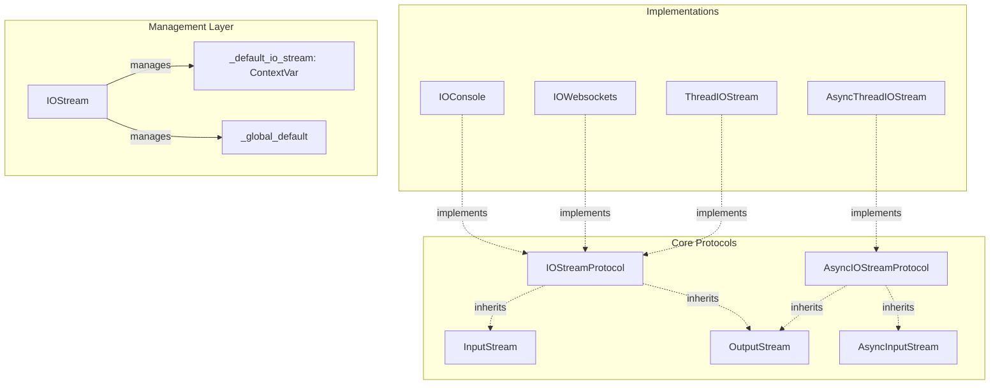
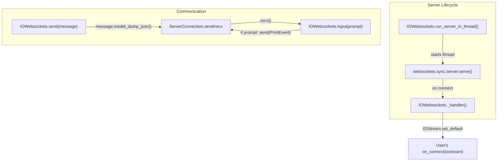
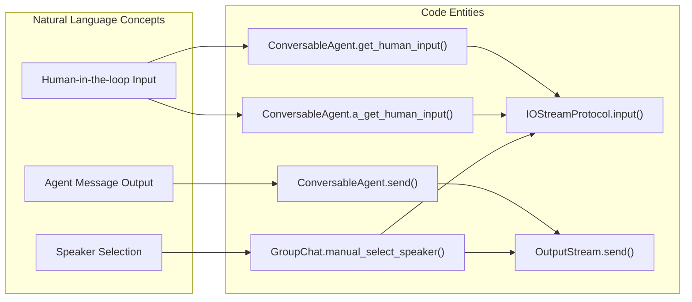
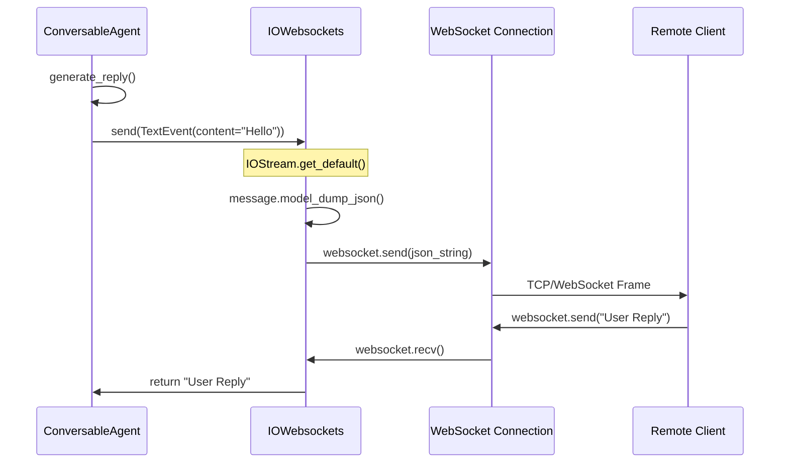

<!-- source: DeepWiki mcp.deepwiki.com · repo ag2ai/ag2 · page 2.5 IO System and Communication · fetched 2026-10-26 -->

# IO System and Communication

<details>
<summary>Relevant source files</summary>

The following files were used as context for generating this wiki page:

- [autogen/agentchat/chat.py](autogen/agentchat/chat.py)
- [autogen/agentchat/conversable_agent.py](autogen/agentchat/conversable_agent.py)
- [autogen/agentchat/group/multi_agent_chat.py](autogen/agentchat/group/multi_agent_chat.py)
- [autogen/agentchat/groupchat.py](autogen/agentchat/groupchat.py)
- [autogen/exception_utils.py](autogen/exception_utils.py)
- [autogen/io/__init__.py](autogen/io/__init__.py)
- [autogen/io/base.py](autogen/io/base.py)
- [autogen/io/console.py](autogen/io/console.py)
- [autogen/io/run_response.py](autogen/io/run_response.py)
- [autogen/io/step_controller.py](autogen/io/step_controller.py)
- [autogen/io/thread_io_stream.py](autogen/io/thread_io_stream.py)
- [autogen/io/websockets.py](autogen/io/websockets.py)
- [autogen/messages/agent_messages.py](autogen/messages/agent_messages.py)
- [notebook/agentchat_custom_events.ipynb](notebook/agentchat_custom_events.ipynb)
- [notebook/agentchat_iterating_runs.ipynb](notebook/agentchat_iterating_runs.ipynb)
- [notebook/agentchat_websockets.ipynb](notebook/agentchat_websockets.ipynb)
- [test/agentchat/group/test_group_chat_cost.py](test/agentchat/group/test_group_chat_cost.py)
- [test/agentchat/group/test_multi_agent_chat.py](test/agentchat/group/test_multi_agent_chat.py)
- [test/agentchat/test_conversable_agent.py](test/agentchat/test_conversable_agent.py)
- [test/agentchat/test_event_streaming.py](test/agentchat/test_event_streaming.py)
- [test/agentchat/test_groupchat.py](test/agentchat/test_groupchat.py)
- [test/io/test_base.py](test/io/test_base.py)
- [test/io/test_run_response.py](test/io/test_run_response.py)
- [test/io/test_step_controller.py](test/io/test_step_controller.py)
- [test/io/test_websockets.py](test/io/test_websockets.py)
- [test/messages/test_agent_messages.py](test/messages/test_agent_messages.py)
- [website/docs/user-guide/advanced-concepts/iterating-runs.mdx](website/docs/user-guide/advanced-concepts/iterating-runs.mdx)

</details>


The IO System provides a unified abstraction layer for input and output operations across the AG2 framework. It enables agents to communicate through various channels including console, websockets, and custom implementations while maintaining consistent interfaces and event-driven communication patterns.

## Architecture Overview

The IO System is built around protocol-based abstractions that support multiple implementation backends and context-aware stream management using `ContextVar` for thread and coroutine safety [autogen/io/base.py:97-100]().

**Core IO Protocol Hierarchy**



Sources: [autogen/io/base.py:21-91](), [autogen/io/console.py:18-56](), [autogen/io/websockets.py:82-214](), [autogen/io/thread_io_stream.py:18-25]()

## Protocol Definitions

The system defines several protocols in `autogen.io` that establish contracts for input/output operations:

### Core Protocols

| Protocol | Methods | Purpose |
|----------|---------|---------|
| `InputStream` | `input(prompt, password)` | Synchronous input operations [autogen/io/base.py:46-59]() |
| `OutputStream` | `print(*objects, ...)`, `send(message)` | Output and event messaging [autogen/io/base.py:23-42]() |
| `AsyncInputStream` | `async input(prompt, password)` | Asynchronous input operations [autogen/io/base.py:61-76]() |
| `IOStreamProtocol` | Combines `InputStream` + `OutputStream` | Complete synchronous IO interface [autogen/io/base.py:78-82]() |
| `AsyncIOStreamProtocol` | Combines `AsyncInputStream` + `OutputStream` | Complete asynchronous IO interface [autogen/io/base.py:84-88]() |

### Event Integration

The `OutputStream` protocol requires a `send(message: BaseEvent)` method [autogen/io/base.py:35-42](). This integrates the IO system with AG2's event-driven architecture, where messages like `TextEvent`, `ToolCallEvent`, or `TerminationEvent` are routed through the active stream [autogen/messages/agent_messages.py:17-43]().

Sources: [autogen/io/base.py:23-88](), [autogen/messages/agent_messages.py:17-43]()

## Stream Management

The `IOStream` class manages the default IO stream for the current execution context.

**Stream Context Management**

```mermaid
graph TD
    GlobalDefault["IOStream._global_default"]
    ContextVar["IOStream._default_io_stream"]
    GetDefault["IOStream.get_default()"]
    SetDefault["IOStream.set_default(stream)"]
    
    GetDefault -->|checks| ContextVar
    ContextVar -->|if None| GlobalDefault
    GlobalDefault -->|fallback| GetDefault
    
    SetDefault -->|contextmanager| ContextVar
    SetDefault -->|token = set(stream)| ContextVar
    
    subgraph "Execution Contexts"
        ThreadA["Thread/Task A"]
        ThreadB["Thread/Task B"]
    end
    
    ContextVar -.->|isolated via ContextVar| ThreadA
    ContextVar -.->|isolated via ContextVar| ThreadB
```

Sources: [autogen/io/base.py:94-152]()

### Context Variable Usage

The system uses `ContextVar` to ensure that in multi-threaded or async environments, agents use the correct stream [autogen/io/base.py:97-100]():

- **Global Default**: Set via `set_global_default(stream)` [autogen/io/base.py:102-110]().
- **Context Default**: Set using the `set_default(stream)` context manager, which uses `token = _default_io_stream.set(stream)` and ensures cleanup via `_default_io_stream.reset(token)` [autogen/io/base.py:137-151]().
- **Retrieval**: `get_default()` first checks the context-specific stream before falling back to the global default [autogen/io/base.py:123-135]().

Sources: [autogen/io/base.py:97-151]()

## Implementation Backends

### Console Implementation (`IOConsole`)

`IOConsole` provides standard terminal-based IO using Python's built-ins [autogen/io/console.py:18-20]().

- **Input**: Uses `builtins.input()` or `getpass.getpass()` if `password=True` [autogen/io/console.py:43-56]().
- **Output**: The `print()` method creates a `PrintEvent` and passes it to `send()` [autogen/io/console.py:22-33]().
- **Events**: `send(message)` calls `message.print()` to render the event to the terminal [autogen/io/console.py:35-41]().

Sources: [autogen/io/console.py:18-56]()

### WebSocket Implementation (`IOWebsockets`)

`IOWebsockets` enables real-time communication with remote clients using the `websockets` library [autogen/io/websockets.py:83-84]().

**WebSocket Server Architecture**



Sources: [autogen/io/websockets.py:83-214]()

### Thread-Based Streams

`ThreadIOStream` and `AsyncThreadIOStream` use internal queues (`queue.Queue` or `asyncio.Queue`) to bridge between agent execution and external responders [autogen/io/thread_io_stream.py:18-25](). This is heavily used in testing to simulate human input [test/agentchat/test_conversable_agent.py:646-665,669-690]().

## Integration with Agent System

Agents interact with the IO system primarily through `ConversableAgent` methods that retrieve the current stream via `IOStream.get_default()`.

**Natural Language to Code Entity Mapping: Agent Communication**



Sources: [autogen/agentchat/conversable_agent.py:1357-1411](), [autogen/agentchat/groupchat.py:408-436]()

### ConversableAgent Input/Output Flow

When an agent needs human input (e.g., `human_input_mode="ALWAYS"`), it calls `get_human_input(prompt)` [autogen/agentchat/conversable_agent.py:1357-1384](). This method:
1. Retrieves the current stream: `iostream = IOStream.get_default()` [autogen/agentchat/conversable_agent.py:1376]().
2. Calls `iostream.input(prompt)` [autogen/agentchat/conversable_agent.py:1377]().
3. Appends the result to `self._human_input` [autogen/agentchat/conversable_agent.py:1378]().

Similarly, `ConversableAgent.send()` and `receive()` methods trigger events that are dispatched to the current `IOStream` via `iostream.send(event)` [autogen/agentchat/conversable_agent.py:63-72]().

### GroupChat Integration

In `GroupChat`, if `speaker_selection_method="manual"`, the `manual_select_speaker` method uses the IO system to present choices and receive input [autogen/agentchat/groupchat.py:408-436]():
- It sends a `SelectSpeakerEvent` to the stream [autogen/agentchat/groupchat.py:414]().
- It loops using `iostream.input()` to get the user's choice [autogen/agentchat/groupchat.py:421]().
- It handles invalid inputs by sending a `SelectSpeakerInvalidInputEvent` [autogen/agentchat/groupchat.py:431]().

Sources: [autogen/agentchat/conversable_agent.py:1357-1411](), [autogen/agentchat/groupchat.py:408-436]()

## Communication Data Flow

**Data Flow: From Agent to WebSocket Client**



Sources: [autogen/io/websockets.py:190-214](), [autogen/agentchat/conversable_agent.py:1376-1378]()

---

