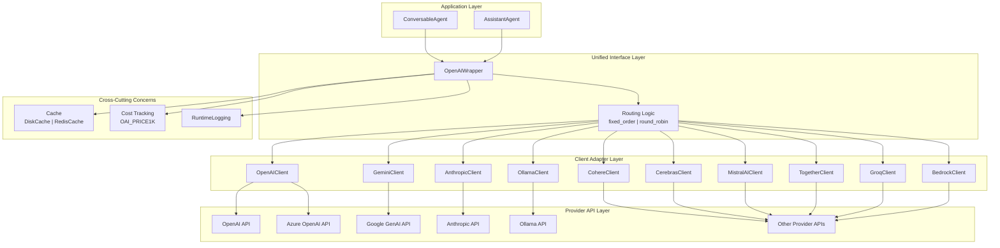
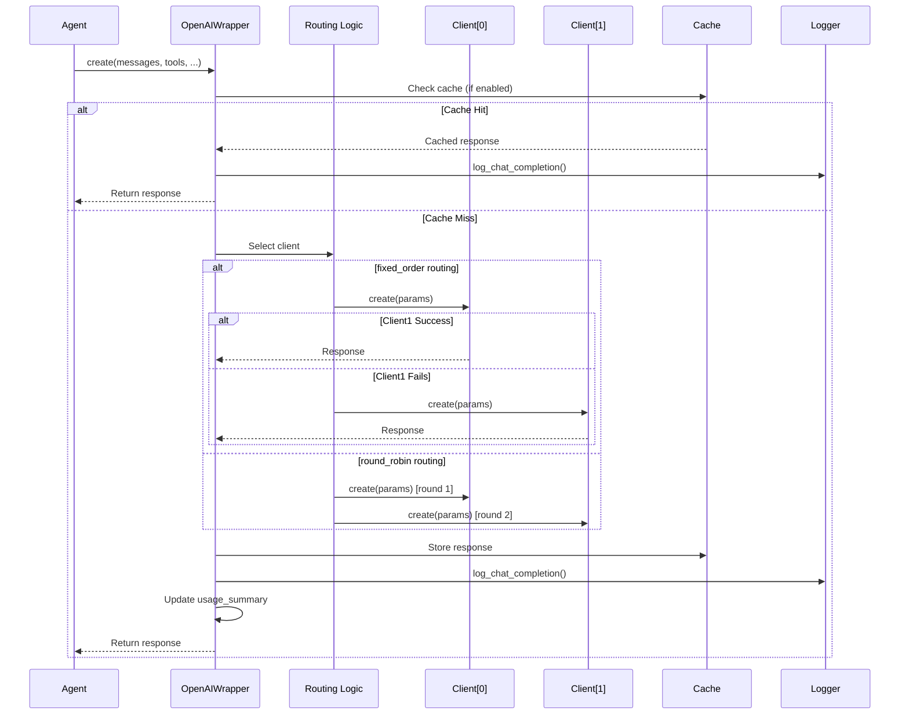

<!-- source: DeepWiki mcp.deepwiki.com · repo ag2ai/ag2 · page 3 LLM Integration · fetched 2026-10-26 -->

# LLM Integration

Relevant source files

The following files were used as context for generating this wiki page:

- [autogen/llm_config/entry.py](autogen/llm_config/entry.py)
- [autogen/oai/anthropic.py](autogen/oai/anthropic.py)
- [autogen/oai/bedrock.py](autogen/oai/bedrock.py)
- [autogen/oai/cerebras.py](autogen/oai/cerebras.py)
- [autogen/oai/client.py](autogen/oai/client.py)
- [autogen/oai/cohere.py](autogen/oai/cohere.py)
- [autogen/oai/groq.py](autogen/oai/groq.py)
- [autogen/oai/mistral.py](autogen/oai/mistral.py)
- [autogen/oai/ollama.py](autogen/oai/ollama.py)
- [autogen/oai/together.py](autogen/oai/together.py)
- [notebook/agentchat_anthropic_structured_outputs.ipynb](notebook/agentchat_anthropic_structured_outputs.ipynb)
- [notebook/agentchat_bedrock_client_exponential_backoff_and_retry_config.ipynb](notebook/agentchat_bedrock_client_exponential_backoff_and_retry_config.ipynb)
- [notebook/agentchat_bedrock_client_structured_output.ipynb](notebook/agentchat_bedrock_client_structured_output.ipynb)
- [test/agentchat/test_agent_logging.py](test/agentchat/test_agent_logging.py)
- [test/agentchat/test_agent_usage.py](test/agentchat/test_agent_usage.py)
- [test/agentchat/test_anthropic_structured_outputs.py](test/agentchat/test_anthropic_structured_outputs.py)
- [test/agentchat/test_assistant_agent.py](test/agentchat/test_assistant_agent.py)
- [test/agentchat/test_async.py](test/agentchat/test_async.py)
- [test/agentchat/test_async_chats.py](test/agentchat/test_async_chats.py)
- [test/agentchat/test_async_get_human_input.py](test/agentchat/test_async_get_human_input.py)
- [test/agentchat/test_cache_agent.py](test/agentchat/test_cache_agent.py)
- [test/agentchat/test_chats.py](test/agentchat/test_chats.py)
- [test/agentchat/test_function_call.py](test/agentchat/test_function_call.py)
- [test/agentchat/test_function_call_groupchat.py](test/agentchat/test_function_call_groupchat.py)
- [test/agentchat/test_human_input.py](test/agentchat/test_human_input.py)
- [test/agentchat/test_math_user_proxy_agent.py](test/agentchat/test_math_user_proxy_agent.py)
- [test/agentchat/test_nested.py](test/agentchat/test_nested.py)
- [test/agentchat/test_tool_calls.py](test/agentchat/test_tool_calls.py)
- [test/conftest.py](test/conftest.py)
- [test/oai/test_anthropic.py](test/oai/test_anthropic.py)
- [test/oai/test_bedrock.py](test/oai/test_bedrock.py)
- [test/oai/test_cerebras.py](test/oai/test_cerebras.py)
- [test/oai/test_client.py](test/oai/test_client.py)
- [test/oai/test_client_stream.py](test/oai/test_client_stream.py)
- [test/oai/test_cohere.py](test/oai/test_cohere.py)
- [test/oai/test_groq.py](test/oai/test_groq.py)
- [test/oai/test_mistral.py](test/oai/test_mistral.py)
- [test/oai/test_ollama.py](test/oai/test_ollama.py)
- [test/test_conftest.py](test/test_conftest.py)
- [test/test_llm_config.py](test/test_llm_config.py)

## Purpose and Scope

This document describes AG2's LLM integration system, which provides a unified interface for interacting with multiple Large Language Model providers (OpenAI, Azure OpenAI, Google Gemini, Anthropic Claude, Ollama, Cohere, Cerebras, Mistral AI, Together AI, Groq, and AWS Bedrock). The system abstracts provider-specific APIs behind a common interface, handles request routing, response caching, cost tracking, and automatic retry logic.

For agent-level LLM configuration, see [Core Agent System](#2). For runtime logging of LLM calls, see [Runtime Logging System](#6.2).

## Architecture Overview

The LLM integration system uses a multi-layered architecture to provide a unified interface across diverse providers:

**Sources:** [autogen/oai/client.py:770-878](), [autogen/oai/gemini.py:151-222](), [autogen/oai/anthropic.py:381-433](), [autogen/oai/ollama.py:80-144]()

### Key Design Principles

1. **Provider Independence**: Applications interact only with `OpenAIWrapper`, never directly with provider-specific clients.
2. **Transparent Failover**: Routing methods (`fixed_order`, `round_robin`) automatically retry failed requests with alternative providers [autogen/oai/client.py:1173-1210]().
3. **Standardized Response Format**: All providers return responses conforming to OpenAI's `ChatCompletion` schema [autogen/oai/client.py:23-57]().
4. **Configuration-Driven**: Provider selection and behavior controlled through `config_list` dictionaries or `LLMConfig` objects [autogen/llm_config/entry.py:1-50]().

## OpenAIWrapper: The Unified Interface

`OpenAIWrapper` serves as the single entry point for all LLM interactions in AG2. It manages client registration, request routing, response caching, and usage tracking [autogen/oai/client.py:770-878]().

For deep architectural details, see [OpenAIWrapper and Client Architecture](#3.1).

### Request Flow with Routing

**Sources:** [autogen/oai/client.py:1108-1313](), [test/oai/test_client.py:142-227]()

## LLM Configuration System

AG2 uses a type-safe configuration system built on Pydantic. It allows users to define a list of model configurations (`config_list`) and load them from various sources like environment variables or JSON files [autogen/llm_config/entry.py:1-100]().

For details on how to set up and manage these configurations, see [LLM Configuration System](#3.2).

## Provider-Specific Clients

Each provider (Anthropic, Gemini, Ollama, etc.) has a dedicated client implementation that translates the unified AG2 request into the provider's specific API format and maps the response back to the standard `ChatCompletion` format.

| Provider | Client Class | Key Feature |
| :--- | :--- | :--- |
| **Anthropic** | `AnthropicClient` | Native structured outputs and extended thinking [autogen/oai/anthropic.py:124-205]() |
| **Gemini** | `GeminiClient` | Native tool calling and Vertex AI support [autogen/oai/gemini.py:151-222]() |
| **Ollama** | `OllamaClient` | Local model support with manual or native tool calling [autogen/oai/ollama.py:80-144]() |
| **Bedrock** | `BedrockClient` | AWS Bedrock Converse API integration [autogen/oai/bedrock.py:105-168]() |

For implementation details of each provider, see [Provider-Specific Clients](#3.3).

## Caching and Cost Tracking

AG2 includes a robust caching layer (supporting Disk and Redis) to minimize API costs and latency. It also tracks token usage and calculates costs based on provider-specific pricing tables [autogen/oai/openai_utils.py:1-50]().

For details on cache configuration and usage tracking, see [Caching and Cost Tracking](#3.4).

## GPT Assistant Agent

The `GPTAssistantAgent` is a specialized agent that wraps OpenAI's Assistant API, providing high-level management for threads, files, and stateful interactions [autogen/agentchat/assistant_agent.py:1-50]().

For more information, see [GPT Assistant Agent](#3.5).

## ModelClient V2 and UnifiedResponse

AG2 is transitioning to a more robust protocol-based architecture. `ModelClientV2` and `UnifiedResponse` introduce typed content blocks, including reasoning (thinking) and citations, to better support advanced model capabilities like those found in Claude 3.7 and o1/o3 [autogen/oai/anthropic.py:124-153]().

For the new architecture and migration guide, see [ModelClient V2 and UnifiedResponse](#3.6).

**Sources:** [autogen/oai/client.py:770-878](), [autogen/oai/anthropic.py:124-205](), [autogen/oai/ollama.py:80-144](), [autogen/oai/bedrock.py:105-168](), [autogen/llm_config/entry.py:1-100]()

---

