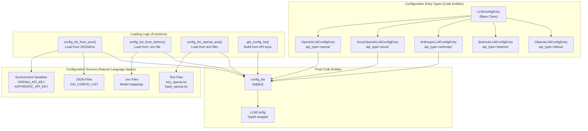
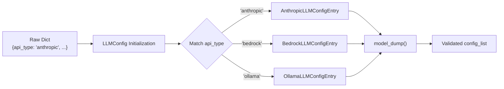
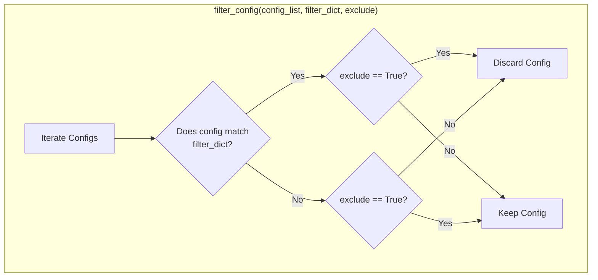

<!-- source: DeepWiki mcp.deepwiki.com · repo ag2ai/ag2 · page 3.2 LLM Configuration System · fetched 2026-10-26 -->

# LLM Configuration System

<details>
<summary>Relevant source files</summary>

The following files were used as context for generating this wiki page:

- [OAI_CONFIG_LIST_sample](OAI_CONFIG_LIST_sample)
- [autogen/llm_config/entry.py](autogen/llm_config/entry.py)
- [autogen/oai/__init__.py](autogen/oai/__init__.py)
- [autogen/oai/anthropic.py](autogen/oai/anthropic.py)
- [autogen/oai/bedrock.py](autogen/oai/bedrock.py)
- [autogen/oai/cerebras.py](autogen/oai/cerebras.py)
- [autogen/oai/cohere.py](autogen/oai/cohere.py)
- [autogen/oai/groq.py](autogen/oai/groq.py)
- [autogen/oai/mistral.py](autogen/oai/mistral.py)
- [autogen/oai/ollama.py](autogen/oai/ollama.py)
- [autogen/oai/openai_utils.py](autogen/oai/openai_utils.py)
- [autogen/oai/together.py](autogen/oai/together.py)
- [autogen/token_count_utils.py](autogen/token_count_utils.py)
- [autogen/tools/experimental/shell/__init__.py](autogen/tools/experimental/shell/__init__.py)
- [autogen/tools/experimental/shell/shell_tool.py](autogen/tools/experimental/shell/shell_tool.py)
- [notebook/agentchat_anthropic_structured_outputs.ipynb](notebook/agentchat_anthropic_structured_outputs.ipynb)
- [notebook/agentchat_bedrock_client_exponential_backoff_and_retry_config.ipynb](notebook/agentchat_bedrock_client_exponential_backoff_and_retry_config.ipynb)
- [notebook/agentchat_bedrock_client_structured_output.ipynb](notebook/agentchat_bedrock_client_structured_output.ipynb)
- [notebook/agentchat_gpt5.1_in_built_tools_example.ipynb](notebook/agentchat_gpt5.1_in_built_tools_example.ipynb)
- [notebook/agentchat_gpt5.1_shell_tool_example.ipynb](notebook/agentchat_gpt5.1_shell_tool_example.ipynb)
- [test/agentchat/test_anthropic_structured_outputs.py](test/agentchat/test_anthropic_structured_outputs.py)
- [test/oai/test_anthropic.py](test/oai/test_anthropic.py)
- [test/oai/test_bedrock.py](test/oai/test_bedrock.py)
- [test/oai/test_cerebras.py](test/oai/test_cerebras.py)
- [test/oai/test_cohere.py](test/oai/test_cohere.py)
- [test/oai/test_groq.py](test/oai/test_groq.py)
- [test/oai/test_mistral.py](test/oai/test_mistral.py)
- [test/oai/test_ollama.py](test/oai/test_ollama.py)
- [test/oai/test_utils.py](test/oai/test_utils.py)
- [test/test_llm_config.py](test/test_llm_config.py)
- [test/test_notebook.py](test/test_notebook.py)
- [test/tools/experimental/shell/test_shell_tool.py](test/tools/experimental/shell/test_shell_tool.py)

</details>


## Purpose and Scope

The LLM Configuration System provides a flexible, type-safe mechanism for configuring connections to multiple LLM providers (OpenAI, Azure OpenAI, Anthropic, Gemini, Bedrock, Ollama, etc.). This system handles API key management, model selection, configuration validation, and provider-specific parameter handling through a unified interface.

This page covers configuration entry types, loading methods, and filtering mechanisms. For information about how configurations are used to instantiate clients, see [OpenAIWrapper and Client Architecture](3.1). For provider-specific implementation details, see [Provider-Specific Clients](3.3).

## Configuration Architecture

The system transitions from raw configuration sources (JSON, Env, Files) to structured `LLMConfigEntry` objects, which are then bundled into an `LLMConfig` for use by agents.



**Sources:** [autogen/oai/openai_utils.py:187-203](), [autogen/llm_config/entry.py:1-50](), [autogen/oai/anthropic.py:89-139](), [autogen/oai/bedrock.py:75-102]()

## Configuration Entry Types

AG2 uses Pydantic models to provide type-safe configuration entries. Each provider has a specific `LLMConfigEntry` subclass that defines valid parameters and default values.

### Provider-Specific Entry Models

| Class Name | `api_type` | Key Specific Parameters | File Reference |
|-----------|------------|-------------------------|----------------|
| `OpenAILLMConfigEntry` | `openai` | `model`, `api_key`, `base_url`, `reasoning_effort` | [test/test_llm_config.py:27-27]() |
| `AzureOpenAILLMConfigEntry` | `azure` | `api_version`, `azure_endpoint`, `azure_ad_token` | [test/test_llm_config.py:18-18]() |
| `AnthropicLLMConfigEntry` | `anthropic` | `model`, `api_key`, `max_tokens` | [autogen/oai/anthropic.py:124-139]() |
| `BedrockLLMConfigEntry` | `bedrock` | `aws_region`, `aws_access_key`, `aws_secret_key` | [autogen/oai/bedrock.py:75-94]() |
| `OllamaLLMConfigEntry` | `ollama` | `client_host`, `num_ctx`, `native_tool_calls` | [autogen/oai/ollama.py:60-75]() |
| `CohereLLMConfigEntry` | `cohere` | `k`, `strict_tools`, `client_name` | [autogen/oai/cohere.py:83-94]() |

### Data Flow for Entry Validation

When a configuration dictionary is passed to `LLMConfig`, it is validated against the appropriate Pydantic model based on the `api_type`.



**Sources:** [test/test_llm_config.py:156-210](), [autogen/oai/anthropic.py:89-91](), [autogen/oai/bedrock.py:46-53]()

## Configuration Loading Methods

### Loading from JSON or Environment Variables
The `config_list_from_json()` function is the primary entry point for loading complex configurations. It can read from a file path or an environment variable containing a JSON string.

**Sources:** [autogen/oai/openai_utils.py:23-23](), [test/oai/test_utils.py:54-95]()

### Loading from .env Files
`config_list_from_dotenv()` uses a mapping to associate specific models with environment variable keys.

```python
# Example mapping used in autogen/oai/openai_utils.py
MODEL_API_KEY_MAP = {
    "gpt-4": "OPENAI_API_KEY",
    "claude-3-5-sonnet": "ANTHROPIC_API_KEY"
}
```

**Sources:** [autogen/oai/openai_utils.py:533-632]()

### Building from Key Lists
`get_config_list()` programmatically generates a list of configuration dictionaries from lists of keys and URLs.

**Sources:** [autogen/oai/openai_utils.py:187-203]()

## API Key and Credential Management

### Validation Logic
OpenAI API keys are validated using a regex pattern to ensure they follow the `sk-` prefix convention and meet minimum length requirements.

**Sources:** [autogen/oai/openai_utils.py:171-183]()

### Provider-Specific Credentials
Different providers require different credential sets, which are handled by their respective `Client` classes during initialization:

*   **Anthropic:** Requires `api_key` or AWS/GCP credentials for Bedrock/Vertex variants. [autogen/oai/anthropic.py:97-118]()
*   **Bedrock:** Requires `aws_region` and optionally `aws_access_key`, `aws_secret_key`, and `aws_session_token`. [autogen/oai/bedrock.py:112-130]()
*   **Ollama:** Typically requires no API key but supports `client_host` for remote instances. [autogen/oai/ollama.py:117-120]()
*   **Cohere:** Requires `api_key` or `COHERE_API_KEY` environment variable. [autogen/oai/cohere.py:110-118]()

### Security: Non-Cacheable Keys
To maintain security and prevent sensitive data from leaking into cache keys (e.g., when using disk caching), the system identifies specific keys to exclude during cache key generation.

**Excluded Keys:** `api_key`, `base_url`, `api_type`, `api_version`, `azure_ad_token`, `credentials`.

**Sources:** [autogen/oai/openai_utils.py:33-41](), [autogen/oai/openai_utils.py:154-169]()

## Configuration Filtering

The `filter_config()` function allows users to select a subset of configurations from a `config_list` based on specific criteria like tags or model names.



**Example Filter Dictionary:**
```python
# Select only models tagged as 'gpt-4o' or 'tool'
filter_dict = {"tags": ["gpt-4o", "tool"]}
```

**Sources:** [autogen/llm_config/utils.py:20-20](), [test/oai/test_utils.py:100-136]()

## Token and Cost Utilities

The configuration system is tightly coupled with token counting and cost estimation utilities.

### Token Counting
`count_token()` and `get_max_token_limit()` provide model-specific context window information and usage tracking.

**Sources:** [autogen/token_count_utils.py:34-107](), [autogen/token_count_utils.py:127-143]()

### Pricing Database
The `OAI_PRICE1K` and `ANTHROPIC_PRICING_1k` dictionaries store the input/output costs for various models to enable real-time cost tracking.

| Model | Input Cost (per 1k) | Output Cost (per 1k) |
|-------|---------------------|----------------------|
| `o1-preview` | 0.0015 | 0.0060 |
| `gpt-4o` | 0.005 | 0.015 |
| `claude-3-haiku` | 0.00025 | 0.00125 |
| `command-r-plus` | 0.003 | 0.015 |

**Sources:** [autogen/oai/openai_utils.py:46-151](), [autogen/oai/anthropic.py:124-139](), [autogen/oai/cohere.py:60-67]()

## Summary of Helper Functions

| Function | Purpose | File Reference |
|----------|---------|----------------|
| `get_config_list` | Generates config list from key arrays | [autogen/oai/openai_utils.py:187-203]() |
| `config_list_from_json` | Loads and filters JSON-based configs | [autogen/oai/openai_utils.py:23-23]() |
| `get_first_llm_config` | Extracts the first entry for quick access | [autogen/oai/openai_utils.py:240-264]() |
| `is_valid_api_key` | Validates OpenAI key string format | [autogen/oai/openai_utils.py:171-183]() |
| `get_key` | Generates a cache-safe unique identifier | [autogen/oai/openai_utils.py:154-169]() |

**Sources:** [autogen/oai/openai_utils.py:1-264]()

---

