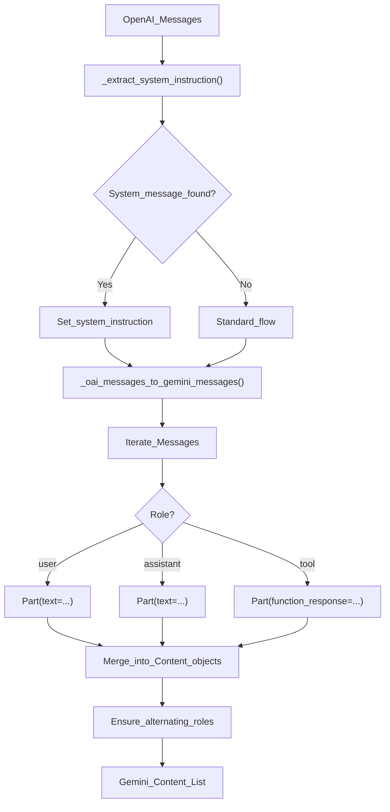
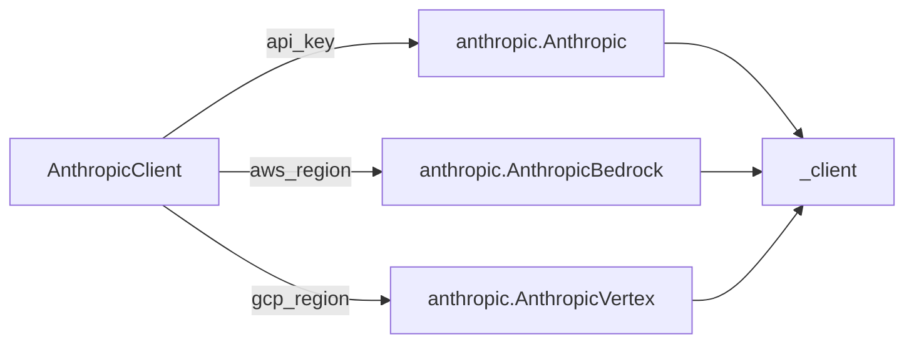

<!-- source: DeepWiki mcp.deepwiki.com · repo ag2ai/ag2 · page 3.3 Provider-Specific Clients · fetched 2026-10-26 -->

# Provider-Specific Clients

<details>
<summary>Relevant source files</summary>

The following files were used as context for generating this wiki page:

- [autogen/coding/remyx_code_executor.py](autogen/coding/remyx_code_executor.py)
- [autogen/llm_clients/models/unified_response.py](autogen/llm_clients/models/unified_response.py)
- [autogen/llm_clients/openai_responses_v2.py](autogen/llm_clients/openai_responses_v2.py)
- [autogen/llm_config/entry.py](autogen/llm_config/entry.py)
- [autogen/llm_config/types.py](autogen/llm_config/types.py)
- [autogen/oai/anthropic.py](autogen/oai/anthropic.py)
- [autogen/oai/bedrock.py](autogen/oai/bedrock.py)
- [autogen/oai/cerebras.py](autogen/oai/cerebras.py)
- [autogen/oai/cohere.py](autogen/oai/cohere.py)
- [autogen/oai/gemini.py](autogen/oai/gemini.py)
- [autogen/oai/groq.py](autogen/oai/groq.py)
- [autogen/oai/mistral.py](autogen/oai/mistral.py)
- [autogen/oai/ollama.py](autogen/oai/ollama.py)
- [autogen/oai/together.py](autogen/oai/together.py)
- [autogen/tools/experimental/apply_patch/README.md](autogen/tools/experimental/apply_patch/README.md)
- [autogen/tools/experimental/apply_patch/apply_patch_tool.py](autogen/tools/experimental/apply_patch/apply_patch_tool.py)
- [autogen/tools/experimental/shell/README.md](autogen/tools/experimental/shell/README.md)
- [notebook/agentchat_anthropic_structured_outputs.ipynb](notebook/agentchat_anthropic_structured_outputs.ipynb)
- [notebook/agentchat_bedrock_client_exponential_backoff_and_retry_config.ipynb](notebook/agentchat_bedrock_client_exponential_backoff_and_retry_config.ipynb)
- [notebook/agentchat_bedrock_client_structured_output.ipynb](notebook/agentchat_bedrock_client_structured_output.ipynb)
- [notebook/agentchat_gemini_thinking_config_example.ipynb](notebook/agentchat_gemini_thinking_config_example.ipynb)
- [notebook/agentchat_v2_responses_client.ipynb](notebook/agentchat_v2_responses_client.ipynb)
- [notebook/tools_google_search.ipynb](notebook/tools_google_search.ipynb)
- [test/agentchat/test_anthropic_structured_outputs.py](test/agentchat/test_anthropic_structured_outputs.py)
- [test/credentials.py](test/credentials.py)
- [test/llm_clients/test_openai_responses_v2_client.py](test/llm_clients/test_openai_responses_v2_client.py)
- [test/llm_clients/test_openai_responses_v2_client_integration.py](test/llm_clients/test_openai_responses_v2_client_integration.py)
- [test/oai/test_anthropic.py](test/oai/test_anthropic.py)
- [test/oai/test_bedrock.py](test/oai/test_bedrock.py)
- [test/oai/test_cerebras.py](test/oai/test_cerebras.py)
- [test/oai/test_cohere.py](test/oai/test_cohere.py)
- [test/oai/test_gemini.py](test/oai/test_gemini.py)
- [test/oai/test_groq.py](test/oai/test_groq.py)
- [test/oai/test_mistral.py](test/oai/test_mistral.py)
- [test/oai/test_ollama.py](test/oai/test_ollama.py)
- [test/test_llm_config.py](test/test_llm_config.py)
- [website/docs/user-guide/advanced-concepts/tools/basics.mdx](website/docs/user-guide/advanced-concepts/tools/basics.mdx)
- [website/docs/user-guide/advanced-concepts/tools/controlling-use.mdx](website/docs/user-guide/advanced-concepts/tools/controlling-use.mdx)
- [website/docs/user-guide/models/amazon-bedrock.mdx](website/docs/user-guide/models/amazon-bedrock.mdx)
- [website/docs/user-guide/models/anthropic.mdx](website/docs/user-guide/models/anthropic.mdx)
- [website/docs/user-guide/models/cerebras.mdx](website/docs/user-guide/models/cerebras.mdx)
- [website/docs/user-guide/models/cohere.mdx](website/docs/user-guide/models/cohere.mdx)
- [website/docs/user-guide/models/deepseek-v3.mdx](website/docs/user-guide/models/deepseek-v3.mdx)
- [website/docs/user-guide/models/google-gemini.mdx](website/docs/user-guide/models/google-gemini.mdx)
- [website/docs/user-guide/models/google-vertexai.mdx](website/docs/user-guide/models/google-vertexai.mdx)
- [website/docs/user-guide/models/grok-and-oai-compatible-models.mdx](website/docs/user-guide/models/grok-and-oai-compatible-models.mdx)
- [website/docs/user-guide/models/groq.mdx](website/docs/user-guide/models/groq.mdx)
- [website/docs/user-guide/models/mistralai.mdx](website/docs/user-guide/models/mistralai.mdx)
- [website/docs/user-guide/models/ollama.mdx](website/docs/user-guide/models/ollama.mdx)
- [website/docs/user-guide/models/openai.mdx](website/docs/user-guide/models/openai.mdx)
- [website/docs/user-guide/models/openai_responses.mdx](website/docs/user-guide/models/openai_responses.mdx)
- [website/docs/user-guide/models/togetherai.mdx](website/docs/user-guide/models/togetherai.mdx)
- [website/docs/user-guide/models/vLLM.mdx](website/docs/user-guide/models/vLLM.mdx)
- [website/docs/user-guide/reference-tools/google-api/google-search.mdx](website/docs/user-guide/reference-tools/google-api/google-search.mdx)
- [website/mkdocs/overrides/main.html](website/mkdocs/overrides/main.html)
- [website/snippets/python-examples/humanintheloop_financial.mdx](website/snippets/python-examples/humanintheloop_financial.mdx)

</details>


## Purpose and Scope

This document covers the implementation details of provider-specific LLM clients in AG2. These clients act as adapters that translate AG2's OpenAI-compatible message format to each provider's native API format, enabling seamless integration with multiple LLM providers through a unified interface.

For information about the unified LLM interface and routing mechanisms, see [OpenAIWrapper and Client Architecture](). For configuration of these clients, see [LLM Configuration System]().

## Client Architecture Overview

All provider-specific clients implement a common interface that allows `OpenAIWrapper` to interact with different LLM providers uniformly. Each client is responsible for:

1.  **Message Translation**: Converting AG2's OpenAI-compatible messages to provider-specific formats.
2.  **Tool Calling**: Translating function/tool definitions and handling tool execution flows.
3.  **Response Mapping**: Converting provider responses back to OpenAI-compatible format.
4.  **Cost Calculation**: Computing usage costs based on token counts.
5.  **Error Handling**: Managing provider-specific errors and retries.

### Common Client Interface

The diagram below illustrates the relationship between the base protocol and the specialized implementations.

**Provider Client Hierarchy**
```mermaid
classDiagram
    class "ModelClient" {
        <<interface>>
        +create(params) ChatCompletion
        +message_retrieval(response) list
        +cost(response) float
        +get_usage(response) dict
    }
    
    class "OpenAIClient" {
        +RESPONSE_USAGE_KEYS list
        +create(params) ChatCompletion
    }
    
    class "GeminiClient" {
        +RESPONSE_USAGE_KEYS list
        +use_vertexai bool
        +create(params) ChatCompletion
        +_oai_messages_to_gemini_messages() list
        +_tools_to_gemini_tools() list
    }
    
    class "AnthropicClient" {
        +RESPONSE_USAGE_KEYS list
        +_client Anthropic|AnthropicBedrock|AnthropicVertex
        +create(params) ChatCompletion
        +_oai_messages_to_anthropic_messages() list
    }
    
    class "OllamaClient" {
        +RESPONSE_USAGE_KEYS list
        +TOOL_CALL_MANUAL_INSTRUCTION str
        +create(params) ChatCompletion
    }
    
    class "CohereClient" {
        +RESPONSE_USAGE_KEYS list
        +_client ClientV2
        +create(params) ChatCompletion
    }
    
    "ModelClient" <|.. "OpenAIClient"
    "ModelClient" <|.. "GeminiClient"
    "ModelClient" <|.. "AnthropicClient"
    "ModelClient" <|.. "OllamaClient"
    "ModelClient" <|.. "CohereClient"
```
Sources: [autogen/oai/gemini.py:153-245](), [autogen/oai/anthropic.py:381-438](), [autogen/oai/ollama.py:80-144](), [autogen/oai/cohere.py:99-158]()

## GeminiClient

`GeminiClient` provides integration with Google's Gemini API, supporting both direct API access and Vertex AI.

### Key Features

| Feature | Support | Notes |
| :--- | :--- | :--- |
| **Authentication** | API Key or Vertex AI | Can use `api_key`, or Google Cloud credentials via `project_id` and `location` [autogen/oai/gemini.py:170-186]() |
| **Streaming** | Yes | Supported via `stream=True` in config [autogen/oai/gemini.py:130-134]() |
| **Tool Calling** | Native | Full support for function calls [autogen/oai/gemini.py:732-750]() |
| **Structured Outputs** | Yes | Via `response_format` with JSON schema [autogen/oai/gemini.py:333-349]() |
| **Thinking Config** | Yes | Supports `include_thoughts`, `thinking_budget`, and `thinking_level` [autogen/oai/gemini.py:135-145]() |

### Message Translation

Gemini requires alternating user/model roles and specific message ordering. The translation process handles the conversion from OpenAI format to Google GenAI `Content` objects.

**Gemini Message Flow**

Sources: [autogen/oai/gemini.py:493-518](), [autogen/oai/gemini.py:632-725](), [test/oai/test_gemini.py:148-174]()

### Thinking Configuration
Gemini 2.0+ models support "thinking" capabilities. `GeminiClient` exposes these through `GeminiLLMConfigEntry`:
- `include_thoughts`: Boolean to include reasoning in the response [autogen/oai/gemini.py:135-138]().
- `thinking_budget`: Token limit for reasoning [autogen/oai/gemini.py:139-142]().
- `thinking_level`: Presets like "High", "Medium", "Low" [autogen/oai/gemini.py:143-145]().

## AnthropicClient

`AnthropicClient` integrates with Anthropic's Claude models, supporting the Anthropic API, AWS Bedrock, and Google Cloud Vertex AI.

### Key Features

| Feature | Support | Notes |
| :--- | :--- | :--- |
| **Auth Modes** | 3 Modes | `Anthropic`, `AnthropicBedrock`, `AnthropicVertex` [autogen/oai/anthropic.py:384-432]() |
| **Structured Outputs** | Native | Supported on Sonnet 3.5+, Opus 4.1+, Haiku 4.5+ [autogen/oai/anthropic.py:156-205]() |
| **Extended Thinking** | Yes | Via `thinking` block in messages [autogen/oai/anthropic.py:355-377]() |

### Structured Output Support
The client automatically detects if a model supports native structured outputs (constrained decoding) using `supports_native_structured_outputs` [autogen/oai/anthropic.py:156-205](). If supported, it uses the `messages.parse()` API [autogen/oai/anthropic.py:612-625]().

**Anthropic Client Initialization**

Sources: [autogen/oai/anthropic.py:384-432](), [test/oai/test_anthropic.py:148-195]()

## OllamaClient

`OllamaClient` provides integration with locally-hosted Ollama models. It is unique in offering both **Native** and **Manual** tool calling.

### Tool Calling Modes
1.  **Native**: Uses Ollama's built-in tool calling support [autogen/oai/ollama.py:74-75]().
2.  **Manual**: Injects a strict two-step process instruction into the system message [autogen/oai/ollama.py:92-107](). This is useful for models that do not natively support tool calling.

**Ollama Parameter Mapping**
Ollama parameters are mapped to the `options` dictionary in the API request:
- `num_predict` -> `max_tokens` [autogen/oai/ollama.py:65-68]()
- `num_ctx` -> Context window size [autogen/oai/ollama.py:69]()
- `repeat_penalty` [autogen/oai/ollama.py:70]()

Sources: [autogen/oai/ollama.py:145-180](), [test/oai/test_ollama.py:101-128]()

## Amazon Bedrock (Converse API)

`BedrockClient` utilizes the Amazon Bedrock Converse API to interact with models like Llama, Claude, and Mistral hosted on AWS.

### Message Translation
The utility `oai_messages_to_bedrock_messages` converts standard OpenAI-formatted messages into the Bedrock structure:
- Roles are mapped to `user` or `assistant` [autogen/oai/bedrock.py:284-288]().
- Tool calls are translated to `toolUse` blocks [autogen/oai/bedrock.py:330-344]().
- Tool results are translated to `toolResult` blocks [autogen/oai/bedrock.py:302-316]().

Sources: [autogen/oai/bedrock.py:280-360](), [test/oai/test_bedrock.py:123-174]()

## CohereClient

`CohereClient` leverages the `ClientV2` from the Cohere SDK.

### Implementation Details
- **Message Retrieval**: Extracts messages from the `choices` field of the Cohere response [autogen/oai/cohere.py:122-128]().
- **Parameter Validation**: Validates parameters like `k`, `seed`, `frequency_penalty`, and `presence_penalty` [autogen/oai/cohere.py:83-93]().
- **Structured Outputs**: Supports Pydantic models by converting them to JSON schemas via `model_json_schema()` [autogen/oai/cohere.py:163-165]().

Sources: [autogen/oai/cohere.py:145-195](), [test/oai/test_cohere.py:1-100]()

## Cost and Usage Tracking

Every client must implement `get_usage` and `cost` methods to provide a unified interface for token and expense tracking.

| Client | Pricing Source | Calculation Method |
| :--- | :--- | :--- |
| **Anthropic** | `ANTHROPIC_PRICING_1k` | `(input * rate_in + output * rate_out) / 1000` [autogen/oai/anthropic.py:124-139]() |
| **Cohere** | `COHERE_PRICING_1K` | Model-specific lookup [autogen/oai/cohere.py:60-67]() |
| **Gemini** | `calculate_gemini_cost` | Handles Vertex vs. Google AI differences [autogen/oai/gemini.py:1253-1255]() |
| **Ollama** | N/A | Typically returns 0.0 for local execution [autogen/oai/ollama.py:130-131]() |

Sources: [autogen/oai/anthropic.py:1084-1096](), [autogen/oai/gemini.py:1253-1308](), [autogen/oai/cohere.py:297-317]()

---

