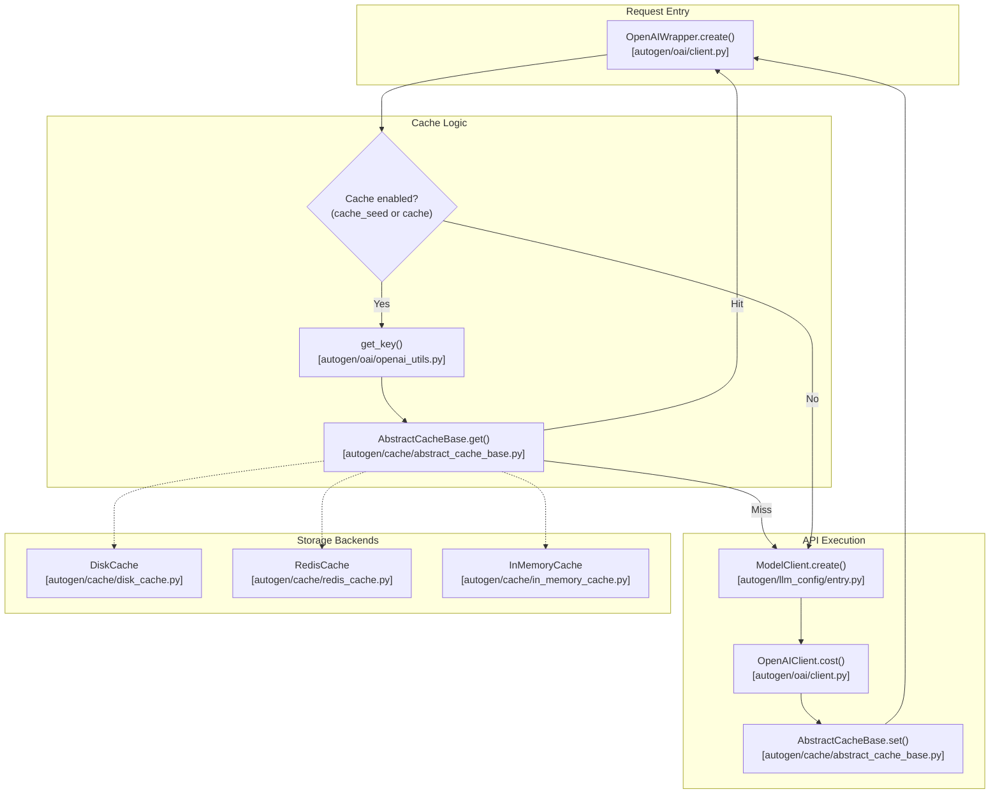
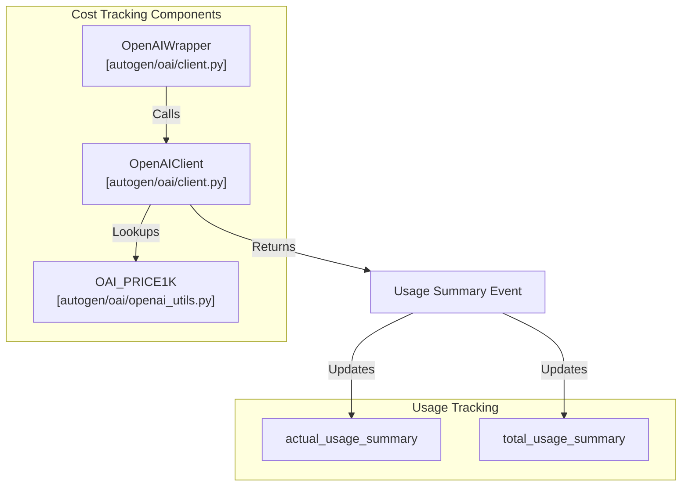

<!-- source: DeepWiki mcp.deepwiki.com · repo ag2ai/ag2 · page 3.4 Caching and Cost Tracking · fetched 2026-10-26 -->

# Caching and Cost Tracking

<details>
<summary>Relevant source files</summary>

The following files were used as context for generating this wiki page:

- [autogen/cache/__init__.py](autogen/cache/__init__.py)
- [autogen/cache/abstract_cache_base.py](autogen/cache/abstract_cache_base.py)
- [autogen/cache/cache.py](autogen/cache/cache.py)
- [autogen/cache/cache_factory.py](autogen/cache/cache_factory.py)
- [autogen/cache/cosmos_db_cache.py](autogen/cache/cosmos_db_cache.py)
- [autogen/cache/disk_cache.py](autogen/cache/disk_cache.py)
- [autogen/cache/in_memory_cache.py](autogen/cache/in_memory_cache.py)
- [autogen/cache/redis_cache.py](autogen/cache/redis_cache.py)
- [autogen/oai/__init__.py](autogen/oai/__init__.py)
- [autogen/oai/client.py](autogen/oai/client.py)
- [autogen/oai/openai_utils.py](autogen/oai/openai_utils.py)
- [autogen/token_count_utils.py](autogen/token_count_utils.py)
- [autogen/tools/experimental/shell/__init__.py](autogen/tools/experimental/shell/__init__.py)
- [autogen/tools/experimental/shell/shell_tool.py](autogen/tools/experimental/shell/shell_tool.py)
- [notebook/agentchat_gpt5.1_in_built_tools_example.ipynb](notebook/agentchat_gpt5.1_in_built_tools_example.ipynb)
- [notebook/agentchat_gpt5.1_shell_tool_example.ipynb](notebook/agentchat_gpt5.1_shell_tool_example.ipynb)
- [test/agentchat/test_agent_logging.py](test/agentchat/test_agent_logging.py)
- [test/agentchat/test_agent_usage.py](test/agentchat/test_agent_usage.py)
- [test/agentchat/test_assistant_agent.py](test/agentchat/test_assistant_agent.py)
- [test/agentchat/test_async.py](test/agentchat/test_async.py)
- [test/agentchat/test_async_chats.py](test/agentchat/test_async_chats.py)
- [test/agentchat/test_async_get_human_input.py](test/agentchat/test_async_get_human_input.py)
- [test/agentchat/test_cache_agent.py](test/agentchat/test_cache_agent.py)
- [test/agentchat/test_chats.py](test/agentchat/test_chats.py)
- [test/agentchat/test_function_call.py](test/agentchat/test_function_call.py)
- [test/agentchat/test_function_call_groupchat.py](test/agentchat/test_function_call_groupchat.py)
- [test/agentchat/test_human_input.py](test/agentchat/test_human_input.py)
- [test/agentchat/test_math_user_proxy_agent.py](test/agentchat/test_math_user_proxy_agent.py)
- [test/agentchat/test_nested.py](test/agentchat/test_nested.py)
- [test/agentchat/test_tool_calls.py](test/agentchat/test_tool_calls.py)
- [test/cache/test_cache.py](test/cache/test_cache.py)
- [test/cache/test_cosmos_db_cache.py](test/cache/test_cosmos_db_cache.py)
- [test/cache/test_in_memory_cache.py](test/cache/test_in_memory_cache.py)
- [test/conftest.py](test/conftest.py)
- [test/oai/test_client.py](test/oai/test_client.py)
- [test/oai/test_client_stream.py](test/oai/test_client_stream.py)
- [test/oai/test_together.py](test/oai/test_together.py)
- [test/oai/test_utils.py](test/oai/test_utils.py)
- [test/test_conftest.py](test/test_conftest.py)
- [test/test_notebook.py](test/test_notebook.py)
- [test/tools/experimental/shell/test_shell_tool.py](test/tools/experimental/shell/test_shell_tool.py)

</details>


## Purpose and Scope

This document explains how AG2 implements response caching and cost tracking for LLM API calls through the `OpenAIWrapper` class. Caching reduces API costs by storing and reusing responses for identical requests, while cost tracking provides visibility into LLM usage across conversations. This page covers cache key generation, cache storage strategies, pricing databases, and token counting utilities.

For information about the `OpenAIWrapper` client architecture and model routing, see [3.1 OpenAIWrapper and Client Architecture](). For runtime logging of conversations and function calls, see [6.2 Runtime Logging System]().

## Cache System Architecture

The caching system uses a key-value store to save LLM responses. Cache keys are generated from request parameters (excluding sensitive data like API keys), and responses are retrieved from cache when available, bypassing expensive API calls.

### Data Flow and Code Entities

The following diagram maps the logical request flow to specific code entities within `autogen.oai.client` and `autogen.cache`.



**Sources:** [autogen/oai/client.py:1092-1197](), [autogen/oai/openai_utils.py:154-169](), [autogen/cache/abstract_cache_base.py:14-45]()

### Cache Key Generation

The `get_key()` function in `autogen/oai/openai_utils.py` uniquely identifies requests while excluding sensitive and non-deterministic parameters. It removes parameters listed in `NON_CACHE_KEY` [autogen/oai/openai_utils.py:33-41]() before generating the cache identifier.

| Parameter | Included in Cache Key | Reason |
|-----------|----------------------|--------|
| `messages` | ✓ | Core request content |
| `model` | ✓ | Different models produce different responses |
| `temperature` | ✓ | Affects response variability |
| `max_tokens` | ✓ | Affects response length |
| `api_key` | ✗ | Sensitive credential |
| `base_url` | ✗ | Infrastructure detail |
| `api_type` | ✗ | Provider-specific |
| `api_version` | ✗ | API versioning detail |

**Sources:** [autogen/oai/openai_utils.py:33-41](), [autogen/oai/openai_utils.py:154-169]()

## Cache Configuration

AG2 provides two caching mechanisms: legacy caching via `cache_seed` (backward compatible) and modern caching via the `Cache` factory and context manager.

### Legacy Caching with cache_seed

Legacy caching uses a numeric seed to determine the cache directory. When `cache_seed` is provided, responses are cached in `.cache/{cache_seed}/` subdirectories [autogen/oai/client.py:203-204]().

**Cache Seed Priority:**
1. `cache_seed` parameter in `create()` method (highest priority) [autogen/oai/client.py:1092]()
2. `cache_seed` parameter in `OpenAIWrapper()` constructor [autogen/oai/client.py:203]()
3. No caching if both are `None` (default behavior).

**Legacy Constants:**
- `LEGACY_DEFAULT_CACHE_SEED = 41` [autogen/oai/client.py:204]()
- `LEGACY_CACHE_DIR = ".cache"` [autogen/oai/client.py:203]()

**Sources:** [autogen/oai/client.py:203-204](), [autogen/oai/client.py:1092-1197]()

### Modern Caching Abstractions

The modern caching approach uses the `Cache` class [autogen/cache/cache.py:16-17]() and the `CacheFactory` [autogen/cache/cache_factory.py:15-16]() to instantiate specific backends.

| Class | File Path | Description |
|-------|-----------|-------------|
| `DiskCache` | `autogen/cache/disk_cache.py` | Stores responses in a local directory using `diskcache` library. |
| `RedisCache` | `autogen/cache/redis_cache.py` | Stores responses in a Redis instance for distributed caching. |
| `InMemoryCache` | `autogen/cache/in_memory_cache.py` | Volatile cache stored in a Python dictionary. |
| `CosmosDbCache` | `autogen/cache/cosmos_db_cache.py` | Stores responses in Azure Cosmos DB. |

**Sources:** [autogen/cache/cache_factory.py:15-55](), [autogen/cache/disk_cache.py:15-20](), [autogen/cache/redis_cache.py:15-20]()

## Token Counting Utilities

AG2 provides utilities in `autogen/token_count_utils.py` for estimating token usage before making API calls. This is crucial for context window management.

### Key Functions
- `count_token(input, model)`: Counts tokens for strings, lists, or dicts [autogen/token_count_utils.py:127-142]().
- `get_max_token_limit(model)`: Returns the context window size for a specific model (e.g., `gpt-4o` is 128,000) [autogen/token_count_utils.py:34-107]().
- `token_left(input, model)`: Calculates remaining space in the context window [autogen/token_count_utils.py:114-124]().

### Model-Specific Logic
The utility includes specific logic for OpenAI's `tiktoken` encoding [autogen/token_count_utils.py:145-152]() and accounts for message overhead (e.g., 3 tokens per message for newer GPT models) [autogen/token_count_utils.py:203-204](). It also handles image token counting via `num_tokens_from_gpt_image` if PIL is installed [autogen/token_count_utils.py:15-28]().

**Sources:** [autogen/token_count_utils.py:34-107](), [autogen/token_count_utils.py:127-142](), [autogen/token_count_utils.py:203-204]()

## Cost Tracking System

Cost tracking distinguishes between **actual usage** (new API calls) and **total usage** (including cached responses). This separation helps understand true costs versus total request volume.

### Pricing Database

The `OAI_PRICE1K` dictionary in `autogen/oai/openai_utils.py` stores pricing per 1,000 tokens. Prices are tuples of `(input_price, output_price)`.

```python
# Example from autogen/oai/openai_utils.py
OAI_PRICE1K = {
    "o1-preview": (0.0015, 0.0060),
    "gpt-4o": (0.005, 0.015),
    "gpt-4o-mini": (0.000150, 0.000600),
    "gpt-3.5-turbo": (0.0005, 0.0015),
}
```

**Sources:** [autogen/oai/openai_utils.py:46-151]()

### Cost Calculation Implementation

The `OpenAIClient.cost()` method calculates costs based on the response's model and token usage [autogen/oai/client.py:698-726]().



**Usage Summary Structure:**
Both `actual_usage_summary` and `total_usage_summary` in `OpenAIWrapper` aggregate the following fields [autogen/oai/client.py:755-756]():
- `prompt_tokens`: Input tokens.
- `completion_tokens`: Output tokens.
- `total_tokens`: Sum of tokens.
- `cost`: Total USD cost.
- `model`: Model name.

**Sources:** [autogen/oai/client.py:698-726](), [autogen/oai/client.py:755-756](), [autogen/oai/openai_utils.py:46-151]()

### Custom Pricing
Models not in `OAI_PRICE1K` can specify pricing via the `price` field in config entries (e.g., `{"price": [prompt_price_per_1k, completion_price_per_1k]}`) [autogen/oai/client.py:713-716](). If no pricing is found, a warning is issued and cost is logged as 0 [autogen/oai/client.py:706-711]().

**Sources:** [autogen/oai/client.py:706-716]()

## Usage Tracking Methods

The `OpenAIWrapper` class provides methods to inspect and manage usage summaries:

- `print_usage_summary()`: Outputs formatted usage statistics to the console, showing both actual and total usage if they differ [autogen/oai/client.py:755-816]().
- `clear_usage_summary()`: Resets both usage summaries to `None` [autogen/oai/client.py:749-753]().

**Sources:** [autogen/oai/client.py:749-816]()

---

