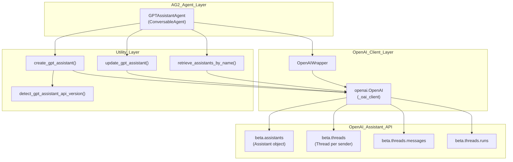
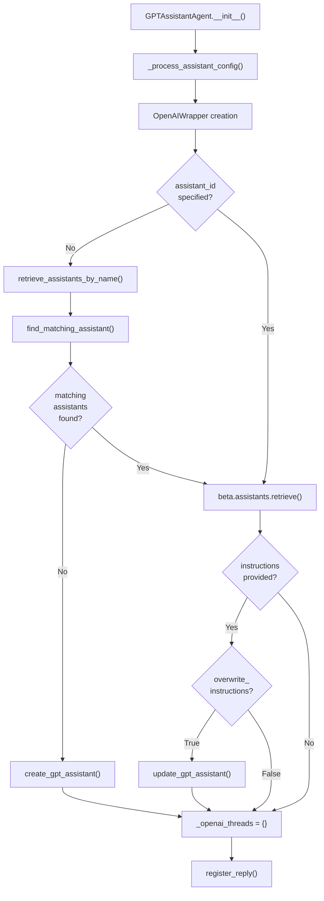
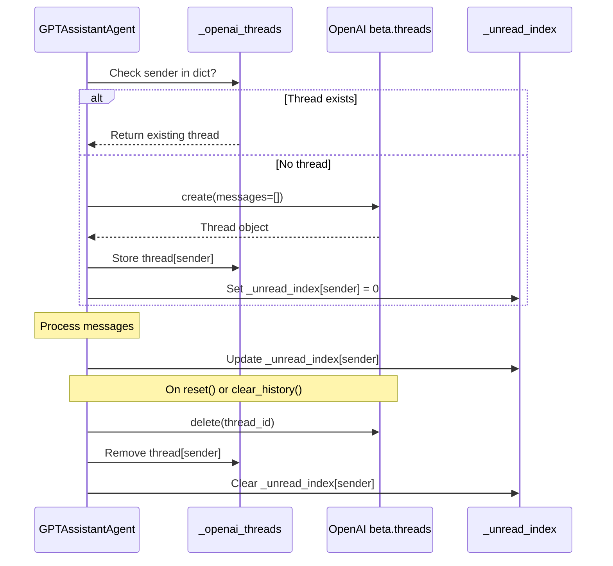
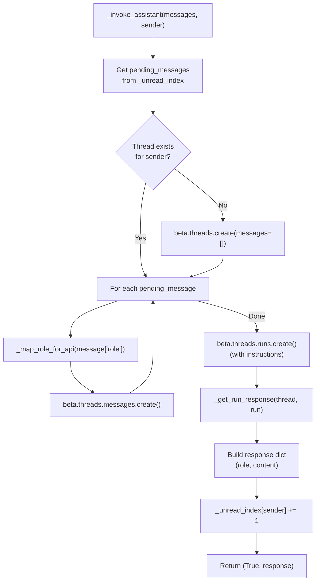
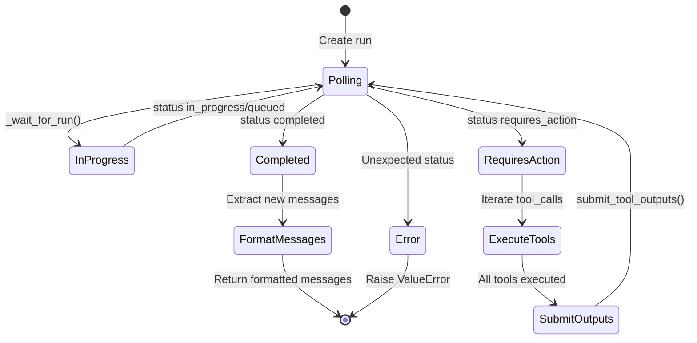
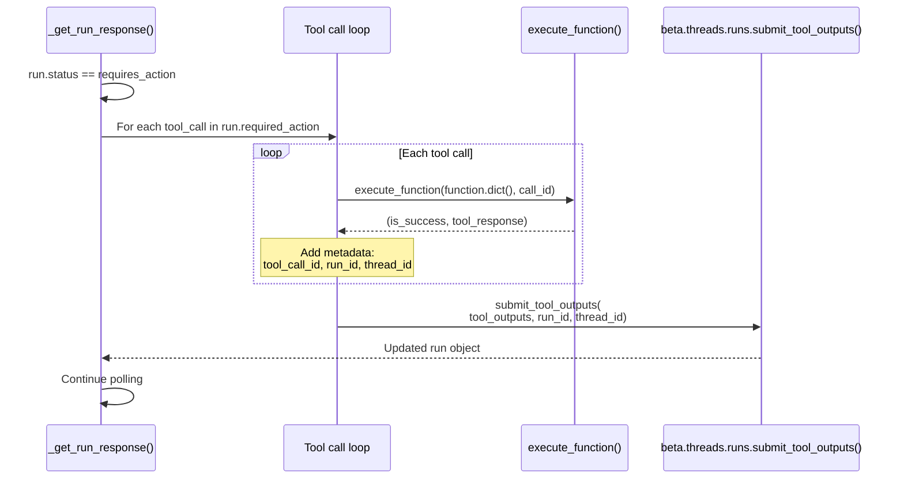
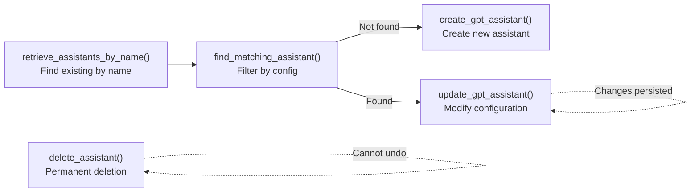
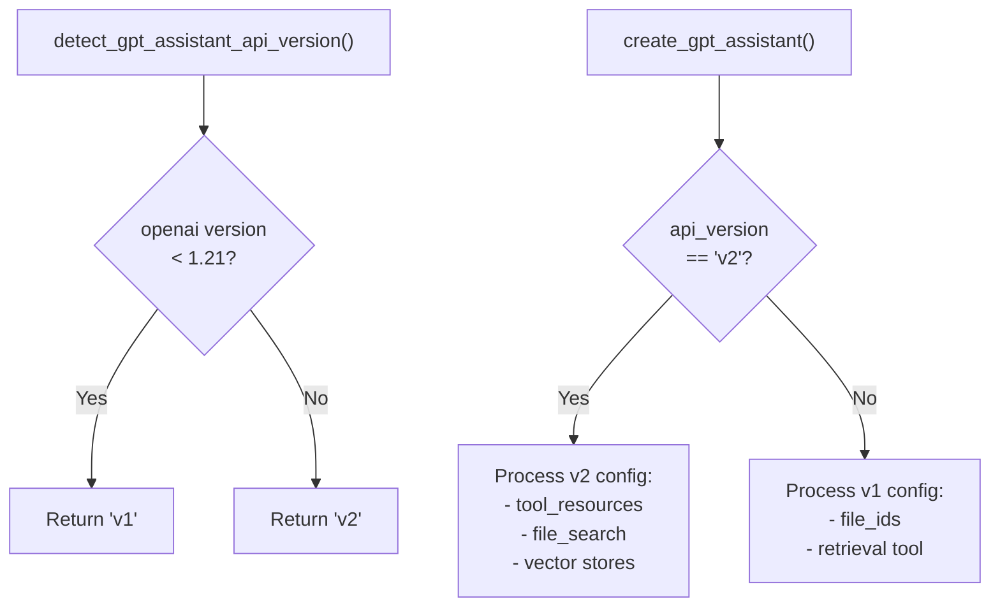
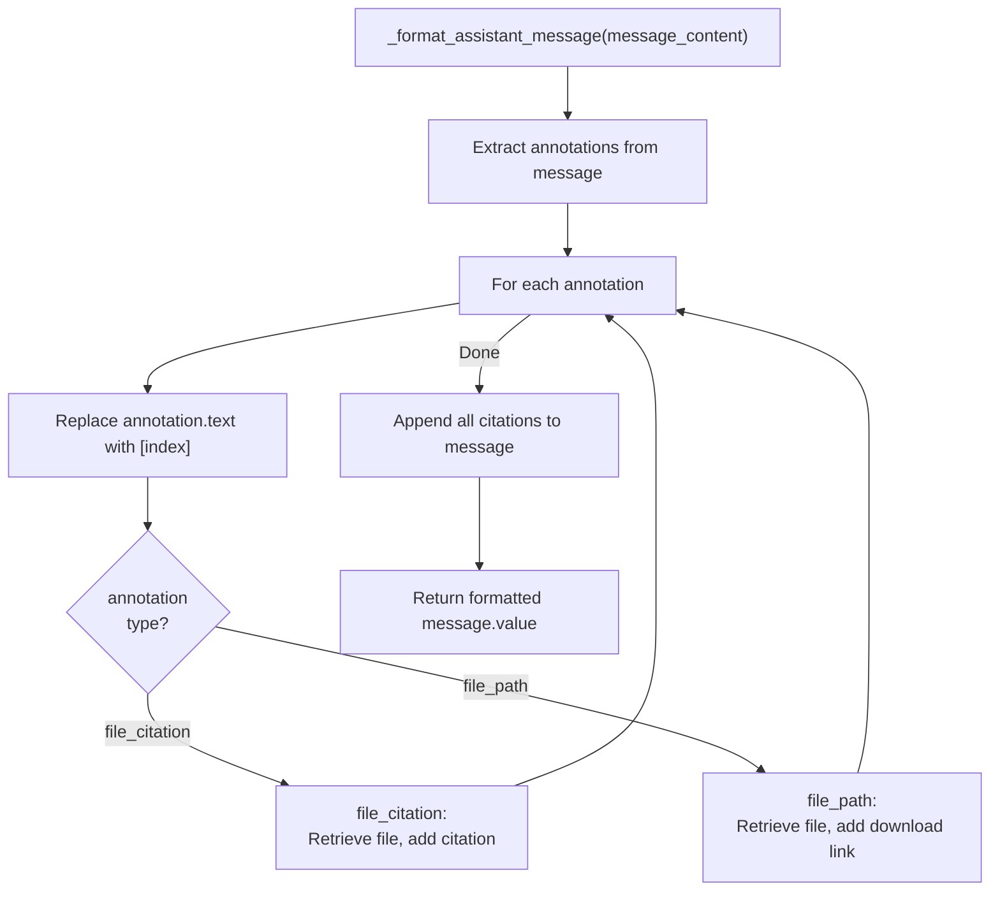

<!-- source: DeepWiki mcp.deepwiki.com · repo ag2ai/ag2 · page 3.5 GPT Assistant Agent · fetched 2026-10-26 -->

# GPT Assistant Agent

<details>
<summary>Relevant source files</summary>

The following files were used as context for generating this wiki page:

- [autogen/agentchat/contrib/gpt_assistant_agent.py](autogen/agentchat/contrib/gpt_assistant_agent.py)
- [notebook/agentchat_oai_assistant_function_call.ipynb](notebook/agentchat_oai_assistant_function_call.ipynb)
- [notebook/agentchat_oai_assistant_groupchat.ipynb](notebook/agentchat_oai_assistant_groupchat.ipynb)
- [notebook/agentchat_oai_assistant_retrieval.ipynb](notebook/agentchat_oai_assistant_retrieval.ipynb)
- [notebook/agentchat_oai_assistant_twoagents_basic.ipynb](notebook/agentchat_oai_assistant_twoagents_basic.ipynb)
- [notebook/agentchat_oai_code_interpreter.ipynb](notebook/agentchat_oai_code_interpreter.ipynb)
- [test/agentchat/contrib/test_gpt_assistant.py](test/agentchat/contrib/test_gpt_assistant.py)

</details>


The GPT Assistant Agent is a specialized agent implementation that wraps OpenAI's Assistant API for conversational capabilities. Unlike standard AG2 agents like `AssistantAgent` which manage conversation state locally, `GPTAssistantAgent` delegates state management to OpenAI's Assistant API, including thread management, message history, and tool execution coordination.

> [!WARNING]
> `GPTAssistantAgent` is deprecated as of v0.12 and will be removed in v0.14. Users are encouraged to use `ConversableAgent` instead.
> **Sources**: [autogen/agentchat/contrib/gpt_assistant_agent.py:27-35](), [notebook/agentchat_oai_code_interpreter.ipynb:9-13]()

**Scope**: This document covers the `GPTAssistantAgent` class implementation, its integration with OpenAI's Assistant API (v1 and v2), thread management, tool execution, and assistant lifecycle.

## Architecture Overview

`GPTAssistantAgent` extends `ConversableAgent` but deviates from the standard agent pattern by outsourcing conversation state to OpenAI's cloud-based Assistant API. This architectural choice provides access to OpenAI-hosted tools (Code Interpreter, File Search) and persistent conversation threads managed by OpenAI.

**Core Components and Their Relationships**



**Sources**: [autogen/agentchat/contrib/gpt_assistant_agent.py:28-105](), [autogen/oai/openai_utils.py:635-741]()

## Initialization and Configuration

The `GPTAssistantAgent.__init__()` method processes configuration through two distinct paths: creating a new assistant or retrieving an existing one. Configuration is split into `llm_config` (client configuration) and `assistant_config` (assistant-specific settings).

**Configuration Processing Flow**



**Sources**: [autogen/agentchat/contrib/gpt_assistant_agent.py:39-181](), [autogen/agentchat/contrib/gpt_assistant_agent.py:509-526]()

### Configuration Parameters

The initialization accepts the following key parameters:

| Parameter | Type | Description |
|-----------|------|-------------|
| `name` | `str` | Agent name; used to find existing assistants by name |
| `instructions` | `str \| None` | System instructions for the assistant |
| `llm_config` | `LLMConfig \| dict \| bool \| None` | OpenAI client configuration (API keys, model) |
| `assistant_config` | `dict \| None` | Assistant-specific settings (tools, files, tool_resources) |
| `overwrite_instructions` | `bool` | Whether to update existing assistant instructions |
| `overwrite_tools` | `bool` | Whether to update existing assistant tools |

**Assistant Configuration Keys**:
- `assistant_id`: Existing assistant ID to retrieve [autogen/agentchat/contrib/gpt_assistant_agent.py:65]()
- `tools`: List of tool definitions (function, code_interpreter, file_search) [autogen/agentchat/contrib/gpt_assistant_agent.py:67-68]()
- `file_ids`: (Deprecated in v2) File IDs for retrieval tool [autogen/agentchat/contrib/gpt_assistant_agent.py:69]()
- `tool_resources`: (v2 only) Resources for tools (file_search, code_interpreter) [autogen/agentchat/contrib/gpt_assistant_agent.py:70]()
- `check_every_ms`: Polling interval for run status checks [autogen/agentchat/contrib/gpt_assistant_agent.py:66]()

**Sources**: [autogen/agentchat/contrib/gpt_assistant_agent.py:41-82](), [autogen/agentchat/contrib/gpt_assistant_agent.py:509-526]()

## Thread Management and State

`GPTAssistantAgent` maintains one OpenAI thread per conversation partner. Threads are stored in `_openai_threads` dictionary keyed by sender agent, enabling concurrent conversations with multiple agents.

**Thread Lifecycle**



**Sources**: [autogen/agentchat/contrib/gpt_assistant_agent.py:178-181](), [autogen/agentchat/contrib/gpt_assistant_agent.py:204-209](), [autogen/agentchat/contrib/gpt_assistant_agent.py:385-408]()

### Thread State Properties

The class maintains thread state through:

- `_openai_threads`: `dict[Agent, Any]` - Maps sender agents to OpenAI thread objects [autogen/agentchat/contrib/gpt_assistant_agent.py:179]()
- `_unread_index`: `defaultdict(int)` - Tracks the index of unread messages per sender [autogen/agentchat/contrib/gpt_assistant_agent.py:180]()
- `oai_threads` property: Public read-only access to thread dictionary [autogen/agentchat/contrib/gpt_assistant_agent.py:434-437]()

## Message Processing and Invocation

The `_invoke_assistant()` method orchestrates the complete message processing flow, from sending pending messages to executing tool calls and retrieving responses.

**Message Invocation Flow**



**Sources**: [autogen/agentchat/contrib/gpt_assistant_agent.py:183-245]()

### Role Mapping for API Compatibility

OpenAI's Assistant API only accepts specific roles: `user`, `assistant`, and `system`. The `_map_role_for_api()` method translates AG2 internal roles to API-compatible roles:

| Internal Role | Mapped API Role |
|--------------|----------------|
| `function` | `assistant` |
| `tool` | `assistant` |
| `system` | `system` |
| `user` | `user` |
| `assistant` | `assistant` |
| Other | `assistant` (default) |

**Sources**: [autogen/agentchat/contrib/gpt_assistant_agent.py:247-266](), [test/agentchat/contrib/test_gpt_assistant.py:590-653]()

## Run Execution and Tool Handling

The `_get_run_response()` method manages the run lifecycle, polling for completion and handling tool execution requests.

**Run Execution State Machine**



**Sources**: [autogen/agentchat/contrib/gpt_assistant_agent.py:268-332](), [autogen/agentchat/contrib/gpt_assistant_agent.py:334-350]()

### Tool Execution Details

When a run requires action (tool calls), the agent executes each tool and submits results:



**Sources**: [autogen/agentchat/contrib/gpt_assistant_agent.py:298-329]()

The `tool_response` dictionary includes:
- `name`: Function name [autogen/agentchat/contrib/gpt_assistant_agent.py:303]()
- `content`: Execution result [autogen/agentchat/contrib/gpt_assistant_agent.py:303]()
- `metadata`: Tracking information (tool_call_id, run_id, thread_id) [autogen/agentchat/contrib/gpt_assistant_agent.py:304-307]()

## Assistant Lifecycle Management

`GPTAssistantAgent` provides methods for managing the assistant resource on OpenAI's platform.

**Assistant Lifecycle Operations**



**Sources**: [autogen/oai/openai_utils.py:635-741](), [autogen/agentchat/contrib/gpt_assistant_agent.py:456-507]()

### Key Methods

| Method | Purpose | API Call |
|--------|---------|----------|
| `get_assistant_instructions()` | Retrieve current instructions | Returns `_openai_assistant.instructions` [autogen/agentchat/contrib/gpt_assistant_agent.py:452-459]() |
| `delete_assistant()` | Permanently delete assistant | `beta.assistants.delete(assistant_id)` [autogen/agentchat/contrib/gpt_assistant_agent.py:444-450]() |
| `find_matching_assistant()` | Filter candidates by config | Compares instructions, tools, function names [autogen/agentchat/contrib/gpt_assistant_agent.py:461-507]() |
| `reset()` | Clear threads and state | Deletes all threads via `beta.threads.delete()` [autogen/agentchat/contrib/gpt_assistant_agent.py:385-401]() |
| `clear_history()` | Clear specific conversation | Deletes thread for one sender [autogen/agentchat/contrib/gpt_assistant_agent.py:403-409]() |

## API Version Compatibility

OpenAI's Assistant API has two major versions with significant differences in file handling and tool configuration.

**API Version Detection and Handling**



**Sources**: [autogen/oai/openai_utils.py:645-648](), [autogen/oai/openai_utils.py:672-719]()

### Key Differences Between v1 and v2

| Feature | v1 API | v2 API |
|---------|--------|--------|
| File attachment | `file_ids` parameter | `tool_resources` object [autogen/oai/openai_utils.py:680-706]() |
| Retrieval tool | `retrieval` type | `file_search` type [autogen/oai/openai_utils.py:680-681]() |
| File storage | Assistant-level files | Vector stores [autogen/oai/openai_utils.py:689-702]() |

**Sources**: [autogen/oai/openai_utils.py:680-719]()

## Message Formatting and Annotations

The `_format_assistant_message()` method processes OpenAI's response content to include file citations and annotations.

**Annotation Processing**



**Sources**: [autogen/agentchat/contrib/gpt_assistant_agent.py:352-379]()

**Citation Format**:
- File citation: `[{index}] {filename}: {quote}` [autogen/agentchat/contrib/gpt_assistant_agent.py:363-368]()
- File path: `[{index}] Click <here> to download {filename}` [autogen/agentchat/contrib/gpt_assistant_agent.py:370-374]()

## Usage Example

The following example demonstrates how to enable `GPTAssistantAgent` with a code interpreter, as seen in the framework's notebooks.

```python
from autogen.agentchat.contrib.gpt_assistant_agent import GPTAssistantAgent
from autogen.agentchat import UserProxyAgent

# Initiate an agent equipped with code interpreter
gpt_assistant = GPTAssistantAgent(
    name="CoderAssistant",
    llm_config={
        "config_list": config_list,
    },
    assistant_config={
        "tools": [{"type": "code_interpreter"}],
    },
    instructions="You are an expert at solving math questions. Write code and run it to solve math problems.",
)

user_proxy = UserProxyAgent(
    name="user_proxy",
    code_execution_config={"work_dir": "coding", "use_docker": False},
)

user_proxy.initiate_chat(
    gpt_assistant, 
    message="If $725x + 727y = 1500$ and $729x+ 731y = 1508$, what is the value of $x - y$ ?"
)
gpt_assistant.delete_assistant()
```

**Sources**: [notebook/agentchat_oai_code_interpreter.ipynb:101-127](), [test/agentchat/contrib/test_gpt_assistant.py:39-101]()

---

