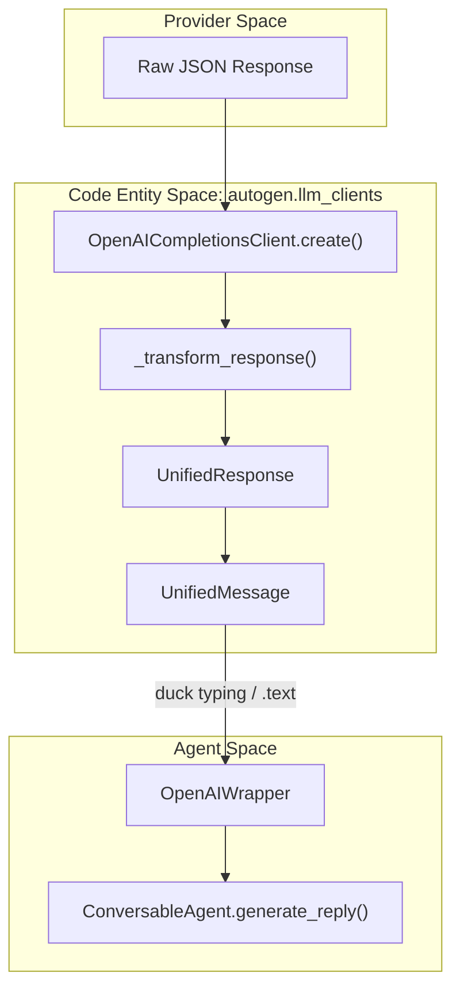
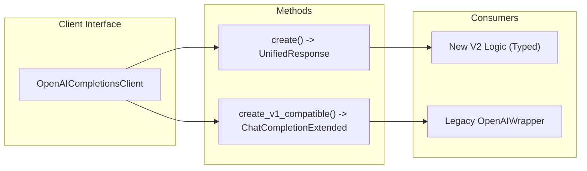

<!-- source: DeepWiki mcp.deepwiki.com · repo ag2ai/ag2 · page 3.6 ModelClient V2 and UnifiedResponse · fetched 2026-10-26 -->

# ModelClient V2 and UnifiedResponse

<details>
<summary>Relevant source files</summary>

The following files were used as context for generating this wiki page:

- [autogen/agentchat/group/__init__.py](autogen/agentchat/group/__init__.py)
- [autogen/agentchat/group/targets/function_target.py](autogen/agentchat/group/targets/function_target.py)
- [autogen/llm_clients/MIGRATION_TO_V2.md](autogen/llm_clients/MIGRATION_TO_V2.md)
- [autogen/llm_clients/__init__.py](autogen/llm_clients/__init__.py)
- [autogen/llm_clients/client_v2.py](autogen/llm_clients/client_v2.py)
- [autogen/llm_clients/models/__init__.py](autogen/llm_clients/models/__init__.py)
- [autogen/llm_clients/models/content_blocks.py](autogen/llm_clients/models/content_blocks.py)
- [autogen/llm_clients/models/unified_message.py](autogen/llm_clients/models/unified_message.py)
- [autogen/llm_clients/models/unified_response.py](autogen/llm_clients/models/unified_response.py)
- [autogen/llm_clients/openai_completions_client.py](autogen/llm_clients/openai_completions_client.py)
- [autogen/llm_clients/openai_responses_v2.py](autogen/llm_clients/openai_responses_v2.py)
- [autogen/llm_config/types.py](autogen/llm_config/types.py)
- [autogen/tools/experimental/apply_patch/README.md](autogen/tools/experimental/apply_patch/README.md)
- [autogen/tools/experimental/apply_patch/apply_patch_tool.py](autogen/tools/experimental/apply_patch/apply_patch_tool.py)
- [autogen/tools/experimental/shell/README.md](autogen/tools/experimental/shell/README.md)
- [notebook/agentchat_function_target_example.ipynb](notebook/agentchat_function_target_example.ipynb)
- [notebook/agentchat_v2_responses_client.ipynb](notebook/agentchat_v2_responses_client.ipynb)
- [test/agentchat/test_agent_with_openai_v2_client.py](test/agentchat/test_agent_with_openai_v2_client.py)
- [test/agentchat/test_function_targets.py](test/agentchat/test_function_targets.py)
- [test/agentchat/test_multimodal_integration.py](test/agentchat/test_multimodal_integration.py)
- [test/llm_clients/fixtures/openai_responses/multimodal_vision_response.json](test/llm_clients/fixtures/openai_responses/multimodal_vision_response.json)
- [test/llm_clients/fixtures/openai_responses/multiple_images_response.json](test/llm_clients/fixtures/openai_responses/multiple_images_response.json)
- [test/llm_clients/test_openai_completions_client.py](test/llm_clients/test_openai_completions_client.py)
- [test/llm_clients/test_openai_completions_client_integration.py](test/llm_clients/test_openai_completions_client_integration.py)
- [test/llm_clients/test_openai_completions_client_with_fixtures.py](test/llm_clients/test_openai_completions_client_with_fixtures.py)
- [test/llm_clients/test_openai_responses_v2_client.py](test/llm_clients/test_openai_responses_v2_client.py)
- [test/llm_clients/test_openai_responses_v2_client_integration.py](test/llm_clients/test_openai_responses_v2_client_integration.py)
- [test/llm_clients/test_openai_v2_response_capture.py](test/llm_clients/test_openai_v2_response_capture.py)
- [website/docs/user-guide/advanced-concepts/tools/basics.mdx](website/docs/user-guide/advanced-concepts/tools/basics.mdx)
- [website/docs/user-guide/models/deepseek-v3.mdx](website/docs/user-guide/models/deepseek-v3.mdx)
- [website/docs/user-guide/models/grok-and-oai-compatible-models.mdx](website/docs/user-guide/models/grok-and-oai-compatible-models.mdx)
- [website/docs/user-guide/models/openai.mdx](website/docs/user-guide/models/openai.mdx)
- [website/docs/user-guide/models/openai_responses.mdx](website/docs/user-guide/models/openai_responses.mdx)
- [website/mkdocs/overrides/main.html](website/mkdocs/overrides/main.html)

</details>


The ModelClient V2 architecture represents a modernization of AG2's LLM integration layer. It introduces the `ModelClientV2` protocol and the `UnifiedResponse` format, designed to handle the increasing complexity of modern LLM outputs—such as reasoning chains, multimodal content, and stateful conversation IDs—while maintaining backward compatibility with the existing agent infrastructure.

## Overview of ModelClient V2

The V2 architecture shifts from simple string-based or dictionary-based responses to structured, typed objects. This allows AG2 to preserve provider-specific features (like OpenAI's reasoning tokens or citations) without losing them during the translation to the standard agent message format.

### Key Components

| Component | Description |
| :--- | :--- |
| **`ModelClientV2`** | A protocol defining the standard interface for LLM clients, requiring a `create` method that returns a `UnifiedResponse`. |
| **`UnifiedResponse`** | A standardized container for LLM outputs, including content blocks, usage metrics, and cost tracking. |
| **Content Blocks** | Typed objects (e.g., `TextContent`, `ReasoningContent`) that represent different parts of an LLM's response. |
| **`llm_clients` Module** | The new home for provider-specific V2 implementations like `OpenAICompletionsClient` and `OpenAIResponsesV2Client`. |

**Sources:** [autogen/llm_clients/client_v2.py:1-20](), [autogen/llm_clients/models/unified_response.py:1-30](), [autogen/llm_clients/openai_completions_client.py:53-81]()

---

## UnifiedResponse and Content Blocks

The `UnifiedResponse` object is the core data structure returned by V2 clients. It aggregates all information from an LLM call into a single, navigable entity.

### Content Block Hierarchy

Instead of a single "content" string, a response contains a list of `UnifiedMessage` objects, which in turn contain specific content blocks:

*   **`TextContent`**: Standard text output from the model.
*   **`ReasoningContent`**: Thinking process or "Chain of Thought" (e.g., from OpenAI `o1`/`o3` models).
*   **`CitationContent`**: References and URLs provided by models with search capabilities.
*   **`ImageContent`**: Generated images or image metadata.
*   **`ToolCallContent`**: Structured data for function or tool execution.

### Data Flow: API to Agent
This diagram illustrates how a raw provider response is transformed into a `UnifiedResponse` and eventually consumed by a `ConversableAgent`.

**Provider Response Transformation**

**Sources:** [autogen/llm_clients/openai_completions_client.py:128-174](), [autogen/llm_clients/models/content_blocks.py:1-100](), [autogen/llm_clients/models/unified_response.py:35-80]()

---

## OpenAI V2 Clients

AG2 provides two primary implementations of the V2 protocol for OpenAI, catering to different API paradigms.

### 1. OpenAICompletionsClient
This client wraps the standard Chat Completions API (`/chat/completions`). It is the primary client for `gpt-4o`, `o1`, and `o3` models.

*   **Reasoning Extraction**: Automatically identifies and extracts reasoning tokens into `ReasoningContent` blocks [autogen/llm_clients/openai_completions_client.py:157-159]().
*   **Cost Calculation**: Includes a built-in pricing table for accurate USD cost tracking per request [autogen/llm_clients/openai_completions_client.py:108-126]().

### 2. OpenAIResponsesV2Client
This client wraps the newer, stateful Responses API (`/responses`). It is designed for complex workflows involving built-in tools.

*   **Stateful Context**: Automatically manages `previous_response_id` to maintain conversation state without manually passing history [autogen/llm_clients/openai_responses_v2.py:9-15]().
*   **Built-in Tools**: Supports native `web_search`, `image_generation`, and `shell` tools directly through the API [autogen/llm_clients/openai_responses_v2.py:54-58]().

**Sources:** [autogen/llm_clients/openai_completions_client.py:53-81](), [autogen/llm_clients/openai_responses_v2.py:6-20]()

---

## Migration from V1 to V2

The V2 architecture is designed to be a drop-in replacement for V1 clients. AG2 uses "duck typing" to ensure that `UnifiedResponse` objects work with existing `OpenAIWrapper` logic.

### Configuration Changes
To use a V2 client, update the `api_type` in your `LLMConfig`:

```python
# V1 Style (Legacy)
config_v1 = {"api_type": "openai", "model": "gpt-4o"}

# V2 Style (New)
config_v2 = {"api_type": "openai_v2", "model": "gpt-4o"}
```

### V1 Compatibility Layer
Every `ModelClientV2` provides a `create_v1_compatible()` method. This method returns a response that mimics the legacy `ChatCompletion` object structure (having `.choices`, `.usage`, etc.), allowing older code to function without modification.

**Client Interaction Pattern**


**Sources:** [autogen/llm_clients/openai_completions_client.py:128-135](), [autogen/llm_clients/openai_responses_v2.py:239-245](), [website/docs/user-guide/models/openai_responses.mdx:44-58]()

---

## Advanced Usage: Function Targets

The V2 architecture facilitates advanced orchestration patterns like `FunctionTarget`. This allows a group chat to transition to a specific function execution based on the LLM's output, using the rich metadata available in the `UnifiedResponse`.

### Implementation Details
*   **`FunctionTarget`**: A transition target in a `GroupChat` that invokes a Python function [autogen/agentchat/group/targets/function_target.py:162-171]().
*   **`FunctionTargetResult`**: The return type of these functions, allowing the update of `ContextVariables` and the selection of the next agent [autogen/agentchat/group/targets/function_target.py:40-53]().

**Sources:** [autogen/agentchat/group/targets/function_target.py:162-185](), [test/agentchat/test_function_targets.py:67-72]()

---

## Cost and Usage Tracking

V2 clients implement robust cost tracking. Unlike V1, which often relied on external calculation, V2 clients maintain internal state for both per-request and cumulative costs.

| Metric | Access Method |
| :--- | :--- |
| **Per-Request Cost** | `response.cost` (float in USD) |
| **Token Usage** | `response.usage` (dict with prompt/completion/total) |
| **Cumulative Cost** | `client.get_cumulative_usage()` |

**Sources:** [autogen/llm_clients/openai_completions_client.py:83-84](), [website/docs/user-guide/models/openai_responses.mdx:225-237]()

---

