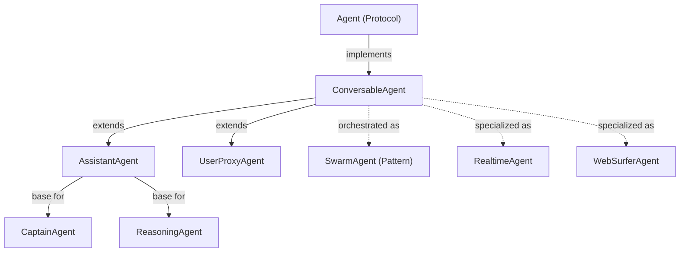
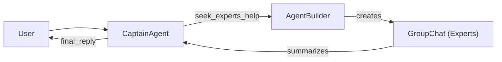

<!-- source: DeepWiki mcp.deepwiki.com · repo ag2ai/ag2 · page 4 Advanced Agent Types · fetched 2026-10-26 -->

# Advanced Agent Types

Relevant source files

The following files were used as context for generating this wiki page:

- [.pre-commit-config.yaml](.pre-commit-config.yaml)
- [autogen/agentchat/assistant_agent.py](autogen/agentchat/assistant_agent.py)
- [autogen/agentchat/contrib/agent_optimizer.py](autogen/agentchat/contrib/agent_optimizer.py)
- [autogen/agentchat/contrib/captainagent/agent_builder.py](autogen/agentchat/contrib/captainagent/agent_builder.py)
- [autogen/agentchat/contrib/captainagent/captainagent.py](autogen/agentchat/contrib/captainagent/captainagent.py)
- [autogen/agentchat/contrib/math_user_proxy_agent.py](autogen/agentchat/contrib/math_user_proxy_agent.py)
- [autogen/agentchat/contrib/swarm_agent.py](autogen/agentchat/contrib/swarm_agent.py)
- [autogen/agentchat/contrib/text_analyzer_agent.py](autogen/agentchat/contrib/text_analyzer_agent.py)
- [autogen/agentchat/user_proxy_agent.py](autogen/agentchat/user_proxy_agent.py)
- [autogen/tools/dependency_injection.py](autogen/tools/dependency_injection.py)
- [autogen/tools/function_utils.py](autogen/tools/function_utils.py)
- [notebook/agentchat_agentoptimizer.ipynb](notebook/agentchat_agentoptimizer.ipynb)
- [notebook/agentchat_teachability.ipynb](notebook/agentchat_teachability.ipynb)
- [notebook/agentchat_teachable_oai_assistants.ipynb](notebook/agentchat_teachable_oai_assistants.ipynb)
- [scripts/pre-commit-mypy-run.sh](scripts/pre-commit-mypy-run.sh)
- [test/agentchat/contrib/test_agent_optimizer.py](test/agentchat/contrib/test_agent_optimizer.py)
- [test/agentchat/contrib/test_swarm.py](test/agentchat/contrib/test_swarm.py)
- [test/tools/test_dependency_injection.py](test/tools/test_dependency_injection.py)
- [test/tools/test_function_utils.py](test/tools/test_function_utils.py)

## Overview

AG2 provides specialized agent types that extend `ConversableAgent` with advanced capabilities for complex workflows, dynamic orchestration, and enhanced reasoning. These agent types implement sophisticated patterns for multi-agent coordination, tree-of-thought reasoning, and autonomous task execution.

This page introduces the primary advanced agent types in AG2:
- **SwarmAgent**: Dynamic multi-agent orchestration with conditional handoffs and context management. [autogen/agentchat/contrib/swarm_agent.py:43-49]()
- **RealtimeAgent**: Experimental agents for low-latency voice and multimodal interaction using WebSocket/WebRTC. [autogen/agentchat/realtime/realtime_agent.py:1-50]()
- **Specialized Contrib Agents**: A collection of community-contributed agents for specific domains like reasoning, web surfing, and teaching. [autogen/agentchat/contrib/captainagent/captainagent.py:21-23]()

Each type builds on `ConversableAgent` while adding domain-specific functionality. Detailed documentation for each category is available in the respective sub-pages.

Sources: [autogen/agentchat/conversable_agent.py:17-30](), [autogen/agentchat/contrib/swarm_agent.py:1-49](), [autogen/agentchat/realtime/realtime_agent.py:1-50]()

## Advanced Agent Type Hierarchy

The advanced agent types extend the core AG2 classes to provide specialized orchestration and execution patterns.

**Agent Class Hierarchy and Relationships**

Sources: [autogen/agentchat/agent.py:13-27](), [autogen/agentchat/conversable_agent.py:29-40](), [autogen/agentchat/assistant_agent.py:17-26](), [autogen/agentchat/user_proxy_agent.py:17-27](), [autogen/agentchat/contrib/swarm_agent.py:43-49]()

## SwarmAgent and Dynamic Orchestration

The Swarm system enables dynamic multi-agent orchestration where agents can "hand off" the conversation to one another based on logic or LLM decisions. Unlike static `GroupChat`, Swarm transitions are fluid and state-aware.

**Key Components:**
- **Handoff Conditions**: Use `OnCondition` for LLM-driven transitions [autogen/agentchat/contrib/swarm_agent.py:115-138]() or `OnContextCondition` for state-driven transitions [autogen/agentchat/contrib/swarm_agent.py:157-175]().
- **After-Work Policies**: `AfterWork` defines what happens when an agent finishes a task (e.g., `TERMINATE`, `REVERT_TO_USER`, or `STAY`) [autogen/agentchat/contrib/swarm_agent.py:57-80]().
- **Context Management**: `ContextVariables` allow sharing of structured state across the swarm [autogen/agentchat/group/context_variables.py:1-50]().
- **Initiation**: Swarm chats are started using `initiate_swarm_chat` or its async counterpart `a_initiate_swarm_chat` [autogen/agentchat/contrib/swarm_agent.py:46-47]().

For details, see [SwarmAgent and Dynamic Orchestration](#4.1).

Sources: [autogen/agentchat/contrib/swarm_agent.py:57-175](), [test/agentchat/contrib/test_swarm.py:108-143]()

## Realtime Agents

The `RealtimeAgent` system is an experimental framework designed for low-latency, multimodal interactions, specifically targeting the OpenAI and Gemini Realtime APIs.

**Core Architecture:**
- **Transports**: Supports `WebSocket` and `WebRTC` for streaming audio and video data.
- **Clients**: Specialized clients for different providers (e.g., `OpenAIRealtimeClient`, `GeminiRealtimeClient`).
- **Swarm Integration**: Realtime agents can participate in swarm-like handoffs while maintaining a live connection.
- **Event-Driven**: Uses a streaming event model to handle partial transcripts and tool calls in real-time.

For details, see [Realtime Agents](#4.2).

Sources: [autogen/agentchat/realtime/realtime_agent.py:1-100]()

## Specialized Contrib Agents

The `autogen.agentchat.contrib` package contains several high-level agents designed for complex reasoning and specific environment interactions.

| Agent Class | Purpose | Key Feature |
| :--- | :--- | :--- |
| `CaptainAgent` | Autonomous task solver | Builds and manages its own nested group chats of experts. [autogen/agentchat/contrib/captainagent/captainagent.py:21-23]() |
| `ReasoningAgent` | Complex problem solving | Implements Tree-of-Thought reasoning with Beam Search or MCTS. |
| `WebSurferAgent` | Web interaction | Navigates the web, clicks buttons, and extracts information autonomously. |
| `TeachableAgent` | Persistent learning | Remembers user preferences and facts across different chat sessions. |
| `SocietyOfMindAgent` | Encapsulation | Wraps a whole `GroupChat` as a single agent for higher-level orchestration. |

**CaptainAgent Logic Flow**

For details, see [Specialized Contrib Agents](#4.3).

Sources: [autogen/agentchat/contrib/captainagent/captainagent.py:24-65](), [autogen/agentchat/contrib/agent_optimizer.py:90-108](), [autogen/agentchat/contrib/math_user_proxy_agent.py:148-158]()

## Integration with Dependency Injection

Advanced agents frequently utilize AG2's dependency injection system to access conversation context or shared state without polluting tool signatures.

- **BaseContext & ChatContext**: Provide structured access to agent state [autogen/tools/dependency_injection.py:36-79]().
- **Depends()**: Used in tool definitions to automatically inject `ContextVariables` or `ChatContext` [autogen/tools/dependency_injection.py:91-105]().
- **inject_params**: A decorator that resolves these dependencies at runtime [autogen/tools/dependency_injection.py:29]().

Sources: [autogen/tools/dependency_injection.py:23-105](), [test/tools/test_dependency_injection.py:158-171]()

---
*For more information on the foundational agent classes, refer to the [Core Agent System](2.-Core-Agent-System) section.*

---

