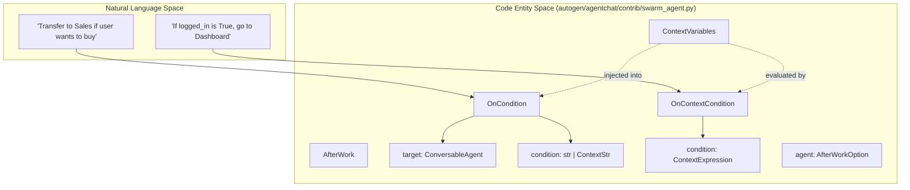
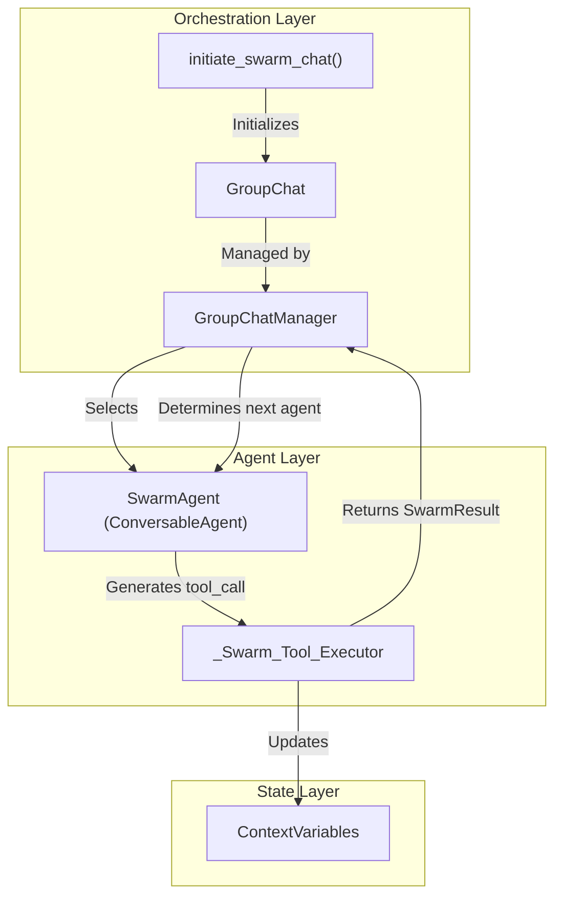

<!-- source: DeepWiki mcp.deepwiki.com · repo ag2ai/ag2 · page 4.1 SwarmAgent and Dynamic Orchestration · fetched 2026-10-26 -->

# SwarmAgent and Dynamic Orchestration

Relevant source files

The following files were used as context for generating this wiki page:

- [.pre-commit-config.yaml](.pre-commit-config.yaml)
- [autogen/agentchat/contrib/swarm_agent.py](autogen/agentchat/contrib/swarm_agent.py)
- [autogen/agentchat/group/events/transition_events.py](autogen/agentchat/group/events/transition_events.py)
- [autogen/agentchat/group/group_tool_executor.py](autogen/agentchat/group/group_tool_executor.py)
- [autogen/agentchat/group/group_utils.py](autogen/agentchat/group/group_utils.py)
- [autogen/agentchat/group/guardrails.py](autogen/agentchat/group/guardrails.py)
- [autogen/agentchat/group/patterns/pattern.py](autogen/agentchat/group/patterns/pattern.py)
- [autogen/agentchat/group/targets/transition_target.py](autogen/agentchat/group/targets/transition_target.py)
- [autogen/tools/dependency_injection.py](autogen/tools/dependency_injection.py)
- [autogen/tools/function_utils.py](autogen/tools/function_utils.py)
- [notebook/agentchat_groupchat_finite_state_machine.ipynb](notebook/agentchat_groupchat_finite_state_machine.ipynb)
- [notebook/agentchat_groupchat_stateflow.ipynb](notebook/agentchat_groupchat_stateflow.ipynb)
- [notebook/agentchat_swarm.ipynb](notebook/agentchat_swarm.ipynb)
- [notebook/agentchat_swarm_enhanced.ipynb](notebook/agentchat_swarm_enhanced.ipynb)
- [notebook/agentchat_swarm_graphrag_telemetry_trip_planner.ipynb](notebook/agentchat_swarm_graphrag_telemetry_trip_planner.ipynb)
- [notebook/agentchat_swarm_w_groupchat_legacy.ipynb](notebook/agentchat_swarm_w_groupchat_legacy.ipynb)
- [notebook/contributing.md](notebook/contributing.md)
- [scripts/pre-commit-mypy-run.sh](scripts/pre-commit-mypy-run.sh)
- [test/agentchat/contrib/test_swarm.py](test/agentchat/contrib/test_swarm.py)
- [test/agentchat/group/targets/test_transition_target.py](test/agentchat/group/targets/test_transition_target.py)
- [test/agentchat/group/test_group_tool_executor.py](test/agentchat/group/test_group_tool_executor.py)
- [test/agentchat/group/test_group_utils.py](test/agentchat/group/test_group_utils.py)
- [test/agentchat/group/test_guardrails.py](test/agentchat/group/test_guardrails.py)
- [test/agentchat/group/test_transition_events.py](test/agentchat/group/test_transition_events.py)
- [test/oai/test_openai_streaming_structured_output.py](test/oai/test_openai_streaming_structured_output.py)
- [test/tools/test_dependency_injection.py](test/tools/test_dependency_injection.py)
- [test/tools/test_function_utils.py](test/tools/test_function_utils.py)
- [website/docs/user-guide/advanced-concepts/orchestration/group-chat/guardrails.mdx](website/docs/user-guide/advanced-concepts/orchestration/group-chat/guardrails.mdx)
- [website/docs/user-guide/advanced-concepts/tools/index.mdx](website/docs/user-guide/advanced-concepts/tools/index.mdx)

## Purpose and Scope

This document provides a technical deep dive into the SwarmAgent orchestration system within AG2. The Swarm pattern enables dynamic, context-aware agent collaboration through conditional handoffs (`OnCondition`, `OnContextCondition`), fallback mechanisms (`AfterWork`), and shared state (`ContextVariables`). Unlike the standard `GroupChat` (see [#2.4]()) which often relies on a central manager for speaker selection, Swarms allow agents to autonomously transfer control based on LLM reasoning, programmatic conditions, or tool outputs.

The Swarm system is built on top of `ConversableAgent` (see [#2.1]()) and utilizes a specialized internal `GroupChat` configuration for execution.

## Overview of the Swarm Pattern

The Swarm orchestration pattern focuses on lightweight agent coordination. Agents in a Swarm explicitly hand off control to each other through three primary mechanisms defined in `autogen/agentchat/contrib/swarm_agent.py`:

1.  **OnContextCondition**: Programmatic transitions based on `ContextVariables` evaluation (no LLM call required).
2.  **OnCondition**: LLM-evaluated transitions where conditions are translated into tools.
3.  **AfterWork**: Fallback behavior when an agent completes its turn without an explicit handoff.

**Sources:** [autogen/agentchat/contrib/swarm_agent.py:36-49](), [autogen/agentchat/contrib/swarm_agent.py:113-143](), [autogen/agentchat/contrib/swarm_agent.py:175-201]()

## Core Components and Data Structures

### AfterWork and AfterWorkOption

The `AfterWork` class handles the next step when an agent provides a response without suggesting a tool call or a handoff.

| Option (`AfterWorkOption`) | Behavior |
| :--- | :--- |
| `TERMINATE` | Ends the swarm conversation immediately. |
| `REVERT_TO_USER` | Hands control back to the `user_agent` if provided. |
| `STAY` | The current agent stays active for the next turn. |
| `SWARM_MANAGER` | Hands control to an internal `GroupChatManager` for speaker selection. |

**Sources:** [autogen/agentchat/contrib/swarm_agent.py:57-61](), [autogen/agentchat/contrib/swarm_agent.py:64-81]()

### OnCondition: LLM-Based Handoffs

`OnCondition` defines transitions that the LLM evaluates. These are translated into tool definitions and attached to the agent. When the LLM decides the condition is met, it calls a generated "transfer" function.

*   **Implementation**: The function `_create_transfer_function` generates a callable that returns a `SwarmResult` containing the target agent.
*   **Tool Registration**: These functions are registered for the LLM using `agent.register_for_llm` and for execution via `agent.register_for_execution`.

**Sources:** [autogen/agentchat/contrib/swarm_agent.py:113-143](), [autogen/agentchat/contrib/swarm_agent.py:1326-1425]()

### OnContextCondition: Programmatic Handoffs

`OnContextCondition` provides immediate transitions based on the state of `ContextVariables`.

*   **Evaluation**: These are evaluated *before* the LLM is called, using a reply function `_run_oncontextconditions` registered at position 0.
*   **Logic**: It uses `ContextExpression` to evaluate logical strings like `"${attempts} >= 3"`.

**Sources:** [autogen/agentchat/contrib/swarm_agent.py:175-201](), [autogen/agentchat/contrib/swarm_agent.py:277-312]()

## Swarm Architecture and Data Flow

The Swarm system establishes a specialized architecture where a hidden agent, `_Swarm_Tool_Executor`, manages all tool executions for the group.

### Tool Execution Logic

1.  **Aggregation**: `_prepare_swarm_agents` collects all tools from all participating agents and registers them with the `_Swarm_Tool_Executor`.
2.  **Context Injection**: Tools that require `ContextVariables` are wrapped using `_change_tool_context_variables_to_depends`, which uses the AG2 dependency injection system (`autogen/tools/dependency_injection.py`) to provide the shared state.
3.  **Result Handling**: Tools return a `SwarmResult`. If the result includes a new agent, the `_Swarm_Tool_Executor` sets a hidden attribute `_swarm_next_agent` which the `GroupChatManager` uses to perform the transition.

**Sources:** [autogen/agentchat/contrib/swarm_agent.py:52-53](), [autogen/agentchat/contrib/swarm_agent.py:314-332](), [autogen/agentchat/contrib/swarm_agent.py:402-430](), [autogen/agentchat/contrib/swarm_agent.py:640-673]()

## Handoff Evaluation Order

When an agent finishes its turn, the system determines the next speaker in the following strict order:

1.  **Immediate Context Check**: `_run_oncontextconditions` checks if any `OnContextCondition` is met. If so, transition occurs immediately.
2.  **Tool Call Detection**: If the agent's message contains `tool_calls`, the next speaker is automatically set to `_Swarm_Tool_Executor`.
3.  **SwarmResult Agent**: If a tool was just executed and returned a `SwarmResult` with an `agent` field, that agent is selected.
4.  **AfterWork Fallback**: If no other conditions met, the agent's `_swarm_after_work` or the global `after_work` policy is applied.

**Sources:** [autogen/agentchat/contrib/swarm_agent.py:277-312](), [autogen/agentchat/contrib/swarm_agent.py:640-743]()

## Nested Chats in Swarms

Swarms support handoffs to nested chats, allowing a group of agents to be treated as a single "target" in a transition.

*   **Registration**: `register_hand_off` can take a dictionary as a `target`, which is interpreted as a nested chat configuration.
*   **Agent Creation**: `_create_nested_chats` dynamically creates a `ConversableAgent` (named `nested_chat_agent_N`) that initiates the nested conversation when triggered.
*   **State Propagation**: The nested chat can return a summary that is then passed back to the parent Swarm context.

**Sources:** [autogen/agentchat/contrib/swarm_agent.py:445-503](), [autogen/agentchat/contrib/swarm_agent.py:1264-1323]()

## Context Variables and Dependency Injection

Shared state is managed via the `ContextVariables` class. The Swarm system ensures that tools can access and modify this state seamlessly.

*   **Injection**: The function `_modify_context_variables_param` in `autogen/agentchat/group/group_tool_executor.py` (and similar logic in `swarm_agent.py`) replaces standard `ContextVariables` parameters with `Annotated[ContextVariables, Depends(on(shared_context))]`.
*   **SwarmResult**: Tools are encouraged to return a `SwarmResult` object, which allows updating `ContextVariables` and suggesting the next agent simultaneously.

**Sources:** [autogen/agentchat/contrib/swarm_agent.py:314-365](), [autogen/agentchat/group/group_tool_executor.py:86-128](), [autogen/tools/dependency_injection.py:91-105]()

## Key API Functions

### initiate_swarm_chat
The main entry point for starting a Swarm. It sets up the internal `GroupChat` and `GroupChatManager` with a custom transition function.
**Sources:** [autogen/agentchat/contrib/swarm_agent.py:874-1024]()

### register_hand_off
The utility used to define transitions between agents. It handles the logic of creating transfer functions for `OnCondition` and storing `AfterWork` preferences.
**Sources:** [autogen/agentchat/contrib/swarm_agent.py:1226-1323]()

### create_swarm_transition
Creates the `speaker_selection_method` used by the internal `GroupChat`. This function encapsulates the logic for `_determine_next_agent`.
**Sources:** [autogen/agentchat/contrib/swarm_agent.py:745-782]()

---

