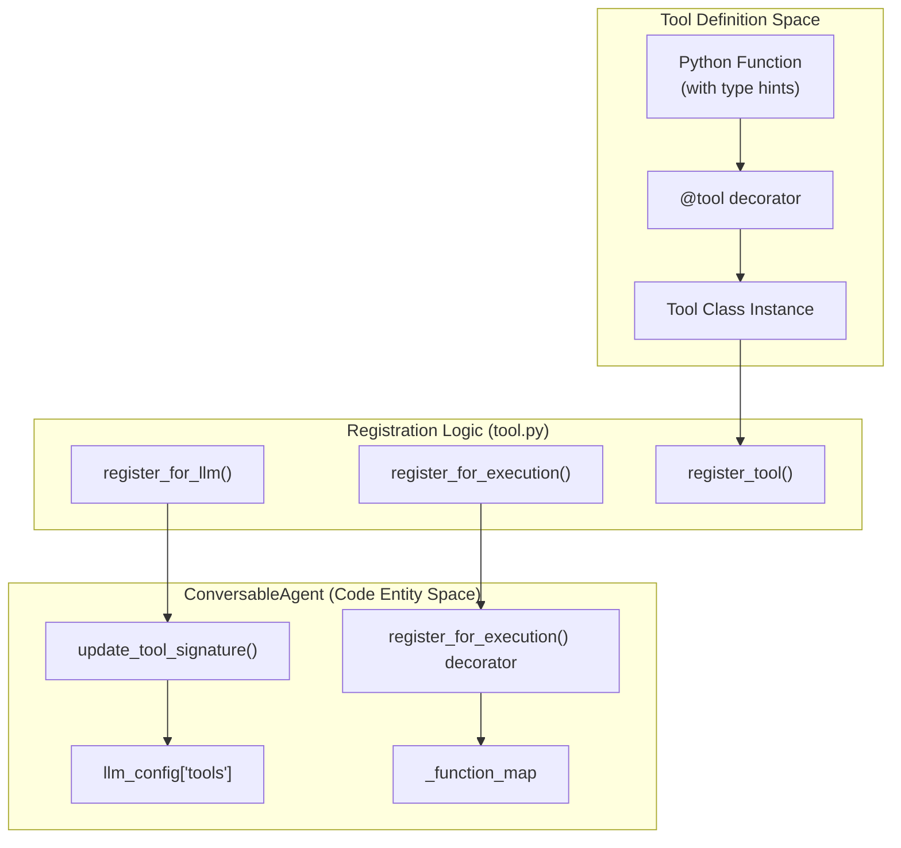
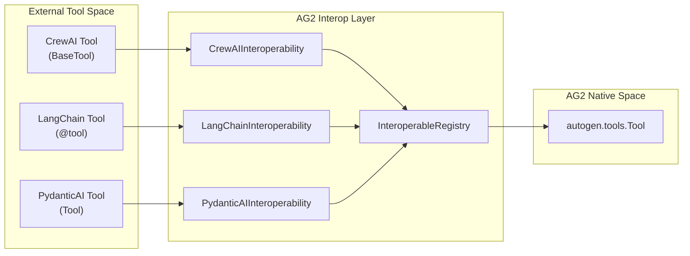

<!-- source: DeepWiki mcp.deepwiki.com · repo ag2ai/ag2 · page 5 Tools and Capabilities · fetched 2026-10-26 -->

# Tools and Capabilities

Relevant source files

The following files were used as context for generating this wiki page:

- [autogen/agentchat/contrib/capabilities/transform_messages.py](autogen/agentchat/contrib/capabilities/transform_messages.py)
- [autogen/agentchat/contrib/capabilities/transforms.py](autogen/agentchat/contrib/capabilities/transforms.py)
- [autogen/agentchat/contrib/capabilities/transforms_util.py](autogen/agentchat/contrib/capabilities/transforms_util.py)
- [autogen/formatting_utils.py](autogen/formatting_utils.py)
- [autogen/interop/__init__.py](autogen/interop/__init__.py)
- [autogen/interop/crewai/__init__.py](autogen/interop/crewai/__init__.py)
- [autogen/interop/crewai/crewai.py](autogen/interop/crewai/crewai.py)
- [autogen/interop/interoperability.py](autogen/interop/interoperability.py)
- [autogen/interop/interoperable.py](autogen/interop/interoperable.py)
- [autogen/interop/langchain/__init__.py](autogen/interop/langchain/__init__.py)
- [autogen/interop/pydantic_ai/__init__.py](autogen/interop/pydantic_ai/__init__.py)
- [autogen/interop/pydantic_ai/pydantic_ai.py](autogen/interop/pydantic_ai/pydantic_ai.py)
- [autogen/llm_config/client.py](autogen/llm_config/client.py)
- [autogen/tools/__init__.py](autogen/tools/__init__.py)
- [autogen/tools/tool.py](autogen/tools/tool.py)
- [autogen/types.py](autogen/types.py)
- [test/agentchat/contrib/capabilities/test_transform_messages.py](test/agentchat/contrib/capabilities/test_transform_messages.py)
- [test/agentchat/contrib/capabilities/test_transforms.py](test/agentchat/contrib/capabilities/test_transforms.py)
- [test/agentchat/contrib/capabilities/test_transforms_util.py](test/agentchat/contrib/capabilities/test_transforms_util.py)
- [test/interop/crewai/test_crewai.py](test/interop/crewai/test_crewai.py)
- [test/interop/langchain/test_langchain.py](test/interop/langchain/test_langchain.py)
- [test/interop/pydantic_ai/test_pydantic_ai.py](test/interop/pydantic_ai/test_pydantic_ai.py)
- [test/interop/pydantic_ai/test_pydantic_ai_tool.py](test/interop/pydantic_ai/test_pydantic_ai_tool.py)
- [test/interop/test_interoperability.py](test/interop/test_interoperability.py)
- [test/tools/test_tool.py](test/tools/test_tool.py)

This document provides an overview of AG2's tool system, which enables agents to extend their capabilities beyond language generation by interacting with external services, executing code, and performing specialized tasks. Tools transform agents from pure conversational entities into active problem-solvers that can retrieve data, manipulate information, and interact with the outside world.

**Scope**: This page introduces the architecture and types of tools available in AG2. For detailed implementation information:
- Function registration and decorators: see [Function Calling and Tool Registration](#5.1)
- Dependency injection and context management: see [Dependency Injection for Tools](#5.2)  
- Code execution specifics: see [Code Execution System](#5.3)
- Individual tool documentation: see [Experimental Tools](#5.4)
- Model Context Protocol integration: see [MCP Integration](#5.5)
- Third-party framework bridging: see [Framework Interoperability](#5.6)

## Tool Types and Categories

AG2 supports several categories of tools that agents can use:

| Category | Description | Examples |
|----------|-------------|----------|
| **Python Functions** | Type-annotated functions wrapped in the `Tool` class | Custom business logic, data processing |
| **Code Execution** | Dynamic code generation and execution | Python scripts in Docker or local environment |
| **Experimental Tools** | Pre-built tool classes for common tasks | Web scraping, search, browser automation |
| **Interoperable Tools** | Tools imported from other frameworks | CrewAI, LangChain, PydanticAI tools |
| **MCP Tools** | Tools provided via Model Context Protocol | External MCP servers |

Tools are represented by the `Tool` class [autogen/tools/tool.py:20-31](), which encapsulates a name, description, and executable function.

Sources: [autogen/tools/tool.py:20-31](), [autogen/interop/interoperability.py:15-20]()

## Tool Registration Architecture

The `Tool` class acts as a bridge between a raw Python function and an agent's internal registries. It handles schema generation for LLMs and provides methods to bind execution logic to specific agents.

**Key Registration Methods**
- `register_for_llm`: Registers the tool's JSON schema so the LLM knows how to call it [autogen/tools/tool.py:89-102]().
- `register_for_execution`: Binds the actual function to the agent's execution map [autogen/tools/tool.py:103-112]().
- `register_tool`: Performs both of the above steps [autogen/tools/tool.py:114-127]().

Sources: [autogen/tools/tool.py:89-127](), [autogen/tools/tool.py:174-183]()

## Framework Interoperability

AG2 provides a robust interoperability layer that allows using tools from other popular AI frameworks within the AG2 ecosystem. This is managed by the `Interoperability` class [autogen/interop/interoperability.py:15-20]() and specialized adapters.

**Supported Frameworks**
- **CrewAI**: Converts `BaseTool` instances, sanitizing names and formatting descriptions [autogen/interop/crewai/crewai.py:28-81]().
- **LangChain**: Supports LangChain tools and chat model factories [autogen/interop/langchain/langchain.py:8-13]().
- **PydanticAI**: Handles `RunContext` and dependency injection for PydanticAI tools [autogen/interop/pydantic_ai/pydantic_ai.py:27-35]().

Sources: [autogen/interop/interoperability.py:25-40](), [autogen/interop/crewai/crewai.py:37-81](), [autogen/interop/pydantic_ai/pydantic_ai.py:98-162]()

## Dependency Injection and Context

Tools often require access to runtime information (like the current user's ID or a database connection) that shouldn't be part of the LLM's prompt. AG2 uses a dependency injection system to handle this.

- **ChatContext**: A base class for context objects that are automatically resolved during tool execution [autogen/tools/tool.py:11-12]().
- **Parameter Injection**: The `Tool` class uses `inject_params` to wrap functions, stripping out context parameters from the schema while ensuring they are passed during the actual call [autogen/tools/tool.py:54-58]().

For details, see [Dependency Injection for Tools](#5.2).

Sources: [autogen/tools/tool.py:49-62](), [autogen/interop/pydantic_ai/pydantic_ai.py:39-57]()

## Message Transformation and Context Handling

AG2 includes a "capabilities" system that allows transforming message history before it is sent to the LLM. This is useful for managing token limits and long conversations.

| Transform Class | Purpose | Key Parameters |
|-----------------|---------|----------------|
| `MessageHistoryLimiter` | Keeps only the most recent N messages | `max_messages`, `keep_first_message` |
| `MessageTokenLimiter` | Truncates messages to fit token budgets | `max_tokens`, `max_tokens_per_message` |
| `TextMessageCompressor` | Uses LLMs to compress text content | `text_compressor` (e.g., LLMLingua) |

These transforms implement the `MessageTransform` protocol [autogen/agentchat/contrib/capabilities/transforms.py:21-37]().

Sources: [autogen/agentchat/contrib/capabilities/transforms.py:56-80](), [autogen/agentchat/contrib/capabilities/transforms.py:143-164](), [autogen/agentchat/contrib/capabilities/transform_messages.py:10-11]()

## Code Execution System

Code execution allows agents to perform complex computations or environment interactions by writing and running scripts.

- **Executors**: AG2 supports multiple execution environments including Local, Docker, and Jupyter.
- **Factory Pattern**: The `CodeExecutorFactory` (referenced in [autogen/agentchat/conversable_agent.py:342-343]()) creates appropriate executors based on the agent's `code_execution_config`.
- **Security**: By default, code execution is often performed in isolated environments like Docker to prevent unauthorized access to the host system.

For details, see [Code Execution System](#5.3).

Sources: [autogen/agentchat/conversable_agent.py:308-354](), [test/agentchat/contrib/capabilities/test_transform_messages.py:33-39]()

## Summary of Tool Capabilities

| Feature | Description | Reference |
|---------|-------------|-----------|
| **Function Calling** | Standardized schema generation and execution map binding | [Function Calling and Tool Registration](#5.1) |
| **Interop** | Use tools from CrewAI, LangChain, and PydanticAI | [Framework Interoperability](#5.6) |
| **DI** | Inject runtime dependencies into tool functions | [Dependency Injection for Tools](#5.2) |
| **Transforms** | Manage message history and token usage | [autogen/agentchat/contrib/capabilities/transforms.py:21-37]() |
| **MCP** | Consume tools from Model Context Protocol servers | [MCP Integration](#5.5) |

Sources: [autogen/tools/tool.py:1-183](), [autogen/interop/interoperability.py:1-72](), [autogen/agentchat/contrib/capabilities/transforms.py:1-164]()

---

