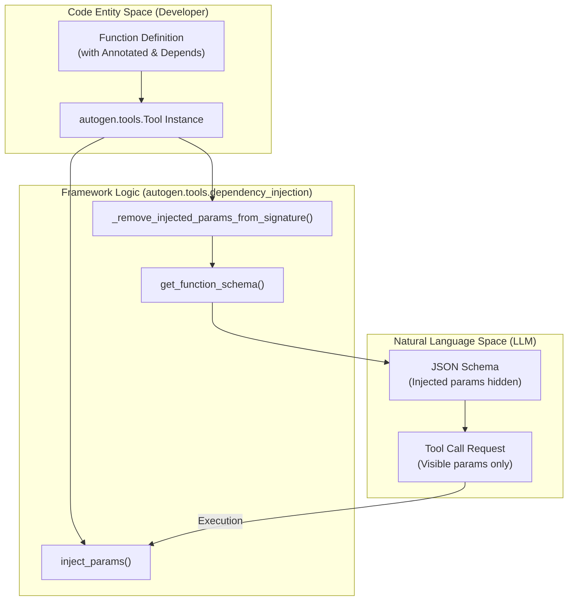
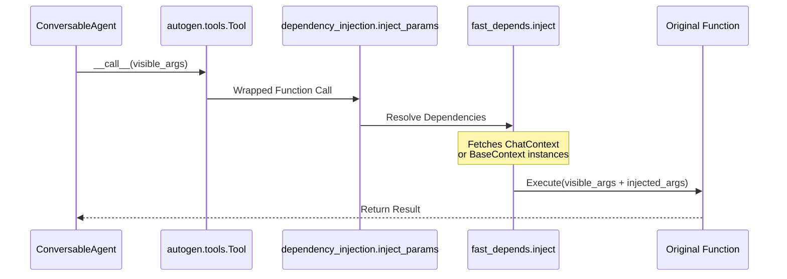

<!-- source: DeepWiki mcp.deepwiki.com · repo ag2ai/ag2 · page 5.2 Dependency Injection for Tools · fetched 2026-10-26 -->

# Dependency Injection for Tools

<details>
<summary>Relevant source files</summary>

The following files were used as context for generating this wiki page:

- [.pre-commit-config.yaml](.pre-commit-config.yaml)
- [autogen/agentchat/contrib/swarm_agent.py](autogen/agentchat/contrib/swarm_agent.py)
- [autogen/interop/__init__.py](autogen/interop/__init__.py)
- [autogen/interop/crewai/__init__.py](autogen/interop/crewai/__init__.py)
- [autogen/interop/crewai/crewai.py](autogen/interop/crewai/crewai.py)
- [autogen/interop/interoperability.py](autogen/interop/interoperability.py)
- [autogen/interop/interoperable.py](autogen/interop/interoperable.py)
- [autogen/interop/langchain/__init__.py](autogen/interop/langchain/__init__.py)
- [autogen/interop/pydantic_ai/__init__.py](autogen/interop/pydantic_ai/__init__.py)
- [autogen/interop/pydantic_ai/pydantic_ai.py](autogen/interop/pydantic_ai/pydantic_ai.py)
- [autogen/llm_config/client.py](autogen/llm_config/client.py)
- [autogen/tools/__init__.py](autogen/tools/__init__.py)
- [autogen/tools/dependency_injection.py](autogen/tools/dependency_injection.py)
- [autogen/tools/function_utils.py](autogen/tools/function_utils.py)
- [autogen/tools/tool.py](autogen/tools/tool.py)
- [scripts/pre-commit-mypy-run.sh](scripts/pre-commit-mypy-run.sh)
- [test/agentchat/contrib/test_swarm.py](test/agentchat/contrib/test_swarm.py)
- [test/interop/crewai/test_crewai.py](test/interop/crewai/test_crewai.py)
- [test/interop/langchain/test_langchain.py](test/interop/langchain/test_langchain.py)
- [test/interop/pydantic_ai/test_pydantic_ai.py](test/interop/pydantic_ai/test_pydantic_ai.py)
- [test/interop/pydantic_ai/test_pydantic_ai_tool.py](test/interop/pydantic_ai/test_pydantic_ai_tool.py)
- [test/interop/test_interoperability.py](test/interop/test_interoperability.py)
- [test/tools/test_dependency_injection.py](test/tools/test_dependency_injection.py)
- [test/tools/test_function_utils.py](test/tools/test_function_utils.py)
- [test/tools/test_tool.py](test/tools/test_tool.py)

</details>


## Purpose and Scope

This document details AG2's dependency injection (DI) system for tools. The DI system enables the secure passing of sensitive data—such as credentials, API keys, and user contexts—to tool functions without exposing these parameters to Large Language Models (LLMs). It automates parameter resolution at runtime, ensuring that "injected" parameters are excluded from the tool's JSON schema while remaining available during execution.

For basic tool registration, see [Function Calling and Tool Registration](#5.1). For execution environments, see [Code Execution System](#5.3).

## Overview

Dependency injection in AG2 creates a functional boundary between the LLM's view of a tool and the actual execution environment. The system utilizes Python type hints and the `Depends()` marker to differentiate between parameters the LLM should provide and parameters the framework should provide.

Key features include:
- **Automatic Schema Filtering**: Parameters marked for injection are automatically removed from the JSON schema sent to the LLM.
- **Context Awareness**: Tools can access the current chat history or agent state via `ChatContext`.
- **Flexible Resolution**: Dependencies can be resolved from static instances, class definitions, or dynamic callables.

Sources: [autogen/tools/dependency_injection.py:1-32](), [autogen/tools/tool.py:54-62]()

## Core Components

### BaseContext and ChatContext
`BaseContext` is an abstract base class used to identify types that should be injected. `ChatContext` is a specialized implementation that provides tools with access to the conversation state.

| Class | Purpose | Key Properties/Methods |
| :--- | :--- | :--- |
| `BaseContext` | Base marker for all injectable context objects. | N/A |
| `ChatContext` | Provides access to the agent's message history. | `chat_messages`, `last_message` |

`ChatContext` is initialized with a `ConversableAgent` instance and allows a tool to inspect the conversation flow without the LLM needing to pass the history as a parameter.

Sources: [autogen/tools/dependency_injection.py:35-79]()

### The Depends() Function
The `Depends` function wraps a dependency provider. It is used within `Annotated` type hints to signal the `inject_params` logic to handle the parameter.

```python
from autogen.tools import Depends, ChatContext
from typing import Annotated

def my_tool(ctx: Annotated[ChatContext, Depends(ChatContext)]):
    messages = ctx.chat_messages
    # ...
```

Sources: [autogen/tools/dependency_injection.py:91-105]()

### Internal Resolution Logic
The system relies on several key internal functions in `autogen.tools.dependency_injection`:
- `get_context_params`: Inspects a function signature to find parameters that are subclasses of `BaseContext` or `ChatContext`. [autogen/tools/dependency_injection.py:107-119]()
- `inject_params`: Wraps the tool function with `fast_depends.inject`, enabling the actual runtime resolution. [autogen/tools/dependency_injection.py:221-228]()
- `_remove_injected_params_from_signature`: Cleans the function signature so that `get_function_schema` generates a schema containing only the parameters the LLM is expected to provide. [autogen/tools/dependency_injection.py:143-149]()

## Architecture and Data Flow

The following diagram illustrates how a tool definition in the "Code Space" is transformed into a "Natural Language Space" representation for the LLM, and how parameters are reunited during execution.

### Tool Transformation Flow


**Diagram: Mapping Code Entities to LLM Visibility**

Sources: [autogen/tools/tool.py:54-62](), [autogen/tools/dependency_injection.py:143-149](), [autogen/tools/dependency_injection.py:221-228]()

### Runtime Execution Sequence

When an agent receives a tool call from an LLM, the `Tool` object manages the resolution.


**Diagram: Runtime Dependency Resolution Sequence**

Sources: [autogen/tools/tool.py:128-138](), [autogen/tools/dependency_injection.py:221-228]()

## Usage Patterns

### Pattern 1: Automatic Chat History Access
By using `ChatContext`, a tool can automatically receive the message history of the agent executing it.

```python
from autogen.tools import ChatContext, Depends
from typing import Annotated

def analyze_history(
    query: str, 
    context: Annotated[ChatContext, Depends(ChatContext)]
) -> str:
    # 'context' is injected automatically by the framework
    last_msg = context.last_message
    return f"Analyzing '{query}' given last message: {last_msg}"
```
Sources: [autogen/tools/dependency_injection.py:47-79](), [autogen/tools/tool.py:55-57]()

### Pattern 2: Swarm Agent Context Variables
In the Swarm system, context variables are managed via a specific dependency injection pattern. The `SwarmAgent` uses `ContextVariables` to maintain state across handoffs.

- `__CONTEXT_VARIABLES_PARAM_NAME__`: The reserved name (`context_variables`) used for injecting swarm state. [autogen/agentchat/contrib/swarm_agent.py:32]()
- `_change_tool_context_variables_to_depends`: An internal utility that converts standard `context_variables` parameters into `Depends` parameters during swarm initialization. [autogen/agentchat/contrib/swarm_agent.py:1135-1153]()

Sources: [autogen/agentchat/contrib/swarm_agent.py:32](), [autogen/agentchat/contrib/swarm_agent.py:1135-1153]()

### Pattern 3: Interoperability Injection
The `Interoperability` layer uses DI to bridge tools from other frameworks (like PydanticAI or CrewAI).
- `PydanticAIInteroperability.inject_params`: Wraps foreign tools to inject `RunContext` and handle retries before execution by an AG2 agent. [autogen/interop/pydantic_ai/pydantic_ai.py:39-94]()

Sources: [autogen/interop/pydantic_ai/pydantic_ai.py:39-94](), [autogen/interop/interoperability.py:25-40]()

## Implementation Details

### Parameter Filtering
The core of the security model is `_is_context_param` and `_is_depends_param`.
- `_is_context_param`: Checks if a parameter's type annotation is a subclass of `BaseContext`. [autogen/tools/dependency_injection.py:121-128]()
- `_is_depends_param`: Checks if the parameter has a default value of `Depends()` or an `Annotated` metadata containing `Depends`. [autogen/tools/dependency_injection.py:130-135]()

### Schema Generation
When `Tool.tool_schema` is called, it invokes `get_function_schema`. Before this happens, `Tool.__init__` calls `inject_params`, which internally calls `_remove_injected_params_from_signature`. This ensures the `inspect.signature` used for JSON schema generation does not contain the injected fields.

Sources: [autogen/tools/tool.py:54-62](), [autogen/tools/tool.py:141-147](), [autogen/tools/dependency_injection.py:143-149]()

### Field Metadata
The `Field` class and `_string_metadata_to_description_field` utility handle documentation. They convert simple string metadata in `Annotated` types into formal `Field` objects with descriptions, which are then parsed into the JSON schema "description" fields for the LLM.

Sources: [autogen/tools/dependency_injection.py:151-188]()

## Summary of Key Functions

| Function | File | Description |
| :--- | :--- | :--- |
| `inject_params` | `dependency_injection.py` | Wraps a function to enable runtime DI via `fast_depends`. |
| `on(x)` | `dependency_injection.py` | Helper to create a callable that returns `x`, often used with `Depends`. |
| `get_function_schema` | `function_utils.py` | Generates the LLM-compatible JSON schema from a function signature. |
| `register_for_llm` | `tool.py` | Registers the sanitized tool schema with an agent. |

Sources: [autogen/tools/dependency_injection.py:84-88](), [autogen/tools/dependency_injection.py:221-228](), [autogen/tools/function_utils.py:184-198](), [autogen/tools/tool.py:89-101]()

---

