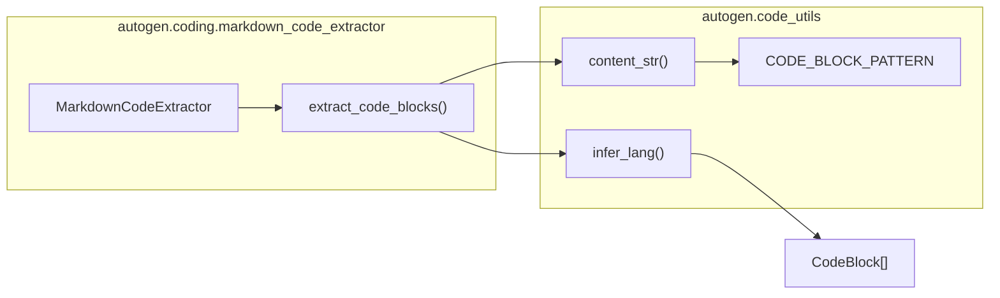
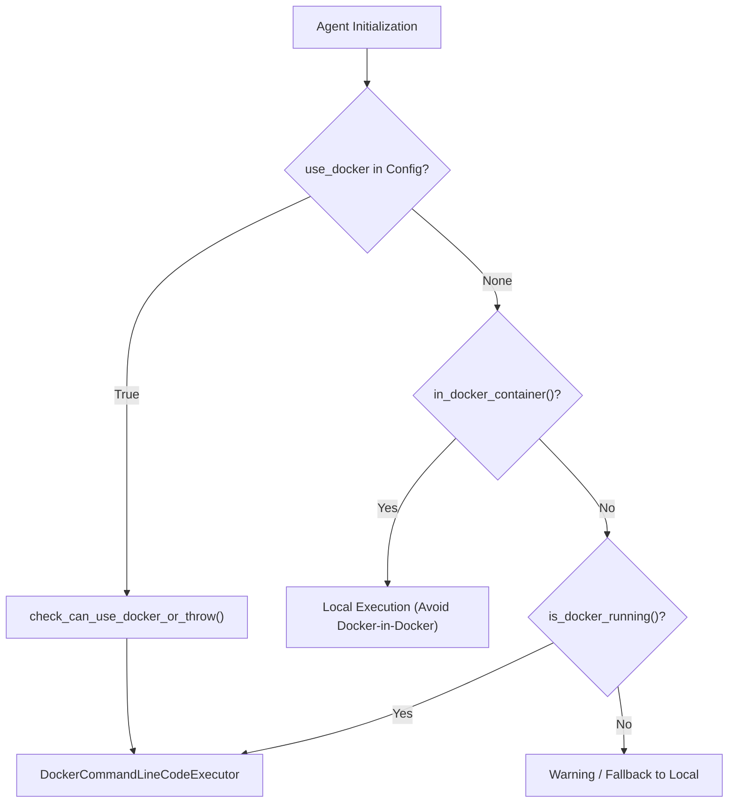

<!-- source: DeepWiki mcp.deepwiki.com · repo ag2ai/ag2 · page 5.3 Code Execution System · fetched 2026-10-26 -->

# Code Execution System

<details>
<summary>Relevant source files</summary>

The following files were used as context for generating this wiki page:

- [.gitignore](.gitignore)
- [autogen/code_utils.py](autogen/code_utils.py)
- [autogen/coding/__init__.py](autogen/coding/__init__.py)
- [autogen/coding/base.py](autogen/coding/base.py)
- [autogen/coding/daytona_code_executor.py](autogen/coding/daytona_code_executor.py)
- [autogen/coding/docker_commandline_code_executor.py](autogen/coding/docker_commandline_code_executor.py)
- [autogen/coding/factory.py](autogen/coding/factory.py)
- [autogen/coding/func_with_reqs.py](autogen/coding/func_with_reqs.py)
- [autogen/coding/jupyter/base.py](autogen/coding/jupyter/base.py)
- [autogen/coding/jupyter/docker_jupyter_server.py](autogen/coding/jupyter/docker_jupyter_server.py)
- [autogen/coding/jupyter/embedded_ipython_code_executor.py](autogen/coding/jupyter/embedded_ipython_code_executor.py)
- [autogen/coding/jupyter/jupyter_client.py](autogen/coding/jupyter/jupyter_client.py)
- [autogen/coding/jupyter/jupyter_code_executor.py](autogen/coding/jupyter/jupyter_code_executor.py)
- [autogen/coding/jupyter/local_jupyter_server.py](autogen/coding/jupyter/local_jupyter_server.py)
- [autogen/coding/local_commandline_code_executor.py](autogen/coding/local_commandline_code_executor.py)
- [autogen/coding/remyx_code_executor.py](autogen/coding/remyx_code_executor.py)
- [autogen/coding/utils.py](autogen/coding/utils.py)
- [autogen/oai/gemini.py](autogen/oai/gemini.py)
- [notebook/agentchat_daytona_executor.ipynb](notebook/agentchat_daytona_executor.ipynb)
- [notebook/agentchat_gemini_thinking_config_example.ipynb](notebook/agentchat_gemini_thinking_config_example.ipynb)
- [notebook/agentchat_remyx_executor.ipynb](notebook/agentchat_remyx_executor.ipynb)
- [notebook/tools_google_search.ipynb](notebook/tools_google_search.ipynb)
- [test/coding/__init__.py](test/coding/__init__.py)
- [test/coding/test_commandline_code_executor.py](test/coding/test_commandline_code_executor.py)
- [test/coding/test_daytona_code_executor.py](test/coding/test_daytona_code_executor.py)
- [test/coding/test_daytona_code_executor_integration.py](test/coding/test_daytona_code_executor_integration.py)
- [test/coding/test_embedded_ipython_code_executor.py](test/coding/test_embedded_ipython_code_executor.py)
- [test/coding/test_remyx_executor.py](test/coding/test_remyx_executor.py)
- [test/coding/test_remyx_executor_integration.py](test/coding/test_remyx_executor_integration.py)
- [test/coding/test_user_defined_functions.py](test/coding/test_user_defined_functions.py)
- [test/credentials.py](test/credentials.py)
- [test/oai/test_gemini.py](test/oai/test_gemini.py)
- [test/test_code_utils.py](test/test_code_utils.py)
- [website/docs/installation/Optional-Dependencies.mdx](website/docs/installation/Optional-Dependencies.mdx)
- [website/docs/user-guide/advanced-concepts/code-execution.mdx](website/docs/user-guide/advanced-concepts/code-execution.mdx)
- [website/docs/user-guide/advanced-concepts/tools/controlling-use.mdx](website/docs/user-guide/advanced-concepts/tools/controlling-use.mdx)
- [website/docs/user-guide/getting-started/Getting-Started.mdx](website/docs/user-guide/getting-started/Getting-Started.mdx)
- [website/docs/user-guide/models/google-gemini.mdx](website/docs/user-guide/models/google-gemini.mdx)
- [website/docs/user-guide/reference-tools/google-api/google-search.mdx](website/docs/user-guide/reference-tools/google-api/google-search.mdx)
- [website/snippets/python-examples/humanintheloop_financial.mdx](website/snippets/python-examples/humanintheloop_financial.mdx)

</details>


The Code Execution System is a comprehensive framework within AG2 that enables conversable agents to execute code blocks in various environments safely and efficiently. This system provides a unified interface for code execution while supporting multiple backends including local command line, Docker containers, and IPython kernels, as well as third-party cloud executors like Remyx, YepCode, and Daytona.

For information about function calling and tool registration, see [Function Calling and Tool Registration](#5.1).

## Architecture Overview

The code execution system is built around a protocol-based architecture that separates code extraction, execution, and result handling into distinct, composable components.

### Core Architecture

The following diagram illustrates the relationship between the high-level `ConversableAgent` and the underlying execution entities.

Title: Code Execution Architecture
```mermaid
graph TB
    subgraph "Agent Layer"
        CA["ConversableAgent"]
        CEC["CodeExecutionConfig"]
    end
    
    subgraph "Extraction Layer"
        CE["CodeExtractor Protocol"]
        MCE["MarkdownCodeExtractor"]
        CB["CodeBlock"]
    end
    
    subgraph "Execution Layer"
        CEX["CodeExecutor Protocol"]
        CEF["CodeExecutorFactory"]
    end
    
    subgraph "Local & Containerized"
        LCE["LocalCommandLineCodeExecutor"]
        DCE["DockerCommandLineCodeExecutor"]
    end
    
    subgraph "IPython & Jupyter"
        EICE["EmbeddedIPythonCodeExecutor"]
        JCE["JupyterCodeExecutor"]
    end

    subgraph "Cloud Sandboxes"
        RCE["RemyxCodeExecutor"]
        YCE["YepCodeCodeExecutor"]
        DYCE["DaytonaCodeExecutor"]
    end
    
    CA --> CEC
    CEC --> CEF
    CEF --> CEX
    
    CEX <|-- LCE
    CEX <|-- DCE
    CEX <|-- EICE
    CEX <|-- JCE
    CEX <|-- RCE
    CEX <|-- YCE
    CEX <|-- DYCE
    
    CE <|-- MCE
    MCE --> CB
    
    style CEX fill:none,stroke-width:2px
    style CEF fill:none,stroke-width:2px
    style CB fill:none,stroke-width:2px
```

**Sources:** [autogen/coding/base.py:58-87](), [autogen/coding/factory.py:14-47](), [autogen/coding/local_commandline_code_executor.py:39-143](), [autogen/coding/docker_commandline_code_executor.py:44-107](), [autogen/coding/daytona_code_executor.py:23-45]()

## Core Components

### Base Protocols and Data Structures

The system defines several key protocols and data structures in `autogen.coding.base` that form the foundation of code execution:

| Component | Purpose | Key Fields/Methods |
|-----------|---------|----------------------|
| `CodeBlock` | Represents executable code | `code: str`, `language: str` |
| `CodeExecutor` | Protocol for code execution | `execute_code_blocks()`, `restart()`, `code_extractor` |
| `CodeExtractor` | Protocol for code extraction | `extract_code_blocks()` |
| `CodeResult` | Base execution result | `exit_code: int`, `output: str` |
| `CommandLineCodeResult` | Result with file path | `code_file: str | None` |

**Sources:** [autogen/coding/base.py:21-37](), [autogen/coding/base.py:58-87](), [autogen/coding/base.py:116-123]()

### Code Extraction

The `MarkdownCodeExtractor` is the primary implementation for extracting code blocks from agent messages using the `CODE_BLOCK_PATTERN` regex ` ```[ \t]*(\w+)?[ \t]*\r?\n(.*?)\r?\n[ \t]*``` `.

Title: Code Extraction Logic


**Sources:** [autogen/coding/markdown_code_extractor.py:19-46](), [autogen/code_utils.py:29-37](), [autogen/code_utils.py:106-120]()

## Execution Environments

### Local Command Line Executor

The `LocalCommandLineCodeExecutor` executes code directly on the local machine. It supports a `virtual_env_context` to run code within a specific Python virtual environment, preventing pollution of the base environment.

- **Execution Policies**: Determines if a language is executed or just saved to a file. By default, `python`, `bash`, and `sh` are enabled, while `javascript`, `html`, and `css` are set to `False` (save only).
- **Function Support**: Can inject user-defined functions into the execution environment by creating a functions module (default name `"functions"`).

**Sources:** [autogen/coding/local_commandline_code_executor.py:40-82](), [autogen/coding/local_commandline_code_executor.py:145-162](), [autogen/coding/local_commandline_code_executor.py:212-234]()

### Docker Command Line Executor

The `DockerCommandLineCodeExecutor` provides isolation by running code inside a Docker container. It uses the `docker` Python library to manage container lifecycles.

- **Container Management**: It pulls the specified `image` (default `python:3-slim`), creates a container with a `/workspace` volume mount, and executes commands using `container.exec_run()`.
- **Advanced Configuration**: Users can pass `container_create_kwargs` to configure environment variables, GPU access, or other Docker-specific settings.

**Sources:** [autogen/coding/docker_commandline_code_executor.py:59-107](), [autogen/coding/docker_commandline_code_executor.py:144-168](), [autogen/coding/docker_commandline_code_executor.py:216-240]()

### IPython and Jupyter Executors

AG2 supports stateful execution through `EmbeddedIPythonCodeExecutor` and `JupyterCodeExecutor`. These are ideal for data science tasks where variables must persist across multiple messages.

- **EmbeddedIPythonCodeExecutor**: Uses `ipykernel.KernelManager` to run an in-process or subprocess kernel.
- **JupyterCodeExecutor**: Connects to a `JupyterServer` (either `LocalJupyterServer` or `DockerJupyterServer`) and interacts with it via a `JupyterClient`.

**Sources:** [autogen/coding/jupyter/embedded_ipython_code_executor.py:34-70](), [autogen/coding/jupyter/jupyter_code_executor.py:31-60](), [autogen/coding/jupyter/local_jupyter_server.py:32-50]()

### Third-Party Cloud Executors

The system integrates with several cloud-based sandbox environments for secure, serverless code execution:

| Executor | Class | Use Case |
|----------|-------|----------|
| **Remyx** | `RemyxCodeExecutor` | Pre-built Docker environments in Remyx Cloud |
| **YepCode** | `YepCodeCodeExecutor` | Serverless execution in YepCode Cloud |
| **Daytona** | `DaytonaCodeExecutor` | Sandbox environments in Daytona Cloud |

**Sources:** [autogen/coding/remyx_code_executor.py:19-35](), [autogen/coding/daytona_code_executor.py:23-45](), [website/docs/user-guide/advanced-concepts/code-execution.mdx:11-18]()

## Security and Safety

### Command Sanitization

The `LocalCommandLineCodeExecutor` implements a `_cmd` utility (internally using `autogen.code_utils.execute_code` patterns) to sanitize and execute commands. However, executing LLM-generated code locally is inherently risky. AG2 recommends:
1. Using `DockerCommandLineCodeExecutor` for isolation.
2. Setting `human_input_mode="ALWAYS"` in the agent to manually review code before execution.

**Sources:** [autogen/coding/local_commandline_code_executor.py:83-86](), [website/docs/user-guide/advanced-concepts/code-execution.mdx:25-27](), [website/docs/user-guide/advanced-concepts/code-execution.mdx:65-66]()

### Environment Decision Flow

The system uses utility functions to decide whether to use Docker based on the environment and user configuration.

Title: Docker Usage Decision Flow


**Sources:** [autogen/code_utils.py:217-254](), [autogen/code_utils.py:194-215](), [autogen/code_utils.py:242-254]()

## Configuration and Factory Pattern

### CodeExecutorFactory

The `CodeExecutorFactory` provides a centralized way to instantiate executors from a `CodeExecutionConfig` dictionary.

```python
# Example Factory Usage
config = {"executor": "commandline-local", "timeout": 30}
executor = CodeExecutorFactory.create(config)
```

**Sources:** [autogen/coding/factory.py:14-47](), [autogen/coding/base.py:98-113]()

### Language Support and Policies

Executors use a mapping to determine which languages are supported and how they should be handled.

| Language | `LocalCommandLineCodeExecutor` | `DockerCommandLineCodeExecutor` |
|----------|-------------------------------|---------------------------------|
| `python` | Supported (Execute) | Supported (Execute) |
| `bash/sh`| Supported (Execute) | Supported (Execute) |
| `javascript`| Supported (Save Only) | Not Default |
| `powershell`| Supported (Execute on Win) | Supported |

**Sources:** [autogen/coding/local_commandline_code_executor.py:41-64](), [autogen/coding/docker_commandline_code_executor.py:45-56]()

## Integration with Agents

Agents use the `code_execution_config` parameter to enable this system. When `ConversableAgent.generate_reply` is called, it triggers the following sequence:

1. **Extraction**: `MarkdownCodeExtractor` parses the message for `CodeBlock` objects.
2. **Review**: If `human_input_mode` is set, the user can intercept.
3. **Execution**: The chosen `CodeExecutor` runs the blocks.
4. **Reporting**: The `CodeResult` (exit code and output) is formatted into a message and sent back to the assistant.

**Sources:** [autogen/agentchat/conversable_agent.py:611-666](), [website/docs/user-guide/advanced-concepts/code-execution.mdx:31-33](), [website/docs/user-guide/advanced-concepts/code-execution.mdx:96-100]()

---

