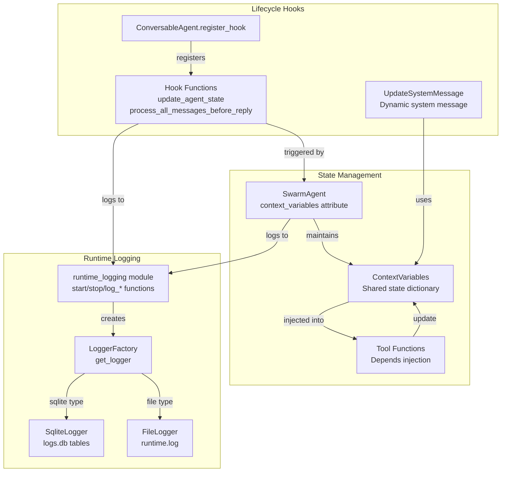
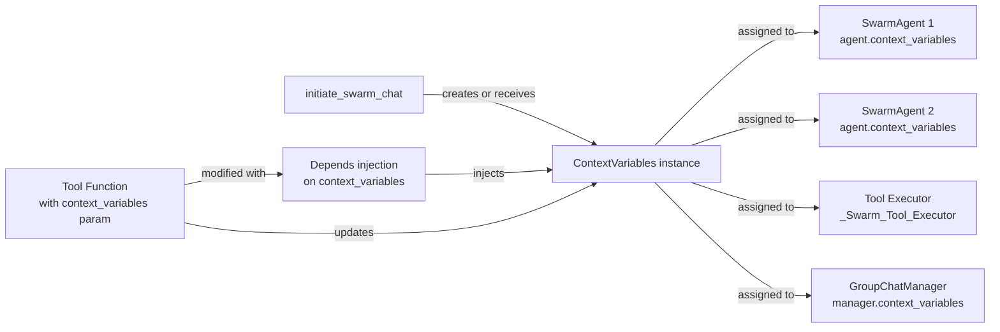
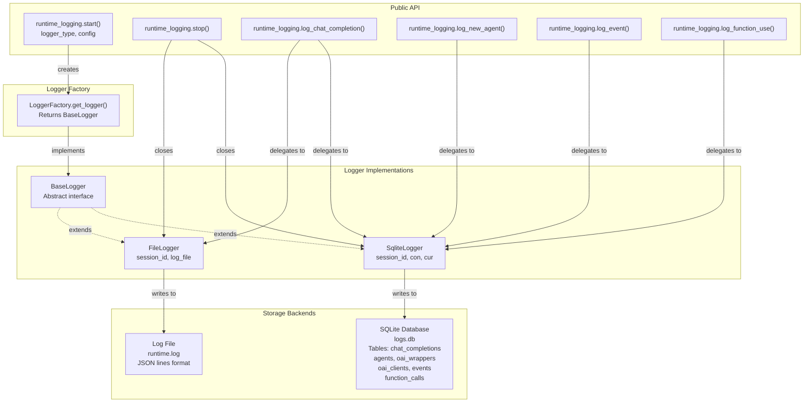
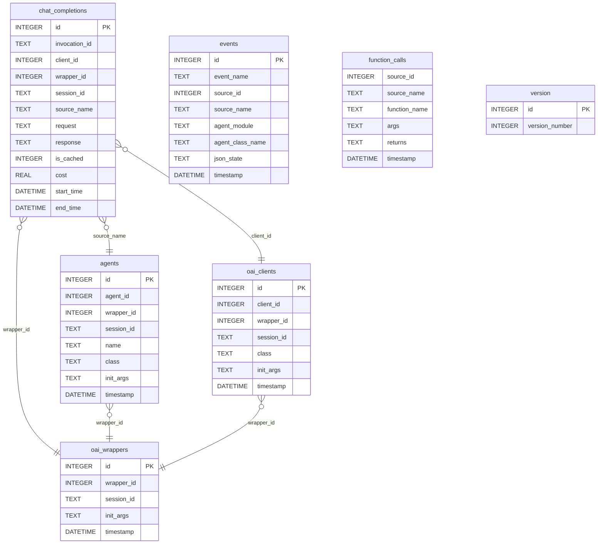
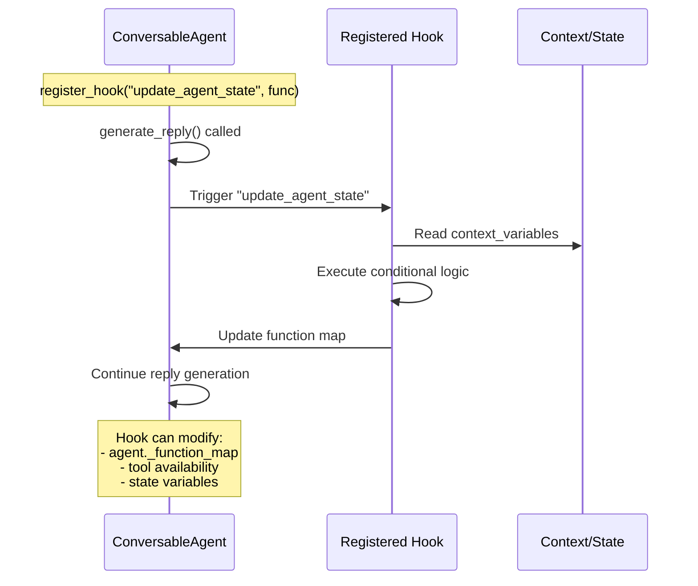
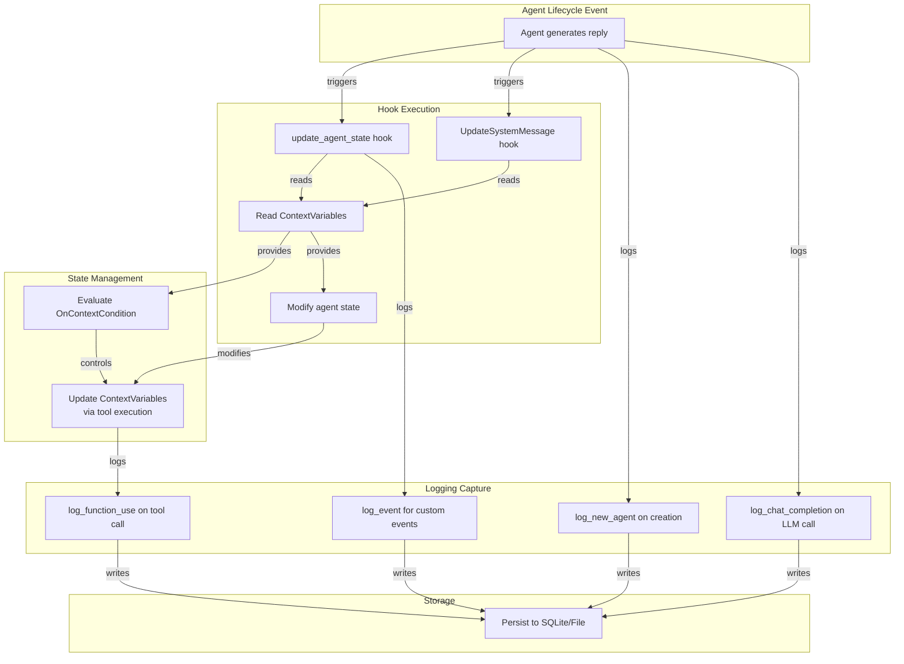

<!-- source: DeepWiki mcp.deepwiki.com · repo ag2ai/ag2 · page 6 State Management and Logging · fetched 2026-10-26 -->

# State Management and Logging

Relevant source files

The following files were used as context for generating this wiki page:

- [.pre-commit-config.yaml](.pre-commit-config.yaml)
- [autogen/agentchat/contrib/swarm_agent.py](autogen/agentchat/contrib/swarm_agent.py)
- [autogen/logger/base_logger.py](autogen/logger/base_logger.py)
- [autogen/logger/file_logger.py](autogen/logger/file_logger.py)
- [autogen/logger/logger_factory.py](autogen/logger/logger_factory.py)
- [autogen/logger/logger_utils.py](autogen/logger/logger_utils.py)
- [autogen/logger/sqlite_logger.py](autogen/logger/sqlite_logger.py)
- [autogen/runtime_logging.py](autogen/runtime_logging.py)
- [autogen/tools/dependency_injection.py](autogen/tools/dependency_injection.py)
- [autogen/tools/function_utils.py](autogen/tools/function_utils.py)
- [notebook/agentchat_logging.ipynb](notebook/agentchat_logging.ipynb)
- [scripts/pre-commit-mypy-run.sh](scripts/pre-commit-mypy-run.sh)
- [test/agentchat/contrib/test_swarm.py](test/agentchat/contrib/test_swarm.py)
- [test/agentchat/test_agent_file_logging.py](test/agentchat/test_agent_file_logging.py)
- [test/logger/__init__.py](test/logger/__init__.py)
- [test/logger/test_file_logger_redaction.py](test/logger/test_file_logger_redaction.py)
- [test/test_logging.py](test/test_logging.py)
- [test/tools/test_dependency_injection.py](test/tools/test_dependency_injection.py)
- [test/tools/test_function_utils.py](test/tools/test_function_utils.py)

This page provides an overview of AG2's systems for managing agent state, tracking runtime behavior, and responding to lifecycle events. These capabilities enable agents to share contextual information, persist execution history for analysis, and react to changes in their environment.

For details on specific state management patterns in SwarmAgent, see [ContextVariables and Shared State](#6.1). For comprehensive logging system documentation, see [Runtime Logging System](#6.2). For hook registration and lifecycle events, see [Hooks and Lifecycle Management](#6.3).

## Core State and Logging Systems

AG2 provides three interconnected systems for managing agent state and tracking execution:

**System Architecture Overview**

**ContextVariables**: A dictionary-like container for sharing state across agents in a swarm. Tools can read and modify context variables through dependency injection, enabling stateful multi-agent workflows. Defined in [autogen/agentchat/group/context_variables.py]().

**Runtime Logging**: A pluggable logging system that captures chat completions, agent creation, function calls, and custom events. Supports SQLite and file-based backends for post-execution analysis. Managed via [autogen/runtime_logging.py:1-162]().

**Lifecycle Hooks**: Callback functions registered to execute at specific points in an agent's lifecycle, such as before generating a reply or when the agent state updates.

Sources: [autogen/agentchat/contrib/swarm_agent.py:1-100](), [autogen/runtime_logging.py:1-162](), [autogen/logger/base_logger.py:1-130]()

## ContextVariables in SwarmAgent

`ContextVariables` provides a shared state mechanism for `SwarmAgent` workflows. Each agent in a swarm maintains a reference to the same `ContextVariables` instance, enabling state coordination across agent transitions.

**Context Flow in SwarmChat**

Key implementation details:

- **Initialization**: Created at swarm startup in `_setup_context_variables` [autogen/agentchat/contrib/swarm_agent.py:2901-2917]().
- **Assignment**: All agents receive the same reference during swarm preparation [autogen/agentchat/contrib/swarm_agent.py:2915-2916]().
- **Tool Integration**: Functions with `context_variables` parameters get dependency injection via `_change_tool_context_variables_to_depends` [autogen/agentchat/contrib/swarm_agent.py:2661-2689]().
- **Parameter Hiding**: The `context_variables` parameter is removed from tool schemas sent to LLMs to prevent agents from attempting to pass it manually [autogen/agentchat/contrib/swarm_agent.py:2691-2712]().

Sources: [autogen/agentchat/contrib/swarm_agent.py:2661-2917](), [test/agentchat/contrib/test_swarm.py:370-498]()

## Runtime Logging Architecture

The runtime logging system provides a unified interface for capturing agent interactions and LLM calls. The system uses a factory pattern to support multiple backend implementations.

**Logging Data Flow**

### Logging Workflow

| Step | Function | Purpose |
|------|----------|---------|
| 1 | `runtime_logging.start()` | Initialize logger, create session_id, set up storage [autogen/runtime_logging.py:41-66]() |
| 2 | Agent operations | Framework automatically logs via wrapper methods |
| 3 | `runtime_logging.log_*()` | Manual logging of custom events or function calls [autogen/runtime_logging.py:97-110]() |
| 4 | `runtime_logging.stop()` | Close connections, flush buffers [autogen/runtime_logging.py:145-150]() |
| 5 | Query logs | Use `get_connection()` to access the underlying SQLite connection [autogen/runtime_logging.py:152-158]() |

### Logged Information

The logging system captures:

- **Chat Completions**: Every LLM call with request, response, cost, and caching status [autogen/logger/base_logger.py:37-66]().
- **Agent Creation**: Agent initialization with configuration (excluding API keys) [autogen/logger/base_logger.py:68-76]().
- **Events**: Custom events with arbitrary key-value data [autogen/logger/base_logger.py:78-87]().
- **Function Calls**: Tool/function executions with arguments and return values [autogen/logger/base_logger.py:110-120]().
- **Wrappers and Clients**: `OpenAIWrapper` and LLM client instantiation [autogen/logger/base_logger.py:89-108]().

Sources: [autogen/runtime_logging.py:1-162](), [autogen/logger/base_logger.py:1-130](), [autogen/logger/sqlite_logger.py:1-525](), [autogen/logger/file_logger.py:1-263]()

## SQLite Logger Schema

The `SqliteLogger` stores data in a relational schema designed for traceability across sessions.

**Database Schema (SqliteLogger)**

**Key Fields:**
- `session_id`: UUID linking all records from a single `start()` call [autogen/logger/sqlite_logger.py:82]().
- `invocation_id`: UUID for a single `OpenAIWrapper.create()` invocation [autogen/logger/sqlite_logger.py:91]().
- `is_cached`: 1 if response came from cache, 0 otherwise [autogen/logger/sqlite_logger.py:98]().
- `cost`: Calculated token cost for the completion [autogen/logger/sqlite_logger.py:99]().

The schema includes a versioning system to manage database migrations [autogen/logger/sqlite_logger.py:144-150]().

Sources: [autogen/logger/sqlite_logger.py:86-176](), [test/test_logging.py:88-243]()

## Hook System Integration

Hooks enable custom logic at specific agent lifecycle points. SwarmAgent uses hooks for conditional transitions and state updates.

**Hook Execution Sequence**

### SwarmAgent Hook Usage

SwarmAgent registers two key hooks during initialization:

1. **`update_agent_state` Hook**: Updates conditional function availability based on the current context [autogen/agentchat/contrib/swarm_agent.py:251]().
   - Implementation: `_update_conditional_functions` [autogen/agentchat/contrib/swarm_agent.py:1843-1859]().
2. **Context Condition Reply Function**: Evaluates `OnContextCondition` transitions before standard LLM reply generation [autogen/agentchat/contrib/swarm_agent.py:257]().
   - Implementation: `_run_oncontextconditions` [autogen/agentchat/contrib/swarm_agent.py:277-312]().

### UpdateSystemMessage Hook

`UpdateSystemMessage` is a specialized hook for dynamically updating agent system messages based on context. It can be a string template or a callable [autogen/agentchat/conversable_agent.py]().

| Property | Description |
|----------|-------------|
| Creation | `UpdateSystemMessage(message_or_callable)` |
| Execution Time | Before each reply generation |
| Variable Substitution | Uses `context_variables` for template rendering |

Sources: [autogen/agentchat/contrib/swarm_agent.py:229-312](), [autogen/agentchat/contrib/swarm_agent.py:1843-1859](), [test/agentchat/contrib/test_swarm.py:632-716]()

## Integration: State, Logging, and Hooks

The three systems work together in agent workflows:

**Integrated Execution Flow**

This integration enables:
- **Stateful multi-agent workflows** with shared context via `ContextVariables`.
- **Complete execution traces** for debugging and analysis via `runtime_logging`.
- **Dynamic agent behavior** based on runtime state using lifecycle hooks.

Sources: [autogen/agentchat/contrib/swarm_agent.py:229-570](), [autogen/runtime_logging.py:41-162](), [autogen/logger/logger_utils.py:1-163]()

---

