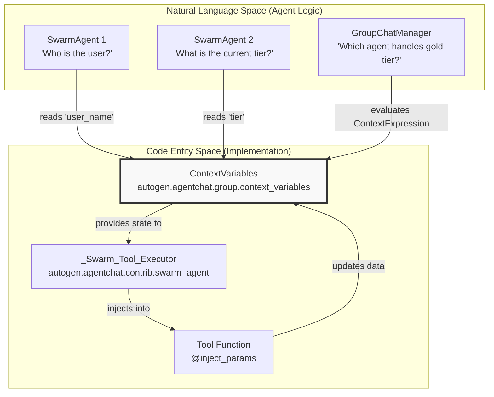
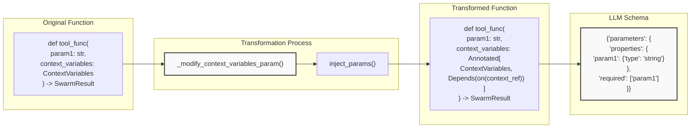
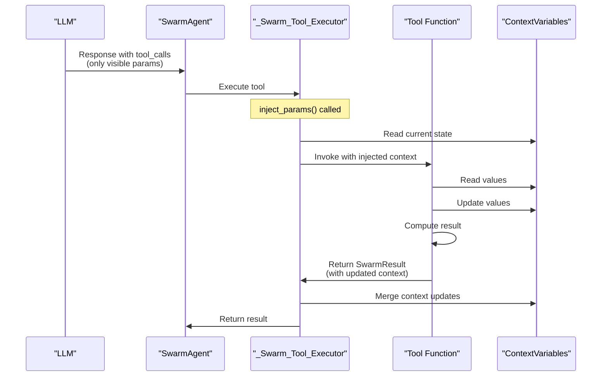
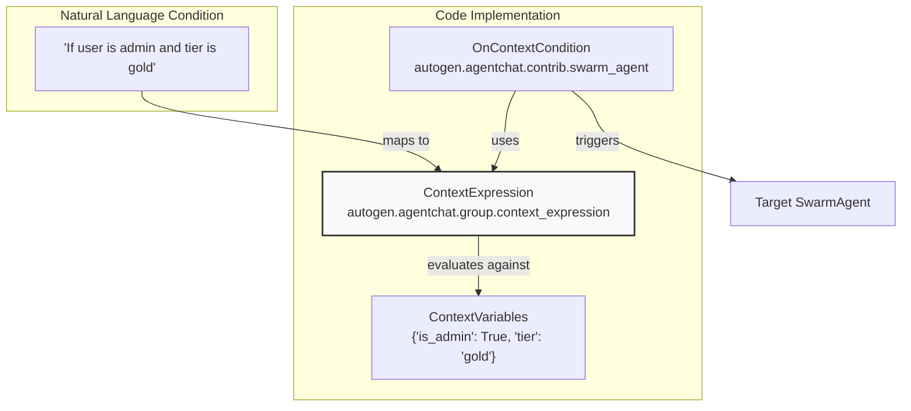
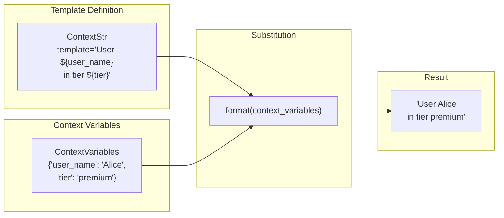

<!-- source: DeepWiki mcp.deepwiki.com · repo ag2ai/ag2 · page 6.1 ContextVariables and Shared State · fetched 2026-10-26 -->

# ContextVariables and Shared State

<details>
<summary>Relevant source files</summary>

The following files were used as context for generating this wiki page:

- [.pre-commit-config.yaml](.pre-commit-config.yaml)
- [autogen/agentchat/contrib/swarm_agent.py](autogen/agentchat/contrib/swarm_agent.py)
- [autogen/tools/dependency_injection.py](autogen/tools/dependency_injection.py)
- [autogen/tools/function_utils.py](autogen/tools/function_utils.py)
- [scripts/pre-commit-mypy-run.sh](scripts/pre-commit-mypy-run.sh)
- [test/agentchat/contrib/test_swarm.py](test/agentchat/contrib/test_swarm.py)
- [test/tools/test_dependency_injection.py](test/tools/test_dependency_injection.py)
- [test/tools/test_function_utils.py](test/tools/test_function_utils.py)
- [website/docs/quick-start.mdx](website/docs/quick-start.mdx)
- [website/docs/user-guide/advanced-concepts/orchestration/group-chat/context-variables.mdx](website/docs/user-guide/advanced-concepts/orchestration/group-chat/context-variables.mdx)
- [website/docs/user-guide/advanced-concepts/orchestration/group-chat/handoffs.mdx](website/docs/user-guide/advanced-concepts/orchestration/group-chat/handoffs.mdx)
- [website/docs/user-guide/advanced-concepts/orchestration/group-chat/introduction.mdx](website/docs/user-guide/advanced-concepts/orchestration/group-chat/introduction.mdx)
- [website/docs/user-guide/advanced-concepts/orchestration/group-chat/patterns.mdx](website/docs/user-guide/advanced-concepts/orchestration/group-chat/patterns.mdx)
- [website/docs/user-guide/advanced-concepts/orchestration/nested-chat.mdx](website/docs/user-guide/advanced-concepts/orchestration/nested-chat.mdx)
- [website/docs/user-guide/advanced-concepts/orchestration/sequential-chat.mdx](website/docs/user-guide/advanced-concepts/orchestration/sequential-chat.mdx)
- [website/docs/user-guide/advanced-concepts/pattern-cookbook/context_aware_routing.mdx](website/docs/user-guide/advanced-concepts/pattern-cookbook/context_aware_routing.mdx)
- [website/docs/user-guide/basic-concepts/conversable-agent.mdx](website/docs/user-guide/basic-concepts/conversable-agent.mdx)
- [website/docs/user-guide/basic-concepts/installing-ag2.mdx](website/docs/user-guide/basic-concepts/installing-ag2.mdx)
- [website/docs/user-guide/basic-concepts/introducing-swarm-orchestration.mdx](website/docs/user-guide/basic-concepts/introducing-swarm-orchestration.mdx)

</details>


## Purpose and Scope

This page documents the `ContextVariables` system in AG2, which provides shared state management across multiple agents in a swarm. ContextVariables enables agents to maintain, access, and modify common data throughout a conversation, supporting dynamic orchestration patterns and context-aware tool execution.

For information about SwarmAgent orchestration patterns, see [SwarmAgent and Dynamic Orchestration](#4.1). For details on tool dependency injection mechanisms, see [Dependency Injection for Tools](#5.2).

---

## ContextVariables Data Structure

### Class Definition

`ContextVariables` is a dictionary-like container that stores shared state accessible to all agents in a swarm. It supports arbitrary Python objects as values and provides a unified reference across the agent system.

**Key characteristics:**
- Acts as a shared mutable dictionary.
- Passed by reference to all agents in a swarm.
- Supports any JSON-serializable data types.
- Can contain Pydantic models and complex objects.
- Thread-safe when used within a single swarm conversation.

**Basic Usage:**

```python
from autogen.agentchat.group.context_variables import ContextVariables

# Create with initial data
context = ContextVariables(data={"user_id": "123", "preferences": {"theme": "dark"}})

# Access and modify like a dictionary
context["user_id"]  # "123"
context["counter"] = 0
context["counter"] += 1
```

Sources: [autogen/agentchat/group/context_variables.py:32](), [test/agentchat/contrib/test_swarm.py:68-71]()

---

## ContextVariables in SwarmAgent

### Shared State Architecture

The following diagram illustrates how `ContextVariables` bridges the gap between the natural language logic of agents and the underlying code state.

**Shared State Bridge Diagram**



When `initiate_swarm_chat()` is called, a single `ContextVariables` instance is created (or provided) and assigned to all agents in the swarm, including the tool executor and group chat manager. This ensures all agents share the same state reference.

**Assignment Process:**

The `_setup_context_variables()` function [autogen/agentchat/contrib/swarm_agent.py:554-570]() assigns the context to all agents:

```python
def _setup_context_variables(
    tool_execution: ConversableAgent,
    agents: list[ConversableAgent],
    manager: GroupChatManager,
    context_variables: ContextVariables,
) -> None:
    for agent in agents + [tool_execution] + [manager]:
        agent.context_variables = context_variables
```

This creates a shared reference where modifications by any agent are visible to all other agents.

Sources: [autogen/agentchat/contrib/swarm_agent.py:554-570](), [autogen/agentchat/contrib/swarm_agent.py:367-443]()

---

## Tool Integration with ContextVariables

### Dependency Injection Pattern

Tools can access and modify `ContextVariables` through dependency injection. The system automatically provides the context instance without exposing it in the tool's schema sent to the LLM.

#### Function Signature Transformation



The transformation occurs in `_modify_context_variables_param()` [autogen/agentchat/contrib/swarm_agent.py:314-342]():

```python
def _modify_context_variables_param(f: Callable[..., Any], context_variables: ContextVariables) -> Callable[..., Any]:
    sig = inspect.signature(f)
    
    if __CONTEXT_VARIABLES_PARAM_NAME__ in sig.parameters:
        new_params = []
        for name, param in sig.parameters.items():
            if name == __CONTEXT_VARIABLES_PARAM_NAME__:
                # Replace with Depends annotation
                new_param = param.replace(
                    annotation=Annotated[ContextVariables, Depends(on(context_variables))]
                )
                new_params.append(new_param)
            else:
                new_params.append(param)
        
        new_sig = sig.replace(parameters=new_params)
        f.__signature__ = new_sig
    
    return f
```

This transformation:
1. Finds the `context_variables` parameter.
2. Replaces it with `Annotated[ContextVariables, Depends(on(context_variables))]`.
3. Updates the function signature.
4. Removes the parameter from the LLM schema automatically.

Sources: [autogen/agentchat/contrib/swarm_agent.py:314-342](), [autogen/agentchat/contrib/swarm_agent.py:344-365](), [autogen/tools/dependency_injection.py:91-105]()

---

### Tool Execution Flow with ContextVariables



**Example: Multiple Tools Updating Context**

From test case [test/agentchat/contrib/test_swarm.py:370-430]():

```python
# Starting context
test_context_variables = ContextVariables(data={"my_key": 0})

def test_func_1(context_variables: ContextVariables, param1: str) -> SwarmResult:
    context_variables["my_key"] += 1
    return SwarmResult(values=f"Test 1 {param1}", context_variables=context_variables)

def test_func_2(context_variables: ContextVariables, param2: str) -> SwarmResult:
    context_variables["my_key"] += 100
    return SwarmResult(values=f"Test 2 {param2}", context_variables=context_variables)

# After both tools execute: context_variables["my_key"] == 101
```

Both tools receive the same `ContextVariables` instance and their modifications are cumulative across the conversation.

Sources: [test/agentchat/contrib/test_swarm.py:370-430](), [test/agentchat/contrib/test_swarm.py:433-497]()

---

## ContextVariables with Complex Types

### Pydantic Models as Context Values

ContextVariables supports complex Python objects, including Pydantic models:

```python
from pydantic import BaseModel

class UserSettings(BaseModel):
    theme: str = "light"
    notifications: bool = True
    attempts: int = 0

context = ContextVariables(data={
    "user_settings": UserSettings(),
    "session_id": "abc123"
})

# Tools can modify nested properties
def increment_attempts(context_variables: ContextVariables) -> SwarmResult:
    context_variables["user_settings"].attempts += 1
    return SwarmResult(values="Attempt incremented", context_variables=context_variables)
```

This pattern is demonstrated in [test/agentchat/contrib/test_swarm.py:434-497]() where a Pydantic `MyKey` model is stored and modified across multiple tool calls.

Sources: [test/agentchat/contrib/test_swarm.py:434-497]()

---

## OnContextCondition: Context-Based Transitions

### Conditional Agent Handoffs

`OnContextCondition` enables agent transitions based on context variable evaluations without LLM involvement.

**Conditional Transition Bridge Diagram**



**Implementation:** [autogen/agentchat/contrib/swarm_agent.py:277-311]()

```python
def _run_oncontextconditions(
    agent: ConversableAgent,
    messages: list[dict[str, Any]] | None = None,
    sender: Agent | None = None,
    config: Any | None = None,
) -> tuple[bool, str | dict[str, Any] | None]:
    for on_condition in agent._swarm_oncontextconditions:
        is_available = True
        
        # Check if condition is available
        if on_condition.available is not None:
            if callable(on_condition.available):
                is_available = on_condition.available(agent, messages)
            elif isinstance(on_condition.available, str):
                is_available = agent.context_variables.get(on_condition.available) or False
            elif isinstance(on_condition.available, ContextExpression):
                is_available = on_condition.available.evaluate(agent.context_variables)
        
        # Evaluate the context condition
        if is_available and on_condition._context_condition.evaluate(agent.context_variables):
            # Set next agent for transition
            for agent in agent._swarm_manager.groupchat.agents:
                if agent.name == __TOOL_EXECUTOR_NAME__:
                    agent._swarm_next_agent = on_condition.target
                    break
            
            return True, "[Handing off to " + transfer_name + "]"
    
    return False, None
```

**OnContextCondition Structure:** [autogen/agentchat/contrib/swarm_agent.py:175-227]()

| Field | Type | Description |
|-------|------|-------------|
| `target` | `ConversableAgent \| dict` | Agent to transition to or nested chat config. |
| `condition` | `str \| ContextExpression` | Condition expression to evaluate against context. |
| `available` | `Callable \| str \| ContextExpression` | Optional gate to determine if condition should be evaluated. |

Sources: [autogen/agentchat/contrib/swarm_agent.py:175-227](), [autogen/agentchat/contrib/swarm_agent.py:277-311]()

---

## ContextExpression: Logical Evaluation

### Expression Syntax

`ContextExpression` enables logical and comparison operations on context variables. It's used in both `OnContextCondition` and `OnCondition` for dynamic decision-making.

**Supported Operations:**

| Operator | Description | Example |
|----------|-------------|---------|
| `not()` | Logical negation | `not(${logged_in})` |
| `and` | Logical AND | `${logged_in} and ${is_admin}` |
| `or` | Logical OR | `${guest_checkout} or ${premium}` |
| `==` | Equality | `${tier} == 'gold'` |
| `!=` | Inequality | `${status} != 'blocked'` |
| `>`, `>=` | Greater than (or equal) | `${attempts} >= 3` |
| `<`, `<=` | Less than (or equal) | `${age} < 18` |

**Variable Syntax:** Context variables are referenced using `${variable_name}` syntax.

**Examples:**

```python
from autogen.agentchat.group.context_expression import ContextExpression

# Simple boolean check
expr1 = ContextExpression("${is_authenticated}")

# Negation and logical operations
expr2 = ContextExpression("not(${logged_in} and ${is_admin}) or ${guest_checkout}")

# Comparison operations
expr3 = ContextExpression("${attempts} >= 3 or ${is_premium} == True or ${tier} == 'gold'")

# Evaluate against context
context = ContextVariables(data={"attempts": 5, "is_premium": False, "tier": "silver"})
result = expr3.evaluate(context)  # True, because attempts >= 3
```

Sources: [autogen/agentchat/contrib/swarm_agent.py:131-142](), [autogen/agentchat/contrib/swarm_agent.py:189-194]()

---

## ContextStr: Template String Substitution

### Dynamic String Generation

`ContextStr` provides template-based string substitution using context variables. It's commonly used for dynamic system messages and agent selection prompts.

**Usage in AfterWork:**

From [autogen/agentchat/contrib/swarm_agent.py:73-80]():

```python
@dataclass
class AfterWork:
    agent: AfterWorkOption | ConversableAgent | str | Callable[..., Any]
    next_agent_selection_msg: str | ContextStr | Callable[[ConversableAgent, list[dict[str, Any]]], str] | None = None
```

**String Substitution Process:**



The `_prepare_groupchat_auto_speaker()` function [autogen/agentchat/contrib/swarm_agent.py:583-638]() handles substitution:

1. Replaces `{agentlist}` with actual agent names.
2. Calls `ContextStr.format(context_variables)` to substitute context variables.
3. Sets the result as the speaker selection prompt.

Sources: [autogen/agentchat/contrib/swarm_agent.py:66-99](), [autogen/agentchat/contrib/swarm_agent.py:583-638]()

---

## UpdateSystemMessage with ContextVariables

### Dynamic System Message Generation

Agents can update their system messages based on context variables using `UpdateSystemMessage` [autogen/agentchat/conversable_agent.py]():

```python
from autogen import ConversableAgent, UpdateSystemMessage

# Callable function approach
def custom_system_message(agent: ConversableAgent, messages: list[dict[str, Any]]) -> str:
    attempts = agent.context_variables.get("attempts", 0)
    return f"You are assisting a user who has made {attempts} attempts. Be encouraging."

agent = ConversableAgent(
    name="support_agent",
    update_agent_state_before_reply=UpdateSystemMessage(custom_system_message)
)

# String template approach
agent2 = ConversableAgent(
    name="templated_agent",
    update_agent_state_before_reply=UpdateSystemMessage("User tier: {tier}, attempts: {attempts}")
)
```

The system message is updated via the `update_agent_state` hook [autogen/agentchat/contrib/swarm_agent.py:251]() before each reply is generated, ensuring the agent always has current context.

Sources: [test/agentchat/contrib/test_swarm.py:632-715](), [autogen/agentchat/contrib/swarm_agent.py:251]()

---

## Initialization and Cleanup

### Creating ContextVariables for a Swarm

When calling `initiate_swarm_chat()` or `run_swarm()`, context variables can be provided or will be created automatically:

```python
from autogen.agentchat.contrib.swarm_agent import initiate_swarm_chat
from autogen.agentchat.group.context_variables import ContextVariables

# Explicit context creation
my_context = ContextVariables(data={
    "environment": "production",
    "debug_mode": False
})

chat_result, final_context, last_speaker = initiate_swarm_chat(
    initial_agent=agent1,
    agents=[agent1, agent2],
    messages="Start the workflow",
    context_variables=my_context  # Provided context
)

# Access final state
print(final_context["environment"])  # "production"
```

If no context is provided, an empty `ContextVariables()` is created automatically by `_prepare_swarm_agents()` [autogen/agentchat/contrib/swarm_agent.py:367-443]().

### Return Values

The `initiate_swarm_chat()` function returns three values:

| Return Value | Type | Description |
|--------------|------|-------------|
| `chat_result` | `ChatResult` | Chat history and metadata. |
| `context_variables` | `ContextVariables` | Final state of shared context. |
| `last_speaker` | `Agent \| None` | Last agent that spoke. |

The returned `context_variables` contains all modifications made during the conversation and can be used to resume or analyze the conversation state.

Sources: [autogen/agentchat/contrib/swarm_agent.py:862-1057](), [test/agentchat/contrib/test_swarm.py:152-191]()

---

## Integration with Nested Chats

### Context Propagation in Nested Conversations

When using nested chats with SwarmAgent, context variables are shared between the parent swarm and nested chat agents. Nested chat agents created via `OnCondition` with dictionary targets receive the same context reference.

From [autogen/agentchat/contrib/swarm_agent.py:445-503]():

```python
def create_nested_chat_agent(agent: ConversableAgent, nested_chats: dict[str, Any]) -> ConversableAgent:
    nested_chat_agent = ConversableAgent(name=f"nested_chat_{agent.name}_{i + 1}")
    
    nested_chat_agent.register_nested_chats(
        nested_chats["chat_queue"],
        reply_func_from_nested_chats=nested_chats.get("reply_func_from_nested_chats"),
        config=nested_chats.get("config"),
        trigger=lambda sender: True,
        position=0,
        use_async=nested_chats.get("use_async", False),
    )
    
    # Nested chat agent inherits context_variables from swarm setup
    register_hand_off(nested_chat_agent, AfterWork(agent=agent))
    
    return nested_chat_agent
```

Context modifications in nested chats are visible to the parent swarm immediately due to shared references.

Sources: [autogen/agentchat/contrib/swarm_agent.py:445-503](), [autogen/agentchat/contrib/swarm_agent.py:481-502]()

---

## Thread Safety Considerations

### Single Swarm Execution

Within a single swarm conversation (`initiate_swarm_chat` call), `ContextVariables` is thread-safe because:

1. All agents share the same Python object reference.
2. Modifications happen sequentially through the conversation flow.
3. Tool execution is synchronous within the swarm's execution context.

### Multiple Concurrent Swarms

When running multiple swarms concurrently (e.g., in a web server handling multiple requests), each swarm must have its own `ContextVariables` instance to avoid race conditions and data leakage.

Sources: [autogen/agentchat/contrib/swarm_agent.py:554-570]()

---

