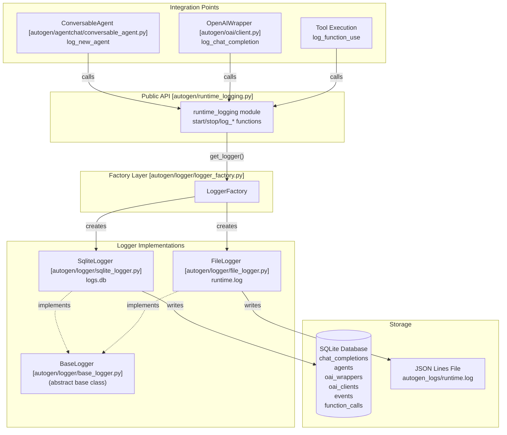
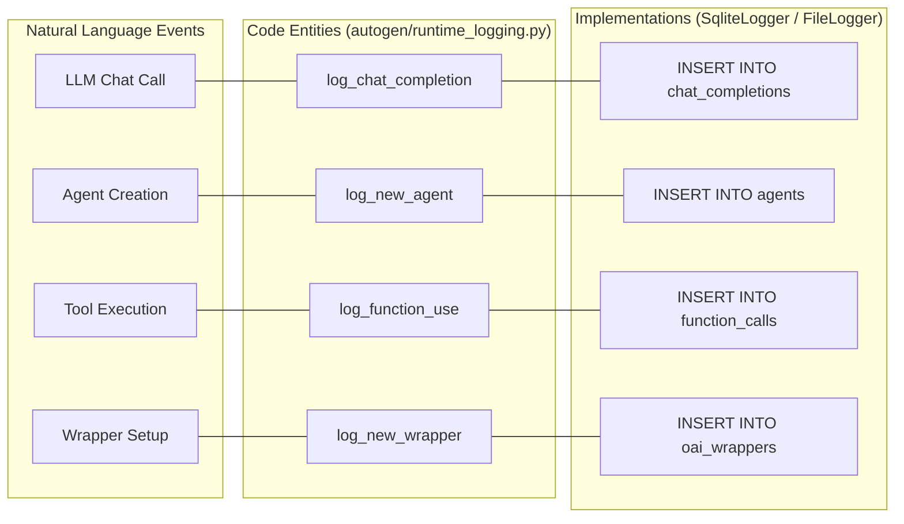
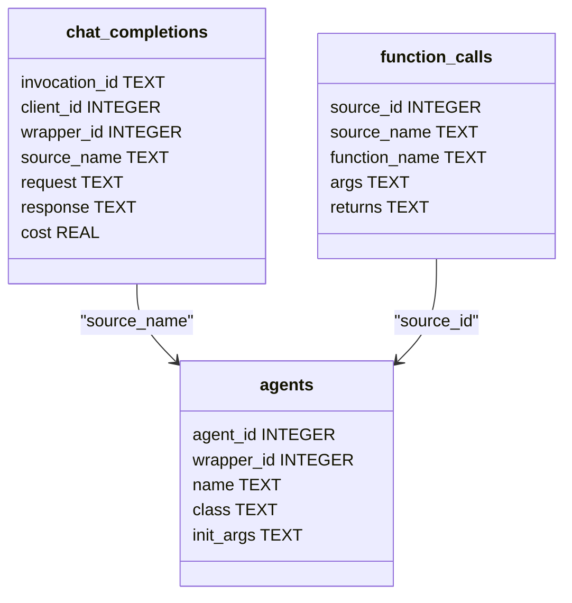

<!-- source: DeepWiki mcp.deepwiki.com · repo ag2ai/ag2 · page 6.2 Runtime Logging System · fetched 2026-10-26 -->

# Runtime Logging System

<details>
<summary>Relevant source files</summary>

The following files were used as context for generating this wiki page:

- [autogen/logger/base_logger.py](autogen/logger/base_logger.py)
- [autogen/logger/file_logger.py](autogen/logger/file_logger.py)
- [autogen/logger/logger_factory.py](autogen/logger/logger_factory.py)
- [autogen/logger/logger_utils.py](autogen/logger/logger_utils.py)
- [autogen/logger/sqlite_logger.py](autogen/logger/sqlite_logger.py)
- [autogen/oai/client.py](autogen/oai/client.py)
- [autogen/runtime_logging.py](autogen/runtime_logging.py)
- [notebook/agentchat_logging.ipynb](notebook/agentchat_logging.ipynb)
- [test/agentchat/test_agent_file_logging.py](test/agentchat/test_agent_file_logging.py)
- [test/agentchat/test_agent_logging.py](test/agentchat/test_agent_logging.py)
- [test/agentchat/test_agent_usage.py](test/agentchat/test_agent_usage.py)
- [test/agentchat/test_assistant_agent.py](test/agentchat/test_assistant_agent.py)
- [test/agentchat/test_async.py](test/agentchat/test_async.py)
- [test/agentchat/test_async_chats.py](test/agentchat/test_async_chats.py)
- [test/agentchat/test_async_get_human_input.py](test/agentchat/test_async_get_human_input.py)
- [test/agentchat/test_cache_agent.py](test/agentchat/test_cache_agent.py)
- [test/agentchat/test_chats.py](test/agentchat/test_chats.py)
- [test/agentchat/test_function_call.py](test/agentchat/test_function_call.py)
- [test/agentchat/test_function_call_groupchat.py](test/agentchat/test_function_call_groupchat.py)
- [test/agentchat/test_human_input.py](test/agentchat/test_human_input.py)
- [test/agentchat/test_math_user_proxy_agent.py](test/agentchat/test_math_user_proxy_agent.py)
- [test/agentchat/test_nested.py](test/agentchat/test_nested.py)
- [test/agentchat/test_tool_calls.py](test/agentchat/test_tool_calls.py)
- [test/conftest.py](test/conftest.py)
- [test/logger/__init__.py](test/logger/__init__.py)
- [test/logger/test_file_logger_redaction.py](test/logger/test_file_logger_redaction.py)
- [test/oai/test_client.py](test/oai/test_client.py)
- [test/oai/test_client_stream.py](test/oai/test_client_stream.py)
- [test/test_conftest.py](test/test_conftest.py)
- [test/test_logging.py](test/test_logging.py)

</details>


## Purpose and Scope

The Runtime Logging System provides comprehensive instrumentation for AG2 applications, capturing all LLM interactions, agent lifecycle events, tool executions, and costs for debugging and performance analysis. The system supports two storage backends: SQLite databases and structured log files.

This document details the `runtime_logging` module, the `BaseLogger` interface, and the specific implementations for SQLite and File-based logging.

## System Architecture

The logging system follows a factory pattern with pluggable storage backends:

Title: Runtime Logging Architecture


Sources: [autogen/runtime_logging.py:1-162](), [autogen/logger/base_logger.py:1-130](), [autogen/logger/logger_factory.py:1-43]()

### Module Structure

| Module | Purpose |
|--------|---------|
| `autogen.runtime_logging` | Public API for starting/stopping logging and logging events |
| `autogen.logger.base_logger.BaseLogger` | Abstract base class defining the logger interface |
| `autogen.logger.sqlite_logger.SqliteLogger` | SQLite database implementation |
| `autogen.logger.file_logger.FileLogger` | JSON Lines file implementation |
| `autogen.logger.logger_factory.LoggerFactory` | Factory for creating logger instances |
| `autogen.logger.logger_utils` | Utilities for timestamp generation and object serialization |

Sources: [autogen/logger/base_logger.py:1-130](), [autogen/logger/sqlite_logger.py:1-40](), [autogen/logger/file_logger.py:1-35]()

## Starting and Stopping Logging

### Basic Usage

Logging is controlled through the `autogen.runtime_logging` module:

```python
import autogen

# Start logging with default SQLite backend
session_id = autogen.runtime_logging.start()

# ... run agent workflows ...

# Stop logging
autogen.runtime_logging.stop()
```

Sources: [autogen/runtime_logging.py:41-66](), [autogen/runtime_logging.py:145-150]()

### Configuration Options

The `start()` function accepts three parameters:

| Parameter | Type | Default | Description |
|-----------|------|---------|-------------|
| `logger` | `BaseLogger \| None` | `None` | Custom logger instance (overrides `logger_type`) |
| `logger_type` | `"sqlite" \| "file"` | `"sqlite"` | Backend type to use |
| `config` | `dict[str, Any] \| None` | `None` | Backend-specific configuration |

#### SQLite Configuration

```python
session_id = autogen.runtime_logging.start(
    logger_type="sqlite",
    config={"dbname": "my_logs.db"}  # Default: "logs.db"
)
```

#### File Configuration

```python
session_id = autogen.runtime_logging.start(
    logger_type="file",
    config={"filename": "my_runtime.log"}  # Default: "runtime.log"
)
```

Sources: [autogen/runtime_logging.py:41-66](), [autogen/logger/sqlite_logger.py:70-85](), [autogen/logger/file_logger.py:55-82]()

## Logged Data Types

The system captures six primary categories of events:

Title: Natural Language Space to Code Entity Mapping


Sources: [autogen/runtime_logging.py:69-142](), [autogen/logger/sqlite_logger.py:244-513]()

### 1. Chat Completions

Logs every LLM API call with request, response, caching, and cost information.

**Function:** `log_chat_completion(invocation_id, client_id, wrapper_id, source, request, response, is_cached, cost, start_time)`

**Captured Fields:**
- `invocation_id`: UUID for the `OpenAIWrapper.create()` call.
- `client_id`: Python ID of the underlying LLM client instance.
- `wrapper_id`: Python ID of the `OpenAIWrapper` instance.
- `source`: Agent name or string identifier.
- `request`: Full request dictionary (messages, model, parameters).
- `response`: Complete API response including choices and usage.
- `is_cached`: 0 or 1 indicating cache hit.
- `cost`: Calculated cost in dollars.
- `start_time` / `end_time`: Timestamps in UTC.

Sources: [autogen/runtime_logging.py:69-86](), [autogen/logger/sqlite_logger.py:244-306](), [autogen/logger/file_logger.py:84-122]()

### 2. New Agents

Logs agent instantiation with initialization arguments.

**Function:** `log_new_agent(agent, init_args)`

**Captured Fields:**
- `agent_id`: Python ID via `id(agent)`.
- `wrapper_id`: ID of agent's `client` if present.
- `name`: Agent name.
- `class`: Class name (e.g., `AssistantAgent`).
- `init_args`: JSON-serialized constructor arguments.

**Excluded Fields:** `api_key`, `organization`, `base_url`, `azure_endpoint`, `azure_ad_token`, `azure_ad_token_provider`.

Sources: [autogen/runtime_logging.py:89-94](), [autogen/logger/sqlite_logger.py:308-354](), [autogen/logger/file_logger.py:124-143]()

### 3. Function/Tool Usage

Logs registered tool and function executions.

**Function:** `log_function_use(source, function, args, returns)`

**Captured Fields:**
- `source_id`: ID of calling agent.
- `source_name`: Agent name.
- `function_name`: Function's `__name__`.
- `args`: JSON-serialized arguments.
- `returns`: JSON-serialized return value.

Sources: [autogen/runtime_logging.py:105-110](), [autogen/logger/sqlite_logger.py:434-457](), [autogen/logger/file_logger.py:234-251]()

## SQLite Database Schema

The `SqliteLogger` creates a relational schema with tables for completions, agents, wrappers, clients, events, and function calls.

Title: SqliteLogger Schema Mapping


Sources: [autogen/logger/sqlite_logger.py:86-175]()

### Schema Version Management

The database includes a `version` table for schema migrations. Migration scripts are applied from a `migrations/` directory.

Sources: [autogen/logger/sqlite_logger.py:143-215]()

## File Logger Format

The `FileLogger` writes JSON Lines format (one JSON object per line) to files in the `autogen_logs/` directory. Each log entry includes a `thread_id` field capturing the Python thread identifier via `threading.get_ident()`.

Sources: [autogen/logger/file_logger.py:55-262]()

## Data Extraction and Analysis

The `get_connection()` function in `runtime_logging` returns a `sqlite3.Connection` for direct SQL queries when using the SQLite backend.

```python
import autogen
con = autogen.runtime_logging.get_connection()
cur = con.cursor()
cur.execute("SELECT cost FROM chat_completions")
```

Sources: [autogen/runtime_logging.py:152-157](), [autogen/logger/sqlite_logger.py:520-524]()

## Utility Functions

### Timestamp Generation
The `get_current_ts()` function returns UTC timestamps in the format `YYYY-MM-DD HH:MM:SS.ffffff`.

Sources: [autogen/logger/logger_utils.py:15-21]()

### Object Serialization
The `to_dict()` function recursively converts objects to dictionaries for JSON serialization, handling exclusions for sensitive keys like `api_key`.

Sources: [autogen/logger/logger_utils.py:24-57]()

### Safe Serialization
The `safe_serialize()` function handles non-serializable objects by replacing them with a string placeholder containing the type name.

Sources: [autogen/logger/sqlite_logger.py:45-61](), [autogen/logger/file_logger.py:43-50]()

## Thread Safety

Both logger implementations use thread locks for write operations. `SqliteLogger` uses a `threading.Lock()` and creates connections with `check_same_thread=False`.

Sources: [autogen/logger/sqlite_logger.py:38-39](), [autogen/logger/sqlite_logger.py:80]()

## Error Handling

The logging system catches exceptions in all logger methods to ensure that logging failures do not crash the main application. Errors are logged using the standard Python `logging` module.

Sources: [autogen/logger/sqlite_logger.py:224-242](), [autogen/runtime_logging.py:10-13]()

---

