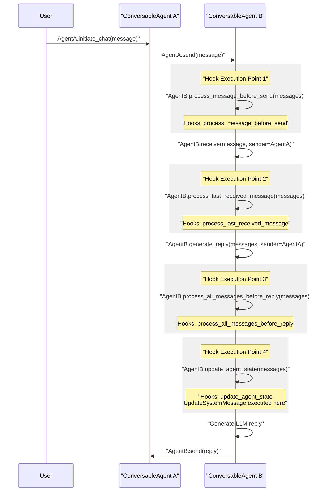
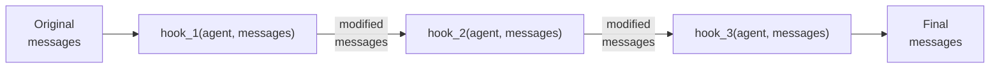

<!-- source: DeepWiki mcp.deepwiki.com · repo ag2ai/ag2 · page 6.3 Hooks and Lifecycle Management · fetched 2026-10-26 -->

# Hooks and Lifecycle Management

<details>
<summary>Relevant source files</summary>

The following files were used as context for generating this wiki page:

- [autogen/agentchat/chat.py](autogen/agentchat/chat.py)
- [autogen/agentchat/contrib/capabilities/transform_messages.py](autogen/agentchat/contrib/capabilities/transform_messages.py)
- [autogen/agentchat/contrib/capabilities/transforms.py](autogen/agentchat/contrib/capabilities/transforms.py)
- [autogen/agentchat/contrib/capabilities/transforms_util.py](autogen/agentchat/contrib/capabilities/transforms_util.py)
- [autogen/agentchat/conversable_agent.py](autogen/agentchat/conversable_agent.py)
- [autogen/agentchat/groupchat.py](autogen/agentchat/groupchat.py)
- [autogen/exception_utils.py](autogen/exception_utils.py)
- [autogen/formatting_utils.py](autogen/formatting_utils.py)
- [autogen/io/__init__.py](autogen/io/__init__.py)
- [autogen/io/base.py](autogen/io/base.py)
- [autogen/io/console.py](autogen/io/console.py)
- [autogen/io/websockets.py](autogen/io/websockets.py)
- [autogen/messages/agent_messages.py](autogen/messages/agent_messages.py)
- [autogen/types.py](autogen/types.py)
- [notebook/agentchat_websockets.ipynb](notebook/agentchat_websockets.ipynb)
- [test/agentchat/contrib/capabilities/test_transform_messages.py](test/agentchat/contrib/capabilities/test_transform_messages.py)
- [test/agentchat/contrib/capabilities/test_transforms.py](test/agentchat/contrib/capabilities/test_transforms.py)
- [test/agentchat/contrib/capabilities/test_transforms_util.py](test/agentchat/contrib/capabilities/test_transforms_util.py)
- [test/agentchat/test_conversable_agent.py](test/agentchat/test_conversable_agent.py)
- [test/agentchat/test_groupchat.py](test/agentchat/test_groupchat.py)
- [test/io/test_base.py](test/io/test_base.py)
- [test/io/test_websockets.py](test/io/test_websockets.py)
- [test/messages/test_agent_messages.py](test/messages/test_agent_messages.py)

</details>


The hooks and lifecycle management system in AG2 provides extension points for customizing agent behavior at critical stages of message processing and conversation flow. This system enables developers to inject custom logic at well-defined points in an agent's lifecycle without modifying core agent code.

For information about agent initialization and configuration, see [Core Agent System](#2). For details on message handling and reply functions, see [Message Handling and Reply Functions](#2.2).

## Purpose and Scope

This document covers:
- The hook registration and execution mechanism in `ConversableAgent`
- Available hookable methods and their invocation points
- The `UpdateSystemMessage` helper for dynamic system message updates
- Lifecycle flow showing when hooks are executed during conversations
- Best practices for implementing custom hooks

## Hook System Architecture

**ConversableAgent Hook System Architecture**

```mermaid
graph TB
    subgraph "ConversableAgent Methods"
        INIT["ConversableAgent.__init__<br/>line 157"]
        RECEIVE["ConversableAgent.receive()<br/>line 1675"]
        GENERATE["ConversableAgent.generate_reply()<br/>line 1761"]
        SEND["ConversableAgent.send()<br/>line 1545"]
    end
    
    subgraph "self.hook_lists dict<br/>Initialized at line 376"
        H1["'process_last_received_message': []"]
        H2["'process_all_messages_before_reply': []"]
        H3["'process_message_before_send': []"]
        H4["'update_agent_state': []"]
        H5["'safeguard_tool_inputs': []"]
        H6["'safeguard_tool_outputs': []"]
        H7["'safeguard_llm_inputs': []"]
        H8["'safeguard_llm_outputs': []"]
        H9["'safeguard_human_inputs': []"]
    end
    
    subgraph "Hook Management"
        REG["ConversableAgent.register_hook()<br/>line 1129"]
        GET["ConversableAgent._get_hooks()<br/>line 1159"]
        EXEC1["ConversableAgent.process_last_received_message()<br/>line 1171"]
        EXEC2["ConversableAgent.process_all_messages_before_reply()<br/>line 1188"]
        EXEC3["ConversableAgent.process_message_before_send()<br/>line 1206"]
    end
    
    INIT -->|"initializes<br/>defaultdict(list)"| H1
    INIT -->|initializes| H2
    INIT -->|initializes| H3
    INIT -->|"calls<br/>_register_update_agent_state_before_reply()"| H4
    
    REG -->|"appends callable<br/>to list"| H1
    REG -->|appends| H2
    REG -->|appends| H3
    REG -->|appends| H4
    
    RECEIVE -->|"line 1735<br/>calls"| EXEC1
    GENERATE -->|"line 1818<br/>calls"| EXEC2
    GENERATE -->|"line 1818<br/>calls"| H4
    SEND -->|"line 1597<br/>calls"| EXEC3
    
    EXEC1 -->|"iterates through"| H1
    EXEC2 -->|iterates| H2
    EXEC3 -->|iterates| H3
    
    GET -->|"returns list from"| H1
    GET -->|returns| H2
    GET -->|returns| H3
```



Sources: [autogen/agentchat/conversable_agent.py:157-390](), [autogen/agentchat/conversable_agent.py:1129-1232](), [autogen/agentchat/conversable_agent.py:1545-1614](), [autogen/agentchat/conversable_agent.py:1675-1740](), [autogen/agentchat/conversable_agent.py:1761-1824]()

## Hookable Methods

The `ConversableAgent` maintains a dictionary `self.hook_lists` (initialized at line 376) where each key represents a hookable method name (string) and each value is a list of callable hooks. Hooks are stored as lists and executed in registration order.

**Hookable Methods Reference Table**

| Hookable Method | Invocation Point | Execution Method | Purpose |
|-----------------|------------------|------------------|---------|
| `process_last_received_message` | `receive()` line 1735 | `process_last_received_message()` line 1171 | Process or modify the last received message |
| `process_all_messages_before_reply` | `generate_reply()` line 1818 | `process_all_messages_before_reply()` line 1188 | Process all messages in conversation history before reply generation |
| `process_message_before_send` | `send()` line 1597 | `process_message_before_send()` line 1206 | Validate or transform outgoing messages before transmission |
| `update_agent_state` | `generate_reply()` line 1818 | Direct iteration line 1821-1824 | Update agent configuration, system message, or state |
| `safeguard_tool_inputs` | (Reserved for future use) | Not currently invoked | Validate or sanitize tool inputs before execution |
| `safeguard_tool_outputs` | (Reserved for future use) | Not currently invoked | Validate or sanitize tool outputs after execution |
| `safeguard_llm_inputs` | (Reserved for future use) | Not currently invoked | Validate or modify messages sent to LLM |
| `safeguard_llm_outputs` | (Reserved for future use) | Not currently invoked | Validate or modify LLM responses |
| `safeguard_human_inputs` | (Reserved for future use) | Not currently invoked | Validate or sanitize human inputs |

**Note:** Safeguard hooks are defined in the `hook_lists` dictionary but are not currently invoked in the codebase. They serve as extension points for future security and validation features or for developers to invoke manually.

Sources: [autogen/agentchat/conversable_agent.py:376-387](), [autogen/agentchat/conversable_agent.py:1171-1232](), [autogen/agentchat/conversable_agent.py:1545-1614](), [autogen/agentchat/conversable_agent.py:1675-1740](), [autogen/agentchat/conversable_agent.py:1761-1824]()

## Hook Registration

### Using register_hook

Hooks are registered using the `register_hook` method defined at line 1129, which appends a callable to the specified hookable method's list in `self.hook_lists`.

**Method Signature:**

```python
def register_hook(self, hookable_method: str, hook: Callable) -> None:
    """Register a hook to be called with a hookable method.
    
    Args:
        hookable_method (str): A hookable method name, e.g., "process_message_before_send".
        hook (Callable): A method to be called with the hookable method.
    
    Raises:
        ValueError: If the hookable_method is not a valid hookable method.
    """
```

**Implementation Details:**
- Validates that `hookable_method` exists in `self.hook_lists` [autogen/agentchat/conversable_agent.py:1138-1145]()
- Appends the hook callable to the list at `self.hook_lists[hookable_method]` [autogen/agentchat/conversable_agent.py:1157]()
- Hooks execute sequentially in registration order when the hookable method is invoked.
- Raises `ValueError` with available hookable methods if an invalid name is provided.

**Hook Callable Signature:**

Most message-processing hooks follow this signature:
```python
def hook_function(
    agent: ConversableAgent,
    messages: List[Dict[str, Any]]
) -> List[Dict[str, Any]]:
    """
    Args:
        agent: The ConversableAgent instance executing the hook
        messages: Current conversation messages (list of dicts with 'role', 'content', etc.)
    
    Returns:
        List[Dict[str, Any]]: Modified or original messages
    """
```

Sources: [autogen/agentchat/conversable_agent.py:1129-1157]()

### Hook Execution Methods

Each hookable method has a corresponding execution method that invokes registered hooks:

```python
def process_last_received_message(self, messages: List[Dict[str, Any]]) -> List[Dict[str, Any]]:
    """Execute all hooks registered for 'process_last_received_message'"""
    
def process_all_messages_before_reply(self, messages: List[Dict[str, Any]]) -> List[Dict[str, Any]]:
    """Execute all hooks registered for 'process_all_messages_before_reply'"""
    
def process_message_before_send(self, messages: List[Dict[str, Any]]) -> List[Dict[str, Any]]:
    """Execute all hooks registered for 'process_message_before_send'"""
```

These methods iterate through registered hooks and pass messages through each one sequentially, with the output of one hook becoming the input to the next [autogen/agentchat/conversable_agent.py:1171-1232]().

Sources: [autogen/agentchat/conversable_agent.py:1171-1232]()

## UpdateSystemMessage Helper

`UpdateSystemMessage` is a dataclass defined at lines 102-132 that provides a convenient way to dynamically update an agent's system message before it generates a reply. It is automatically converted to a hook and registered to the `update_agent_state` hookable method.

**Class Definition:**

```python
@dataclass
@export_module("autogen")
class UpdateSystemMessage:
    """Update the agent's system message before they reply
    
    Args:
        content_updater: The format string or function to update the agent's system message.
            Can be a format string or a Callable.
            If a string, it will be used as a template and substitute the context variables.
            If a Callable, it should have the signature:
                def my_content_updater(agent: ConversableAgent, messages: List[Dict[str, Any]]) -> str
    """
    content_updater: Callable | str
```

### String Template Pattern

When `content_updater` is a string, it uses `OpenAIWrapper.instantiate()` [autogen/agentchat/conversable_agent.py:478]() for template substitution with the agent's `context_variables`. The template string is validated at initialization [autogen/agentchat/conversable_agent.py:117-121]() and warns if no variables are found.

### Callable Pattern

When `content_updater` is a callable, it must accept two parameters and return a string (validated at [autogen/agentchat/conversable_agent.py:123-130]()).

### Internal Implementation

The `_register_update_agent_state_before_reply()` method [autogen/agentchat/conversable_agent.py:448-494]() processes `UpdateSystemMessage` instances:

1. Wraps the `UpdateSystemMessage` in a closure function `update_system_message_wrapper` [autogen/agentchat/conversable_agent.py:471-489]().
2. The wrapper:
   - If string: calls `OpenAIWrapper.instantiate()` with the template and `context_variables` [autogen/agentchat/conversable_agent.py:475-482]().
   - If callable: invokes the callable with `(agent, messages)` [autogen/agentchat/conversable_agent.py:484]().
3. Updates the system message via `agent.update_system_message()` [autogen/agentchat/conversable_agent.py:486]().
4. Registers the wrapper to the `update_agent_state` hookable method [autogen/agentchat/conversable_agent.py:491]().

This conversion happens during `__init__` when `update_agent_state_before_reply` parameter is provided [autogen/agentchat/conversable_agent.py:390]().

Sources: [autogen/agentchat/conversable_agent.py:102-132](), [autogen/agentchat/conversable_agent.py:448-494]()

## Lifecycle Flow

The following diagram shows when hooks are invoked during a typical conversation flow:



### Hook Invocation Points in Code

**Hook Invocation Reference Table**

| Hook Point | File Location | Calling Method | Execution Details |
|------------|---------------|----------------|-------------------|
| `process_message_before_send` | Line 1597 | `send()` | Calls `self.process_message_before_send(messages)` before transmitting message to recipient |
| `process_last_received_message` | Line 1735 | `receive()` | Calls `self.process_last_received_message(messages)` after appending received message to `_oai_messages` |
| `process_all_messages_before_reply` | Line 1818 | `generate_reply()` | Calls `self.process_all_messages_before_reply(messages)` before iterating through reply functions |
| `update_agent_state` | Lines 1821-1824 | `generate_reply()` | Direct iteration: `for hook in self._get_hooks("update_agent_state"): messages = hook(self, messages)` |

**Code Flow Details:**

1. **`send()` method** [autogen/agentchat/conversable_agent.py:1545-1614]():
   - Line 1597: `messages = self.process_message_before_send(messages)`
   - Hook executes before `self._append_oai_message()` and `recipient.receive()`.

2. **`receive()` method** [autogen/agentchat/conversable_agent.py:1675-1740]():
   - Line 1733: Message appended to `self._oai_messages[sender]`.
   - Line 1735: `messages = self.process_last_received_message(messages)`
   - Hook executes after message storage, before triggering reply.

3. **`generate_reply()` method** [autogen/agentchat/conversable_agent.py:1761-1824]():
   - Line 1818: `messages = self.process_all_messages_before_reply(messages)`
   - Lines 1821-1824: Executes `update_agent_state` hooks directly.
   - Both execute before iterating through `self._reply_func_list`.

Sources: [autogen/agentchat/conversable_agent.py:1545-1614](), [autogen/agentchat/conversable_agent.py:1675-1740](), [autogen/agentchat/conversable_agent.py:1761-1824]()

## Hook Execution Mechanics

### Sequential Processing

Hooks are executed sequentially in registration order, with each hook's output becoming the next hook's input. This creates a processing pipeline.

**Implementation in `process_all_messages_before_reply()` [autogen/agentchat/conversable_agent.py:1188-1209]():**

```python
def process_all_messages_before_reply(self, messages: List[Dict[str, Any]]) -> List[Dict[str, Any]]:
    """Process all messages before generating a reply."""
    hook_list = self._get_hooks("process_all_messages_before_reply")
    if hook_list:
        for hook in hook_list:
            messages = hook(self, messages)  # Output feeds into next iteration
    return messages
```

The same pattern is used in `process_last_received_message()` [autogen/agentchat/conversable_agent.py:1171-1186]() and `process_message_before_send()` [autogen/agentchat/conversable_agent.py:1206-1232]().

**Processing Flow:**



Sources: [autogen/agentchat/conversable_agent.py:1171-1232]()

## Integration with Agent Features

### Context Variables Integration

Hooks can access and modify the agent's `context_variables` (instance of `ContextVariables` [autogen/agentchat/group/context_variables.py:14]()) for state management.

### Coordination with Reply Functions

Hooks execute before reply functions in the reply generation chain. The lifecycle order in `generate_reply` [autogen/agentchat/conversable_agent.py:1761-1824]() is:

1. `process_all_messages_before_reply` hooks.
2. `update_agent_state` hooks (including `UpdateSystemMessage`).
3. Reply function chain (e.g., `generate_oai_reply`, `generate_tool_calls_reply`).

This ensures hooks can prepare messages and agent state before any reply generation logic runs.

Sources: [autogen/agentchat/conversable_agent.py:1818-1824]()

## Registration Patterns

### Single Hook Registration

```python
agent.register_hook(
    hookable_method="process_message_before_send",
    hook=my_validation_hook
)
```

### Using update_agent_state_before_reply Parameter

The `update_agent_state_before_reply` initialization parameter [autogen/agentchat/conversable_agent.py:173]() accepts hooks directly and registers them to `update_agent_state` during `__init__`.

**Processing Logic** [autogen/agentchat/conversable_agent.py:448-494]():

The `_register_update_agent_state_before_reply()` method:
1. Accepts `None`, single callable/UpdateSystemMessage, or list of them.
2. Converts to list if not already [autogen/agentchat/conversable_agent.py:463-464]().
3. For each item:
   - If `UpdateSystemMessage`: wraps in closure and registers [autogen/agentchat/conversable_agent.py:467-491]().
   - If `Callable`: registers directly via `self.register_hook()` [autogen/agentchat/conversable_agent.py:494]().

All hooks registered via this parameter are added to `self.hook_lists["update_agent_state"]` and execute in the order provided during `generate_reply()`.

Sources: [autogen/agentchat/conversable_agent.py:173-176](), [autogen/agentchat/conversable_agent.py:448-494]()

## Safeguard Hooks

Safeguard hooks are defined in `self.hook_lists` [autogen/agentchat/conversable_agent.py:381-386]() but are **not currently invoked** in the `ConversableAgent` implementation. They serve as reserved extension points for security and validation features.

**Defined Safeguard Hooks:**

| Hook Name | Line | Intended Purpose |
|-----------|------|------------------|
| `safeguard_tool_inputs` | 382 | Validate tool call arguments before execution |
| `safeguard_tool_outputs` | 383 | Validate tool execution results after execution |
| `safeguard_llm_inputs` | 384 | Validate/modify messages before LLM API call |
| `safeguard_llm_outputs` | 385 | Validate/modify LLM responses after API call |
| `safeguard_human_inputs` | 386 | Validate/sanitize input from human users |

**Current Status:**

These hooks can be registered via `register_hook()` but are **not automatically invoked** by `ConversableAgent` methods. Developers must manually invoke them using `_get_hooks(hookable_method)` [autogen/agentchat/conversable_agent.py:1159]() in custom overrides.

Sources: [autogen/agentchat/conversable_agent.py:381-386](), [autogen/agentchat/conversable_agent.py:1159]()

## Summary

The hooks and lifecycle management system provides a flexible extension mechanism for customizing agent behavior without modifying core code. Key concepts:

- **Hookable Methods**: Pre-defined extension points in the agent lifecycle.
- **Sequential Execution**: Hooks execute in registration order, chaining transformations.
- **UpdateSystemMessage**: Specialized helper for dynamic system message updates.
- **Integration Points**: Hooks execute before reply functions and can access agent state.
- **Safeguards**: Dedicated hooks for security and validation at critical points.

The hook system enables clean separation of concerns, allowing developers to add logging, validation, state management, and custom processing logic while keeping the core agent implementation unchanged.

---

