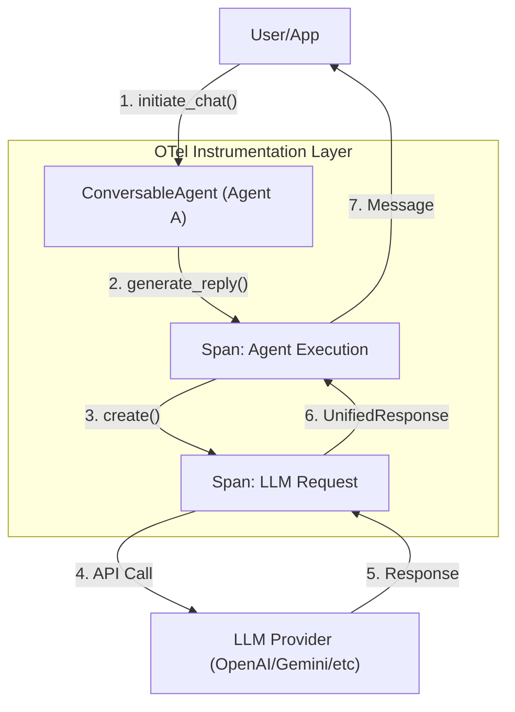
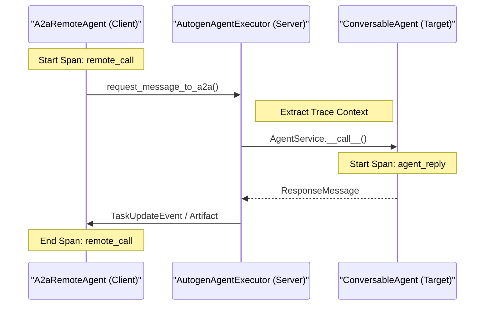

<!-- source: DeepWiki mcp.deepwiki.com · repo ag2ai/ag2 · page 6.4 OpenTelemetry Tracing · fetched 2026-10-26 -->

# OpenTelemetry Tracing

Relevant source files

The following files were used as context for generating this wiki page:

- [autogen/a2a/agent_executor.py](autogen/a2a/agent_executor.py)
- [autogen/a2a/client.py](autogen/a2a/client.py)
- [autogen/a2a/server.py](autogen/a2a/server.py)
- [autogen/a2a/utils.py](autogen/a2a/utils.py)
- [autogen/ag_ui/adapter.py](autogen/ag_ui/adapter.py)
- [autogen/agentchat/remote/agent_service.py](autogen/agentchat/remote/agent_service.py)
- [autogen/agentchat/remote/protocol.py](autogen/agentchat/remote/protocol.py)
- [autogen/oai/client_utils.py](autogen/oai/client_utils.py)
- [autogen/testing/test_agent.py](autogen/testing/test_agent.py)
- [notebook/tools_veronica_circuit_breaker.ipynb](notebook/tools_veronica_circuit_breaker.ipynb)
- [test/a2a/chats/test_chat.py](test/a2a/chats/test_chat.py)
- [test/a2a/chats/test_streaming.py](test/a2a/chats/test_streaming.py)
- [test/a2a/test_client.py](test/a2a/test_client.py)
- [test/a2a/test_parsing.py](test/a2a/test_parsing.py)
- [test/ag_ui/test_adapter.py](test/ag_ui/test_adapter.py)
- [test/ag_ui/test_asgi.py](test/ag_ui/test_asgi.py)
- [test/oai/test_client_utils.py](test/oai/test_client_utils.py)
- [website/docs/_blogs/2025-10-27-A2A-Protocol-Support/index.mdx](website/docs/_blogs/2025-10-27-A2A-Protocol-Support/index.mdx)
- [website/docs/_blogs/2025-12-22-GPT-5.1-Apply-Patch-Tool/img/ag2-apply-patch-banner.png](website/docs/_blogs/2025-12-22-GPT-5.1-Apply-Patch-Tool/img/ag2-apply-patch-banner.png)
- [website/docs/_blogs/2025-12-22-GPT-5.1-Apply-Patch-Tool/index.mdx](website/docs/_blogs/2025-12-22-GPT-5.1-Apply-Patch-Tool/index.mdx)
- [website/docs/_blogs/2025-12-23-Ag2-logging-events/img/observability.png](website/docs/_blogs/2025-12-23-Ag2-logging-events/img/observability.png)
- [website/docs/_blogs/2025-12-23-Ag2-logging-events/index.mdx](website/docs/_blogs/2025-12-23-Ag2-logging-events/index.mdx)
- [website/docs/_blogs/2025-12-24-AG2-MultiMCPSessionManager/index.mdx](website/docs/_blogs/2025-12-24-AG2-MultiMCPSessionManager/index.mdx)
- [website/docs/_blogs/2025-12-24-AG2-Shell-Tool-and-multi-in-built-tool-execution/index.mdx](website/docs/_blogs/2025-12-24-AG2-Shell-Tool-and-multi-in-built-tool-execution/index.mdx)
- [website/docs/_blogs/2025-12-29-AG2-Gemini-Thinking-Config-Support/index.mdx](website/docs/_blogs/2025-12-29-AG2-Gemini-Thinking-Config-Support/index.mdx)
- [website/docs/_blogs/2026-02-08-AG2-OpenTelemetry-Tracing/index.mdx](website/docs/_blogs/2026-02-08-AG2-OpenTelemetry-Tracing/index.mdx)
- [website/docs/user-guide/tracing/opentelemetry.mdx](website/docs/user-guide/tracing/opentelemetry.mdx)
- [website/docs/user-guide/tracing/remote-agents.mdx](website/docs/user-guide/tracing/remote-agents.mdx)

OpenTelemetry (OTel) integration in AG2 provides standardized observability for agentic workflows. It allows developers to track the execution flow across multiple agents, LLM calls, and tool executions. The integration is designed to support distributed tracing, enabling visibility into complex multi-agent interactions that may span different processes or servers.

## Architecture and Data Flow

The tracing system instruments core components of the AG2 framework, primarily focusing on the messaging lifecycle between agents and the underlying LLM requests. When enabled, spans are created for each significant operation, carrying metadata such as agent names, model configurations, and message content.

### Trace Propagation Flow
The following diagram illustrates how a trace context flows from a user initiation through the agent system to an LLM provider.

**Agent-to-LLM Tracing Flow**

Sources: [autogen/ag_ui/adapter.py:50-60](), [autogen/a2a/client.py:87-94]()

## Core Components

### 1. Agent Instrumentation
AG2 instruments the `ConversableAgent` to capture the start and end of reply generation. This includes tracking which agent is sending a message and which is receiving it. For remote interactions, the system utilizes the Agent-to-Agent (A2A) protocol to propagate trace headers.

*   **A2aRemoteAgent**: This class handles asynchronous communication with remote servers. It replaces standard reply functions with `generate_remote_reply` and `a_generate_remote_reply` to ensure remote calls are captured in the trace [autogen/a2a/client.py:87-94]().
*   **AgentService**: Acts as a wrapper for agents when exposed via a server, ensuring that incoming requests are correctly associated with the agent's execution context [autogen/a2a/agent_executor.py:34-35]().

### 2. LLM Tracing
The `OpenAIWrapper` and provider-specific clients are instrumented to provide detailed spans for every LLM interaction. This includes:
*   Model name and parameters.
*   Token usage (prompt, completion, and total).
*   Cost tracking (if configured).
*   Tool call details.

### 3. A2A and Distributed Tracing
For distributed systems, AG2 uses the A2A protocol to maintain trace continuity across network boundaries.

| Component | Role in Tracing | File Reference |
| :--- | :--- | :--- |
| `A2aRemoteAgent` | Client-side proxy that propagates context to remote A2A servers. | [autogen/a2a/client.py:39-54]() |
| `AutogenAgentExecutor` | Server-side executor that processes A2A tasks and maintains span context. | [autogen/a2a/agent_executor.py:27-32]() |
| `AgentService` | Internal service layer used to execute agent logic within a server context. | [autogen/agentchat/remote/agent_service.py:1-20]() |

## Distributed Tracing with A2A

The A2A protocol (Agent-to-Agent) is a JSON-RPC 2.0 based communication standard. AG2's implementation ensures that when an `A2aRemoteAgent` calls a remote service, the OpenTelemetry trace context is injected into the request metadata.

**Distributed A2A Entity Mapping**

Sources: [autogen/a2a/client.py:172-180](), [autogen/a2a/agent_executor.py:63-74](), [autogen/a2a/utils.py:25-46]()

### Implementation Details
*   **Context Injection**: The `request_message_to_a2a` function prepares the A2A `Message` object. While it primarily handles `client_tools` and `context_update` in metadata [autogen/a2a/utils.py:30-35](), the underlying A2A SDK handles the OTel carrier injection into HTTP headers.
*   **Task Management**: On the server side, `AutogenAgentExecutor` uses a `TaskUpdater` to report progress back to the client. Each update can be linked back to the original trace via the `task_id` and `context_id` [autogen/a2a/agent_executor.py:56-58]().

## Integration with AG-UI
Tracing also extends to the frontend via the `AGUIStream` adapter. This component translates internal AG2 events into UI-compatible events while maintaining the execution context.

*   **AGUIStream**: Manages the lifecycle of a stream, dispatching events like `RunStartedEvent` and `TextMessageStartEvent` [autogen/ag_ui/adapter.py:136-165]().
*   **Event Interceptors**: Allows for custom OTel spans to be created as events flow through the `dispatch` method [autogen/ag_ui/adapter.py:61-67]().

Sources: [autogen/ag_ui/adapter.py:50-94]()

## Enabling Tracing

To enable OpenTelemetry tracing in an AG2 application:

1.  **Install Dependencies**: Ensure `opentelemetry-api`, `opentelemetry-sdk`, and relevant instrumentors (like `opentelemetry-instrumentation-httpx`) are installed.
2.  **Initialize SDK**: Configure the OTel TracerProvider and Exporter (e.g., OTLP, Jaeger, or Zipkin) at the start of the application.
3.  **Instrument AG2**: AG2 components automatically detect the presence of an active tracer if the environment is properly configured.

### Configuration Parameters
When using remote agents, the `ClientConfig` and `interceptors` can be used to add custom tracing logic to the HTTP communication layer:
[autogen/a2a/client.py:56-67]()

Sources:
- [autogen/a2a/client.py:1-180]()
- [autogen/a2a/agent_executor.py:1-117]()
- [autogen/a2a/utils.py:1-46]()
- [autogen/ag_ui/adapter.py:1-205]()

---

