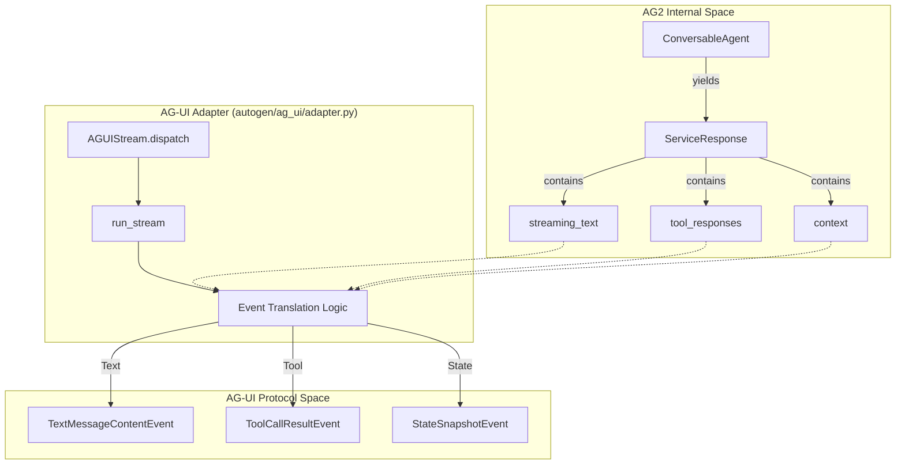
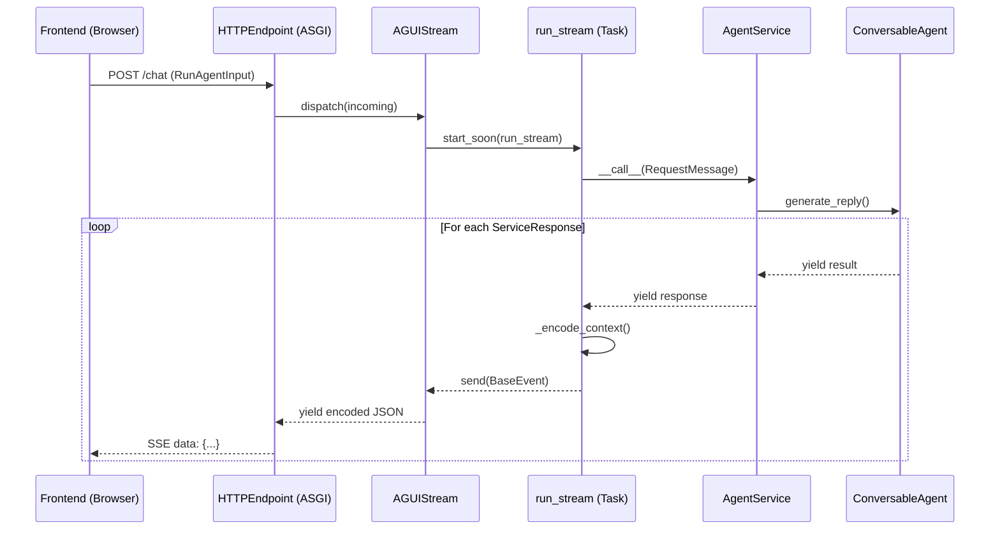

<!-- source: DeepWiki mcp.deepwiki.com · repo ag2ai/ag2 · page 7.2 AG-UI Adapter · fetched 2026-10-26 -->

# AG-UI Adapter

Relevant source files

The following files were used as context for generating this wiki page:

- [autogen/a2a/agent_executor.py](autogen/a2a/agent_executor.py)
- [autogen/a2a/client.py](autogen/a2a/client.py)
- [autogen/a2a/server.py](autogen/a2a/server.py)
- [autogen/a2a/utils.py](autogen/a2a/utils.py)
- [autogen/ag_ui/adapter.py](autogen/ag_ui/adapter.py)
- [autogen/agentchat/remote/agent_service.py](autogen/agentchat/remote/agent_service.py)
- [autogen/agentchat/remote/protocol.py](autogen/agentchat/remote/protocol.py)
- [autogen/oai/client_utils.py](autogen/oai/client_utils.py)
- [autogen/testing/test_agent.py](autogen/testing/test_agent.py)
- [test/a2a/chats/test_chat.py](test/a2a/chats/test_chat.py)
- [test/a2a/chats/test_streaming.py](test/a2a/chats/test_streaming.py)
- [test/a2a/test_client.py](test/a2a/test_client.py)
- [test/a2a/test_parsing.py](test/a2a/test_parsing.py)
- [test/ag_ui/test_adapter.py](test/ag_ui/test_adapter.py)
- [test/ag_ui/test_asgi.py](test/ag_ui/test_asgi.py)
- [test/oai/test_client_utils.py](test/oai/test_client_utils.py)
- [website/docs/_blogs/2026-02-17-AG2-AG-UI-Protocol/img/ag2-ag-ui-demo.gif](website/docs/_blogs/2026-02-17-AG2-AG-UI-Protocol/img/ag2-ag-ui-demo.gif)
- [website/docs/_blogs/2026-02-17-AG2-AG-UI-Protocol/img/ag2-ag-ui.webp](website/docs/_blogs/2026-02-17-AG2-AG-UI-Protocol/img/ag2-ag-ui.webp)
- [website/docs/_blogs/2026-02-17-AG2-AG-UI-Protocol/img/demo-ui.webp](website/docs/_blogs/2026-02-17-AG2-AG-UI-Protocol/img/demo-ui.webp)
- [website/docs/_blogs/2026-02-17-AG2-AG-UI-Protocol/index.mdx](website/docs/_blogs/2026-02-17-AG2-AG-UI-Protocol/index.mdx)
- [website/docs/_blogs/2026-03-03-GPT-Researcher-AG2/img/gpt-researcher-ag2.webp](website/docs/_blogs/2026-03-03-GPT-Researcher-AG2/img/gpt-researcher-ag2.webp)
- [website/docs/_blogs/2026-03-03-GPT-Researcher-AG2/img/pipeline.webp](website/docs/_blogs/2026-03-03-GPT-Researcher-AG2/img/pipeline.webp)
- [website/docs/_blogs/2026-03-03-GPT-Researcher-AG2/index.mdx](website/docs/_blogs/2026-03-03-GPT-Researcher-AG2/index.mdx)
- [website/docs/_blogs/2026-03-05-AG2-Playground/img/animation.webp](website/docs/_blogs/2026-03-05-AG2-Playground/img/animation.webp)
- [website/docs/_blogs/2026-03-05-AG2-Playground/img/banner.png](website/docs/_blogs/2026-03-05-AG2-Playground/img/banner.png)
- [website/docs/_blogs/2026-03-05-AG2-Playground/index.mdx](website/docs/_blogs/2026-03-05-AG2-Playground/index.mdx)
- [website/docs/_blogs/2026-03-05-Intelligent-Agent-Handoffs/index.mdx](website/docs/_blogs/2026-03-05-Intelligent-Agent-Handoffs/index.mdx)

The AG-UI Adapter provides a standardized bridge between the AG2 agent framework and the **Agent-User Interaction (AG-UI) Protocol**. AG-UI is an open, event-based protocol designed to facilitate real-time communication between AI agents and frontend applications. By using the `AGUIStream` adapter, developers can expose any `ConversableAgent` as an asynchronous stream of UI-friendly events, enabling features like token-by-token streaming, live tool execution status, and interactive human-in-the-loop (HITL) components.

## Core Components

The integration is primarily managed by the `autogen.ag_ui` module, which translates internal AG2 events into structured AG-UI protocol events.

### AGUIStream
The `AGUIStream` class is the primary interface for connecting an agent to a UI. It wraps a `ConversableAgent` and manages the lifecycle of a "Run" [autogen/ag_ui/adapter.py:50-60](). It utilizes `AgentService` to execute the agent and captures its output through an asynchronous generator [autogen/ag_ui/adapter.py:59-67]().

### AGUI Protocol Events
The adapter translates agent activity into specific event types defined in the AG-UI core:
*   **Lifecycle Events**: `RunStartedEvent`, `RunFinishedEvent`, and `RunErrorEvent` [autogen/ag_ui/adapter.py:13-16]().
*   **Message Events**: `TextMessageStartEvent`, `TextMessageContentEvent`, and `TextMessageEndEvent` for streaming text [autogen/ag_ui/adapter.py:18-21]().
*   **Tool Events**: `ToolCallStartEvent`, `ToolCallArgsEvent`, `ToolCallResultEvent`, and `ToolCallEndEvent` to visualize function calling [autogen/ag_ui/adapter.py:22-26]().
*   **State Events**: `StateSnapshotEvent` to synchronize `ContextVariables` with the frontend [autogen/ag_ui/adapter.py:17]().

### Diagram: Event Translation Flow
This diagram illustrates how internal AG2 agent actions are translated into AG-UI Protocol events by the `AGUIStream` adapter.

**Sources:** [autogen/ag_ui/adapter.py:50-67](), [autogen/ag_ui/adapter.py:109-200](), [autogen/agentchat/remote/agent_service.py:35-40]()

## ASGI Integration

The adapter provides a built-in method to generate an ASGI-compatible endpoint, making it easy to integrate with web frameworks like FastAPI or Starlette.

1.  **`build_asgi()`**: This method calls an internal utility to create an `HTTPEndpoint` [autogen/ag_ui/adapter.py:95-100]().
2.  **Mounting**: The resulting endpoint can be mounted directly into a FastAPI app using `app.mount("/path", stream.build_asgi())` [website/docs/_blogs/2026-02-17-AG2-AG-UI-Protocol/index.mdx:126-126]().
3.  **Server-Sent Events (SSE)**: The endpoint communicates with the frontend via SSE, where each JSON event is prefixed with `data: ` [website/docs/_blogs/2026-02-17-AG2-AG-UI-Protocol/index.mdx:152-160]().

**Sources:** [autogen/ag_ui/adapter.py:95-100](), [website/docs/_blogs/2026-02-17-AG2-AG-UI-Protocol/index.mdx:114-140]()

## Data Flow and Execution

When a request is received from the frontend (via `RunAgentInput`), the adapter performs the following steps:

1.  **Context Merging**: It combines the agent's initial `ContextVariables`, the state passed from the frontend, and any manual context provided at dispatch [autogen/ag_ui/adapter.py:71-77]().
2.  **Tool Preparation**: It extracts tools from the incoming request and formats them for the LLM [autogen/ag_ui/adapter.py:115-124]().
3.  **Stream Processing**: It iterates over the `AgentService` generator. For each response block:
    *   If `streaming_text` is present, it emits text events [autogen/ag_ui/adapter.py:157-174]().
    *   If a tool result is present, it emits `ToolCallResultEvent` followed by `ToolCallEndEvent` [autogen/ag_ui/adapter.py:189-205]().
    *   If the context has changed, it emits a `StateSnapshotEvent` [autogen/ag_ui/adapter.py:176-183]().

### Diagram: Request to Stream Pipeline
This diagram maps the code entities involved in processing a UI request through the `AGUIStream`.

**Sources:** [autogen/ag_ui/adapter.py:61-94](), [autogen/ag_ui/adapter.py:109-215](), [autogen/agentchat/remote/agent_service.py:15-35]()

## Building Interactive Frontends

The AG-UI adapter enables complex interaction patterns beyond simple chat:

### Human-in-the-Loop (HITL)
In complex pipelines (e.g., GPT Researcher), the agent can pause for human approval. When an agent requires input, the adapter (via `AgentService`) can trigger an `InputRequestEvent`. The frontend then displays a UI panel for the user to provide feedback or approval before the pipeline continues [website/docs/_blogs/2026-03-03-GPT-Researcher-AG2/index.mdx:36-37]().

### State Synchronization
The adapter uses `StateSnapshotEvent` to ensure the frontend is always aware of the current `ContextVariables`. This allows the UI to display progress bars, current "stage" indicators, or updated metadata (like source counts) in real-time [autogen/ag_ui/adapter.py:143-149](), [website/docs/_blogs/2026-03-03-GPT-Researcher-AG2/index.mdx:42-44]().

### Interceptors
Developers can provide `event_interceptors` to `AGUIStream`. These are callables that receive a `ServiceResponse` and can yield additional custom `BaseEvent` objects, allowing for domain-specific UI updates [autogen/ag_ui/adapter.py:55-58](), [autogen/ag_ui/adapter.py:153-155]().

**Sources:** [autogen/ag_ui/adapter.py:55-58](), [autogen/ag_ui/adapter.py:143-155](), [website/docs/_blogs/2026-03-03-GPT-Researcher-AG2/index.mdx:36-47]()

---

